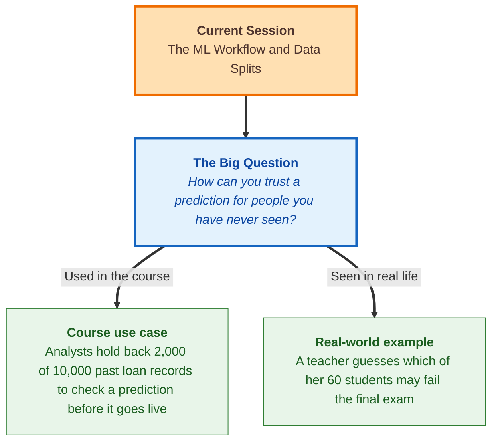

## <span style="color:#2F7DDE">The ML Workflow and Data Splits</span>

### <span style="color:#2F7DDE">Mental Map</span>



---

### <span style="color:#2F7DDE">What You'll Learn</span>

Have you ever wondered how Ms. Rao can tell which of her 60 students may fail?

By the end of this session, you will be able to:

- <span style="color:#D9660B">**Classify**</span> three class questions as predicting a known result, finding groups, or learning from rewards.
- <span style="color:#D9660B">**Describe**</span> the steps Ms. Rao follows, from her first question to using her rule.
- <span style="color:#D9660B">**Explain**</span> how using the class average before setting students aside leaks answers into her check.
- <span style="color:#D9660B">**Determine**</span> what she wants to guess, which clues she uses, and what one row means.
- <span style="color:#D9660B">**Justify**</span> why she reports her rule's score on 12 students it has never seen.
- <span style="color:#D9660B">**Build**</span> groups of 36, 12 and 12 students from the 60, using a fixed shuffle you can repeat.

> <span style="color:#2F7DDE">**Topics you will meet:**</span> business question and row grain, ML workflow stages, supervised vs unsupervised learning, and train/test split. Then scaler before the split, train, validation, test split, and held-out evaluation.
>
> Join the session to learn each of these in detail.

---

### <span style="color:#2F7DDE">Why You Are Learning This Topic</span>

Ms. Rao teaches 60 students. She kept last year's mock test scores and final results. This year she wants to spot struggling students early. She builds a rule from last year's sheet. Will the rule work on new students?

A <span style="color:#D9660B">**data split**</span> means setting a few rows aside so the rule never sees them.

In your course, you will split data like this before every prediction.

> <span style="color:#2F7DDE">**Think about it:**</span> How can Ms. Rao check her rule without waiting for next year's exam?

---

### <span style="color:#2F7DDE">The Exam Prediction Puzzle</span>

Here are 5 students from last year's sheet.

| Student | Study hours per week | Mock test score | Final result |
|:-------:|:--------------------:|:---------------:|:------------:|
| Asha | 12 | 78 | Pass |
| Bilal | 4 | 41 | Fail |
| Charu | 9 | 66 | Pass |
| Dev | 6 | 52 | Fail |
| Esha | 14 | 85 | Pass |

<span style="color:#D9660B">**What you want to happen:**</span>

- Guess each new student's final result before the exam.
- Find out if the guesses work for new students.
- Pick between two study plans fairly.

Here is how it might start. You do not need to understand it yet.

```python
from sklearn.model_selection import train_test_split
practice, check = train_test_split(students, test_size=0.2, random_state=42)
print(len(practice), len(check))
```

> <span style="color:#D9660B">**Wonder about this:**</span>
>
> - Why is it unfair to check the rule on students it already learned from?
> - What goes wrong if Ms. Rao peeks at the final results while building?

---

### <span style="color:#2F7DDE">Think It Through</span>

There is no wrong first try. Keep your guesses for the session.

**1. What does one row describe, and which column does Ms. Rao want to guess?**
Hint: The guess is the column she does not know yet.

**2. Which 12 students would you set aside before building the rule?**
Hint: Pick students the rule never sees.

**3. Ms. Rao works out the class average first, then sets 12 students aside. What could go wrong?**
Hint: Ask who helped make that average.

---

### <span style="color:#2F7DDE">One Question to Carry Into the Session</span>

> <span style="color:#2F7DDE">**How can Ms. Rao trust a rule that has only seen last year's students?**</span>
>
> And which rows stay hidden until her last step?
