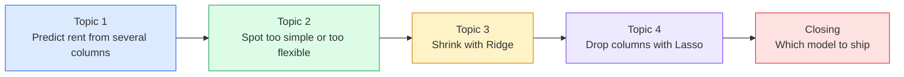
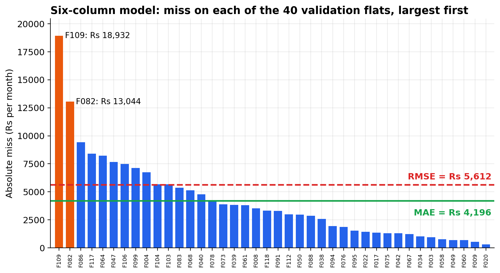
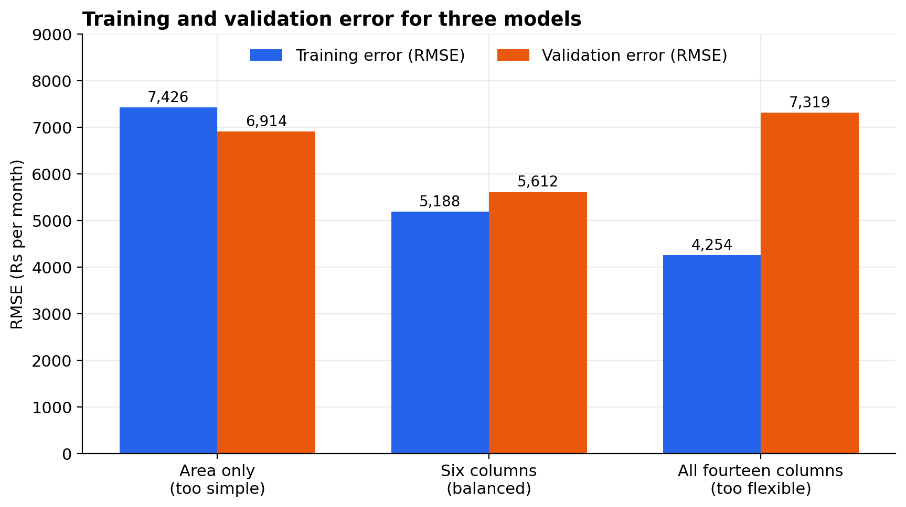
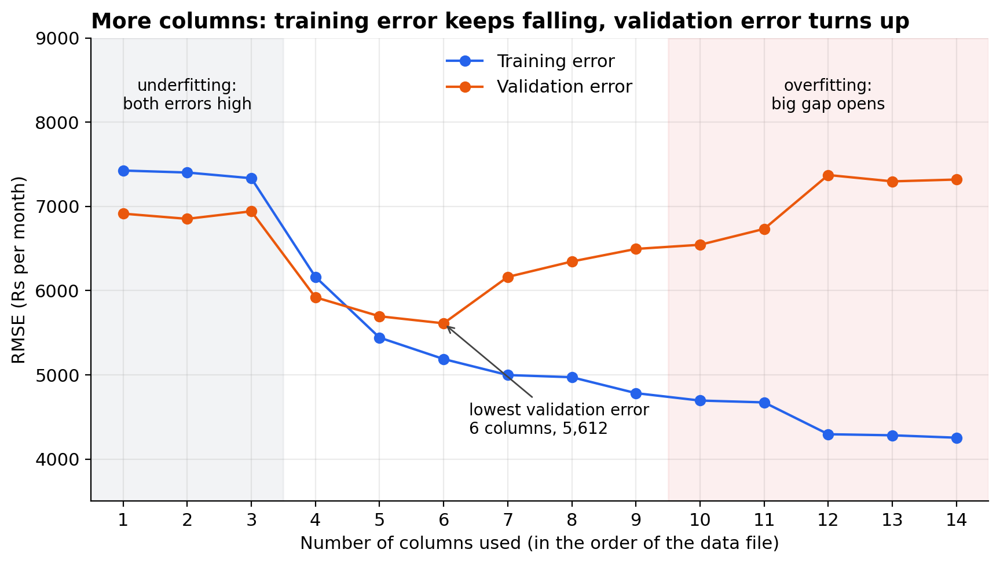
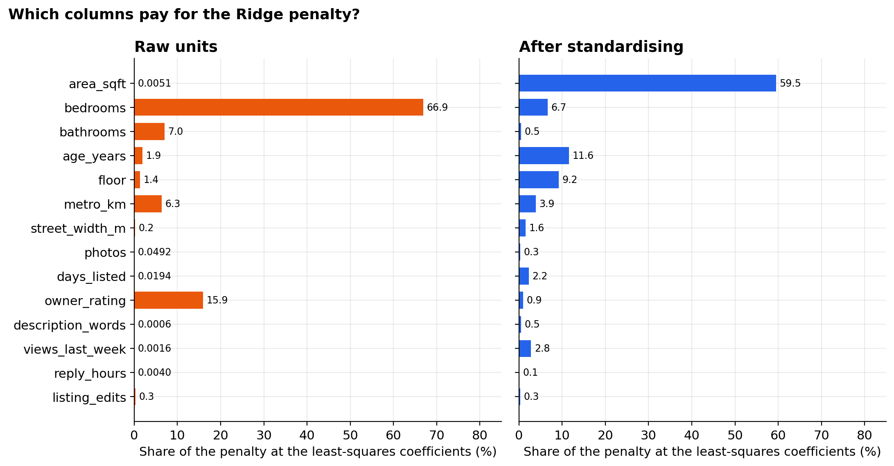
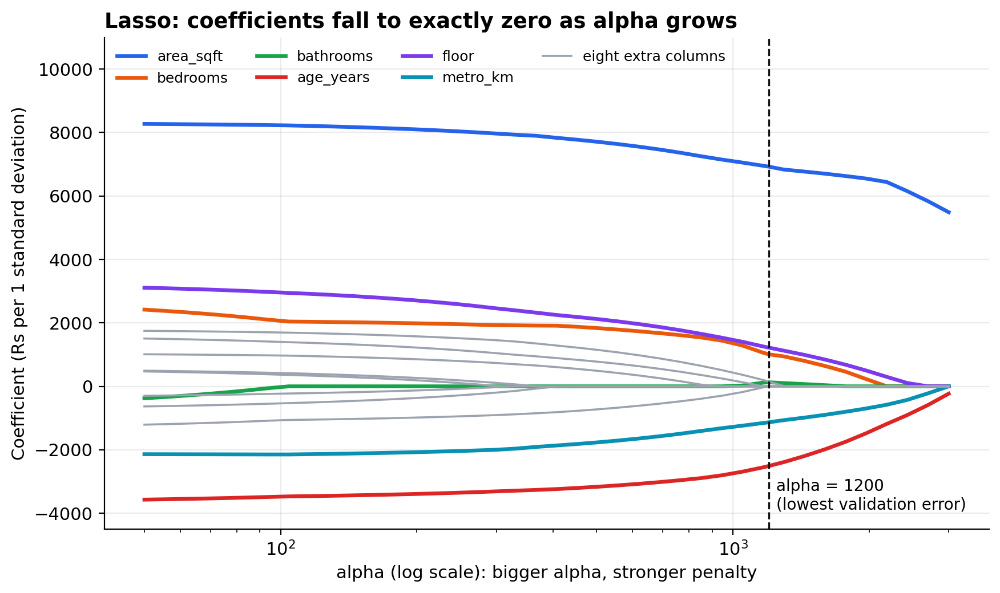
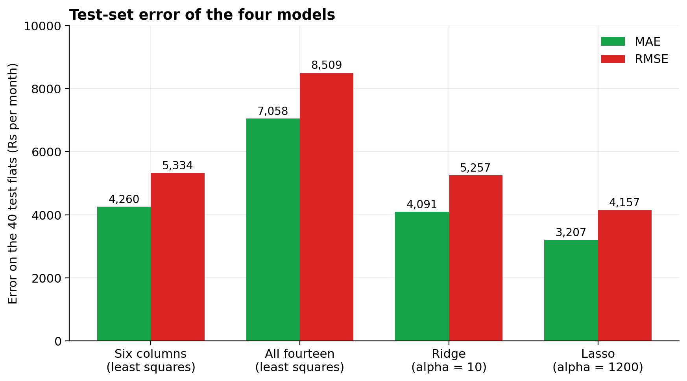

# <font color='#1d4ed8'>Lecture Script: Multiple Regression, Overfitting, Ridge and Lasso</font>

---

## <font color='blue'>Agenda</font>

The lecture runs as four topics. Each topic ends with a quiz.

| Topic | What we do | Learning objectives covered | Minutes |
|:-:|:--|:--|:-:|
| 1 | Predict rent from several columns | Train a multiple linear regression model on several numeric features<br>Compute MAE and RMSE for a set of regression predictions | 25 |
| 2 | Spot a model that is too simple or too flexible | Compare overfitting and underfitting by their training and validation error signatures<br>Explain the bias-variance trade-off in terms of model complexity | 25 |
| 3 | Shrink the coefficients with Ridge | Train a Ridge regression model with an L2 penalty<br>Explain why features must be scaled before fitting a regularised regression | 30 |
| 4 | Drop columns with Lasso | Train a Lasso regression model with an L1 penalty | 25 |
| — | Closing: Outcome & Summary | | 15 |
| | **Total** | | **120** |

> <font color="red">**🎯 Instructor Note**</font> Pace: in Topic 1 keep the fit quick and spend the time on MAE and RMSE. In Topic 3 slow down at the unit-change test; it is the reason for scaling.
> Topic 2 is mostly reading tables and charts. Topic 4 reuses the scaled columns from Topic 3, so keep the set-up short.

---

## <font color='blue'>Scenario</font>

A 99acres-style property portal shows every owner an estimated monthly rent the moment they list a flat. Owners copy that number straight into their listing.

**The risk:** if the estimate is wrong for a flat the model has never seen, the owner either loses rent or leaves the flat empty.

> <font color="red">**🎯 Instructor Note**</font> 99acres is only the setting. Do not claim it uses this data; the 120 flats in `data/flat_rents.csv` and the owner in the story are invented for teaching.
> Learners need Python 3 with pandas and scikit-learn 1.4 or later. The split uses `random_state=42`, so every output matches.

---

## <font color='blue'>Problem Statement</font>

The pricing team built a rent estimator on six listing columns: area, bedrooms, bathrooms, age, floor and distance to the metro. Then someone said, "The listing form has eight more columns. More information must help." They added all eight.

On the flats the model had learned from, the error fell from about Rs 5,200 to about Rs 4,300. The team shipped it. Later they measured the error on flats the model had never seen, and it had risen from about Rs 5,600 to about Rs 7,300. Meera listed her flat at the estimate, Rs 9,000 above what flats like hers were renting for. It stayed empty for two months.

> <font color='purple'>**How do we build a rent model that stays accurate on flats it has never seen, even when the listing has many columns?**</font>

> <font color="red">**🎯 Instructor Note**</font> Poll: "Model A errs by about Rs 4,300 on the flats it learned from and Rs 7,300 on new flats. Model B errs by about Rs 5,200 and Rs 5,600. Which do you trust for new listings?" Give learners 30 seconds to respond in chat. Reveal the answer in the Closing.

---

## <font color='blue'>What We Will Use</font>

The ideas below are used in every topic. Each topic uses them without repeating them.

| Term | Meaning | In our flats |
|:--|:--|:--|
| **Multiple linear regression** | A straight-line rule that uses several numeric columns to predict one number | area, bedrooms and more, to rent |
| **Coefficient** $b_j$ | The change in the predicted rent for one extra unit of column $j$, with the other columns held fixed | Rs per sq ft, Rs per bedroom |
| **MAE** | The average size of the miss, in the unit of the target | Rs |
| **RMSE** | The square root of the average squared miss; big misses count more | Rs |
| **Training error, validation error** | The error on the flats the model learned from, and on held-out flats | Rs |
| **Underfitting** | The model is too simple: both errors are high | area only |
| **Overfitting** | The model is too flexible: training error is low, validation error is much higher | all fourteen columns |
| **Bias** | The error that stays because the model is too simple to follow the pattern | shows as high training error |
| **Variance** | How much the predictions change when the model learns from different flats | the "swing" of a prediction |
| **Penalty, $\alpha$** | A cost on large coefficients; $\alpha$ sets its strength, and $\alpha = 0$ gives plain least squares | a number we choose |
| **Ridge (L2)** | Penalises the sum of squared coefficients; it shrinks them and keeps every column | |
| **Lasso (L1)** | Penalises the sum of absolute coefficients; it can set some to exactly zero | |
| **Standardising** | Rescale each column to mean 0 and standard deviation 1, using the training rows only | `StandardScaler` |

The model and the two scores, with $\text{miss}_i = y_i - \hat{y}_i$:

$$\boxed{\hat{y} = b_0 + b_1 x_1 + b_2 x_2 + \dots + b_p x_p}$$

$$\boxed{\text{MAE} = \frac{1}{n}\sum_{i=1}^{n} |y_i - \hat{y}_i|} \qquad \boxed{\text{RMSE} = \sqrt{\frac{1}{n}\sum_{i=1}^{n} (y_i - \hat{y}_i)^2}}$$

The two penalties added to the squared misses (scikit-learn does not penalise the intercept $b_0$):

$$\boxed{\text{Ridge: } \sum_{i=1}^{n} (y_i - \hat{y}_i)^2 + \alpha \sum_{j=1}^{p} b_j^2} \qquad \boxed{\text{Lasso: } \frac{1}{2n}\sum_{i=1}^{n} (y_i - \hat{y}_i)^2 + \alpha \sum_{j=1}^{p} |b_j|}$$

Standardising a column, with the mean $\bar{x}$ and standard deviation $s$ taken from the training rows:

$$\boxed{z = \frac{x - \bar{x}}{s}}$$

> <font color='#b45309'>**Watch out for**</font>
> - MAE and RMSE are in rupees, the unit of the target. Lower is better, and RMSE is never smaller than MAE.
> - A low training error alone proves nothing. Judge a model on held-out flats.
> - Choose $\alpha$ on the validation flats. Use the test flats once, at the end.
> - Lasso's $\alpha$ and Ridge's $\alpha$ are on different scales (Lasso divides the misses by $2n$), so do not compare their numbers.
> - A coefficient of zero in Lasso means the model dropped the column. It does not prove the column is useless in real life.

---

## <font color='blue'>How: Walking Through the Rent Estimator</font>



---

## <font color='blue'>Topic 1: Predict Rent from Several Columns</font> `25 min`

> <font color='purple'>**Last session a model used one numeric column to make a prediction. A flat's rent depends on more than its area, so how do we use several columns at once?**</font>

### <font color='green'>Example: look at the flats and split them</font>

> <font color='purple'>**What does the data hold, and how do we keep some flats away from the model?**</font>

Last session you fitted `LinearRegression` on one column. In the data-splits session you split rows into training, validation and test sets with a fixed seed. We do both again: 120 flats, split into three sets of 40.

**Predict before running: What will happen?**

> <font color="red">**🎯 Instructor Note**</font> Expected: 120 rows and 16 columns, and three sets of 40 rows with 14 columns each (the id and the rent are removed from `X`). Common guess: forgetting that the id column is not a feature.

```python
import pandas as pd
from sklearn.model_selection import train_test_split

df = pd.read_csv("data/flat_rents.csv")
X, y = df.drop(columns=["flat_id", "rent_inr"]), df["rent_inr"]
X_rest, X_test, y_rest, y_test = train_test_split(X, y, test_size=40, random_state=42)
X_train, X_val, y_train, y_val = train_test_split(X_rest, y_rest, test_size=40, random_state=42)
print(df.shape, X_train.shape, X_val.shape, X_test.shape)
print(y.agg(["min", "median", "max"]))
```

**Output**

```
(120, 16) (40, 14) (40, 14) (40, 14)
min        6000.0
median    26500.0
max       65500.0
Name: rent_inr, dtype: float64
```

#### <font color='#c2410c'>Code Explanation</font>

- **`read_csv`** Reads the 120 flats into a table called `df`.
- **`X, y = ...`** `X` holds the 14 feature columns. `y` is the rent we want to predict.
- **First `train_test_split`** Sets aside 40 flats as the test set.
- **Second `train_test_split`** Splits the other 80 into 40 for training and 40 for validation.
- **Last two lines** Print the table sizes, then the cheapest, middle and dearest rent.

> <font color='green'>**Result**</font> We have 40 flats to learn from, 40 to check against and 40 to keep untouched. Rents run from Rs 6,000 (a floor the portal does not list below) to Rs 65,500.

### <font color='green'>Example: train a multiple regression on six columns</font>

> <font color='purple'>**What rule do area, bedrooms, bathrooms, age, floor and metro distance give for rent?**</font>

The rule is the one from last session with more terms: $\hat{y} = b_0 + b_1 x_1 + \dots + b_6 x_6$. Least squares still picks every $b$ so that the sum of squared misses is smallest.

**Predict before running: What will happen?**

> <font color="red">**🎯 Instructor Note**</font> Expected: one coefficient per column. Area is a small number (Rs per sq ft), bedrooms is large (Rs per bedroom), age and metro distance are negative.

```python
from sklearn.linear_model import LinearRegression

core = ["area_sqft", "bedrooms", "bathrooms", "age_years", "floor", "metro_km"]
model = LinearRegression().fit(X_train[core], y_train)
print(pd.Series(model.coef_, index=core).round(2))
print("intercept", round(model.intercept_, 2))
```

**Output**

```
area_sqft      24.74
bedrooms     2585.36
bathrooms     536.50
age_years    -611.16
floor         325.34
metro_km     -819.50
dtype: float64
intercept 1514.91
```

#### <font color='#c2410c'>Code Explanation</font>

- **`core = [...]`** Lists the six columns the first model uses.
- **`.fit(X_train[core], y_train)`** Learns all six coefficients and the intercept from the 40 training flats.
- **`pd.Series(model.coef_, index=core)`** Pairs each coefficient with its column name.
- **Last line** Prints the intercept.

> <font color='green'>**Result**</font> Each extra sq ft adds about Rs 24.74, each bedroom about Rs 2,585 and each extra year of age takes off about Rs 611, always with the other five columns held fixed.

> <font color='#b45309'>**Common mistake**</font> Reading a coefficient alone. Area, bedrooms and bathrooms move together, so say "with the others held fixed" every time.

### <font color='green'>Extending it: predict one flat by hand</font>

> <font color='purple'>**What rent does the model give for the first validation flat, F039?**</font>

F039 has 1,390 sq ft, 2 bedrooms, 3 bathrooms, is 14 years old, on floor 19 and 1.2 km from the metro. With the coefficients rounded to 2 decimals:

$$\hat{y} = 1514.91 + 24.74(1390) + 2585.36(2) + 536.50(3) - 611.16(14) + 325.34(19) - 819.50(1.2) \approx 39{,}326$$

```python
flat = X_val[core].iloc[[0]]
print(flat.to_string(index=False))
by_hand = model.intercept_ + (model.coef_ * flat.iloc[0].values).sum()
print(round(by_hand), model.predict(flat).round(0), y_val.iloc[0])
```

**Output**

```
 area_sqft  bedrooms  bathrooms  age_years  floor  metro_km
      1390         2          3         14     19       1.2
39329 [39329.] 35500
```

#### <font color='#c2410c'>Code Explanation</font>

- **`flat = ...iloc[[0]]`** Takes the first validation flat as a one-row table.
- **`print(flat.to_string(...))`** Shows its six values.
- **`by_hand`** Adds the intercept to each coefficient times its value, using the unrounded coefficients.
- **Last line** Prints the hand answer, the model's answer and the actual rent.

> <font color='green'>**Result**</font> The model predicts Rs 39,329 for F039 and the owner pays Rs 35,500, so the model is Rs 3,829 too high for this flat. The hand answer of about 39,326 differs by Rs 3 only because the coefficients were rounded.

### <font color='green'>Example: score the predictions with MAE and RMSE</font>

> <font color='purple'>**One flat is Rs 3,829 off. How do we describe the miss over all 40 validation flats in one number?**</font>

Take five validation flats first. The miss is the actual rent minus the predicted rent.

| Flat | Actual | Predicted | Miss | Absolute miss | Squared miss |
|:--|:-:|:-:|:-:|:-:|:-:|
| F039 | 35,500 | 39,329 | $-3{,}829$ | 3,829 | 14,661,241 |
| F034 | 20,000 | 18,962 | $+1{,}038$ | 1,038 | 1,077,444 |
| F020 | 14,500 | 14,807 | $-307$ | 307 | 94,249 |
| F118 | 11,500 | 14,813 | $-3{,}313$ | 3,313 | 10,975,969 |
| F073 | 21,500 | 25,389 | $-3{,}889$ | 3,889 | 15,124,321 |

$$\text{MAE} = \frac{3829 + 1038 + 307 + 3313 + 3889}{5} = \frac{12376}{5} = 2475.2$$

$$\text{RMSE} = \sqrt{\frac{14661241 + 1077444 + 94249 + 10975969 + 15124321}{5}} = \sqrt{8386644.8} \approx 2896$$

**Predict before running: What will happen?**

> <font color="red">**🎯 Instructor Note**</font> Ask: "Which will be larger on all 40 flats, MAE or RMSE?" Give learners 30 seconds to respond in chat. Expected: RMSE, and the by-hand and scikit-learn answers match.

```python
import numpy as np
from sklearn.metrics import mean_absolute_error as mae, root_mean_squared_error as rmse

pred = model.predict(X_val[core])
miss = y_val - pred
print("MAE by hand ", round(np.abs(miss).mean()), " RMSE by hand", round(np.sqrt((miss ** 2).mean())))
print("MAE sklearn ", round(mae(y_val, pred)), " RMSE sklearn", round(rmse(y_val, pred)))
```

**Output**

```
MAE by hand  4196  RMSE by hand 5612
MAE sklearn  4196  RMSE sklearn 5612
```

#### <font color='#c2410c'>Code Explanation</font>

- **`pred`** The model's rent for every validation flat.
- **`miss`** Actual minus predicted, for all 40 flats.
- **`MAE by hand`** Takes the absolute value of each miss and averages them.
- **`RMSE by hand`** Squares each miss, averages the squares and takes the square root.
- **`mae`, `rmse`** The scikit-learn functions that give the same two numbers.

> <font color='green'>**Result**</font> On the 40 validation flats the model's average miss is Rs 4,196 (MAE) and its RMSE is Rs 5,612. RMSE is larger because squaring lets big misses count more.

### <font color='green'>Extending it: which flats pull RMSE up?</font>

> <font color='purple'>**How much do the biggest misses change the two scores?**</font>

**Predict before running: What will happen?**

> <font color="red">**🎯 Instructor Note**</font> Expected: removing the single largest miss lowers RMSE by far more than MAE. Common guess: both fall by the same amount.

```python
top = miss.abs().nlargest(3)
print(df.loc[top.index, ["flat_id", "area_sqft", "bedrooms", "rent_inr"]].assign(miss=miss[top.index].round(0)))
keep = miss.abs() < top.iloc[0]
print("without the biggest miss: MAE", round(miss[keep].abs().mean()), "RMSE", round(np.sqrt((miss[keep] ** 2).mean())))
```

**Output**

```
    flat_id  area_sqft  bedrooms  rent_inr     miss
108    F109        930         2     50000  18932.0
81     F082       1080         2     21000 -13044.0
85     F086       1590         4     39500  -9419.0
without the biggest miss: MAE 3818 RMSE 4808
```

#### <font color='#c2410c'>Code Explanation</font>

- **`top`** The three largest absolute misses.
- **`df.loc[top.index, ...]`** Looks up those flats and adds their miss as a column.
- **`keep`** Marks every flat whose miss is smaller than the largest one.
- **Last line** Recomputes MAE and RMSE without the largest miss.

<p align="center"></p>

> <font color='green'>**Result**</font> One premium flat, F109, is Rs 18,932 off. Without it MAE drops from 4,196 to 3,818 but RMSE drops from 5,612 to 4,808. Use RMSE when big misses are costly and MAE for the typical miss.

### <font color='purple'>Quiz 1</font>

**Question:** A model misses three flats by Rs 2,000 too high, Rs 4,000 too low and Rs 6,000 too high. What are its MAE and RMSE?

**Options:**
- A) MAE = Rs 4,000 and RMSE = Rs 4,000
- B) MAE = Rs 1,333 and RMSE = Rs 4,320
- C) MAE = Rs 4,000 and RMSE = Rs 4,320
- D) MAE = Rs 4,320 and RMSE = Rs 4,000

**Correct Answer:** C

**Explanation:**
- **A)** Wrong: RMSE squares the misses first, so the Rs 6,000 miss counts more and RMSE is $\sqrt{56{,}000{,}000 / 3} \approx 4{,}320$, not 4,000.
- **B)** Wrong: Rs 1,333 comes from averaging the signed misses, where plus and minus cancel. MAE uses absolute misses.
- **C)** Correct: MAE is $(2000 + 4000 + 6000)/3 = 4000$ and RMSE is $\sqrt{(4 + 16 + 36) \times 10^6 / 3} \approx 4320$.
- **D)** Wrong: the two scores are swapped. RMSE can never be smaller than MAE.

---

## <font color='blue'>Topic 2: Spot a Model That Is Too Simple or Too Flexible</font> `25 min`

> <font color='purple'>**Six columns gave a validation RMSE of Rs 5,612. The team then added eight more columns. How do we tell whether a model got better or only memorised its flats?**</font>

### <font color='green'>Example: three models, two errors each</font>

> <font color='purple'>**What do the training and validation errors look like for a model with 1, 6 and 14 columns?**</font>

The training error is the RMSE on the flats the model learned from. The validation error is the RMSE on flats it has not seen. We compare them side by side.

**Predict before running: What will happen?**

> <font color="red">**🎯 Instructor Note**</font> Ask: "Which model will have the lowest training error?" Give learners 30 seconds to respond in chat. Expected: the 14-column model, but it will not have the lowest validation error.

```python
sets = {"area only": ["area_sqft"], "six columns": core, "all fourteen": list(X.columns)}
for name, cols in sets.items():
    m = LinearRegression().fit(X_train[cols], y_train)
    tr, va = rmse(y_train, m.predict(X_train[cols])), rmse(y_val, m.predict(X_val[cols]))
    print(f"{name:12s} train {tr:6,.0f}   validation {va:6,.0f}")
```

**Output**

```
area only    train  7,426   validation  6,914
six columns  train  5,188   validation  5,612
all fourteen train  4,254   validation  7,319
```

#### <font color='#c2410c'>Code Explanation</font>

- **`sets`** Names three models by the columns they use: area only, the six columns, all fourteen.
- **`for name, cols in sets.items()`** Fits one model per set on the training flats.
- **`tr`, `va`** The RMSE on the training flats and on the validation flats.
- **Last line** Prints both errors for each model.

<p align="center"></p>

#### <font color='#c2410c'>Logic Explanation</font>

| Signature | Training error | Validation error | What it means |
|:--|:-:|:-:|:--|
| Underfitting | high | high, close to training | The model is too simple to follow the pattern |
| A good fit | low | close to training | The model learned a pattern that carries to new flats |
| Overfitting | lowest | much higher than training | The model learned the noise in its own flats |

> <font color='green'>**Result**</font> Area only underfits: both errors are high (7,426 and 6,914). All fourteen columns overfit: training error is the lowest (4,254) but validation error is Rs 3,065 higher at 7,319. The six-column model is the balanced one.

### <font color='green'>Extending it: add one column at a time</font>

> <font color='purple'>**Where exactly does the validation error stop improving?**</font>

We add columns in the order they appear in the data file, so the first six are the six we used before.

```python
for k in (1, 3, 6, 9, 12, 14):
    cols = list(X.columns[:k])
    m = LinearRegression().fit(X_train[cols], y_train)
    tr, va = rmse(y_train, m.predict(X_train[cols])), rmse(y_val, m.predict(X_val[cols]))
    print(f"{k:2d} columns  train {tr:6,.0f}   validation {va:6,.0f}")
```

**Output**

```
 1 columns  train  7,426   validation  6,914
 3 columns  train  7,335   validation  6,942
 6 columns  train  5,188   validation  5,612
 9 columns  train  4,783   validation  6,496
12 columns  train  4,295   validation  7,373
14 columns  train  4,254   validation  7,319
```

#### <font color='#c2410c'>Code Explanation</font>

- **`for k in (1, 3, 6, 9, 12, 14)`** Tries six model sizes.
- **`cols = list(X.columns[:k])`** Takes the first `k` columns.
- **`m`, `tr`, `va`** Fit the model and compute the two errors, as before.

<p align="center"></p>

> <font color='green'>**Result**</font> Training error falls with every added column, from 7,426 to 4,254. Validation error is lowest at 6 columns (5,612) and then climbs back to 7,319. Past 6 columns the model gets better at its own flats and worse at new ones.

### <font color='green'>Example: the same flats, different training sets</font>

> <font color='purple'>**If the model had learned from a different set of flats, how much would its prediction change?**</font>

Training error shows **bias**: a model that is too simple stays wrong even on its own flats. **Variance** is how much a prediction moves when the training flats change. We measure it: refit each model 100 times, each time on a random 30 of the 40 training flats, and see how far the prediction for each validation flat moves. The "swing" is that spread, averaged over the 40 validation flats.

**Predict before running: What will happen?**

> <font color="red">**🎯 Instructor Note**</font> Expected: the swing grows from area only to all fourteen. Common guess: the most flexible model is the most stable because it knows the most.

```python
rng = np.random.default_rng(0)
for name, cols in sets.items():
    P = []
    for _ in range(100):
        idx = rng.choice(len(X_train), 30, replace=False)
        m = LinearRegression().fit(X_train.iloc[idx][cols], y_train.iloc[idx])
        P.append(m.predict(X_val[cols]))
    print(f"{name:12s} swing {np.array(P).std(0).mean():6,.0f}")
```

**Output**

```
area only    swing  1,056
six columns  swing  1,731
all fourteen swing  3,386
```

#### <font color='#c2410c'>Code Explanation</font>

- **`rng`** A seeded random generator so every run picks the same flats.
- **`rng.choice(len(X_train), 30, replace=False)`** Picks 30 of the 40 training flats.
- **`m`** Fits the model on only those 30 flats.
- **`P.append(...)`** Keeps its predictions for all 40 validation flats.
- **`np.array(P).std(0).mean()`** Finds how much each flat's prediction varies across the 100 fits, then averages over flats.

#### <font color='#c2410c'>Logic Explanation</font>

| Model | Columns | Training error (shows bias) | Swing (shows variance) | Validation error |
|:--|:-:|:-:|:-:|:-:|
| Area only | 1 | 7,426 | 1,056 | 6,914 |
| Six columns | 6 | 5,188 | 1,731 | 5,612 |
| All fourteen | 14 | 4,254 | 3,386 | 7,319 |

- More columns means a more complex model. Bias goes down (training error falls) and variance goes up (the swing grows).
- Validation error is lowest where the two balance, at six columns. Too few columns leave bias high. Too many leave variance high.

> <font color='green'>**Result**</font> The swing more than triples, from 1,056 to 3,386, as the model grows. That is the bias-variance trade-off: a more complex model follows its training flats more closely but moves more when they change.

### <font color='purple'>Quiz 2</font>

**Question:** Model P has a training error of Rs 2,100 and a validation error of Rs 6,800. Model Q has a training error of Rs 6,500 and a validation error of Rs 6,700. What do the numbers say?

**Options:**
- A) P is overfitting and Q is underfitting
- B) P is underfitting and Q is overfitting
- C) Both are overfitting, because validation error is higher than training error in both
- D) P is the better model, because its training error is the lowest

**Correct Answer:** A

**Explanation:**
- **A)** Correct: P has a low training error and a large gap (4,700), the overfitting signature. Q has both errors high and close together (6,500 and 6,700), the underfitting signature.
- **B)** Wrong: the labels are swapped. A model that is bad even on its own flats (Q) is too simple, not too flexible.
- **C)** Wrong: validation error is usually a little higher than training error. What matters is a large gap with a low training error, which only P has.
- **D)** Wrong: training error alone cannot rank models. P is the worse model on new flats (6,800 against 6,700).

---

## <font color='blue'>Topic 3: Shrink the Coefficients with Ridge</font> `30 min`

> <font color='purple'>**All fourteen columns overfit, but the extra columns might carry a little signal. Can we keep them and still stop the model chasing noise?**</font>

### <font color='green'>Example: train Ridge on the raw columns</font>

> <font color='purple'>**What happens to the coefficients when large ones are made expensive?**</font>

Ridge adds a cost $\alpha \sum b_j^2$ to the squared misses, so the model keeps a coefficient large only when it pays for itself. We fit it with a strong $\alpha = 1000$ so the effect is easy to see, and compare with plain least squares on all 14 columns. The column "kept %" is the Ridge coefficient as a share of the least-squares one.

**Predict before running: What will happen?**

> <font color="red">**🎯 Instructor Note**</font> Ask: "Will every coefficient shrink by about the same share?" Give learners 30 seconds to respond in chat. Expected: no. Bedrooms, bathrooms and owner rating almost vanish, while area_sqft barely moves.

```python
from sklearn.linear_model import Ridge

ols = LinearRegression().fit(X_train, y_train)
ridge_raw = Ridge(alpha=1000).fit(X_train, y_train)
show = ["area_sqft", "bedrooms", "bathrooms", "age_years", "owner_rating"]
t = pd.DataFrame({"OLS": ols.coef_, "Ridge": ridge_raw.coef_}, index=X.columns).loc[show]
t["kept %"] = 100 * t["Ridge"] / t["OLS"]
print(t.round(0))
```

**Output**

```
                 OLS  Ridge  kept %
area_sqft       28.0   32.0   115.0
bedrooms      3192.0   26.0     1.0
bathrooms    -1034.0   14.0    -1.0
age_years     -544.0 -343.0    63.0
owner_rating  1555.0   32.0     2.0
```

#### <font color='#c2410c'>Code Explanation</font>

- **`ols`** Least squares on all 14 raw columns.
- **`Ridge(alpha=1000)`** The same model with the L2 penalty at strength 1000.
- **`show`** Five columns to look at.
- **`t["kept %"]`** The Ridge coefficient divided by the least-squares coefficient.

> <font color='green'>**Result**</font> Ridge shrinks bedrooms from 3,192 to 26 and owner rating from 1,555 to 32, but area_sqft stays at 32 (it even rises a little, because the other columns now carry less of the rent). The penalty is very uneven.

### <font color='green'>Extending it: who pays for the penalty?</font>

> <font color='purple'>**Why did bedrooms pay so much and area almost nothing?**</font>

Take the least-squares coefficients and ask what share of $\sum b_j^2$ each column contributes.

```python
sq = pd.Series(ols.coef_ ** 2, index=X.columns)
share_raw = 100 * sq / sq.sum()
print(share_raw.sort_values(ascending=False).head(4).round(1))
print("area_sqft", round(share_raw["area_sqft"], 4))
```

**Output**

```
bedrooms        66.9
owner_rating    15.9
bathrooms        7.0
metro_km         6.3
dtype: float64
area_sqft 0.0051
```

#### <font color='#c2410c'>Code Explanation</font>

- **`sq`** The square of each least-squares coefficient.
- **`share_raw`** Each square as a percentage of the total.
- **Last two lines** Print the four biggest shares and the share of area_sqft.

#### <font color='#c2410c'>Logic Explanation</font>

- A coefficient is "Rs per unit of its column". A column measured in small units, such as bedrooms (1 to 4), needs a large coefficient to move the rent. A column in big units, such as sq ft (350 to 1,670), needs a small one.
- The penalty adds up squared coefficients, so it charges the small-unit columns far more. Bedrooms carries 66.9% of it and area_sqft 0.0051%.

> <font color='green'>**Result**</font> The penalty reacts to the unit of a column, not to how useful the column is.

### <font color='green'>Extending it: change one unit and watch the answer move</font>

> <font color='purple'>**If we measure area in units of 100 sq ft instead of sq ft, should the predictions change?**</font>

The flats and the columns' information are the same. Only the unit of one column changes.

**Predict before running: What will happen?**

> <font color="red">**🎯 Instructor Note**</font> Ask: "Which model's error will change, least squares or Ridge?" Give learners 30 seconds to respond in chat. Expected: only Ridge.

```python
X2_train, X2_val = X_train.copy(), X_val.copy()
X2_train["area_sqft"] /= 100
X2_val["area_sqft"] /= 100
for label, a, b in [("sqft", X_train, X_val), ("100 sqft", X2_train, X2_val)]:
    o, r = LinearRegression().fit(a, y_train), Ridge(alpha=1000).fit(a, y_train)
    print(f"area in {label:8s} OLS {rmse(y_val, o.predict(b)):6,.0f}   Ridge {rmse(y_val, r.predict(b)):6,.0f}")
```

**Output**

```
area in sqft     OLS  7,319   Ridge  6,441
area in 100 sqft OLS  7,319   Ridge 10,433
```

#### <font color='#c2410c'>Code Explanation</font>

- **`X2_train`, `X2_val`** Copies of the tables with `area_sqft` divided by 100.
- **`for label, a, b in [...]`** Runs the same two models on the sq ft and the 100 sq ft versions.
- **`o`, `r`** Least squares and Ridge ($\alpha = 1000$), fitted on the training flats.
- **Last line** Prints the validation RMSE of each.

> <font color='green'>**Result**</font> Least squares gives 7,319 either way. Ridge jumps from 6,441 to 10,433 just because area was written in different units. A model whose answer depends on the unit is not trustworthy.

### <font color='green'>Example: standardise first, then Ridge</font>

> <font color='purple'>**How do we put every column on the same footing, and which $\alpha$ should we use?**</font>

Standardising turns each column into $z = (x - \bar{x})/s$, "how many standard deviations from the mean". In the data-splits session you saw that a scaler is fitted on the training rows only, then applied to the other sets. We do the same, then try five values of $\alpha$ and choose by validation error.

**Predict before running: What will happen?**

> <font color="red">**🎯 Instructor Note**</font> Expected: training error rises with $\alpha$, while validation error falls and then rises again. Ask learners which $\alpha$ is best before revealing 10.

```python
from sklearn.preprocessing import StandardScaler

sc = StandardScaler().fit(X_train)
A, V = sc.transform(X_train), sc.transform(X_val)
for a in [1, 3, 10, 30, 100]:
    r = Ridge(alpha=a).fit(A, y_train)
    print(f"alpha {a:3d}  train {rmse(y_train, r.predict(A)):6,.0f}  validation {rmse(y_val, r.predict(V)):6,.0f}")
```

**Output**

```
alpha   1  train  4,268  validation  7,140
alpha   3  train  4,357  validation  6,884
alpha  10  train  4,854  validation  6,539
alpha  30  train  6,078  validation  6,838
alpha 100  train  8,063  validation  8,371
```

#### <font color='#c2410c'>Code Explanation</font>

- **`StandardScaler().fit(X_train)`** Learns each column's mean and standard deviation from the training flats only.
- **`A, V`** The training and validation tables after standardising.
- **`for a in [...]`** Fits Ridge at five strengths.
- **Last line** Prints training and validation RMSE for each $\alpha$.

> <font color='green'>**Result**</font> With $\alpha = 10$ the validation error is lowest, 6,539, down from 7,319 for plain least squares on the same 14 columns. A very strong $\alpha = 100$ shrinks too much and both errors rise.

### <font color='green'>Extending it: who pays now?</font>

> <font color='purple'>**After standardising, does the penalty still fall on bedrooms?**</font>

```python
sq_s = pd.Series(LinearRegression().fit(A, y_train).coef_ ** 2, index=X.columns)
share_scaled = 100 * sq_s / sq_s.sum()
print(share_scaled.sort_values(ascending=False).head(4).round(1))
```

**Output**

```
area_sqft    59.5
age_years    11.6
floor         9.2
bedrooms      6.7
dtype: float64
```

#### <font color='#c2410c'>Code Explanation</font>

- **`LinearRegression().fit(A, y_train)`** Least squares on the standardised columns.
- **`share_scaled`** Each squared coefficient as a percentage of the total.
- **Last line** Prints the four biggest shares.

<p align="center"></p>

> <font color='green'>**Result**</font> After standardising, area_sqft carries 59.5% of the penalty, because it moves the rent the most per standard deviation. The penalty now follows how much a column matters, not the unit it was written in.

### <font color='green'>Extending it: repeat the unit test after scaling</font>

> <font color='purple'>**Does measuring area in 100 sq ft still change Ridge?**</font>

```python
sc2 = StandardScaler().fit(X2_train)
r_sqft = Ridge(alpha=10).fit(A, y_train)
r_100 = Ridge(alpha=10).fit(sc2.transform(X2_train), y_train)
print("area in sqft    ", round(rmse(y_val, r_sqft.predict(V))))
print("area in 100 sqft", round(rmse(y_val, r_100.predict(sc2.transform(X2_val)))))
```

**Output**

```
area in sqft     6539
area in 100 sqft 6539
```

#### <font color='#c2410c'>Code Explanation</font>

- **`sc2`** A scaler fitted on the training table whose area is in 100 sq ft.
- **`r_sqft`** Ridge ($\alpha = 10$) on the standardised sq ft columns, as before.
- **`r_100`** Ridge ($\alpha = 10$) on the standardised 100 sq ft columns.
- **Last two lines** Print the validation RMSE of each.

> <font color='green'>**Result**</font> Both give 6,539. After standardising, a column in sq ft and the same column in 100 sq ft become identical, so the unit no longer matters. That is why features must be scaled before fitting a regularised regression: the penalty adds up coefficients whose size depends on the unit.

> <font color='#b45309'>**Common mistake**</font> Fitting the scaler on all flats. Fit it on the training rows only, then apply it to validation and test, as in the data-splits session.

### <font color='purple'>Quiz 3</font>

**Question:** Why must features be scaled before fitting a Ridge regression?

**Options:**
- A) Ridge raises an error when the columns have different ranges
- B) Scaling makes ordinary least squares predictions more accurate
- C) Scaling lets us fit the scaler on all flats, so the test flats improve the estimate
- D) The penalty adds up squared coefficients, whose size depends on each column's unit, so unscaled columns are shrunk unevenly

**Correct Answer:** D

**Explanation:**
- **A)** Wrong: Ridge runs without scaling. It just gives uneven, unit-dependent results.
- **B)** Wrong: least squares predictions are the same with or without scaling (validation RMSE 7,319 both ways above).
- **C)** Wrong: fitting the scaler on validation or test flats leaks their information into training. Fit it on the training rows only.
- **D)** Correct: a column in small units needs a large coefficient and is charged more, so the penalty depends on units unless the columns are standardised.

---

## <font color='blue'>Topic 4: Drop Columns with Lasso</font> `25 min`

> <font color='purple'>**Ridge kept all 14 columns, including extra ones that may carry no signal. Can the model switch those columns off by itself?**</font>

### <font color='green'>Example: train Lasso on the standardised columns</font>

> <font color='purple'>**Which columns end with a coefficient of exactly zero?**</font>

Lasso changes the cost to $\alpha \sum |b_j|$, the sum of absolute coefficients (the L1 penalty). The standardised tables `A` and `V` from Topic 3 are ready, and the fitted scaler is the same one.

**Predict before running: What will happen?**

> <font color="red">**🎯 Instructor Note**</font> Ask: "Which of the eight extra columns will be set to zero?" Give learners 30 seconds to respond in chat. Expected: seven of the eight; `views_last_week` keeps a small coefficient.

```python
from sklearn.linear_model import Lasso

las = Lasso(alpha=1200, max_iter=100000).fit(A, y_train)
coef = pd.Series(las.coef_, index=X.columns)
print(coef.round(0).astype(int))
print("exactly zero:", list(coef.index[coef == 0]))
```

**Output**

```
area_sqft            6926
bedrooms             1011
bathrooms             129
age_years           -2511
floor                1221
metro_km            -1133
street_width_m          0
photos                  0
days_listed             0
owner_rating            0
description_words       0
views_last_week       150
reply_hours             0
listing_edits           0
dtype: int64
exactly zero: ['street_width_m', 'photos', 'days_listed', 'owner_rating', 'description_words', 'reply_hours', 'listing_edits']
```

#### <font color='#c2410c'>Code Explanation</font>

- **`Lasso(alpha=1200, max_iter=100000)`** The L1-penalised model; `max_iter` gives the solver room to finish.
- **`coef`** The 14 coefficients with their column names, in Rs per 1 standard deviation.
- **`.round(0).astype(int)`** Shows whole rupees.
- **Last line** Lists the columns whose coefficient is exactly zero.

> <font color='green'>**Result**</font> Lasso set 7 coefficients to exactly zero, all of them among the eight extra columns. It kept all six original columns and one extra, `views_last_week`, with a small coefficient (150). The model has dropped those columns.

### <font color='green'>Extending it: turn the penalty up</font>

> <font color='purple'>**How does the number of kept columns, and the error, change with $\alpha$?**</font>

**Predict before running: What will happen?**

> <font color="red">**🎯 Instructor Note**</font> Expected: bigger $\alpha$ keeps fewer columns and raises training error. Validation error falls first and then rises again.

```python
for a in [100, 200, 400, 800, 1200, 1600, 2400]:
    l = Lasso(alpha=a, max_iter=100000).fit(A, y_train)
    kept = int((l.coef_ != 0).sum())
    print(f"alpha {a:5d}  kept {kept:2d}  train {rmse(y_train, l.predict(A)):6,.0f}  validation {rmse(y_val, l.predict(V)):6,.0f}")
```

**Output**

```
alpha   100  kept 14  train  4,293  validation  6,908
alpha   200  kept 13  train  4,353  validation  6,634
alpha   400  kept 10  train  4,554  validation  6,177
alpha   800  kept  9  train  5,062  validation  5,731
alpha  1200  kept  7  train  5,730  validation  5,675
alpha  1600  kept  6  train  6,190  validation  5,977
alpha  2400  kept  4  train  7,199  validation  6,872
```

#### <font color='#c2410c'>Code Explanation</font>

- **`for a in [...]`** Fits Lasso at seven strengths.
- **`kept`** Counts the columns whose coefficient is not zero.
- **Last line** Prints $\alpha$, the columns kept, and the two errors.

<p align="center"></p>

> <font color='green'>**Result**</font> At $\alpha = 1200$ Lasso keeps 7 columns and has the lowest validation error, 5,675, close to the six-column model (5,612). Past that, it drops real columns and the error rises: at $\alpha = 2400$ only 4 columns remain and validation error is 6,872.

### <font color='green'>Extending it: Ridge and Lasso side by side</font>

> <font color='purple'>**What does each penalty do to the same four extra columns?**</font>

```python
ridge = Ridge(alpha=10).fit(A, y_train)
extras = ["street_width_m", "photos", "days_listed", "owner_rating"]
cmp = pd.DataFrame({"Ridge": ridge.coef_, "Lasso": las.coef_}, index=X.columns).loc[extras]
print(cmp.round(0).astype(int))
print("zeros  Ridge", int((ridge.coef_ == 0).sum()), "  Lasso", int((las.coef_ == 0).sum()))
```

**Output**

```
                Ridge  Lasso
street_width_m   -934      0
photos            879      0
days_listed       924      0
owner_rating      611      0
zeros  Ridge 0   Lasso 7
```

#### <font color='#c2410c'>Code Explanation</font>

- **`ridge`** Ridge at $\alpha = 10$, the value chosen in Topic 3, on the same standardised columns.
- **`extras`** Four of the extra columns.
- **`cmp`** Their Ridge and Lasso coefficients, side by side.
- **Last line** Counts the coefficients that are exactly zero in each model.

> <font color='green'>**Result**</font> Ridge shrinks these four columns but keeps all of them (0 zeros among the 14 coefficients). Lasso sets them to exactly zero (7 zeros). Use Ridge to keep every column with smaller coefficients, and Lasso to also choose which columns to keep.

### <font color='purple'>Quiz 4</font>

**Question:** Which statement about a Lasso regression with an L1 penalty is correct?

**Options:**
- A) It always keeps every column, only with smaller coefficients
- B) It can set some coefficients to exactly zero, which drops those columns
- C) It needs no scaling, because absolute values do not depend on units
- D) A larger $\alpha$ keeps more columns

**Correct Answer:** B

**Explanation:**
- **A)** Wrong: that describes Ridge. At $\alpha = 1200$ Lasso set 7 of 14 coefficients to zero.
- **B)** Correct: the L1 penalty can push coefficients all the way to zero, so Lasso picks columns as well as shrinking them.
- **C)** Wrong: an absolute coefficient still depends on the column's unit, so Lasso needs the same standardising as Ridge.
- **D)** Wrong: a larger $\alpha$ is a stronger penalty and keeps fewer columns (14 at $\alpha = 100$, 4 at $\alpha = 2400$).

---

## <font color='blue'>Closing: Outcome & Summary</font> `15 min`

Back to the problem: the extra columns made the model look better on its own flats and worse on new ones. We answer it using each topic once, then check the winner on the 40 test flats we have not touched.

> <font color='purple'>**1. How do we predict rent from several columns, and how do we score it?**</font>

Multiple regression on six columns, $\hat{y} = b_0 + b_1 x_1 + \dots + b_6 x_6$, scored by MAE and RMSE on held-out flats: Rs 4,196 and Rs 5,612 on the validation flats.

> <font color='purple'>**2. Why did the eight extra columns hurt?**</font>

Fourteen columns overfit: training error fell to 4,254 while validation error rose to 7,319, and the swing of a prediction nearly doubled from 1,731 to 3,386. Too many columns means high variance.

> <font color='purple'>**3. Can we keep all fourteen columns and still be safe?**</font>

Yes, with Ridge on standardised columns. At $\alpha = 10$ the validation error fell from 7,319 to 6,539. Scaling was needed so the penalty treated every column by its importance, not its unit.

> <font color='purple'>**4. Can the model drop the columns that do not matter?**</font>

Yes, with Lasso at $\alpha = 1200$: it kept 7 columns and had a validation error of 5,675. Now the final check, once, on the 40 test flats, with the four models we built and both scores.

```python
T = sc.transform(X_test)
models = {"six columns": (LinearRegression().fit(X_train[core], y_train), X_test[core]),
          "all fourteen": (ols, X_test), "Ridge": (ridge, T), "Lasso": (las, T)}
for name, (m, Xt) in models.items():
    p = m.predict(Xt)
    print(f"{name:13s} MAE {mae(y_test, p):6,.0f}   RMSE {rmse(y_test, p):6,.0f}")
```

**Output**

```
six columns   MAE  4,260   RMSE  5,334
all fourteen  MAE  7,058   RMSE  8,509
Ridge         MAE  4,091   RMSE  5,257
Lasso         MAE  3,207   RMSE  4,157
```

#### <font color='#c2410c'>Code Explanation</font>

- **`T`** The test flats standardised with the scaler fitted on training flats (Topic 3).
- **`models`** The six-column model (Topic 1), the all-fourteen model (Topic 2), Ridge (Topic 3) and Lasso (Topic 4), each with its own test table.
- **`for name, (m, Xt) in models.items()`** Predicts the test flats with each model.
- **`mae`, `rmse`** The two scores from Topic 1.

<p align="center"></p>

### <font color='green'>Outcome</font>

| | Six columns | All fourteen | Ridge ($\alpha = 10$) | Lasso ($\alpha = 1200$) |
|:--|:-:|:-:|:-:|:-:|
| Columns used | 6 | 14 | 14 (shrunk) | 7 |
| Training RMSE | 5,188 | 4,254 | 4,854 | 5,730 |
| Validation RMSE | 5,612 | 7,319 | 6,539 | 5,675 |
| Test MAE | 4,260 | 7,058 | 4,091 | 3,207 |
| Test RMSE | 5,334 | 8,509 | 5,257 | 4,157 |

> <font color='green'>**Therefore,**</font> the portal should not ship the 14-column model; it has the lowest training error and the highest test error (8,509). A Lasso model on standardised columns uses 7 columns and misses a typical new flat by about Rs 3,200 (MAE), with a test RMSE of Rs 4,157. Ridge (5,257) brings the 14-column model back to the level of the six-column model (5,334), and Lasso, which also drops columns, does better still.

> <font color="red">**🎯 Instructor Note**</font> Reveal the poll: Model B (about 5,200 and 5,600) is the one to trust, because its gap is small. Learners saw a gap of 3,065 in Topic 2.
> With only 40 test flats, small differences, such as Ridge against the six-column model, are not conclusive.

### <font color='green'>Summary</font>

| Learning objective | Takeaway |
|:--|:--|
| Multiple linear regression | $\hat{y} = b_0 + b_1 x_1 + \dots$ with `LinearRegression().fit(X[cols], y)`; read each coefficient "with the other columns held fixed" |
| MAE and RMSE | MAE is the average absolute miss (4,196); RMSE squares first, so big misses count more (5,612) |
| Overfitting and underfitting | Underfit: both errors high. Overfit: low training error and a big gap to validation (4,254 against 7,319) |
| Bias-variance trade-off | More complexity lowers bias (training error) and raises variance (the swing, 1,056 to 3,386); validation error is lowest in between |
| Ridge (L2) | Adds $\alpha \sum b_j^2$; shrinks all coefficients and keeps every column; $\alpha = 10$ cut validation error to 6,539 |
| Scaling before regularisation | The penalty depends on the unit of a column, so standardise first, fitting the scaler on training rows only |
| Lasso (L1) | Adds $\alpha \sum \lvert b_j \rvert$; sets some coefficients to exactly zero, so it also selects columns (7 kept at $\alpha = 1200$) |
| **Practical value** | A model is only as good as its error on flats it has not seen; with many columns, scale them and let Ridge or Lasso hold the model back |

---

# <font color='red'>Launch the Feedback Poll</font>

> <font color="red">**🎯 Instructor Note**</font> Reminder: launch the feedback poll now to collect learner feedback.
