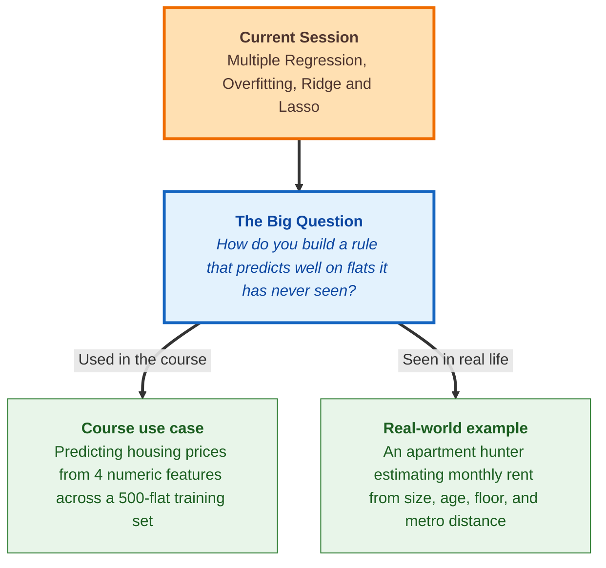

## <span style="color:#2F7DDE">Multiple Regression, Overfitting, Ridge and Lasso</span>

### <span style="color:#2F7DDE">Mental Map</span>



---

### <span style="color:#2F7DDE">What You'll Learn</span>

Have you ever wondered how a website predicts a flat's rent before it is listed?

By the end of this session, you will be able to:

- <span style="color:#D9660B">**Explain**</span> how model complexity changes what a model learns from training data versus new data.
- <span style="color:#D9660B">**Describe**</span> why features measured in different units need rescaling before a penalty is applied.
- <span style="color:#D9660B">**Use**</span> four flat features to build a rent prediction from training data.
- <span style="color:#D9660B">**Calculate**</span> two error measures for a set of 6 predicted rent values.
- <span style="color:#D9660B">**Apply**</span> two penalty methods to a rent model and observe which features each keeps.
- <span style="color:#D9660B">**Compare**</span> a model that memorises training rents with one that generalises well, using their error gaps.

> <span style="color:#2F7DDE">**Topics you will meet:**</span> Multiple linear regression, MAE and RMSE, Overfitting vs underfitting, Bias vs variance, Ridge regression, Lasso regression, Scaling before regularisation.
>
> Join the session to learn each of these in detail.

---

### <span style="color:#2F7DDE">Why You Are Learning This Topic</span>

Imagine you are searching for a flat in a new city. You study 10 listings and notice a pattern: bigger flats near the metro cost more. You build a rule and it matches every one perfectly. Then you test it on a new flat and the gap is €300. <span style="color:#D9660B">**Overfitting**</span> means a model has learned its training data so well that it fails on new data. In this course, you will spot this problem, measure the errors, and use a penalty to fix it.

> <span style="color:#2F7DDE">**Think about it:**</span> Does a perfect fit on training data guarantee accurate predictions on new flats?

---

### <span style="color:#2F7DDE">The Flat Hunt Puzzle</span>

A property website lists 5 flats with known rents.

| Flat | Size (m²) | Age (years) | Floor | Metro (km) | Rent (€/month) |
|------|-----------|-------------|-------|------------|----------------|
| A    | 48        | 12          | 3     | 0.4        | 950            |
| B    | 65        | 5           | 7     | 1.2        | 1120           |
| C    | 72        | 20          | 2     | 0.8        | 1050           |
| D    | 55        | 8           | 5     | 2.5        | 980            |
| E    | 90        | 3           | 10    | 0.3        | 1380           |

<span style="color:#D9660B">**What you want to happen:**</span>

- Predict the rent for Flat G: 60 m², 6 years old, floor 4, 1.0 km from metro.
- Measure how far each predicted rent sits from the real rent.
- Test whether adding a penalty to the rule improves the prediction for Flat G.

Here is how it might start. You do not need to understand it yet.

```python
rents = [950, 1120, 1050, 980, 1380]
predictions = [940, 1140, 1030, 1000, 1360]
errors = [abs(p - r) for p, r in zip(predictions, rents)]
```

> <span style="color:#D9660B">**Wonder about this:**</span>
>
> - Flat E: 90 m², €1,380 rent. Could a model trained on only 3 flats predict that accurately?
> - Size is in m² and age is in years. Does that scale difference change each feature's weight?

---

### <span style="color:#2F7DDE">Think It Through</span>

There is no wrong first try. Keep your guesses for the session.

**1. You train a model on flats A to E and it matches all five exactly. The error on flat F is €210. What does that tell you?**
Hint: Think about what a perfect fit on training data usually signals.

**2. Flat E: size is 90 m² and metro distance is 0.3 km. Which feature would a penalty favour if you skip rescaling?**
Hint: A penalty responds to the number's size, not its units.

**3. If you remove the floor feature and the error on new flats barely changes, what does that say about floor?**
Hint: A feature that adds nothing to accuracy may not be worth including.

---

### <span style="color:#2F7DDE">One Question to Carry Into the Session</span>

> <span style="color:#2F7DDE">**When does a model know enough to generalise?**</span>
>
> Can a model trained on 5 flats be trusted to predict rent on a street it has never seen?
