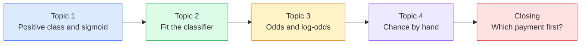
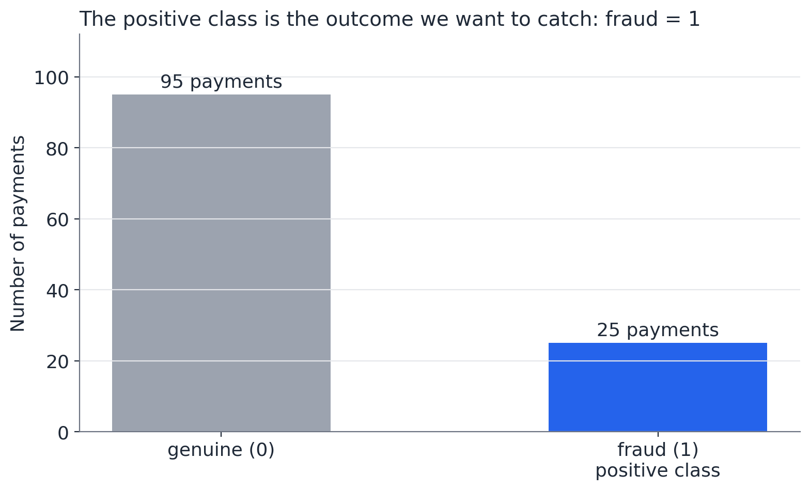
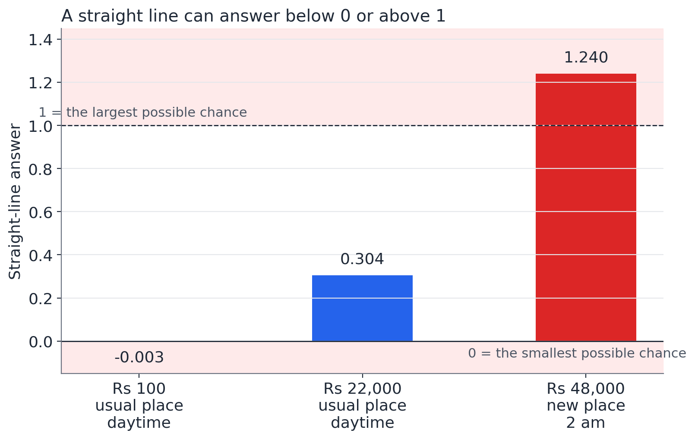
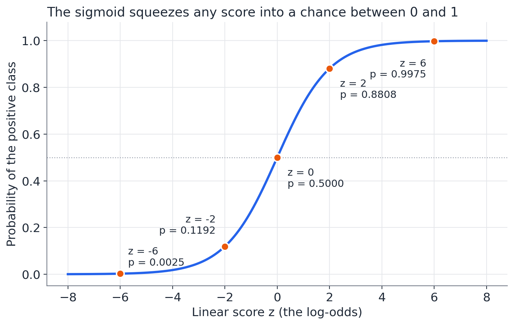
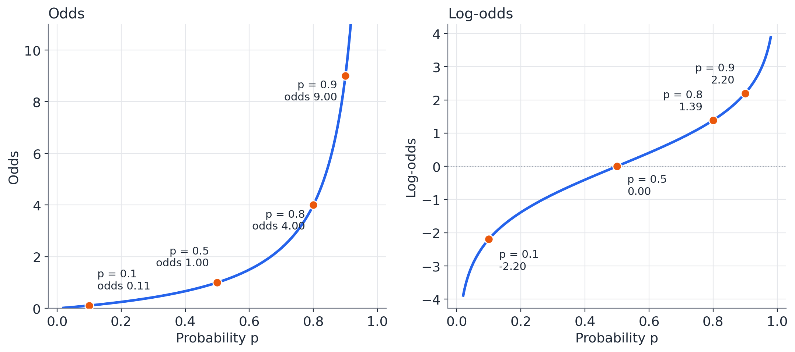
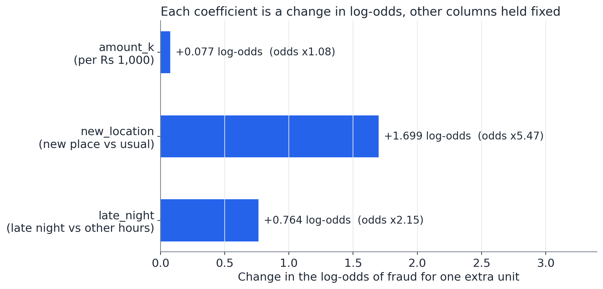
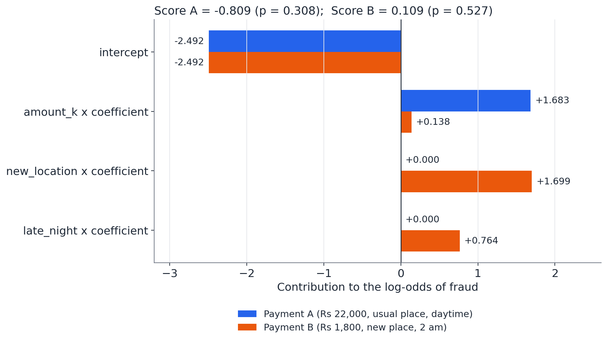

# <font color='#1d4ed8'>Lecture Script: Building a Logistic Regression Classifier</font>

---

## <font color='blue'>Agenda</font>

The lecture runs as four topics. Each topic ends with a quiz.

| Topic | What we do | Learning objectives covered | Minutes |
|:-:|:--|:--|:-:|
| 1 | Name the positive class and squeeze a score into a chance | Identify the positive class in a stated binary classification problem<br>Explain the role of the sigmoid function in mapping a linear score to a probability | 30 |
| 2 | Let scikit-learn fit the classifier | Train a logistic regression model for a binary target | 20 |
| 3 | Read the model with odds and log-odds | Explain odds as the ratio of the chance an event happens to the chance it does not<br>Interpret a logistic regression coefficient as a change in log-odds for the positive class | 30 |
| 4 | Work out one payment's chance by hand | Compute a predicted probability from logistic regression coefficients for one input row | 25 |
| — | Closing: Outcome & Summary | | 15 |
| | **Total** | | **120** |

> <font color="red">**🎯 Instructor Note**</font> Pace: in Topic 1 spend about 10 minutes on the positive class and the straight-line problem, and the rest on the sigmoid. Topic 2 is a short, hands-on fit.
> Take Topics 3 and 4 slowly; reading a coefficient and computing a chance by hand are what learners will use at work.

---

## <font color='blue'>Scenario</font>

A PhonePe-style UPI app checks every payment in the second before it goes through. The fraud team can hold only a few payments for a human check, and two arrive together.

| | Payment A | Payment B |
|:--|:-:|:-:|
| Amount | Rs 22,000 | Rs 1,800 |
| Place | the user's usual city | a city the user has never paid from |
| Time | 2 pm | 2 am |
| Old rule: "hold anything above Rs 20,000" | Hold | Let through |

> <font color="red">**🎯 Instructor Note**</font> PhonePe is only the setting. Do not claim it uses this data; the 120 payments in `data/payments.csv` are invented for teaching.
> Learners need Python 3 with pandas 2 or later, numpy and scikit-learn 1.4 or later. The split uses `random_state=42`, so every output matches.

---

## <font color='blue'>Problem Statement</font>

The fraud team's old rule was simple: hold every payment above Rs 20,000. One evening it held Priya's Rs 24,000 rent payment for three hours. Her landlord did not get the money by the deadline, and she paid a late fee. The same night the rule let through Arjun's Rs 1,500 payment. It was made at 2 am from a city he had never paid from, and it was fraud. The rule looked at one clue and ignored the others.

The team now has 120 past payments, each marked fraud or genuine, and wants every new payment to carry a chance of fraud.

> <font color='purple'>**How do we turn a payment's details into a chance of fraud that the team can rank, read and explain?**</font>

> <font color="red">**🎯 Instructor Note**</font> Poll: "Which is more likely to be fraud, Payment A or Payment B?" Give learners 30 seconds to respond in chat. Reveal the answer in the Closing.

---

## <font color='blue'>What We Will Use</font>

Everything the lecture needs, in one place. Each topic uses these terms without repeating them.

| Term | Meaning | In our payments |
|:--|:--|:--|
| **Binary target** | A column with exactly two outcomes, coded 0 and 1 | `fraud`: 1 = fraud, 0 = genuine |
| **Positive class** | The outcome the model gives a probability for; it is coded 1 | fraud |
| **Linear score** $z$ | A weighted sum of the columns, like last session's line; it can be any number | $z = b_0 + b_1x_1 + b_2x_2 + b_3x_3$ |
| **Sigmoid** $\sigma(z)$ | The curve that turns any score into a number between 0 and 1 | the chance of fraud |
| **Odds** | The chance an event happens divided by the chance it does not | fraud payments to genuine payments |
| **Log-odds** | The natural logarithm of the odds | the score $z$ |
| **Coefficient** $b_j$ | The change in the log-odds of the positive class for one extra unit of column $j$, other columns held fixed | $b_1, b_2, b_3$ |
| `LogisticRegression`, `fit`, `predict_proba`, `coef_`, `intercept_`, `classes_` | The scikit-learn tools: build the model, learn it, give chances, read the numbers | `model.fit(X_train, y_train)` |

Our columns: $x_1$ = `amount_k` (the amount in Rs 1,000), $x_2$ = `new_location` (1 = a city the user has never paid from), $x_3$ = `late_night` (1 = paid between 12 am and 5 am).

The score, the sigmoid and the odds:

$$\boxed{p = \sigma(z) = \frac{1}{1 + e^{-z}}} \qquad \text{odds} = \frac{p}{1 - p} \qquad \ln\frac{p}{1-p} = z$$

> <font color='#b45309'>**Watch out for**</font>
> - The positive class is the outcome the question asks about, not the "good" one.
> - A coefficient is a change in log-odds, not a change in probability.
> - `predict_proba` has one column per class, in the order of `classes_`.

---

## <font color='blue'>How: Walking Through the Payment Check</font>



---

## <font color='blue'>Topic 1: Name the Positive Class and Squeeze a Score into a Chance</font> `30 min`

Last session you used Ridge and Lasso to predict a rent in rupees, and before that you read a slope and an intercept from a straight line. Today the answer is not an amount but a yes or no: fraud or genuine.

> <font color='purple'>**We have 120 past payments, each marked fraud or genuine. Which of the two outcomes should the model give a chance for?**</font>

### <font color='green'>Example: look at the payments</font>

**Predict before running: What will happen?**

> <font color="red">**🎯 Instructor Note**</font> Expected: 120 rows and 5 columns, with 95 genuine and 25 fraud payments. Common guess: learners forget the id column is counted.

```python
import pandas as pd

df = pd.read_csv("data/payments.csv")
print(df.shape)
print(df.head(5))
print(df["fraud"].value_counts())
```

**Output**

```
(120, 5)
  payment_id  amount_k  new_location  late_night  fraud
0       P001       0.1             1           1      1
1       P002      48.0             0           0      0
2       P003      36.5             0           0      1
3       P004       0.5             0           0      0
4       P005       5.1             0           0      0
fraud
0    95
1    25
Name: count, dtype: int64
```

#### <font color='#c2410c'>Code Explanation</font>

- **Line 1** Loads pandas, which reads tables.
- **Line 3** Reads the payment file into a table called `df`.
- **Line 4** Prints the size as (rows, columns).
- **Line 5** Shows the first 5 payments.
- **Line 6** Counts how many payments carry each value of `fraud`.

> <font color='green'>**Result**</font> Each row is one payment. The target `fraud` is a binary target: 1 for fraud and 0 for genuine, and 25 of the 120 payments are fraud.

#### <font color='#c2410c'>Logic Explanation</font>

- The positive class is the outcome the model gives a probability for. Here it is fraud, coded 1: the outcome the team wants to catch.
- "Positive" does not mean "good". It means "the one we are looking for".

<p align="center"></p>

### <font color='green'>Extending it: the same data, a different question</font>

> <font color='purple'>**What if another team asks "which payments are genuine?"**</font>

> <font color="red">**🎯 Instructor Note**</font> Ask which class is positive for that team. Give learners 30 seconds to respond in chat. Expected: genuine.

```python
genuine = 1 - df["fraud"]
print(df["fraud"].mean().round(3), genuine.mean().round(3))
```

**Output**

```
0.208 0.792
```

#### <font color='#c2410c'>Code Explanation</font>

- **Line 1** Builds a new column that is 1 for a genuine payment and 0 for fraud.
- **Line 2** Prints the share of 1s in each column, rounded to 3 decimals.

> <font color='green'>**Result**</font> When the question is about genuine payments, genuine becomes the positive class and the share of 1s jumps from 0.208 to 0.792. The positive class follows the question, not the data.

> <font color='#b45309'>**Common mistake**</font> Choosing the more common outcome, or the "good" outcome, as the positive class. Read the question and pick the outcome it asks about.

### <font color='green'>Example: a straight line as a chance</font>

> <font color='purple'>**Last session's straight line gave a number for every row. Can it give a chance of fraud?**</font>

**Predict before running: What will happen?**

> <font color="red">**🎯 Instructor Note**</font> Ask: "Will all three answers lie between 0 and 1?" Expected: no. The first is just below 0 and the last is above 1.

```python
from sklearn.linear_model import LinearRegression

X = df[["amount_k", "new_location", "late_night"]]
y = df["fraud"]
line = LinearRegression().fit(X, y)
new = pd.DataFrame({"amount_k": [0.1, 22, 48], "new_location": [0, 0, 1], "late_night": [0, 0, 1]})
print(line.predict(new).round(3))
```

**Output**

```
[-0.003  0.304  1.24 ]
```

#### <font color='#c2410c'>Code Explanation</font>

- **Line 1** Imports the straight-line model from last session.
- **Line 3** Builds `X`, the three feature columns, as a table.
- **Line 4** Builds `y`, the 0 and 1 target.
- **Line 5** Fits the straight line to the 0 and 1 target.
- **Line 6** Builds three payments: Rs 100 from a usual place by day, Rs 22,000 from a usual place by day, and Rs 48,000 from a new place at night. Every amount is inside the range of the data.
- **Line 7** Prints the line's answer for each payment, rounded to 3 decimals.

<p align="center"></p>

> <font color='green'>**Result**</font> The line answers $-0.003$ and $1.24$. A chance cannot be below 0 or above 1, so we need a curve that always stays between 0 and 1.

### <font color='green'>Example: the sigmoid</font>

> <font color='purple'>**How do we squeeze any score into a number between 0 and 1?**</font>

The model first builds a linear score $z = b_0 + b_1x_1 + b_2x_2 + b_3x_3$, as in last session. It can be any number, negative or positive. The sigmoid then maps it to a probability of the positive class:

$$\boxed{\sigma(z) = \frac{1}{1 + e^{-z}}}$$

By hand: $\sigma(0) = \dfrac{1}{1 + e^{0}} = \dfrac{1}{2} = 0.5$, $\ \sigma(2) = \dfrac{1}{1 + e^{-2}} = \dfrac{1}{1 + 0.1353} = 0.8808$, $\ \sigma(-2) = \dfrac{1}{1 + e^{2}} = \dfrac{1}{1 + 7.3891} = 0.1192$.

**Predict before running: What will happen?**

> <font color="red">**🎯 Instructor Note**</font> Ask what $z = 0$ and $z = \pm 6$ give. Expected: exactly 0.5 at 0, a value near 0 at $-6$ and near 1 at 6.

```python
import numpy as np

def sigmoid(z):
    return 1 / (1 + np.exp(-z))

z = np.array([-6, -2, 0, 2, 6])
print(sigmoid(z).round(4))
```

**Output**

```
[0.0025 0.1192 0.5    0.8808 0.9975]
```

#### <font color='#c2410c'>Code Explanation</font>

- **Line 1** Loads numpy, a library for number arrays.
- **Lines 3 and 4** Define `sigmoid`, which applies $1 / (1 + e^{-z})$ to a score.
- **Line 6** Makes five scores, from $-6$ to $6$.
- **Line 7** Applies the sigmoid to all five and rounds to 4 decimals.

<p align="center"></p>

> <font color='green'>**Result**</font> Negative scores give a chance below 0.5, a score of 0 gives exactly 0.5, and positive scores give a chance above 0.5. Whatever the score, the answer stays between 0 and 1.

### <font color='green'>Extending it: very large scores</font>

> <font color='purple'>**What does the sigmoid give for a score of 20 or $-20$, and how are $\sigma(z)$ and $\sigma(-z)$ related?**</font>

> <font color="red">**🎯 Instructor Note**</font> Ask: "Can the sigmoid ever return exactly 1?" Give learners 30 seconds to respond in chat. Expected: no, it only gets very close.

```python
for z in (-20, -2, 2, 20):
    print(z, f"{sigmoid(z):.9f}")
```

**Output**

```
-20 0.000000002
-2 0.119202922
2 0.880797078
20 0.999999998
```

#### <font color='#c2410c'>Code Explanation</font>

- **Line 1** Loops over four scores.
- **Line 2** Prints each score and its sigmoid, with 9 decimals so the tiny differences show.

#### <font color='#c2410c'>Logic Explanation</font>

- At 20 the answer is 0.999999998 and at $-20$ it is 0.000000002: very close to 1 and 0, never equal to them.
- $\sigma(-2) + \sigma(2) = 0.119202922 + 0.880797078 = 1$. The chance of the positive class and the chance of the other class always add to 1.

> <font color='green'>**Result**</font> The sigmoid never reaches 0 or 1, and $\sigma(-z) = 1 - \sigma(z)$.

### <font color='purple'>Quiz 1</font>

**Question:** A payment's linear score is $z = 3$. What does the sigmoid return, and what does it mean?

**Options:**
- A) 3, because the sigmoid leaves the score unchanged
- B) 0.5, because the sigmoid always returns 0.5 for a positive score
- C) About 0.95, the probability of the positive class
- D) About 0.05, the probability of the positive class

**Correct Answer:** C

**Explanation:**
- **A)** Wrong: the sigmoid changes the score; its answer always lies between 0 and 1.
- **B)** Wrong: 0.5 is the answer only when $z = 0$.
- **C)** Correct: $\sigma(3) = 1 / (1 + e^{-3}) = 1 / 1.0498 \approx 0.95$, a probability of the positive class.
- **D)** Wrong: 0.05 is $1 - \sigma(3)$, the chance of the other class.

---

## <font color='blue'>Topic 2: Let scikit-learn Fit the Classifier</font> `20 min`

> <font color='purple'>**The sigmoid turns a score into a chance, but where do the numbers $b_0, b_1, b_2, b_3$ in the score come from?**</font>

### <font color='green'>Example: fitting the fraud model</font>

Earlier this module you split data into training and test sets with a fixed seed. Do it again, then fit on the training rows only.

**Predict before running: What will happen?**

> <font color="red">**🎯 Instructor Note**</font> Expected: three coefficients (one per column, all positive), one negative intercept, and the classes [0 1]. Common guess: learners expect a single coefficient.

```python
from sklearn.model_selection import train_test_split
from sklearn.linear_model import LogisticRegression

X_train, X_test, y_train, y_test = train_test_split(X, y, test_size=0.2, random_state=42)
model = LogisticRegression()
model.fit(X_train, y_train)
print(model.coef_, model.intercept_)
print(model.classes_)
```

**Output**

```
[[0.07650505 1.69941292 0.76387876]] [-2.49219926]
[0 1]
```

#### <font color='#c2410c'>Code Explanation</font>

- **Line 1** Imports the split function.
- **Line 2** Imports the `LogisticRegression` class.
- **Line 4** Keeps 80% of the payments for training (96 rows) and 20% for testing (24 rows), with a fixed seed.
- **Line 5** Creates an empty model. By default it adds a mild L2 penalty, the Ridge idea from last session, which pulls the coefficients toward 0.
- **Line 6** Learns the coefficients and the intercept from the training rows.
- **Line 7** Prints the coefficients (one row, one number per column) and the intercept.
- **Line 8** Prints the two classes in order. The coefficients describe the second one, class 1, which is fraud.

> <font color='green'>**Result**</font> The model learned the score $z = -2.492 + 0.077\,x_1 + 1.699\,x_2 + 0.764\,x_3$ for the log-odds of fraud, where class 1 is the positive class.

### <font color='green'>Extending it: chances for payments the model has not seen</font>

> <font color='purple'>**What does the trained model return for payments it was not trained on?**</font>

> <font color="red">**🎯 Instructor Note**</font> Ask: "How many columns will `predict_proba` return, and which one is fraud?" Expected: two columns; the second is fraud.

```python
rows = X_test.head(3)
print(rows)
print(model.predict_proba(rows).round(3))
print(model.predict(rows))
```

**Output**

```
    amount_k  new_location  late_night
44      18.1             0           0
47       1.1             0           0
4        5.1             0           0
[[0.752 0.248]
 [0.917 0.083]
 [0.891 0.109]]
[0 0 0]
```

#### <font color='#c2410c'>Code Explanation</font>

- **Line 1** Takes the first 3 test payments.
- **Line 2** Prints them.
- **Line 3** `predict_proba` gives one row per payment and one column per class, in the order of `classes_`: first the chance of genuine (0), then the chance of fraud (1).
- **Line 4** `predict` gives the class with the higher chance.

> <font color='green'>**Result**</font> For the first payment the model gives 0.752 for genuine and 0.248 for fraud. Each row adds to 1, and the second column is the positive class.

### <font color='green'>Extending it: a target made of words</font>

> <font color='purple'>**What if the target column holds the words "fraud" and "genuine" instead of 1 and 0?**</font>

> <font color="red">**🎯 Instructor Note**</font> Ask which class will be positive. Give learners 30 seconds to respond in chat. Expected: genuine, because it comes second in alphabetical order.

```python
labels = y_train.map({1: "fraud", 0: "genuine"})
text_model = LogisticRegression().fit(X_train, labels)
print(text_model.classes_)
print(text_model.coef_.round(3))
print(model.coef_.round(3))
```

**Output**

```
['fraud' 'genuine']
[[-0.077 -1.699 -0.764]]
[[0.077 1.699 0.764]]
```

#### <font color='#c2410c'>Code Explanation</font>

- **Line 1** Replaces the 1s and 0s with the words "fraud" and "genuine".
- **Line 2** Fits the same model on the word labels.
- **Line 3** Prints the classes in the order scikit-learn uses.
- **Line 4** Prints the new coefficients.
- **Line 5** Prints the coefficients from the 0 and 1 model for comparison.

> <font color='green'>**Result**</font> With words, scikit-learn sorts the classes alphabetically and takes the second one, genuine, as the positive class. Every coefficient flips its sign because it now describes genuine payments.

> <font color='#b45309'>**Common mistake**</font> Leaving the target as words and reading the coefficients as the risk of fraud. Code the target 1 for the outcome you want to catch.

### <font color='purple'>Quiz 2</font>

**Question:** A model is fitted with `y_train` coded 1 for fraud and 0 for genuine. Which column of `model.predict_proba(X_new)` holds the chance of fraud?

**Options:**
- A) Column 1 (the second), because it belongs to class 1
- B) Column 0 (the first), because it is listed first
- C) Both columns, because they hold the same chance
- D) Neither, because `predict_proba` returns class labels

**Correct Answer:** A

**Explanation:**
- **A)** Correct: the columns follow `classes_ = [0 1]`, so the second column is class 1, fraud.
- **B)** Wrong: column 0 is class 0, the chance of genuine.
- **C)** Wrong: the two columns add to 1, so they are equal only when each is 0.5.
- **D)** Wrong: `predict` returns labels; `predict_proba` returns chances.

---

## <font color='blue'>Topic 3: Read the Model with Odds and Log-Odds</font> `30 min`

> <font color='purple'>**The model's score is the log-odds of fraud. An analyst would not call our fraud share "21%" but "5 to 19". What are those odds, and how do they help us read the model?**</font>

### <font color='green'>Example: the odds of fraud</font>

Odds compare the chance an event happens with the chance it does not:

$$\boxed{\text{odds} = \frac{p}{1 - p}}$$

By hand: $p = \dfrac{25}{120} = 0.2083$, so $\text{odds} = \dfrac{25/120}{95/120} = \dfrac{25}{95} = \dfrac{5}{19} \approx 0.2632$.

**Predict before running: What will happen?**

> <font color="red">**🎯 Instructor Note**</font> Expected: counts 25 and 95, then 0.2083 and 0.2632. Common wrong guess: learners say the odds equal the probability, 0.2083.

```python
share = df["fraud"].mean()
print(df["fraud"].sum(), (1 - df["fraud"]).sum())
print(round(share, 4), round(share / (1 - share), 4))
```

**Output**

```
25 95
0.2083 0.2632
```

#### <font color='#c2410c'>Code Explanation</font>

- **Line 1** Takes the share of fraud payments, the probability $p$.
- **Line 2** Prints the number of fraud payments and the number of genuine payments.
- **Line 3** Prints $p$ and the odds $p / (1 - p)$, to 4 decimals.

> <font color='green'>**Result**</font> For every 5 fraud payments there are 19 genuine ones: odds of about 0.26, or "5 to 19". The chance it happens is 0.2083 and the chance it does not is 0.7917, and the odds are their ratio.

### <font color='green'>Extending it: probability, odds and log-odds side by side</font>

> <font color='purple'>**How do a probability, its odds and its log-odds line up?**</font>

> <font color="red">**🎯 Instructor Note**</font> Ask: "If $p = 0.8$, are the odds 0.8?" Expected: no, the odds are 4, because 0.8 divided by 0.2 is 4.

```python
for prob in (0.1, 0.5, 0.8, 0.9):
    odds = prob / (1 - prob)
    print(f"p = {prob}  odds = {odds:.4f}  log-odds = {np.log(odds):.4f}")
```

**Output**

```
p = 0.1  odds = 0.1111  log-odds = -2.1972
p = 0.5  odds = 1.0000  log-odds = 0.0000
p = 0.8  odds = 4.0000  log-odds = 1.3863
p = 0.9  odds = 9.0000  log-odds = 2.1972
```

#### <font color='#c2410c'>Code Explanation</font>

- **Line 1** Loops over four probabilities.
- **Line 2** Computes the odds $p / (1 - p)$.
- **Line 3** Prints $p$, the odds and the log-odds $\ln(\text{odds})$, which `np.log` computes.

#### <font color='#c2410c'>Logic Explanation</font>

- At $p = 0.5$ the odds are 1 (even chance) and the log-odds are 0.
- At $p = 0.8$ the odds are 4, meaning "4 to 1 for the event". At $p = 0.1$ they are $1/9 \approx 0.1111$.
- The log-odds of 0.9 and 0.1 are $+2.1972$ and $-2.1972$. Log-odds can be any number: negative when $p < 0.5$, positive when $p > 0.5$.
- To go back from odds to a probability: $p = \dfrac{\text{odds}}{1 + \text{odds}}$. For our payments, $\dfrac{5/19}{1 + 5/19} = \dfrac{5}{24} = 0.2083$.

<p align="center"></p>

> <font color='green'>**Result**</font> Odds of 4 means 4 to 1, and the log-odds is the natural log of that odds, 1.3863. A probability of 0.5 is odds of 1 and log-odds of 0.

> <font color='#b45309'>**Common mistake**</font> Treating odds as a probability. A chance of 0.8 is odds of 4, not odds of 0.8.

### <font color='green'>Example: coefficients as log-odds</font>

> <font color='purple'>**The model's score $z$ is the log-odds of fraud. So what does each coefficient say?**</font>

The sigmoid and the log-odds are two views of the same model:

$$\boxed{\ln\frac{p}{1 - p} = b_0 + b_1x_1 + b_2x_2 + b_3x_3}$$

One extra unit of column $j$ adds $b_j$ to the log-odds of the positive class, other columns held fixed. The odds are multiplied by $e^{b_j}$.

**Predict before running: What will happen?**

> <font color="red">**🎯 Instructor Note**</font> Ask learners for the sign of each coefficient first. Expected: all positive; a bigger amount, a new place and late night each raise the risk of fraud.

```python
for name, coef in zip(X.columns, model.coef_[0]):
    print(f"{name:13s} log-odds {coef:+.3f}  odds x{np.exp(coef):.2f}")
print(f"intercept     log-odds {model.intercept_[0]:+.3f}")
```

**Output**

```
amount_k      log-odds +0.077  odds x1.08
new_location  log-odds +1.699  odds x5.47
late_night    log-odds +0.764  odds x2.15
intercept     log-odds -2.492
```

#### <font color='#c2410c'>Code Explanation</font>

- **Line 1** Loops over the column names and their coefficients.
- **Line 2** Prints each coefficient as a change in log-odds, and $e^{b}$ as the factor on the odds.
- **Line 3** Prints the intercept, the log-odds when every column is 0.

<p align="center"></p>

> <font color='green'>**Result**</font> Each extra Rs 1,000 adds 0.077 to the log-odds of fraud (odds $\times$ 1.08). A payment from a new place adds 1.699 (odds $\times$ 5.47) and a late-night payment adds 0.764 (odds $\times$ 2.15), each compared with the same payment without it.

### <font color='green'>Extending it: check one coefficient</font>

> <font color='purple'>**Does changing `new_location` from 0 to 1 really add 1.699 to the log-odds?**</font>

> <font color="red">**🎯 Instructor Note**</font> Ask learners to predict the difference between the two scores first. Expected: exactly 1.699, and the odds ratio 5.47.

```python
row = pd.DataFrame({"amount_k": [1.8], "new_location": [0], "late_night": [1]})
z0 = model.decision_function(row)[0]
z1 = model.decision_function(row.assign(new_location=1))[0]
print(round(z0, 3), round(z1, 3), round(z1 - z0, 3))
print(round(np.exp(z1) / np.exp(z0), 2))
```

**Output**

```
-1.591 0.109 1.699
5.47
```

#### <font color='#c2410c'>Code Explanation</font>

- **Line 1** Builds one late-night payment of Rs 1,800 from a usual place.
- **Line 2** `decision_function` returns the linear score $z$, the log-odds of the positive class.
- **Line 3** Copies the row with `new_location` set to 1 and takes its score.
- **Line 4** Prints the score before, the score after, and the difference.
- **Line 5** The odds are $e^{z}$, so this divides the odds after by the odds before.

> <font color='green'>**Result**</font> The score moves from $-1.591$ to $0.109$, a rise of exactly 1.699, and the odds are multiplied by 5.47.

### <font color='green'>Extending it: changing the units</font>

> <font color='purple'>**What if the amount is counted in Rs 10,000 instead of Rs 1,000?**</font>

> <font color="red">**🎯 Instructor Note**</font> Ask: "Does the coefficient stay 0.077?" Expected: no, it becomes ten times larger, 0.765.

```python
b_amount = model.coef_[0][0]
print(round(10 * b_amount, 3), round(np.exp(10 * b_amount), 2))
```

**Output**

```
0.765 2.15
```

#### <font color='#c2410c'>Logic Explanation</font>

- Ten times the unit means ten times the change: $10 \times 0.0765 = 0.765$ added to the log-odds, and the odds are multiplied by $e^{0.765} = 2.15$.
- A Rs 10,000 rise in the amount therefore matters about as much as a late-night payment (0.764).
- Compare coefficient sizes only when the units are comparable. The 0.077 is per Rs 1,000 and the 1.699 is for a yes or no.

> <font color='green'>**Result**</font> Rs 10,000 more adds 0.765 to the log-odds of fraud and multiplies the odds by 2.15.

> <font color='#b45309'>**Common mistake**</font> Reading 1.699 as "the chance of fraud rises by 1.699" or "by 1.699%". It is a change in the log-odds of fraud; say it that way.

### <font color='purple'>Quiz 3</font>

**Question:** The coefficient of `late_night` is 0.764. Which statement is correct?

**Options:**
- A) A late-night payment has a 76.4% chance of fraud
- B) A late-night payment raises the chance of fraud by 0.764
- C) A late-night payment adds 0.764 to the odds of fraud
- D) A late-night payment adds 0.764 to the log-odds of fraud, other columns held fixed

**Correct Answer:** D

**Explanation:**
- **A)** Wrong: a coefficient is not a probability; the chance also depends on the intercept and the other columns.
- **B)** Wrong: the coefficient changes the log-odds, not the chance, so the chance does not rise by a fixed 0.764.
- **C)** Wrong: it is added to the log-odds; the odds are multiplied by $e^{0.764} \approx 2.15$.
- **D)** Correct: a coefficient is the change in the log-odds of the positive class for one extra unit of its column.

---

## <font color='blue'>Topic 4: Work Out One Payment's Chance by Hand</font> `25 min`

> <font color='purple'>**Payment B was Rs 1,800, from a new place, at 2 am. What chance of fraud does the model give it, worked out by hand?**</font>

### <font color='green'>Example: Payment B by hand</font>

The score first, then the sigmoid:

$$\boxed{p = \frac{1}{1 + e^{-(b_0 + b_1x_1 + b_2x_2 + b_3x_3)}}}$$

Score: $z = -2.492 + 0.077(1.8) + 1.699(1) + 0.764(1) = -2.492 + 0.1386 + 1.699 + 0.764 = 0.1096$

Chance: $p = \dfrac{1}{1 + e^{-0.1096}} = \dfrac{1}{1 + 0.8962} = 0.5274$

**Predict before running: What will happen?**

> <font color="red">**🎯 Instructor Note**</font> Expected: 0.1096 and 0.5274 by hand, 0.5272 from the model. They differ in the 4th decimal because we rounded the coefficients.

```python
b0, b1, b2, b3 = -2.492, 0.077, 1.699, 0.764
z = b0 + b1 * 1.8 + b2 * 1 + b3 * 1
print(round(z, 4), round(sigmoid(z), 4))
pay_b = pd.DataFrame({"amount_k": [1.8], "new_location": [1], "late_night": [1]})
print(model.predict_proba(pay_b)[0, 1].round(4))
```

**Output**

```
0.1096 0.5274
0.5272
```

#### <font color='#c2410c'>Code Explanation</font>

- **Line 1** Stores the rounded intercept and the three coefficients.
- **Line 2** Computes the score for Payment B: the intercept plus each coefficient times its value.
- **Line 3** Prints the score and its sigmoid, to 4 decimals.
- **Line 4** Puts Payment B in a one-row table with the same column names as `X`.
- **Line 5** Asks the model for the chance of class 1, fraud, using the unrounded coefficients.

> <font color='green'>**Result**</font> By hand the chance of fraud is 0.5274. The model says 0.5272 because it uses the unrounded coefficients. Both are about 53%.

> <font color='#b45309'>**Common mistake**</font> Reporting the score 0.1096 as the chance, or leaving out the intercept. Without it the score would be 2.6016 and the chance 0.931 instead of 0.527.

### <font color='green'>Extending it: one row from the data</font>

> <font color='purple'>**What does the model give for a real payment from the test set, and what was it?**</font>

> <font color="red">**🎯 Instructor Note**</font> Ask: "Will our sum match `predict_proba` to every decimal this time?" Expected: yes, because no coefficient is rounded.

```python
row = X_test.iloc[[0]]
z = model.intercept_[0] + (model.coef_[0] * row.values[0]).sum()
print(row.values[0], round(z, 4), round(sigmoid(z), 4))
print(model.predict_proba(row)[0, 1].round(4), y_test.iloc[0])
```

**Output**

```
[18.1  0.   0. ] -1.1075 0.2483
0.2483 0
```

#### <font color='#c2410c'>Code Explanation</font>

- **Line 1** Picks the first test payment as a one-row table.
- **Line 2** Computes its score: the intercept plus each coefficient times its value.
- **Line 3** Prints the three values, the score and its sigmoid.
- **Line 4** Prints the model's chance of fraud and the payment's real label.

> <font color='green'>**Result**</font> This payment (Rs 18,100, usual place, not late night) has a score of $-1.1075$ and a chance of fraud of 0.2483. It matches `predict_proba` exactly because the coefficients are not rounded, and the payment was in fact genuine (0).

### <font color='green'>Extending it: the same change, a different effect</font>

> <font color='purple'>**Late night adds 0.764 to the score. Does it add the same amount to the chance of fraud?**</font>

> <font color="red">**🎯 Instructor Note**</font> Ask: "Will +0.764 move the chance by the same amount from every starting score?" Give learners 30 seconds to respond in chat. Expected: no.

```python
for z0 in (-3.0, -0.65, 1.5):
    p0, p1 = sigmoid(z0), sigmoid(z0 + 0.764)
    print(f"score {z0:+.2f}: {p0:.3f} -> {p1:.3f}  (+{p1 - p0:.3f})")
```

**Output**

```
score -3.00: 0.047 -> 0.097  (+0.049)
score -0.65: 0.343 -> 0.528  (+0.185)
score +1.50: 0.818 -> 0.906  (+0.088)
```

#### <font color='#c2410c'>Code Explanation</font>

- **Line 1** Loops over three starting scores: a low one, one close to where Payment B would sit by day, and a high one.
- **Line 2** Computes the chance before and after adding 0.764 to the score.
- **Line 3** Prints the starting score, both chances and the rise.

> <font color='green'>**Result**</font> The same $+0.764$ lifts the chance by 0.049 from a low score, by 0.185 from a score near $-0.65$ and by 0.088 from a high score. The sigmoid is steepest near 0.5, so a change in the log-odds moves the chance most there.

### <font color='purple'>Quiz 4</font>

**Question:** A model with two columns has intercept $-3.0$, a coefficient of 0.1 for `amount_k` and a coefficient of 2.0 for `new_location`. What chance of fraud does it give a Rs 5,000 payment from a new place?

**Options:**
- A) $-0.50$
- B) 0.38
- C) 0.62
- D) 0.92

**Correct Answer:** B

**Explanation:**
- **A)** Wrong: $-0.5$ is the score $z = -3.0 + 0.1(5) + 2.0(1)$, not yet passed through the sigmoid.
- **B)** Correct: $\sigma(-0.5) = 1 / (1 + e^{0.5}) = 1 / 2.6487 \approx 0.38$.
- **C)** Wrong: 0.62 is $\sigma(+0.5)$, which is also $1 - 0.38$, the chance of genuine rather than fraud.
- **D)** Wrong: 0.92 comes from leaving out the intercept: $z = 0.5 + 2.0 = 2.5$ and $\sigma(2.5) \approx 0.92$.

---

## <font color='blue'>Closing: Outcome & Summary</font> `15 min`

Back to the problem: two payments arrived together, and the old rule held A and let B through. We answer it step by step, using each topic once.

> <font color='purple'>**1. What are we giving a chance for?**</font>

The positive class is fraud, coded 1. The sigmoid turns a payment's linear score into the probability of fraud, a number between 0 and 1.

> <font color='purple'>**2. What did the model learn about fraud?**</font>

The fitted model is $z = -2.492 + 0.077\,x_1 + 1.699\,x_2 + 0.764\,x_3$. Each coefficient is a change in the log-odds of fraud: a new place multiplies the odds by 5.47 and a late-night payment by 2.15.

> <font color='purple'>**3. What chance of fraud do Payments A and B get, worked out from the coefficients?**</font>

```python
pay = pd.DataFrame({"amount_k": [22.0, 1.8], "new_location": [0, 1], "late_night": [0, 1]}, index=["A", "B"])
z = model.decision_function(pay)
out = pd.DataFrame({"log_odds": z, "p_fraud": sigmoid(z)}, index=pay.index)
out["odds"] = out["p_fraud"] / (1 - out["p_fraud"])
print(out.round(3))
```

**Output**

```
   log_odds  p_fraud   odds
A    -0.809    0.308  0.445
B     0.109    0.527  1.115
```

#### <font color='#c2410c'>Code Explanation</font>

- **Line 1** Puts Payments A and B in a table with the same columns as `X` (the input rows).
- **Line 2** `decision_function` gives each score, the intercept plus each coefficient times its value (Topics 3 and 4): the log-odds of fraud.
- **Line 3** Applies the sigmoid to get the chance of the positive class, fraud (Topics 1 and 4).
- **Line 4** Computes the odds $p / (1 - p)$ (Topic 3).
- **Line 5** Prints the table, rounded to 3 decimals.

<p align="center"></p>

### <font color='green'>Outcome</font>

| | Payment A | Payment B |
|:--|:-:|:-:|
| Details | Rs 22,000, usual city, 2 pm | Rs 1,800, new city, 2 am |
| Old rule | Hold | Let through |
| Score (log-odds of fraud) | $-0.809$ | $0.109$ |
| Odds of fraud | 0.445 | 1.115 |
| Chance of fraud | 30.8% | 52.7% |

> <font color='green'>**Therefore,**</font> the team should send Payment B for the human check first: the model puts its chance of fraud at about 53%, against about 31% for Payment A, the reverse of what the old rule did. Neither number is a certainty, and A is still worth a look if the team has spare capacity.

> <font color="red">**🎯 Instructor Note**</font> Reveal the opening poll next to the table: B is more likely to be fraud. Many learners pick A because of the amount; B is small but from a new place at 2 am.

### <font color='green'>Summary</font>

| Learning objective | Takeaway |
|:--|:--|
| Positive class | The outcome the question asks about, coded 1 (fraud here); `predict_proba` column 1 is its chance |
| Sigmoid function | $\sigma(z) = 1 / (1 + e^{-z})$ maps any linear score to a probability between 0 and 1 |
| Train a logistic regression | `LogisticRegression().fit(X_train, y_train)` learns one coefficient per column and an intercept |
| Odds | $p / (1 - p)$: the chance it happens divided by the chance it does not; 25 fraud to 95 genuine is 5 to 19 |
| Coefficients as log-odds | One extra unit of a column adds its coefficient to the log-odds of the positive class (odds $\times\, e^{b}$) |
| Predicted probability by hand | Score $= b_0 + b_1x_1 + \dots$, then $p = 1 / (1 + e^{-z})$; Payment B gives 0.527 |
| **Practical value** | Every new case gets a chance and a readable reason, so a small team can rank what to check first |

---

# <font color='red'>Launch the Feedback Poll</font>

> <font color="red">**🎯 Instructor Note**</font> Reminder: launch the feedback poll now to collect learner feedback.
