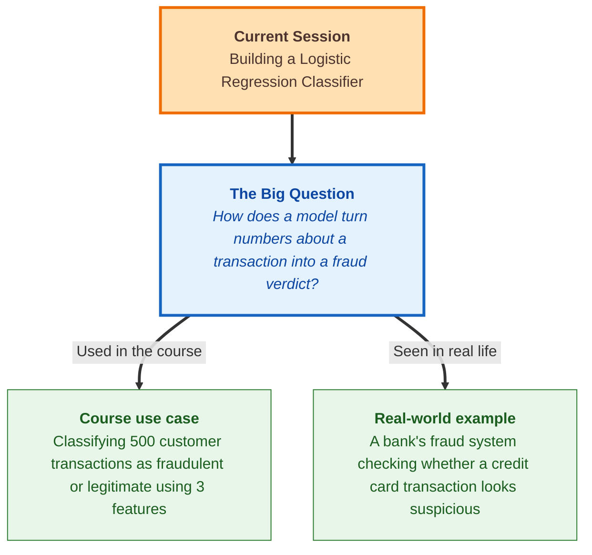

## <span style="color:#2F7DDE">Building a Logistic Regression Classifier</span>

### <span style="color:#2F7DDE">Mental Map</span>



---

### <span style="color:#2F7DDE">What You'll Learn</span>

Have you ever wondered how your bank flags a purchase the moment you tap your card?

By the end of this session, you will be able to:

- <span style="color:#D9660B">**Identify**</span> which outcome is the target in a yes-or-no fraud problem.
- <span style="color:#D9660B">**Describe**</span> the ratio of the chance a transaction is flagged to the chance it is not.
- <span style="color:#D9660B">**Explain**</span> how a curved function converts a raw score into a number between 0 and 1.
- <span style="color:#D9660B">**Interpret**</span> the number assigned to each signal as its push toward the fraud verdict.
- <span style="color:#D9660B">**Use**</span> labeled transaction data to train a fraud-detection model.
- <span style="color:#D9660B">**Calculate**</span> the fraud probability for T6 step by step, using three numbers from the model.

> <span style="color:#2F7DDE">**Topics you will meet:**</span> Positive class, Sigmoid function, Fitting a classifier, Odds, Coefficients as log-odds, Predicted probability by hand.
>
> Join the session to learn each of these in detail.

---

### <span style="color:#2F7DDE">Why You Are Learning This Topic</span>

You tap your card to pay for coffee. In under a second, your bank flags the charge as suspicious. It trained a model on 50,000 labeled transactions. A <span style="color:#D9660B">**classifier**</span> means a model that places each new item into one of two named groups. In this course, you will build one that labels transactions as fraud or not.

> <span style="color:#2F7DDE">**Think about it:**</span> Can you name two signals that would make you suspicious of a purchase?

---

### <span style="color:#2F7DDE">The Fraud Alert Puzzle</span>

A bank has five labeled transactions ready to study.

| Transaction | Amount (€) | Unusual location | Late night | Fraud |
|-------------|-----------|-----------------|------------|-------|
| T1 | 15 | No | No | 0 |
| T2 | 920 | Yes | Yes | 1 |
| T3 | 60 | No | Yes | 0 |
| T4 | 1100 | Yes | No | 1 |
| T5 | 240 | No | No | 0 |

<span style="color:#D9660B">**What you want to happen:**</span>

- Train a model on T1 to T5 so it learns which patterns signal fraud.
- Get a probability score for transaction T6: €750, unusual location, late night.
- Decide whether T6 should trigger a fraud alert.

Here is how it might start. You do not need to understand it yet.

```python
from sklearn.linear_model import LogisticRegression
model = LogisticRegression()
model.fit(X_train, y_train)
```

> <span style="color:#D9660B">**Wonder about this:**</span>
>
> - T2 and T4 are both labeled fraud. T2 was late at night; T4 was not. Does the time decide it?
> - If T6's amount rises to €1,500, would the fraud probability change?

---

### <span style="color:#2F7DDE">Think It Through</span>

There is no wrong first try. Keep your guesses for the session.

**1. Transaction T6 is €750, unusual location, late night. Which table row is most similar to it?**
Hint: Look for two or more signals that match T6.

**2. A model scored 1,000 transactions; 50 are labeled fraud. What are the odds for a new transaction?**
Hint: Odds are a ratio of one group's count to the other group's count.

**3. T1 and T3 are both labeled 0. T3 also has late night Yes. What does that tell you?**
Hint: A signal seen in both classes may carry less weight.

---

### <span style="color:#2F7DDE">One Question to Carry Into the Session</span>

> <span style="color:#2F7DDE">**How does a model turn a list of numbers into a single fraud probability?**</span>
>
> The weight for unusual location is 1.8. What do you do with that number?
