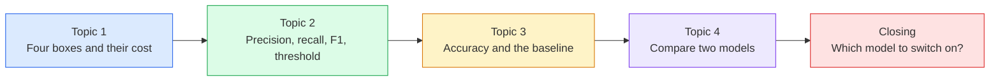
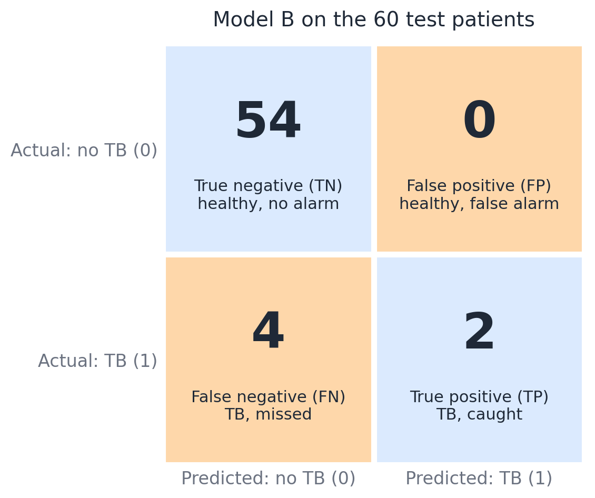
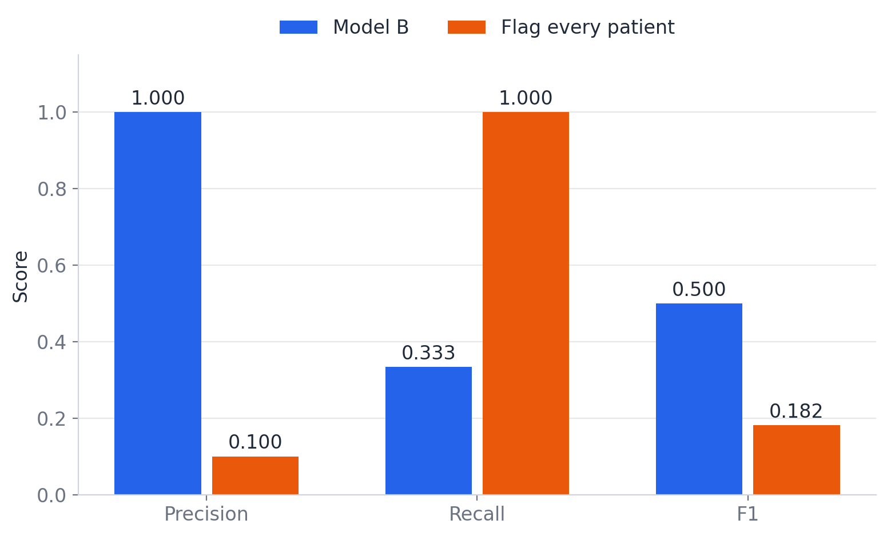
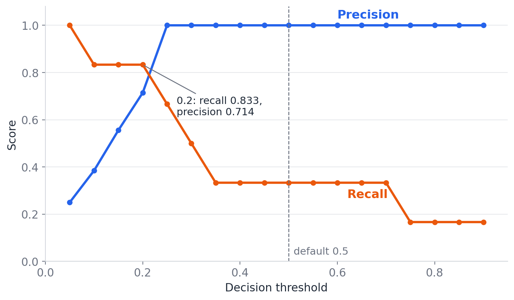
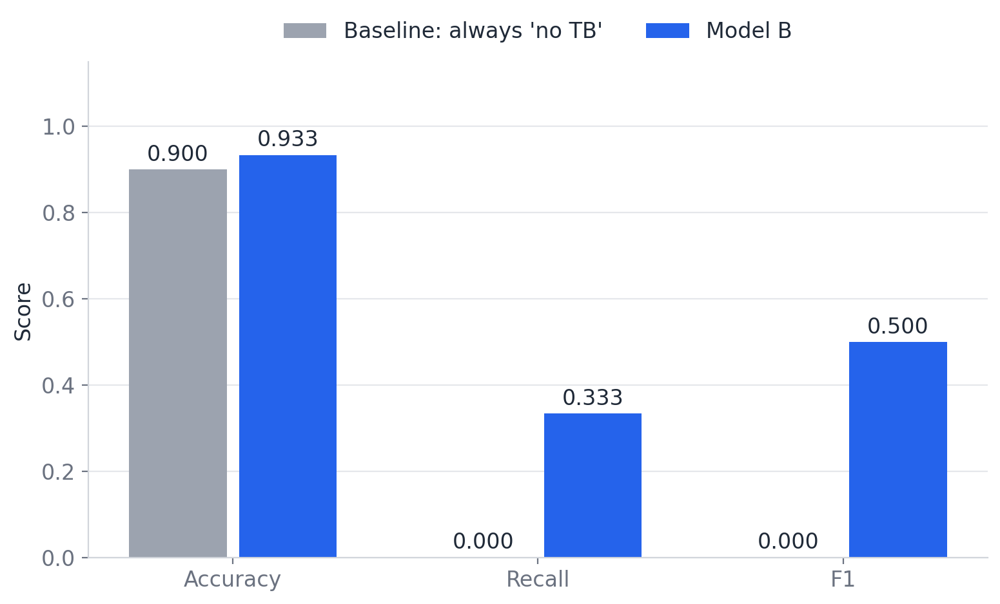
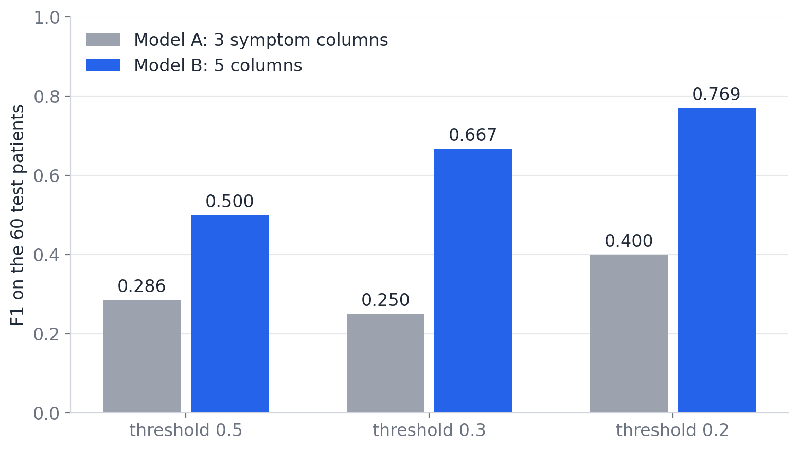
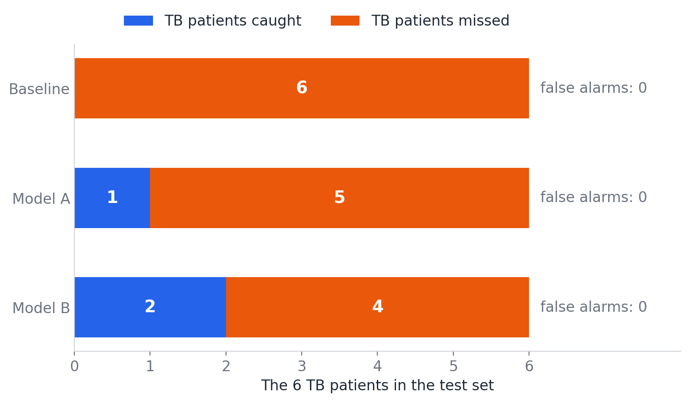

# <font color='#1d4ed8'>Lecture Script: Classification Metrics and Model Choice</font>

---

## <font color='blue'>Agenda</font>

The lecture runs as four topics. Each topic ends with a quiz.

| Topic | What we do | Learning objectives covered | Minutes |
|:-:|:--|:--|:-:|
| 1 | Count the four boxes and name what each mistake costs | Construct a confusion matrix from predicted and actual labels<br>Interpret a confusion matrix by naming what each error type costs in the stated domain | 25 |
| 2 | Score the alarms with precision, recall and F1, then move the threshold | Compute precision, recall and F1 from a confusion matrix<br>Predict how precision and recall move as the decision threshold is raised | 30 |
| 3 | See why accuracy misleads and set a baseline | Explain why accuracy misleads on a heavily imbalanced dataset<br>Construct a baseline predictor that a trained model must beat | 25 |
| 4 | Choose between two models on one metric | Compare two trained models on the same held-out set using one agreed metric | 25 |
| — | Closing: Outcome & Summary | | 15 |
| | **Total** | | **120** |

> <font color="red">**🎯 Instructor Note**</font> Pace: in Topic 1 keep the ten-patient hand count quick and spend the time on the cost of each mistake. In Topic 2 slow down at the threshold table; it is the heart of the lecture.
> Topic 3 is short and sharp, and Topic 4 reuses every number from Topics 1 to 3, so keep its set-up brief.

---

## <font color='blue'>Scenario</font>

An Apollo-style hospital network runs a tuberculosis (TB) screening desk at its health-check centres.

- **Before:** a nurse decides by eye who goes for the confirmatory lab test. On a busy day, a patient with a mild cough is sent home.
- **After:** five numbers for each visitor go into a model: weeks of cough, weight loss in kg, night sweats, contact with a known TB case, and a chest X-ray score. The model says "TB" (send for the lab test) or "no TB" (go home). It screens; it does not diagnose.
- **The decision:** the data team has two candidate models. Model A reads only the three symptom columns (cough, weight loss, night sweats); Model B reads all five. The hospital can switch on only one.

> <font color="red">**🎯 Instructor Note**</font> Apollo is only the setting. Do not claim it uses this data; the 150 patients in `data/tb_screening.csv` are invented for teaching, and nothing here is medical advice.
> Learners need Python 3 with pandas 2 or later, numpy and scikit-learn 1.4 or later. The split uses `random_state=42`, so every output matches.

---

## <font color='blue'>Problem Statement</font>

The screening desk went live with a model that the data team reported as "90% accurate". A few weeks later, Rekha, who had coughed for six weeks and lost weight, was told "no TB" and went home. Two months later she came back much sicker. When the team looked again, the model said "no TB" to almost every visitor. It was right for the nine in ten visitors who are healthy, and wrong for almost everyone who was not.

Nobody had asked which mistake costs more, and nobody had asked what a model that does nothing would score.

> <font color='purple'>**How do we judge a screening model by the mistakes that matter, and choose which model to switch on?**</font>

> <font color="red">**🎯 Instructor Note**</font> Poll: "A tool says 'no TB' to every patient and is right for 9 in 10 patients. Is it a good screening tool?" Give learners 30 seconds to respond in chat. Reveal the answer in the Closing.

---

## <font color='blue'>What We Will Use</font>

Everything the lecture needs, in one place. Each topic uses these terms without repeating them.

| Term | Meaning | In our screening |
|:--|:--|:--|
| **Positive class** | The outcome we look for, coded 1 | TB |
| **Confusion matrix** | Four counts that cross the actual label with the predicted label | 2 by 2 table |
| **TP, FP, FN, TN** | True positive, false positive, false negative, true negative | caught, false alarm, missed, correctly cleared |
| **Precision** | Of the patients flagged as TB, the share who really have TB | trust in an alarm |
| **Recall** | Of the patients who really have TB, the share we flag | TB patients caught |
| **F1** | One number that is high only when precision and recall are both high | balance of the two |
| **Decision threshold** | The chance of TB at or above which we flag a patient | 0.5 by default |
| **Accuracy** | The share of all patients classified correctly | right answers out of 60 |
| **Baseline** | A simple rule, with no learning, that a trained model must beat | say "no TB" to everyone |
| **Held-out set** | Patients the model never learned from | the 60 test patients |

The four counts and the three scores:

$$\boxed{\text{precision} = \frac{TP}{TP + FP}} \qquad \boxed{\text{recall} = \frac{TP}{TP + FN}} \qquad \boxed{F_1 = \frac{2 \times \text{precision} \times \text{recall}}{\text{precision} + \text{recall}}}$$

$$\text{accuracy} = \frac{TP + TN}{TP + TN + FP + FN}$$

> <font color='#b45309'>**Watch out for**</font>
> - A "positive" is the outcome we look for, not the good outcome. Here a positive is a TB patient.
> - Accuracy counts every patient the same. It does not know that one mistake costs more than the other.
> - A score means little until it is set beside a baseline, on the same held-out patients.

---

## <font color='blue'>How: Walking Through the TB Screening Desk</font>



---

## <font color='blue'>Topic 1: Count the Four Boxes and Name What Each Mistake Costs</font> `25 min`

Last session you trained a logistic regression for a yes or no target, named the positive class and read `predict_proba`. Earlier in the module you also held data out with a train/test split. Today we judge a classifier's answers on patients it has never seen. TB is the positive class, coded 1.

> <font color='purple'>**A model gives a yes or no for each patient. How do we count where it is right, and where it is wrong?**</font>

### <font color='green'>Example: four boxes for ten patients</font>

Every answer falls in one of four boxes. Here are ten patients, by hand:

| Patient | 1 | 2 | 3 | 4 | 5 | 6 | 7 | 8 | 9 | 10 |
|:--|:-:|:-:|:-:|:-:|:-:|:-:|:-:|:-:|:-:|:-:|
| Actual | 1 | 0 | 0 | 1 | 0 | 0 | 0 | 1 | 0 | 0 |
| Predicted | 1 | 0 | 1 | 0 | 0 | 0 | 0 | 1 | 0 | 0 |
| Box | TP | TN | FP | FN | TN | TN | TN | TP | TN | TN |

| | Predicted TB (1) | Predicted no TB (0) |
|:--|:-:|:-:|
| **Actual TB (1)** | TP = 2 | FN = 1 |
| **Actual no TB (0)** | FP = 1 | TN = 6 |

**Predict before running: What will happen?**

> <font color="red">**🎯 Instructor Note**</font> Expected: TP 2, FN 1, FP 1, TN 6, matching the table. Common wrong guess: learners swap FP and FN.

```python
import numpy as np

actual    = np.array([1, 0, 0, 1, 0, 0, 0, 1, 0, 0])
predicted = np.array([1, 0, 1, 0, 0, 0, 0, 1, 0, 0])
tp = ((actual == 1) & (predicted == 1)).sum()
fn = ((actual == 1) & (predicted == 0)).sum()
fp = ((actual == 0) & (predicted == 1)).sum()
tn = ((actual == 0) & (predicted == 0)).sum()
print("TP", tp, "FN", fn, "FP", fp, "TN", tn)
```

**Output**

```
TP 2 FN 1 FP 1 TN 6
```

#### <font color='#c2410c'>Code Explanation</font>

- **Line 1** Loads numpy, a library for number arrays.
- **Lines 3 and 4** Store the actual labels and the predicted labels for the ten patients.
- **Line 5** True positive: actual 1 and predicted 1. The `&` keeps patients where both tests are true, and `.sum()` counts them.
- **Line 6** False negative: actual 1 but predicted 0.
- **Line 7** False positive: actual 0 but predicted 1.
- **Line 8** True negative: actual 0 and predicted 0.
- **Line 9** Prints the four counts.

> <font color='green'>**Result**</font> The ten answers fall in four boxes: 2 caught, 1 missed, 1 false alarm and 6 correctly cleared. The four counts add up to the ten patients.

### <font color='green'>Extending it: the model on 60 new patients</font>

> <font color='purple'>**Can we fill the same four boxes for a real model on patients it has not seen?**</font>

Load the 150 invented patients and look at them.

```python
import pandas as pd

df = pd.read_csv("data/tb_screening.csv")
print(df.shape)
print(df.head(5).to_string())
print(df["tb"].value_counts())
```

**Output**

```
(150, 7)
  patient_id  cough_weeks  weight_loss_kg  night_sweats  contact_case  xray_score  tb
0       P001            3             1.0             0             0         0.0   0
1       P002            0             1.7             0             0         1.3   0
2       P003            0             4.3             0             0         5.1   0
3       P004            2             1.4             0             0         2.0   0
4       P005            0             3.6             0             0         6.1   0
tb
0    135
1     15
Name: count, dtype: int64
```

#### <font color='#c2410c'>Code Explanation</font>

- **Line 1** Loads pandas, which reads tables.
- **Line 3** Reads the patient file into a table called `df`.
- **Line 4** Prints the size as (rows, columns).
- **Line 5** Shows the first 5 patients as text, so no column is hidden.
- **Line 6** Counts how many patients carry each value of `tb`.

> <font color='green'>**Result**</font> Each row is one patient. The target `tb` is 1 for TB and 0 for no TB, and only 15 of the 150 patients have TB.

Now split with a fixed seed, fit Model B (the logistic regression from last session, on all five columns) on the training patients, and predict for the test patients.

**Predict before running: What will happen?**

> <font color="red">**🎯 Instructor Note**</font> Expected: 90 training and 60 test patients, 6 TB patients in the test set, and only 2 flagged by the model. Ask: "Will it flag about 6?"

```python
from sklearn.model_selection import train_test_split
from sklearn.linear_model import LogisticRegression

cols = ["cough_weeks", "weight_loss_kg", "night_sweats", "contact_case", "xray_score"]
X_train, X_test, y_train, y_test = train_test_split(df[cols], df["tb"], test_size=0.4, random_state=42, stratify=df["tb"])
model = LogisticRegression().fit(X_train, y_train)
pred = model.predict(X_test)
print(len(X_train), len(X_test), y_test.sum(), pred.sum())
```

**Output**

```
90 60 6 2
```

#### <font color='#c2410c'>Code Explanation</font>

- **Line 1** Imports the split function you used earlier in the module.
- **Line 2** Imports the `LogisticRegression` class from last session.
- **Line 4** Lists the five feature columns.
- **Line 5** Keeps 60% of the patients for training (90 rows) and 40% for testing (60 rows). `stratify` keeps the share of TB patients the same in both parts: 9 in training and 6 in testing.
- **Line 6** Learns the model from the training rows only.
- **Line 7** Predicts 0 or 1 for each test patient. For two classes, this flags a patient as TB when the chance of TB is above 0.5.
- **Line 8** Prints the training size, the test size, the TB patients in the test set and the patients flagged as TB.

> <font color='green'>**Result**</font> The test set has 60 patients, 6 with TB. The model flags only 2 of the 60 as TB. Because only 9 of the 90 training patients have TB, the model rarely gives anyone a chance of TB above 0.5.

### <font color='green'>Extending it: the confusion matrix of the model</font>

> <font color='purple'>**How do the 60 answers fall in the four boxes?**</font>

```python
from sklearn.metrics import confusion_matrix

cm = confusion_matrix(y_test, pred)
print(cm)
tn, fp, fn, tp = cm.ravel()
print("TN", tn, "FP", fp, "FN", fn, "TP", tp)
```

**Output**

```
[[54  0]
 [ 4  2]]
TN 54 FP 0 FN 4 TP 2
```

#### <font color='#c2410c'>Code Explanation</font>

- **Line 3** `confusion_matrix(actual, predicted)` builds the table of counts. Rows are the actual label and columns are the predicted label, with 0 first.
- **Line 4** Prints the table.
- **Line 5** `.ravel()` flattens the table row by row, so the four counts unpack in the order TN, FP, FN, TP.
- **Line 6** Prints the four counts with their names.

<p align="center"></p>

> <font color='green'>**Result**</font> Of the 60 patients: 54 healthy patients cleared, 0 false alarms, 4 TB patients missed and 2 TB patients caught. The counts add up to $54 + 0 + 4 + 2 = 60$.

### <font color='green'>Extending it: reading the layout</font>

> <font color='purple'>**Why is the true positive count in the bottom right, and can we flip the table?**</font>

> <font color="red">**🎯 Instructor Note**</font> Ask: "Where would TP sit if we list class 1 first?" Give learners 30 seconds to respond in chat. Expected: the top left.

```python
print(confusion_matrix(y_test, pred, labels=[1, 0]))
print(pd.crosstab(y_test, pred, rownames=["actual"], colnames=["predicted"]))
```

**Output**

```
[[ 2  4]
 [ 0 54]]
predicted   0  1
actual          
0          54  0
1           4  2
```

#### <font color='#c2410c'>Code Explanation</font>

- **Line 1** `labels=[1, 0]` lists the positive class first, so the table reads TP, FN on the top row and FP, TN on the bottom row.
- **Line 2** `pd.crosstab` builds the same table with the names "actual" and "predicted" on the sides, so nothing has to be remembered.

> <font color='green'>**Result**</font> The default table lists class 0 first, so TP sits bottom right. With `labels=[1, 0]` the positive class comes first and TP sits top left. The counts do not change, only their places.

> <font color='#b45309'>**Common mistake**</font> Reading the default table as if the positive class came first, which swaps FP and FN. Check the row and column names, or use `pd.crosstab`.

### <font color='green'>Extending it: what each mistake costs</font>

> <font color='purple'>**The model made 4 mistakes. Which patients were they, and what does each kind of mistake cost the patient?**</font>

Each box has its own meaning in the clinic:

| Box | What happened | What it costs |
|:--|:--|:--|
| **FN** (missed case) | A TB patient is told "no TB" and goes home | No treatment, the illness gets worse, and the infection can pass to people at home. This is the costly mistake. |
| **FP** (false alarm) | A healthy patient is told "TB" | One more confirmatory test, a few days of worry, and a nurse's time. The test then clears the patient. |
| **TP** (caught) | A TB patient is sent for the lab test | Treatment can start early |
| **TN** (cleared) | A healthy patient goes home | Nothing |

**Predict before running: What will happen?**

> <font color="red">**🎯 Instructor Note**</font> Ask: "Will the four missed patients look sick or healthy?" Expected: they have symptoms or a high X-ray score, but the model's chance of TB stays below 0.5 for each.

```python
missed = X_test[(y_test == 1) & (pred == 0)]
print(missed.assign(p_tb=model.predict_proba(missed)[:, 1].round(3)))
```

**Output**

```
     cough_weeks  weight_loss_kg  night_sweats  contact_case  xray_score   p_tb
115            3             1.3             0             0         3.6  0.054
8              5             0.0             0             0         7.3  0.228
50             3             0.0             1             0         6.3  0.263
135            0             0.4             0             1         7.8  0.301
```

#### <font color='#c2410c'>Code Explanation</font>

- **Line 1** Keeps the test patients whose actual label is 1 but whose predicted label is 0: the false negatives.
- **Line 2** Prints them with the model's chance of TB for each, rounded to 3 decimals. The numbers on the left are the patients' row numbers in `df`, counting from 0.

#### <font color='#c2410c'>Logic Explanation</font>

- All four missed patients have a chance of TB between 0.054 and 0.301, so none reached the 0.5 line.
- One of them has a cough for 5 weeks and an X-ray score of 7.3, yet the model gave only 0.228. A TB patient like this goes home.
- The model made 4 mistakes and all 4 are the costly kind. It made 0 false alarms.

> <font color='green'>**Result**</font> The same number of mistakes can cost very different amounts. In TB screening, a missed case (FN) costs far more than a false alarm (FP), so the two errors must be counted apart. The cost of each box depends on the domain.

### <font color='purple'>Quiz 1</font>

**Question:** The actual labels of eight patients are `[1, 1, 0, 0, 1, 0, 0, 0]` and the predicted labels are `[1, 0, 0, 1, 0, 0, 0, 0]`. How many false negatives are there?

**Options:**
- A) 1
- B) 4
- C) 2
- D) 3

**Correct Answer:** C

**Explanation:**
- **A)** Wrong: 1 is the count of true positives (patient 1), and also of false positives (patient 4).
- **B)** Wrong: 4 is the count of true negatives (patients 3, 6, 7 and 8).
- **C)** Correct: a false negative is an actual 1 predicted as 0. Patients 2 and 5 are the two.
- **D)** Wrong: 3 is the number of actual TB patients, which is TP plus FN.

---

## <font color='blue'>Topic 2: Score the Alarms with Precision, Recall and F1, Then Move the Threshold</font> `30 min`

> <font color='purple'>**The matrix has four numbers and the team wants a score. How do we measure trust in an alarm and the share of TB patients caught?**</font>

### <font color='green'>Example: precision, recall and F1 by hand</font>

Precision looks at the patients the model flagged. Recall looks at the patients who really have TB. F1 combines them, using the formulas above. By hand, with $TP = 2$, $FP = 0$, $FN = 4$:

$$\text{precision} = \frac{2}{2 + 0} = 1 \qquad \text{recall} = \frac{2}{2 + 4} = 0.3333 \qquad F_1 = \frac{2 \times 1 \times 0.3333}{1 + 0.3333} = \frac{0.6667}{1.3333} = 0.5$$

**Predict before running: What will happen?**

> <font color="red">**🎯 Instructor Note**</font> Expected: precision 1.0, recall 0.3333, F1 0.5, in both lines. Ask: "Is a precision of 1.0 good news here?" Expected: only half of it; recall is low.

```python
precision = tp / (tp + fp)
recall = tp / (tp + fn)
f1 = 2 * precision * recall / (precision + recall)
print(round(precision, 4), round(recall, 4), round(f1, 4))
from sklearn.metrics import precision_score, recall_score, f1_score
print(precision_score(y_test, pred), round(recall_score(y_test, pred), 4), f1_score(y_test, pred))
```

**Output**

```
1.0 0.3333 0.5
1.0 0.3333 0.5
```

#### <font color='#c2410c'>Code Explanation</font>

- **Lines 1 to 3** Apply the three formulas to the counts `tp`, `fp` and `fn` from Topic 1.
- **Line 4** Prints the three scores, rounded to 4 decimals.
- **Line 5** Imports scikit-learn's own functions for the same scores.
- **Line 6** Computes them from the actual and predicted labels.

> <font color='green'>**Result**</font> Every alarm the model raised was right (precision 1.0), but it caught only 2 of the 6 TB patients (recall 0.3333). F1 is 0.5. Both methods agree.

### <font color='green'>Extending it: why F1 and not the average</font>

> <font color='purple'>**What if a rule flags every single patient as TB? Precision and recall have to be read together.**</font>

> <font color="red">**🎯 Instructor Note**</font> Ask: "What is the recall of a rule that flags everybody?" Give learners 30 seconds to respond in chat. Expected: 1.0, with very low precision.

```python
all_yes = np.ones(len(y_test), dtype=int)
p, r = precision_score(y_test, all_yes), recall_score(y_test, all_yes)
print(round(p, 4), round(r, 4))
print("average", round((p + r) / 2, 4), "F1", round(f1_score(y_test, all_yes), 4))
```

**Output**

```
0.1 1.0
average 0.55 F1 0.1818
```

#### <font color='#c2410c'>Code Explanation</font>

- **Line 1** Predicts 1 (TB) for all 60 test patients.
- **Line 2** Computes its precision and recall.
- **Line 3** Prints them.
- **Line 4** Prints the plain average of the two, and the F1 score.

#### <font color='#c2410c'>Logic Explanation</font>

- Flagging everyone catches all 6 TB patients, so recall is $6/6 = 1$. It also flags 54 healthy patients, so precision is $6/60 = 0.1$.
- The average is $(0.1 + 1) / 2 = 0.55$, which sounds respectable. F1 is $\dfrac{2 \times 0.1 \times 1}{0.1 + 1} = 0.1818$.
- F1 is low whenever one of the two is low, so a rule cannot hide a poor precision behind a perfect recall.

<p align="center"></p>

> <font color='green'>**Result**</font> Flagging everyone scores recall 1.0 but F1 0.1818. Precision and recall pull against each other, and F1 punishes a model that favours one of them.

### <font color='green'>Extending it: raising the threshold</font>

> <font color='purple'>**The model flags a patient when the chance of TB is above 0.5. What happens if we change that line?**</font>

The 0.5 is the decision threshold. Raising it flags fewer patients. Lowering it flags more. Run the model at seven thresholds on the same 60 patients.

**Predict before running: What will happen?**

> <font color="red">**🎯 Instructor Note**</font> Ask learners to predict, as the threshold goes up, whether recall and precision rise or fall. Expected: recall never rises; precision tends to rise. Common guess: both rise.

```python
prob = model.predict_proba(X_test)[:, 1]
print("threshold flagged  TP  FP  FN  precision  recall")
for t in [0.1, 0.2, 0.3, 0.4, 0.5, 0.7, 0.9]:
    flag = (prob >= t).astype(int)
    _, fp_, fn_, tp_ = confusion_matrix(y_test, flag).ravel()
    pr = precision_score(y_test, flag, zero_division=0)
    print(f"{t:9.1f} {flag.sum():7d} {tp_:3d} {fp_:3d} {fn_:3d} {pr:10.3f} {recall_score(y_test, flag):7.3f}")
```

**Output**

```
threshold flagged  TP  FP  FN  precision  recall
      0.1      13   5   8   1      0.385   0.833
      0.2       7   5   2   1      0.714   0.833
      0.3       3   3   0   3      1.000   0.500
      0.4       2   2   0   4      1.000   0.333
      0.5       2   2   0   4      1.000   0.333
      0.7       2   2   0   4      1.000   0.333
      0.9       1   1   0   5      1.000   0.167
```

#### <font color='#c2410c'>Code Explanation</font>

- **Line 1** Takes the model's chance of TB for each test patient (column 1 is the positive class).
- **Line 2** Prints the column names.
- **Line 3** Loops over seven thresholds.
- **Line 4** Flags a patient when the chance is at least the threshold.
- **Line 5** Counts TP, FP and FN for that threshold.
- **Line 6** Computes precision. `zero_division=0` reports 0 when nobody is flagged, instead of a warning.
- **Line 7** Prints the threshold, the number flagged, the counts, precision and recall.

#### <font color='#c2410c'>Logic Explanation</font>

- A higher threshold removes patients from the flagged list and never adds any. So TP can only stay the same or fall, and recall never rises: 0.833, 0.833, 0.5, 0.333, 0.333, 0.333, 0.167.
- Precision is $TP / (TP + FP)$. Removing a patient lowers FP if the patient was a false alarm, and lowers TP if the patient was a real case. Low-chance patients are mostly healthy, so precision tends to rise, but it is not guaranteed to. Here it goes from 0.385 to 1.000.
- Check one row by hand. At threshold 0.3: $TP = 3$, $FP = 0$, $FN = 3$. Precision is $3/3 = 1$ and recall is $3/6 = 0.5$.
- At 0.5 the row matches Topic 1: TP 2, FP 0, FN 4.

<p align="center"></p>

> <font color='green'>**Result**</font> Raising the threshold lowers recall (it never rises) and tends to raise precision. Lowering it from 0.5 to 0.2 catches 5 of the 6 TB patients (recall 0.833), at the price of 2 false alarms (precision 0.714). For TB, where a missed case costs more, a lower threshold is the safer lever.

> <font color='#b45309'>**Common mistake**</font> Choosing the threshold by looking at the test set you will report on. Here we read it off the test set only to see the pattern. In real work, choose it on validation data and keep the test set for the final score.

### <font color='green'>Extending it: the patients behind the curve</font>

> <font color='purple'>**Why does precision stay at 1.0 for so long, and then drop?**</font>

```python
order = np.argsort(-prob)
print(prob[order][:8].round(3))
print(y_test.values[order][:8])
```

**Output**

```
[0.913 0.716 0.301 0.263 0.241 0.228 0.202 0.19 ]
[1 1 1 1 0 1 0 0]
```

#### <font color='#c2410c'>Code Explanation</font>

- **Line 1** Orders the test patients from the highest chance of TB to the lowest.
- **Line 2** Prints the 8 highest chances.
- **Line 3** Prints the actual labels of those same 8 patients, in the same order.

> <font color='green'>**Result**</font> The four highest-ranked patients all have TB, so any threshold above about 0.24 gives a precision of 1.0. The fifth patient (chance about 0.24) is healthy, so lowering the threshold below that adds the first false alarm and precision starts to fall.

### <font color='green'>Extending it: a threshold nobody passes</font>

> <font color='purple'>**What are precision and recall if the threshold is 0.95 and no patient is flagged?**</font>

> <font color="red">**🎯 Instructor Note**</font> Ask: "What is 0 divided by 0?" Expected: undefined. Without `zero_division=0`, scikit-learn prints a warning.

```python
flag = (prob >= 0.95).astype(int)
print("flagged:", flag.sum())
print("recall:", recall_score(y_test, flag))
print("precision:", precision_score(y_test, flag, zero_division=0))
```

**Output**

```
flagged: 0
recall: 0.0
precision: 0.0
```

#### <font color='#c2410c'>Code Explanation</font>

- **Line 1** Flags a patient only when the chance of TB is at least 0.95.
- **Lines 2 and 3** Print how many are flagged and the recall.
- **Line 4** Prints precision, with `zero_division=0` to choose the value when nothing is flagged.

> <font color='green'>**Result**</font> The highest chance is 0.913, so nobody is flagged. Recall is 0 because no TB patient is caught. Precision is $0 / 0$, which is undefined; `zero_division=0` reports it as 0.0.

### <font color='purple'>Quiz 2</font>

**Question:** A screening model gives $TP = 6$, $FP = 2$, $FN = 4$ and $TN = 88$ on 100 patients. What are its precision and recall?

**Options:**
- A) Precision 0.75 and recall 0.60
- B) Precision 0.60 and recall 0.75
- C) Precision 0.94 and recall 0.60
- D) Precision 0.75 and recall 0.75

**Correct Answer:** A

**Explanation:**
- **A)** Correct: precision is $6 / (6 + 2) = 0.75$ and recall is $6 / (6 + 4) = 0.60$.
- **B)** Wrong: the two scores are swapped. Precision uses FP in its denominator and recall uses FN.
- **C)** Wrong: 0.94 is the accuracy, $(6 + 88) / 100$, not the precision.
- **D)** Wrong: recall is not $6 / (6 + 2)$; its denominator is the number of actual TB patients, $6 + 4 = 10$.

---

## <font color='blue'>Topic 3: See Why Accuracy Misleads and Set a Baseline</font> `25 min`

> <font color='purple'>**The old report said "90% accurate". What is Model B's accuracy, and is that number worth anything?**</font>

### <font color='green'>Example: the accuracy of Model B</font>

Accuracy is the share of all patients classified correctly:

$$\text{accuracy} = \frac{TP + TN}{TP + TN + FP + FN} = \frac{2 + 54}{2 + 54 + 0 + 4} = \frac{56}{60} = 0.9333$$

**Predict before running: What will happen?**

> <font color="red">**🎯 Instructor Note**</font> Expected: 0.9333 from both lines, and 2 of 6 TB patients caught. Ask: "Does 93% sound like a model that is doing its job?"

```python
from sklearn.metrics import accuracy_score

print("by hand", round((tp + tn) / (tp + tn + fp + fn), 4))
print("sklearn", round(accuracy_score(y_test, pred), 4))
print("TB patients caught:", tp, "of", tp + fn)
```

**Output**

```
by hand 0.9333
sklearn 0.9333
TB patients caught: 2 of 6
```

#### <font color='#c2410c'>Code Explanation</font>

- **Line 1** Imports scikit-learn's accuracy function.
- **Line 3** Computes accuracy from the four counts of Topic 1.
- **Line 4** Computes it from the labels with `accuracy_score`.
- **Line 5** Prints how many TB patients were caught out of all the TB patients.

> <font color='green'>**Result**</font> Model B is 93.33% accurate, and it caught only 2 of the 6 TB patients. The accuracy hides a poor result.

### <font color='green'>Extending it: a rule that never looks at a patient</font>

> <font color='purple'>**What accuracy does a rule get if it says "no TB" to everyone, without using any column?**</font>

Such a rule is a baseline: a simple predictor a trained model must beat. This one uses only the most common class in the training patients.

**Predict before running: What will happen?**

> <font color="red">**🎯 Instructor Note**</font> Expected: the most common class is 0, accuracy 0.9, and recall 0. Ask: "Will it beat or lose to Model B on accuracy?"

```python
majority = y_train.mode()[0]
baseline = np.full(len(y_test), majority)
print("majority class in training:", majority)
print("accuracy ", round(accuracy_score(y_test, baseline), 4))
print("recall   ", recall_score(y_test, baseline))
print("precision", precision_score(y_test, baseline, zero_division=0))
print("F1       ", f1_score(y_test, baseline, zero_division=0))
```

**Output**

```
majority class in training: 0
accuracy  0.9
recall    0.0
precision 0.0
F1        0.0
```

#### <font color='#c2410c'>Code Explanation</font>

- **Line 1** Finds the most common class among the training labels (`mode`).
- **Line 2** Predicts that class for every test patient. It uses no feature.
- **Line 3** Prints the class the baseline predicts.
- **Lines 4 to 7** Print its accuracy, recall, precision and F1. Precision is $0/0$ because nobody is flagged, and `zero_division=0` reports 0.

#### <font color='#c2410c'>Logic Explanation</font>

- 54 of the 60 test patients are healthy, so "no TB" for everyone is right $54 / 60 = 0.9$ of the time.
- It catches none of the 6 TB patients, so recall is $0 / 6 = 0$ and F1 is 0.
- This is why accuracy misleads on a heavily imbalanced dataset: when one class is 90% of the patients, a rule that does nothing already scores 90%.

> <font color='green'>**Result**</font> The baseline scores 0.9 accuracy and finds no TB patient at all. Any trained model should be asked to beat it, and on the metric that matters.

### <font color='green'>Extending it: the same baseline from scikit-learn</font>

> <font color='purple'>**Does scikit-learn's own baseline give the same answers?**</font>

```python
from sklearn.dummy import DummyClassifier

dummy = DummyClassifier(strategy="most_frequent").fit(X_train, y_train)
print((dummy.predict(X_test) == baseline).all())
print(accuracy_score(y_test, dummy.predict(X_test)))
```

**Output**

```
True
0.9
```

#### <font color='#c2410c'>Code Explanation</font>

- **Line 1** Imports `DummyClassifier`, a model that ignores the features.
- **Line 3** `strategy="most_frequent"` fits a baseline that always predicts the most common training class.
- **Line 4** Checks that its predictions equal our hand-made baseline for every patient.
- **Line 5** Prints its accuracy.

> <font color='green'>**Result**</font> The two baselines are identical, and both score 0.9. Building the baseline by hand shows exactly what it does.

### <font color='green'>Extending it: Model B against the baseline</font>

> <font color='purple'>**Does Model B beat the baseline, and on which scores?**</font>

```python
print(f"{'':9s} accuracy  recall     F1")
for name, p in [("Baseline", baseline), ("Model B", pred)]:
    print(f"{name:9s} {accuracy_score(y_test, p):8.3f} {recall_score(y_test, p):7.3f} {f1_score(y_test, p):6.3f}")
print("correct patients:", (baseline == y_test).sum(), "vs", (pred == y_test).sum())
```

**Output**

```
          accuracy  recall     F1
Baseline     0.900   0.000  0.000
Model B      0.933   0.333  0.500
correct patients: 54 vs 56
```

#### <font color='#c2410c'>Code Explanation</font>

- **Line 1** Prints the column names.
- **Lines 2 and 3** Loop over the baseline and Model B and print accuracy, recall and F1 for each.
- **Line 4** Counts the patients each one classified correctly.

<p align="center"></p>

> <font color='green'>**Result**</font> Model B gets 56 patients right and the baseline 54, only 2 more, so accuracy moves from 0.900 to 0.933. Recall tells the real story: 0.000 against 0.333, and F1 0.000 against 0.500.

### <font color='green'>Extending it: what if TB were rarer?</font>

> <font color='purple'>**How does the baseline's accuracy change as the share of TB patients falls?**</font>

> <font color="red">**🎯 Instructor Note**</font> Ask: "If only 1 patient in 100 has TB, what accuracy does the do-nothing rule get?" Give learners 30 seconds to respond in chat. Expected: 99%.

```python
for share in (0.5, 0.1, 0.01):
    print(f"TB share {share:.0%} -> majority baseline accuracy {max(share, 1 - share):.0%}")
```

**Output**

```
TB share 50% -> majority baseline accuracy 50%
TB share 10% -> majority baseline accuracy 90%
TB share 1% -> majority baseline accuracy 99%
```

#### <font color='#c2410c'>Code Explanation</font>

- **Line 1** Loops over three TB shares: half the patients, one in ten and one in a hundred.
- **Line 2** The baseline always says the larger group, so its accuracy is the larger share, `max(share, 1 - share)`.

> <font color='green'>**Result**</font> The rarer the positive class, the higher the do-nothing accuracy: 50%, 90%, then 99%. At 1 TB patient in 100, a rule that finds nobody scores 99%.

> <font color='#b45309'>**Common mistake**</font> Reporting accuracy alone on imbalanced data. Report it with the baseline's accuracy, and judge the model on precision, recall or F1 for the positive class.

### <font color='purple'>Quiz 3</font>

**Question:** A district screens 1,000 patients and 20 have TB. A rule says "no TB" to every patient. What accuracy and recall does it get?

**Options:**
- A) Accuracy 2% and recall 100%
- B) Accuracy 50% and recall 50%
- C) Accuracy 98% and recall 100%
- D) Accuracy 98% and recall 0%

**Correct Answer:** D

**Explanation:**
- **A)** Wrong: 2% is the share of TB patients, not the accuracy, and the rule catches none of them.
- **B)** Wrong: 980 of the 1,000 answers are right, so accuracy is far above 50%, and no TB patient is caught, so recall is 0, not 50%.
- **C)** Wrong: accuracy is right at $980 / 1000 = 98\%$, but recall of 100% would need all 20 TB patients flagged.
- **D)** Correct: $980 / 1000 = 98\%$ of the answers are right, and it flags nobody, so recall is $0 / 20 = 0$.

---

## <font color='blue'>Topic 4: Choose Between Two Models on One Metric</font> `25 min`

> <font color='purple'>**The data team has two candidate models. How do we decide fairly which one to switch on?**</font>

### <font color='green'>Example: agree the metric, then compare</font>

Model A is fitted the same way, on the three symptom columns only. Before we look at any score, the team agrees on one metric: **F1 on the 60 held-out patients, at the default threshold 0.5.** F1 is chosen because it drops when TB patients are missed and also when healthy patients are flagged.

**Predict before running: What will happen?**

> <font color="red">**🎯 Instructor Note**</font> Ask: "Which model has the higher F1, and does Model A beat the baseline?" Give learners 30 seconds to respond in chat. Expected: B higher, A above 0.

```python
cols_a = cols[:3]
model_a = LogisticRegression().fit(X_train[cols_a], y_train)
pred_a = model_a.predict(X_test[cols_a])
for name, p in [("Baseline", baseline), ("Model A", pred_a), ("Model B", pred)]:
    print(f"{name:9s} F1 = {f1_score(y_test, p, zero_division=0):.3f}")
```

**Output**

```
Baseline  F1 = 0.000
Model A   F1 = 0.286
Model B   F1 = 0.500
```

#### <font color='#c2410c'>Code Explanation</font>

- **Line 1** Takes the first three feature columns for Model A.
- **Line 2** Fits Model A on the same training patients, with only those columns.
- **Line 3** Predicts for the same 60 test patients.
- **Lines 4 and 5** Print the F1 of the baseline, Model A and Model B on those same patients.

> <font color='green'>**Result**</font> On the agreed metric, Model B scores 0.500, Model A 0.286 and the baseline 0.000. Both models beat the baseline, and B beats A.

### <font color='green'>Extending it: look behind the number</font>

> <font color='purple'>**What do the precision and recall of each model look like, and how many TB patients does each one catch?**</font>

```python
print("Model  precision  recall     F1  TB caught  false alarms")
for name, p in [("A", pred_a), ("B", pred)]:
    t = confusion_matrix(y_test, p).ravel()
    print(f"{name:5s} {precision_score(y_test, p):9.3f} {recall_score(y_test, p):7.3f} {f1_score(y_test, p):6.3f} {t[3]:6d} of 6 {t[1]:9d}")
```

**Output**

```
Model  precision  recall     F1  TB caught  false alarms
A         1.000   0.167  0.286      1 of 6         0
B         1.000   0.333  0.500      2 of 6         0
```

#### <font color='#c2410c'>Code Explanation</font>

- **Line 1** Prints the column names.
- **Line 2** Loops over Model A and Model B.
- **Line 3** Takes the four counts; `t[3]` is TP and `t[1]` is FP.
- **Line 4** Prints precision, recall, F1, TB patients caught and false alarms.

> <font color='green'>**Result**</font> Both models have precision 1.000 and no false alarms, so recall decides: B catches 2 of 6 TB patients and A catches 1 of 6. That is why B's F1 is higher.

> <font color='#b45309'>**Common mistake**</font> Treating a small gap as proof. The test set has only 6 TB patients, so one patient moves recall by 0.167. Look for a gap that holds across settings, and collect more patients before relying on it.

### <font color='green'>Extending it: the same threshold for both</font>

> <font color='purple'>**Does B still win if we move the threshold, as long as both models use the same one?**</font>

> <font color="red">**🎯 Instructor Note**</font> Ask: "If we move the threshold down together, will B still be ahead?" Expected: yes, at all three thresholds here.

```python
prob_a = model_a.predict_proba(X_test[cols_a])[:, 1]
print("threshold  F1 of A  F1 of B")
for t in (0.5, 0.3, 0.2):
    fa, fb = f1_score(y_test, prob_a >= t), f1_score(y_test, prob >= t)
    print(f"{t:9.1f} {fa:8.3f} {fb:8.3f}")
```

**Output**

```
threshold  F1 of A  F1 of B
      0.5    0.286    0.500
      0.3    0.250    0.667
      0.2    0.400    0.769
```

#### <font color='#c2410c'>Code Explanation</font>

- **Line 1** Takes Model A's chance of TB for each test patient.
- **Line 2** Prints the column names.
- **Line 3** Loops over three thresholds: 0.5, 0.3 and 0.2.
- **Line 4** Computes the F1 of A and of B on the same patients with the same threshold.
- **Line 5** Prints the threshold and both scores.

<p align="center"></p>

> <font color='green'>**Result**</font> Model B is ahead at every threshold we tried, by 0.214 at 0.5, by 0.417 at 0.3 and by 0.369 at 0.2. That is stronger evidence than a single 0.5 comparison.

### <font color='green'>Extending it: comparisons that are not fair</font>

> <font color='purple'>**What if one model is scored at a different threshold, or on different patients?**</font>

> <font color="red">**🎯 Instructor Note**</font> Ask what is unfair in line 1 against line 2, and in line 3. Expected: a different threshold, and training patients.

```python
print("A on test, threshold 0.2:", round(f1_score(y_test, prob_a >= 0.2), 3))
print("B on test, threshold 0.5:", round(f1_score(y_test, pred), 3))
print("B on its training rows  :", round(f1_score(y_train, model.predict(X_train)), 3))
```

**Output**

```
A on test, threshold 0.2: 0.4
B on test, threshold 0.5: 0.5
B on its training rows  : 0.667
```

#### <font color='#c2410c'>Code Explanation</font>

- **Line 1** Scores Model A at threshold 0.2 on the test patients.
- **Line 2** Scores Model B at threshold 0.5 on the same test patients.
- **Line 3** Scores Model B on the training patients it learned from.

#### <font color='#c2410c'>Logic Explanation</font>

- Line 1 against line 2 gives A a lower threshold, which helps its recall and makes the gap look smaller: 0.4 against 0.5, when the fair gap at 0.5 is 0.286 against 0.500.
- Line 3 scores B on patients it learned from, 0.667, which is higher than its test score of 0.5. A training score flatters a model; only held-out patients tell the truth.
- A fair comparison uses the same held-out patients, the same threshold and the one metric agreed in advance.

> <font color='green'>**Result**</font> Changing the threshold or the patients changes the scores without changing the models. Compare on the same held-out set, with one agreed metric.

### <font color='green'>Extending it: what accuracy would have said</font>

> <font color='purple'>**If the team had agreed on accuracy instead, what would the comparison look like?**</font>

```python
for name, p in [("Baseline", baseline), ("Model A", pred_a), ("Model B", pred)]:
    print(f"{name:9s} accuracy = {accuracy_score(y_test, p):.3f}")
```

**Output**

```
Baseline  accuracy = 0.900
Model A   accuracy = 0.917
Model B   accuracy = 0.933
```

#### <font color='#c2410c'>Code Explanation</font>

- **Line 1** Loops over the baseline, Model A and Model B.
- **Line 2** Prints the accuracy of each on the same 60 patients.

> <font color='green'>**Result**</font> Accuracy gives 0.900, 0.917 and 0.933: three almost equal numbers that hide the fact that the baseline finds no TB patient and B finds only 2 of 6. F1 spreads them out as 0.000, 0.286 and 0.500.

### <font color='purple'>Quiz 4</font>

**Question:** The team wants to choose between two trained models. Which comparison is fair?

**Options:**
- A) Model Y's F1 on its training rows against Model X's F1 on the test rows
- B) Both models' F1 on the same held-out patients at the same threshold, with the metric agreed before looking
- C) Model X's recall against Model Y's precision, and pick whichever number is higher
- D) Each model on whichever metric makes it look best

**Correct Answer:** B

**Explanation:**
- **A)** Wrong: a training score flatters a model, so the two scores are not measured on the same patients.
- **B)** Correct: same patients, same threshold and one metric chosen in advance means the only thing that differs is the model.
- **C)** Wrong: recall and precision measure different things, so the numbers cannot be compared.
- **D)** Wrong: choosing the metric after the scores are known lets each model pick its own flattering result.

---

## <font color='blue'>Closing: Outcome & Summary</font> `15 min`

Back to the problem: a screening model scored "90% accurate" and still sent Rekha home. We answer it one question at a time, using each topic once.

> <font color='purple'>**1. Which mistake matters, and what does the model do about it? (Topic 1)**</font>

A missed TB patient (FN) costs treatment, health and the risk to others; a false alarm (FP) costs one more test. Model B made 4 mistakes on the 60 test patients, and all 4 were the costly kind: $TP = 2$, $FP = 0$, $FN = 4$, $TN = 54$.

> <font color='purple'>**2. How well does it find TB patients, and what can the threshold do? (Topic 2)**</font>

Precision is 1.0 and recall is 0.3333, so F1 is 0.5. Lowering the threshold from 0.5 to 0.2 raises recall to 0.833 at the price of precision 0.714, a trade that suits a screen where a missed case costs more.

> <font color='purple'>**3. Is 93% accuracy good? (Topic 3)**</font>

Not on its own. A rule that says "no TB" to everyone gets 90% and catches no TB patient, so accuracy hardly separates a model from doing nothing.

> <font color='purple'>**4. Which model do we switch on, on the same patients and the same metric? (Topic 4)**</font>

Score the baseline and both models on the 60 held-out patients, with the metrics and the costly mistake side by side.

```python
print("Candidate  accuracy  precision  recall     F1  missed  false alarms")
for name, p in {"Baseline": baseline, "Model A": pred_a, "Model B": pred}.items():
    tn_, fp_, fn_, tp_ = confusion_matrix(y_test, p, labels=[0, 1]).ravel()
    acc, prec = accuracy_score(y_test, p), precision_score(y_test, p, zero_division=0)
    rec, f = recall_score(y_test, p), f1_score(y_test, p, zero_division=0)
    print(f"{name:9s} {acc:9.3f} {prec:10.3f} {rec:7.3f} {f:6.3f} {fn_:7d} {fp_:13d}")
```

**Output**

```
Candidate  accuracy  precision  recall     F1  missed  false alarms
Baseline      0.900      0.000   0.000  0.000       6             0
Model A       0.917      1.000   0.167  0.286       5             0
Model B       0.933      1.000   0.333  0.500       4             0
```

#### <font color='#c2410c'>Code Explanation</font>

- **Line 1** Prints the column names.
- **Line 2** Loops over the baseline (Topic 3), Model A and Model B (Topic 4), all on the same test patients.
- **Line 3** Takes TN, FP, FN and TP from the confusion matrix with 0 first (Topic 1).
- **Lines 4 and 5** Compute accuracy (Topic 3), precision, recall and F1 (Topic 2).
- **Line 6** Prints one row per candidate, with the missed TB patients (FN) and the false alarms (FP).

<p align="center"></p>

### <font color='green'>Outcome</font>

| | Baseline | Model A | Model B |
|:--|:-:|:-:|:-:|
| Accuracy | 0.900 | 0.917 | 0.933 |
| Precision | undefined (0 flagged) | 1.000 | 1.000 |
| Recall | 0.000 | 0.167 | 0.333 |
| F1 | 0.000 | 0.286 | 0.500 |
| TB patients missed (of 6) | 6 | 5 | 4 |
| False alarms | 0 | 0 | 0 |

> <font color='green'>**Therefore,**</font> switch on Model B: it beats the do-nothing baseline and Model A on the agreed metric (F1 0.500 against 0.000 and 0.286), while accuracy alone (0.933 against 0.900) hardly separates it from doing nothing. At threshold 0.5 it still misses 4 of 6 TB patients, the costly mistake, with 0 false alarms. Lowering the threshold trades false alarms for catches (at 0.2: 5 of 6 caught, 2 false alarms), and the team should set it on validation data and re-check on more TB patients.

> <font color="red">**🎯 Instructor Note**</font> Reveal the opening poll next to the table: no, it is not a good tool. "No TB" for everyone is right for 90% of patients and catches 0 TB patients (recall 0).

### <font color='green'>Summary</font>

| Learning objective | Takeaway |
|:--|:--|
| Construct a confusion matrix | Cross actual with predicted labels into TP, FP, FN and TN; `confusion_matrix` lists class 0 first, so TP sits bottom right |
| Name what each error costs | In TB screening a missed case (FN) costs treatment and health; a false alarm (FP) costs one more test |
| Precision, recall and F1 | $TP/(TP+FP)$, $TP/(TP+FN)$, and F1, which is low if either is low; Model B scores 1.0, 0.333 and 0.5 |
| Decision threshold | Raising it never raises recall and tends to raise precision; lowering it from 0.5 to 0.2 catches 5 of 6 TB patients |
| Accuracy on imbalanced data | A rule that does nothing scores 90% when 9 in 10 patients are healthy, so accuracy alone misleads |
| Baseline model to beat | Predict the most common training class for everyone: accuracy 0.900, recall 0 |
| Comparing models | Same held-out patients, same threshold, one metric agreed in advance: F1 0.500 for B against 0.286 for A |
| **Practical value** | Before trusting a classifier, name the costly mistake, beat the do-nothing baseline, and compare candidates fairly on one agreed metric |

---

# <font color='red'>Launch the Feedback Poll</font>

> <font color="red">**🎯 Instructor Note**</font> Reminder: launch the feedback poll now to collect learner feedback.
