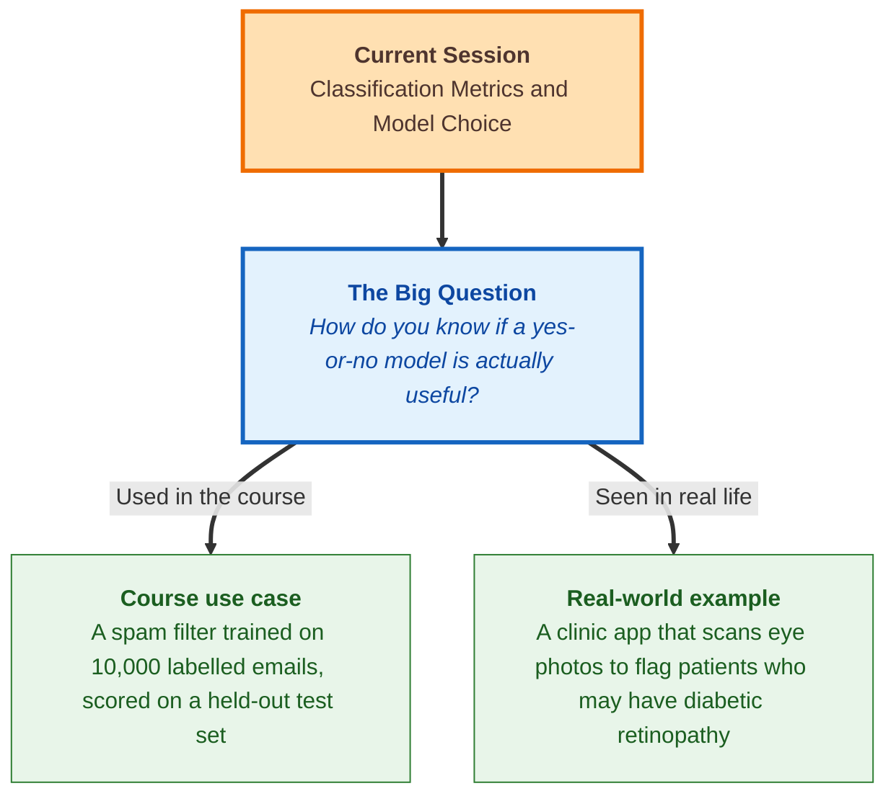

## <span style="color:#2F7DDE">Classification Metrics and Model Choice</span>

### <span style="color:#2F7DDE">Mental Map</span>



---

### <span style="color:#2F7DDE">What You'll Learn</span>

Have you ever wondered how a clinic app decides whether your eye photo shows a warning sign?

By the end of this session, you will be able to:

- <span style="color:#D9660B">**Describe**</span> what each wrong prediction costs a patient in a screening clinic.
- <span style="color:#D9660B">**Predict**</span> how the sick-catch and false-alarm balance shifts as the cutoff rises.
- <span style="color:#D9660B">**Explain**</span> why 95% accuracy can still leave every sick patient undetected.
- <span style="color:#D9660B">**Calculate**</span> three performance measures from the five-patient result table.
- <span style="color:#D9660B">**Compare**</span> two screening tools on a held-out set using one agreed number.
- <span style="color:#D9660B">**Build**</span> a two-by-two results table from five patient records, then name the prediction every tool must beat.

> <span style="color:#2F7DDE">**Topics you will meet:**</span> Confusion matrix; Cost of each error; Precision, recall and F1; Decision threshold; Accuracy on imbalanced data; Baseline model to beat; Comparing models on one metric.
>
> Join the session to learn each of these in detail.

---

### <span style="color:#2F7DDE">Why You Are Learning This Topic</span>

Imagine you work at a clinic where a new tool reads eye photographs. It labels each photo as disease found or healthy. You test it on 1,000 patients and it scores 97% correct. A nurse then shows you that only 30 patients had the disease — and the tool flagged none of them.

A <span style="color:#D9660B">**confusion matrix**</span> means a four-cell table that records each prediction outcome separately. It makes visible what a single accuracy number hides.

That table is a core skill in every classification task in this course.

> <span style="color:#2F7DDE">**Think about it:**</span> If a clinic tool never raises an alarm, what accuracy score would it earn? What would that number hide?

---

### <span style="color:#2F7DDE">The Eye-Screening Puzzle</span>

A pilot clinic ran its screening app on five patients. Here are the results.

| Patient | Actual result | App's prediction |
|---------|:-------------:|:----------------:|
| Yemi    | Healthy       | Healthy          |
| Priya   | Disease found | Disease found    |
| Carlos  | Healthy       | Disease found    |
| Lin     | Disease found | Healthy          |
| Ravi    | Healthy       | Healthy          |

<span style="color:#D9660B">**What you want to happen:**</span>

- Catch every sick patient, with no misses.
- Avoid sending healthy patients for unnecessary follow-up.
- Know which of two tools the clinic should trust more.

Here is how it might start. You do not need to understand it yet.

```python
predicted = ["disease", "healthy", "disease", "healthy", "healthy"]
actual    = ["disease", "disease", "healthy",  "disease", "healthy"]
print(sum(p == a for p, a in zip(predicted, actual)))
```

> <span style="color:#D9660B">**Wonder about this:**</span>
>
> - The table shows two wrong predictions. Which would worry a doctor more, and why?
> - If you wanted to catch more sick patients, what else in the table might also rise?

---

### <span style="color:#2F7DDE">Think It Through</span>

There is no wrong first try. Keep your guesses for the session.

**1. Find every patient the app called "disease found" who was actually healthy. What is that count?**
Hint: Look for rows where the app says "disease found" but the actual label says "healthy."

**2. If the app stamped every photo as "healthy," what accuracy score would it earn for these five patients?**
Hint: Count the actually-healthy rows — that total is what the app gets right.

**3. A second tool catches both sick patients but flags two healthy ones as sick. Is that an improvement?**
Hint: Think about which error type matters more to this clinic.

---

### <span style="color:#2F7DDE">One Question to Carry Into the Session</span>

> <span style="color:#2F7DDE">**If a screening tool scores 97% accurate, does that mean it is safe to use in a clinic?**</span>
>
> What else would you want to know before trusting it with a patient's health?
