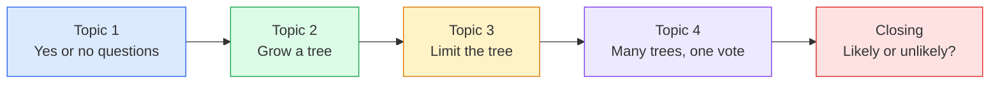
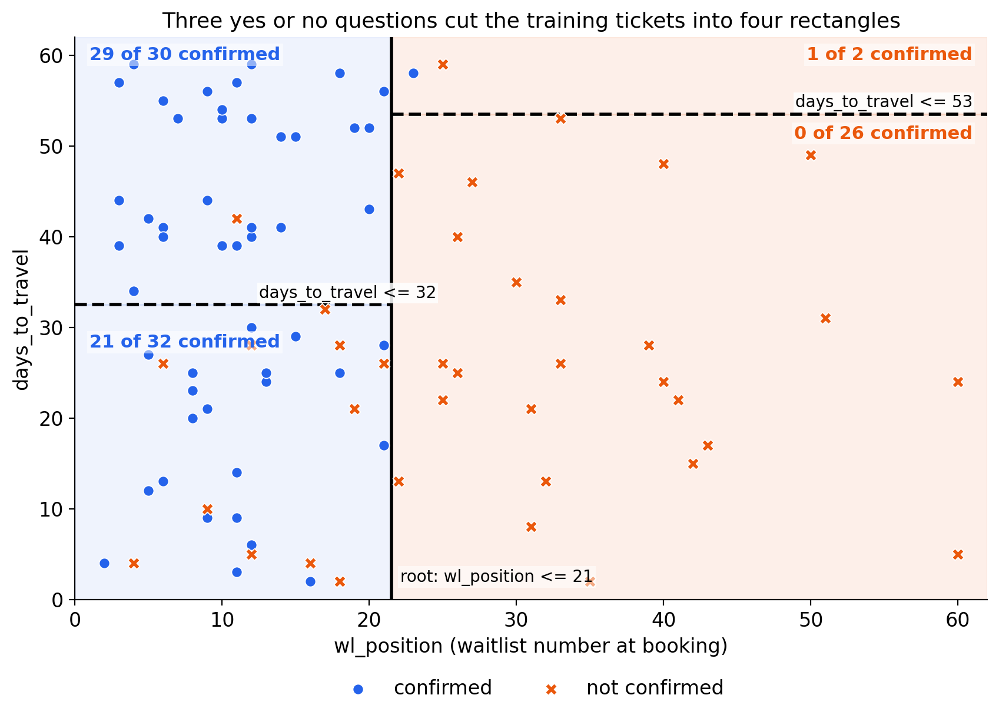
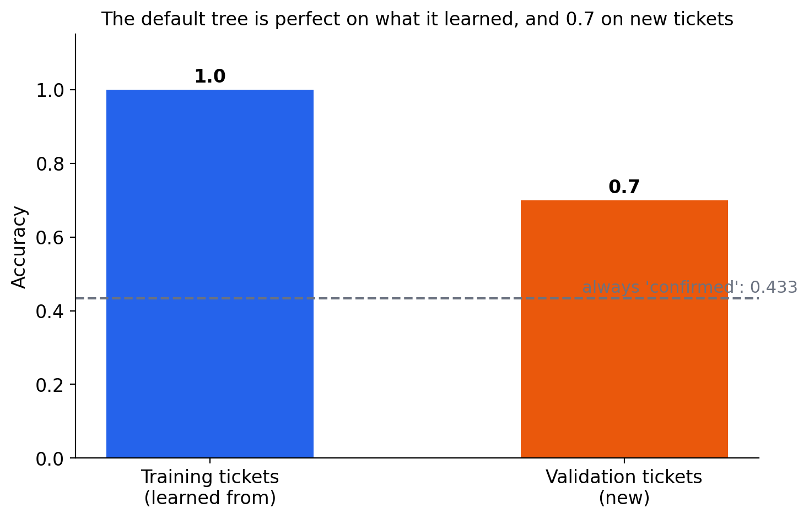
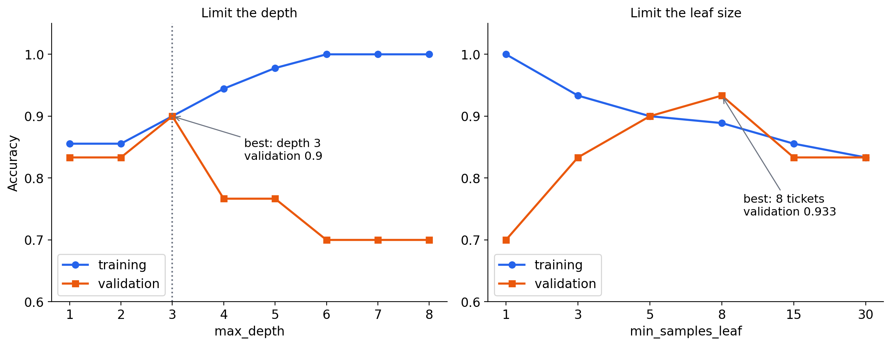
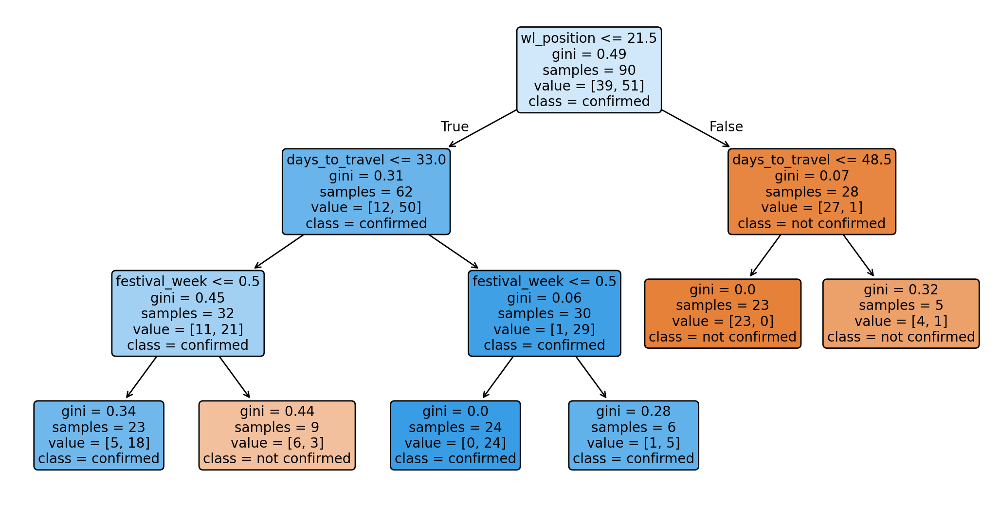
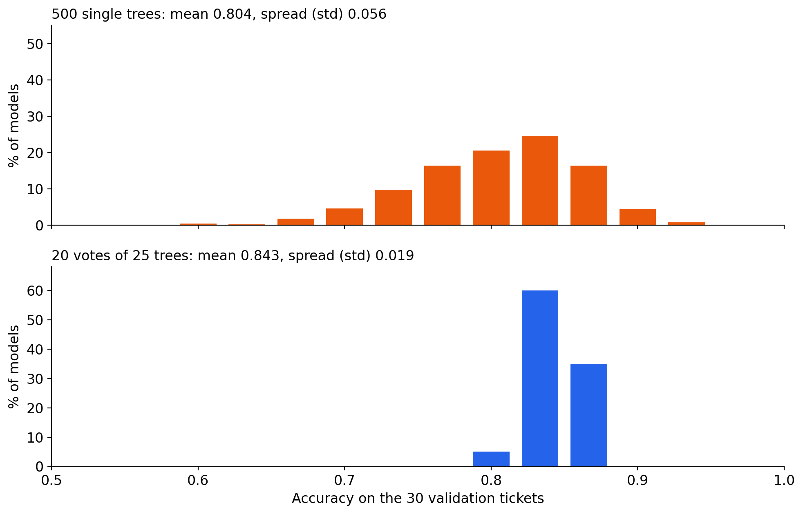
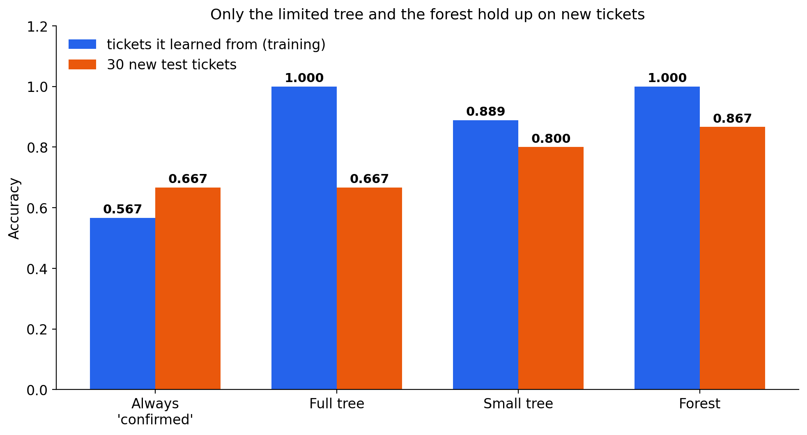

# <font color='#1d4ed8'>Lecture Script: Decision Trees and Random Forests</font>

---

## <font color='blue'>Agenda</font>

The lecture runs as four topics. Each topic ends with a quiz.

| Topic | What we do | Learning objectives covered | Minutes |
|:-:|:--|:--|:-:|
| 1 | Cut the tickets into regions with yes or no questions | Explain how a decision tree partitions the feature space through recursive binary splits | 25 |
| 2 | Grow a tree with scikit-learn | Train a decision tree classifier on a labelled tabular dataset | 20 |
| 3 | Limit the tree and name the settings | Configure depth and leaf-size constraints to limit the complexity of a decision tree<br>Compare a model parameter with a hyperparameter, naming which one fitting sets | 30 |
| 4 | Let many trees vote | Explain how bootstrap aggregation reduces the variance of a high-variance learner<br>Train a random forest classifier on a tabular dataset | 30 |
| — | Closing: Outcome & Summary | | 15 |
| | **Total** | | **120** |

> <font color="red">**🎯 Instructor Note**</font> Pace: in Topic 1 do the first split by hand slowly, then move quickly through the search and the second level. Topic 2 is a short fit. In Topic 3 spend the time on the depth and leaf-size tables; the parameter check is one short example.
> In Topic 4 spend about 15 minutes on the bootstrap and the swing numbers before fitting the forest.

---

## <font color='blue'>Scenario</font>

An IRCTC-style rail booking app sells waitlisted tickets when a train is full. Here is one ticket's life:

1. **At booking, 45 days before travel:** Rohan books a 3A ticket and is placed at waitlist position 18 (WL 18).
2. **In between:** other passengers cancel, and the waitlist moves up.
3. **Before the train leaves:** the final chart is prepared. Rohan's ticket either gets a seat or it does not.

The app must tell Rohan at booking time whether to relax or to book a backup. Rohan's ticket is our test ticket: WL 18, 45 days to travel, an ordinary week, an AC class, and 8 cancellations on that train in the last 7 days.

> <font color="red">**🎯 Instructor Note**</font> IRCTC is only the setting. Do not claim it uses this data; the 150 tickets in `data/waitlist_tickets.csv` and Rohan are invented for teaching.
> Learners need Python 3 with pandas 2 or later, numpy and scikit-learn 1.4 or later. Every split and model uses `random_state=42`, so every output matches.

---

## <font color='blue'>Problem Statement</font>

A friend told Karan, "A waitlist number of 20 or lower always confirms." He booked WL 15 for a festival week and made no backup plan. The ticket did not confirm, and he paid double for a last-minute bus seat. The rule looked at one clue and ignored the rest. In our 150 past tickets, 101 had WL 20 or lower; 21 of them (about 1 in 5) did not confirm, and 10 of those 21 were in festival weeks.

The team now wants a model that learns from the past tickets and tells every new passenger "likely" or "unlikely" at booking. They grew one decision tree until it got every one of the 90 tickets it learned from right. They also tried a smaller tree.

> <font color='purple'>**How do we turn past waitlisted tickets into yes or no questions that predict confirmation, and keep the answers right for tickets the model has never seen?**</font>

> <font color="red">**🎯 Instructor Note**</font> Poll: "Tree A is right on 100% of the tickets it learned from and 70% of new tickets. Tree B is right on 89% and 90%. Which do you trust for new bookings?" Give learners 30 seconds to respond in chat. Reveal the answer in the Closing.

---

## <font color='blue'>What We Will Use</font>

Everything the lecture needs, in one place. Each topic uses these terms without repeating them.

| Term | Meaning | In our tickets |
|:--|:--|:--|
| **Decision tree** | A model that asks a chain of yes or no questions about the columns and ends in an answer | "Is the waitlist number at most 21?" |
| **Split** | One yes or no question about one column, with a cut value | `wl_position <= 21` |
| **Binary, recursive** | Binary: each question has two answers. Recursive: the same step repeats inside each answer | ask again inside "yes" and inside "no" |
| **Feature space** | Every combination of column values; each ticket is one point in it | `wl_position` against `days_to_travel` |
| **Region, leaf** | A box of the feature space that the splits cut out, and the end of its path, where the tree gives a class | confirmed or not confirmed |
| **Gini impurity** | How mixed a group is: 0 for a group of one class, 0.5 for an even mix of two classes | $G$ |
| **Parameter** | A number or rule that fitting sets from the training data | the questions and cuts of a fitted tree |
| **Hyperparameter** | A setting we choose before fitting; fitting never changes it | `max_depth`, `min_samples_leaf` |
| **Bootstrap sample** | $n$ rows drawn at random, with repeats, from the $n$ training rows | a resample of the 90 training tickets |
| **Bagging** | Bootstrap aggregation: grow one model on each bootstrap sample and combine their answers by vote | many trees, one vote |
| **Variance** | How much a model's answers change when its training tickets change | the swing of a tree |
| **Random forest** | Bagged trees where each split may look at only a random few of the columns | `RandomForestClassifier` |
| `DecisionTreeClassifier`, `fit`, `predict`, `predict_proba`, `score`, `export_text` | The scikit-learn tools: build a tree, learn it, give a class, give chances, give accuracy, print its questions | `tree.fit(X_train, y_train)` |

Our columns: `wl_position` (waitlist number at booking), `days_to_travel` (days between booking and travel), `festival_week` (1 = a festival week), `ac_class` (1 = an AC class such as 3A, 0 = a non-AC class), `cancellations_7d` (cancellations on that train in the last 7 days). The target is `confirmed`: 1 = the ticket got a seat, 0 = it did not. Confirmed is the positive class.

The two scores a split is judged by, with $p$ the share of confirmed tickets in a group, $n_L$ and $n_R$ the tickets that answer yes and no, and $n = n_L + n_R$:

$$\boxed{G = 1 - p^2 - (1 - p)^2} \qquad \boxed{G_{\text{split}} = \frac{n_L}{n}\,G_L + \frac{n_R}{n}\,G_R}$$

---

## <font color='blue'>How: Walking Through the Waitlist Model</font>



---

## <font color='blue'>Topic 1: Cut the Tickets into Regions with Yes or No Questions</font> `25 min`

In the logistic regression session you turned a weighted score into a chance of fraud, and last session you judged classifiers by accuracy, precision and a baseline. A decision tree also gives a yes or no answer, but by a different route: it asks questions about the columns, one after another. Today the answer is whether a waitlisted ticket will confirm.

> <font color='purple'>**We have past waitlisted tickets, each marked confirmed or not. Which yes or no question about a ticket separates the confirmed ones from the rest best?**</font>

### <font color='green'>Example: look at the tickets and keep some aside</font>

> <font color='purple'>**What does one row of the data look like, and how many tickets confirmed?**</font>

**Predict before running: What will happen?**

> <font color="red">**🎯 Instructor Note**</font> Expected: 150 rows and 7 columns, with 84 confirmed and 66 not confirmed. Common guess: learners forget the ticket id is a column.

```python
import pandas as pd

df = pd.read_csv("data/waitlist_tickets.csv")
print(df.shape)
print(df.head(5).to_string())
print(df["confirmed"].value_counts())
```

**Output**

```
(150, 7)
  ticket_id  wl_position  days_to_travel  festival_week  ac_class  cancellations_7d  confirmed
0      T001           15              53              0         0                 4          1
1      T002           12               6              0         1                11          1
2      T003           12              41              0         1                 0          1
3      T004            6              13              0         0                10          1
4      T005           11              51              0         0                 4          1
confirmed
1    84
0    66
Name: count, dtype: int64
```

#### <font color='#c2410c'>Code Explanation</font>

- **Line 1** Loads pandas, which reads tables.
- **Line 3** Reads the ticket file into a table called `df`.
- **Line 4** Prints the size as (rows, columns).
- **Line 5** Shows the first 5 tickets as a full table.
- **Line 6** Counts how many tickets carry each value of `confirmed`.

> <font color='green'>**Result**</font> Each row is one waitlisted ticket with five columns of clues and a target, `confirmed`. Of the 150 tickets, 84 got a seat and 66 did not.

> <font color='purple'>**Which tickets may the tree learn from, and which must it never see while learning?**</font>

You split data three ways in the ML workflow session. Do the same here: the training tickets to learn from, the validation tickets to choose settings, the test tickets for the final report.

**Predict before running: What will happen?**

> <font color="red">**🎯 Instructor Note**</font> Expected: 90 training, 30 validation and 30 test tickets (60%, 20%, 20%). Training holds 51 confirmed and 39 not confirmed.

```python
from sklearn.model_selection import train_test_split

features = ["wl_position", "days_to_travel", "festival_week", "ac_class", "cancellations_7d"]
X, y = df[features], df["confirmed"]
X_train, X_rest, y_train, y_rest = train_test_split(X, y, test_size=0.4, random_state=42)
X_val, X_test, y_val, y_test = train_test_split(X_rest, y_rest, test_size=0.5, random_state=42)
train = X_train.assign(confirmed=y_train)
print(len(X_train), len(X_val), len(X_test))
print(y_train.value_counts())
```

**Output**

```
90 30 30
confirmed
1    51
0    39
Name: count, dtype: int64
```

#### <font color='#c2410c'>Code Explanation</font>

- **Line 3** Lists the five clue columns.
- **Line 4** `X` is the clue columns as a table and `y` is the target.
- **Line 5** Sets 40% of the tickets aside, with a fixed seed.
- **Line 6** Splits that 40% in half: validation and test.
- **Line 7** Joins the clues and the target for the training tickets, so we can count both together.
- **Lines 8 and 9** Print the three sizes and the class counts in training.

> <font color='green'>**Result**</font> The tree will learn from 90 tickets. The 30 validation and 30 test tickets stay hidden until we judge a model.

### <font color='green'>Extending it: one question by hand</font>

> <font color='purple'>**If we ask "Is the waitlist number at most 15?", how well does the answer separate confirmed from not confirmed?**</font>

A good question leaves each answer group mostly one class, so we score it with the Gini impurity $G$ from What We Will Use. All 90 training tickets: $p = \dfrac{51}{90} = 0.5667$, so $G = 1 - 0.5667^2 - 0.4333^2 = 0.4911$.

**Predict before running: What will happen?**

> <font color="red">**🎯 Instructor Note**</font> Expected: 47 tickets answer yes (41 confirmed) and 43 answer no (10 confirmed). Ask which group is cleaner. Expected: the yes group.

```python
def gini(y):
    p = y.mean()
    return 1 - p**2 - (1 - p) ** 2

left = train[train["wl_position"] <= 15]
right = train[train["wl_position"] > 15]
print(len(left), left["confirmed"].sum(), len(right), right["confirmed"].sum())
print(round(gini(train["confirmed"]), 4), round(gini(left["confirmed"]), 4), round(gini(right["confirmed"]), 4))
print(round((len(left) * gini(left["confirmed"]) + len(right) * gini(right["confirmed"])) / len(train), 4))
```

**Output**

```
47 41 43 10
0.4911 0.2227 0.3569
0.2869
```

#### <font color='#c2410c'>Code Explanation</font>

- **Lines 1 to 3** `gini` takes a column of 0s and 1s, finds the share of 1s, and returns the impurity.
- **Lines 5 and 6** Split the training tickets by the question: yes (WL 15 or lower) goes left, no goes right.
- **Line 7** Prints the size of each group and how many of its tickets confirmed.
- **Line 8** Prints the impurity of all tickets, the left group and the right group.
- **Line 9** Prints the weighted impurity of the split: each group's impurity times its share of the tickets.

By hand: the yes group has 41 confirmed and 6 not confirmed out of 47, so $G_L = 1 - \dfrac{41^2 + 6^2}{47^2} = \dfrac{492}{2209} = 0.2227$. The no group has 10 confirmed and 33 not confirmed out of 43, so $G_R = 1 - \dfrac{10^2 + 33^2}{43^2} = \dfrac{660}{1849} = 0.3569$. The score of the whole split weighs each group by its share of the tickets:

$$G_{\text{split}} = \frac{47}{90}(0.22272) + \frac{43}{90}(0.35695) = 0.11631 + 0.17054 = 0.28685 \approx 0.2869$$

> <font color='green'>**Result**</font> The question "WL at most 15?" lowers the impurity from 0.4911 to 0.2869. A lower score means cleaner groups. It is a good question, but is it the best one?

### <font color='green'>Extending it: search every question</font>

> <font color='purple'>**Which cut on which column gives the lowest score?**</font>

> <font color="red">**🎯 Instructor Note**</font> Ask which column will win and whether its cut will be 15. Give learners 30 seconds to respond in chat. Expected: `wl_position`, with a cut near 21.

```python
def split_score(d, f, t):
    l, r = d[d[f] <= t], d[d[f] > t]
    return (len(l) * gini(l["confirmed"]) + len(r) * gini(r["confirmed"])) / len(d)

for f in features:
    cuts = sorted(train[f].unique())[:-1]
    t = min(cuts, key=lambda c: split_score(train, f, c))
    print(f, "<=", t, round(split_score(train, f, t), 4))
```

**Output**

```
wl_position <= 21 0.2365
days_to_travel <= 49 0.4335
festival_week <= 0 0.4752
ac_class <= 0 0.4875
cancellations_7d <= 13 0.4719
```

#### <font color='#c2410c'>Code Explanation</font>

- **Lines 1 to 3** `split_score` is the weighted impurity $G_{\text{split}}$ from What We Will Use, for any group `d`, column `f` and cut `t`.
- **Line 5** Takes each column in turn.
- **Line 6** Lists every value in that column except the largest, so both answers always hold tickets.
- **Line 7** Keeps the cut with the lowest score.
- **Line 8** Prints the column, its best cut and the score.

> <font color='green'>**Result**</font> Each column's best question is listed. `wl_position <= 21` has the lowest score, 0.2365, so it beats our guess of 15 (0.2869) and every other column. For a yes or no column such as `festival_week`, the only cut is `<= 0`.

> <font color='#b45309'>**Common mistake**</font> Choosing the cut by eye, or stopping at the first good column. The tree tries every cut on every column and keeps the lowest score.

### <font color='green'>Extending it: ask again inside each answer</font>

> <font color='purple'>**What if we repeat the same search inside the "yes" group and inside the "no" group?**</font>

> <font color="red">**🎯 Instructor Note**</font> Ask: "Will both groups ask the same second question?" Give learners 30 seconds to respond in chat. Expected: the same column, but with different cuts.

```python
def best_split(d):
    cands = [(f, t) for f in features for t in sorted(d[f].unique())[:-1]]
    return min(cands, key=lambda c: split_score(d, *c))

f, t = best_split(train)
print("root:", f, "<=", t)
for name, part in (("yes", train[train[f] <= t]), ("no", train[train[f] > t])):
    f2, t2 = best_split(part)
    print(name, len(part), "tickets ->", f2, "<=", t2)
```

**Output**

```
root: wl_position <= 21
yes 62 tickets -> days_to_travel <= 32
no 28 tickets -> days_to_travel <= 53
```

#### <font color='#c2410c'>Code Explanation</font>

- **Lines 1 to 3** `best_split` tries every column and every cut in a group and returns the best pair.
- **Line 5** Finds the best question for all 90 training tickets: the root.
- **Line 6** Prints the root question.
- **Lines 7 to 9** Run the same search inside the yes group and inside the no group, and print each group's size and its best question.

#### <font color='#c2410c'>Logic Explanation</font>

- Each question has two answers, so every split is **binary**. Asking again inside each answer is **recursion**.
- Three questions cut the plane of waitlist number and days to travel into four boxes. In order of the chart: 32 tickets with WL 21 or lower and 32 days or fewer (21 confirmed), 30 tickets with WL 21 or lower and more than 32 days (29 confirmed), 26 tickets with WL above 21 and 53 days or fewer (none confirmed), and 2 tickets with WL above 21 and more than 53 days (1 confirmed).
- Every box is a rectangle with sides parallel to the axes, because each question looks at one column.

<p align="center"></p>

> <font color='green'>**Result**</font> Three yes or no questions cut the feature space into four rectangles, and the tickets in each rectangle are mostly one class. This is how a tree partitions the feature space through recursive binary splits.

### <font color='purple'>Quiz 1</font>

**Question:** A tree asks "`wl_position <= 21`?" at the root and then asks one more question, "`days_to_travel <= 32`?", only inside the yes group. Into how many regions has it cut the feature space, and what do they look like?

**Options:**
- A) 2 regions, because the second question only relabels the yes group
- B) 3 regions, each a rectangle with sides parallel to the axes
- C) 4 regions, because every question doubles the number of regions
- D) 3 regions, separated by a slanted line that mixes the two columns

**Correct Answer:** B

**Explanation:**
- **A)** Wrong: the second question cuts the yes group into two boxes, so the count goes up by one.
- **B)** Correct: the root makes 2 regions, and the second question cuts one of them in two, giving 3. Each question reads one column, so each border is parallel to an axis.
- **C)** Wrong: a question cuts only the group it is asked in. Here the no group is left whole, so there are 3 regions, not 4.
- **D)** Wrong: a split looks at one column at a time, so a border is never slanted.

---

## <font color='blue'>Topic 2: Grow a Tree with scikit-learn</font> `20 min`

> <font color='purple'>**We found three questions by hand. Can scikit-learn keep asking until the groups are pure, and how right is that tree on tickets it has not seen?**</font>

### <font color='green'>Example: fit a decision tree</font>

> <font color='purple'>**How accurate is a tree that grows until every group is pure, on the tickets it learned and on the validation tickets?**</font>

`fit` repeats the search from Topic 1 inside every group, until each group holds one class or cannot be split. We keep the default settings.

**Predict before running: What will happen?**

> <font color="red">**🎯 Instructor Note**</font> Expected: 1.0 on training and 0.7 on validation; depth 6 and 15 leaves. Common guess: learners expect both scores to be high.

```python
from sklearn.tree import DecisionTreeClassifier, export_text

tree = DecisionTreeClassifier(random_state=42)
tree.fit(X_train, y_train)
print(tree.score(X_train, y_train), tree.score(X_val, y_val))
print(tree.get_depth(), tree.get_n_leaves())
print(round(y_val.mean(), 3))
```

**Output**

```
1.0 0.7
6 15
0.433
```

#### <font color='#c2410c'>Code Explanation</font>

- **Line 1** Loads the tree classifier and a tool that prints a tree as text.
- **Line 3** Builds a tree with the default settings. `random_state=42` fixes how ties between equal questions are settled.
- **Line 4** Fits the tree on the training tickets only.
- **Line 5** Prints the accuracy on the training tickets and on the validation tickets.
- **Line 6** Prints how many questions are asked in a row at most (depth) and how many leaves the tree has.
- **Line 7** Prints the share of confirmed tickets in validation, which is also the accuracy of a predictor that always says "confirmed".

> <font color='green'>**Result**</font> The tree is right on every training ticket (1.0) but on only 21 of the 30 validation tickets (0.7). Always saying "confirmed" scores 0.433, so the tree does beat the baseline, but the gap between 1.0 and 0.7 is the overfitting signature from the rent session.

<p align="center"></p>

### <font color='green'>Extending it: read the questions the tree asked</font>

> <font color='purple'>**Does the tree's first question match the one we found by hand?**</font>

> <font color="red">**🎯 Instructor Note**</font> Ask: "Which question will be at the top?" Give learners 30 seconds to respond in chat. Expected: `wl_position`, with a cut of 21.5.

```python
print(export_text(tree, feature_names=features, max_depth=2))
```

**Output**

```
|--- wl_position <= 21.50
|   |--- days_to_travel <= 33.00
|   |   |--- festival_week <= 0.50
|   |   |   |--- truncated branch of depth 4
|   |   |--- festival_week >  0.50
|   |   |   |--- truncated branch of depth 3
|   |--- days_to_travel >  33.00
|   |   |--- festival_week <= 0.50
|   |   |   |--- class: 1
|   |   |--- festival_week >  0.50
|   |   |   |--- truncated branch of depth 2
|--- wl_position >  21.50
|   |--- days_to_travel <= 55.50
|   |   |--- class: 0
|   |--- days_to_travel >  55.50
|   |   |--- days_to_travel <= 58.50
|   |   |   |--- class: 1
|   |   |--- days_to_travel >  58.50
|   |   |   |--- class: 0
```

#### <font color='#c2410c'>Code Explanation</font>

- **Line 1** Prints the tree as indented questions. `max_depth=2` shows the top two levels and replaces deeper branches with "truncated branch".

> <font color='green'>**Result**</font> The root is `wl_position <= 21.50`, the same partition we found by hand. scikit-learn writes the cut halfway between two neighbouring values (21 and 22), so the same tickets fall on each side. One level down, 33.00 and 55.50 give the same groups as our cuts of 32 and 53, because no training ticket in those groups lies between the two values. Each line reads as a question, and "class: 1" is a leaf that says confirmed.

### <font color='green'>Extending it: predict a new ticket</font>

> <font color='purple'>**What does the tree say about Rohan's ticket: WL 18, 45 days to travel, an ordinary week, an AC class and 8 recent cancellations?**</font>

> <font color="red">**🎯 Instructor Note**</font> Ask what chance of confirming the tree will give. Expected: class 1 with a chance of exactly 1.0, because the leaf holds training tickets of one class only.

```python
rohan = pd.DataFrame([[18, 45, 0, 1, 8]], columns=features)
print(tree.predict(rohan), tree.predict_proba(rohan))
```

**Output**

```
[1] [[0. 1.]]
```

#### <font color='#c2410c'>Code Explanation</font>

- **Line 1** Builds one row with the five columns of Rohan's ticket, in the same order as `features`.
- **Line 2** Prints the predicted class, and the chance of each class in the order of `classes_`: not confirmed, then confirmed.

> <font color='green'>**Result**</font> The tree predicts confirmed, with a chance of 1.0. Following the printed questions, Rohan's ticket ends in a leaf of training tickets that all confirmed. A chance of exactly 1.0 from 90 tickets is too sure.

> <font color='#b45309'>**Common mistake**</font> Reading the training accuracy as the model's quality. Always judge a tree on tickets it did not learn from.

### <font color='purple'>Quiz 2</font>

**Question:** The tree with default settings scores 1.0 on the training tickets and 0.7 on the validation tickets. What is the best reading?

**Options:**
- A) It is the best possible model, because 1.0 shows it will be right on new tickets
- B) The validation tickets must be mislabelled
- C) The tree stopped too early and needs more depth
- D) The tree kept splitting until every group was pure, so it memorised the training tickets, noise included

**Correct Answer:** D

**Explanation:**
- **A)** Wrong: training accuracy only measures tickets the tree already saw. The new tickets give 0.7.
- **B)** Wrong: nothing suggests bad labels; the gap is the usual sign of a model that has memorised its training data.
- **C)** Wrong: the tree already grew to depth 6 with 15 leaves and could not split further. Stopping later is the opposite of what it needs.
- **D)** Correct: `fit` splits until every leaf is pure, which fits the quirks of the 90 training tickets and leaves a 0.3 gap to validation.

---

## <font color='blue'>Topic 3: Limit the Tree and Name the Settings</font> `30 min`

In the rent session you tamed an overfit model with a penalty. A tree has no penalty, so we limit how large it may grow instead.

> <font color='purple'>**The full tree memorised the training tickets. Which limits on its size make it right on new tickets?**</font>

### <font color='green'>Example: limit the depth</font>

> <font color='purple'>**How do training and validation accuracy move as we allow more questions in a row?**</font>

`max_depth` is the most questions a ticket may be asked in a row. A tree of depth $d$ has at most $2^d$ leaves.

**Predict before running: What will happen?**

> <font color="red">**🎯 Instructor Note**</font> Expected: training accuracy rises to 1.0 and stays; validation accuracy peaks at depth 3 (0.9) and then falls to 0.7. Common guess: deeper is always better.

```python
print("depth leaves train val")
for d in range(1, 9):
    m = DecisionTreeClassifier(max_depth=d, random_state=42).fit(X_train, y_train)
    print(d, m.get_n_leaves(), round(m.score(X_train, y_train), 3), round(m.score(X_val, y_val), 3))
```

**Output**

```
depth leaves train val
1 2 0.856 0.833
2 4 0.856 0.833
3 7 0.9 0.9
4 10 0.944 0.767
5 13 0.978 0.767
6 15 1.0 0.7
7 15 1.0 0.7
8 15 1.0 0.7
```

#### <font color='#c2410c'>Code Explanation</font>

- **Line 1** Prints the column names.
- **Line 2** Tries each depth limit from 1 to 8.
- **Line 3** Fits a tree with that limit on the training tickets.
- **Line 4** Prints the depth limit, the number of leaves, and the accuracy on training and validation tickets.

> <font color='green'>**Result**</font> Depth 3 gives the best validation accuracy, 0.9 (27 of 30 tickets), with 7 leaves. Deeper trees fit the training tickets better and the validation tickets worse. From depth 6 the tree stops growing, because every leaf is already pure.

<p align="center"></p>

### <font color='green'>Extending it: limit the leaf size</font>

> <font color='purple'>**What if we do not limit the depth, but require every leaf to hold a minimum number of tickets?**</font>

> <font color="red">**🎯 Instructor Note**</font> Ask: "What happens to the number of leaves as the minimum rises?" Give learners 30 seconds to respond in chat. Expected: it falls, from 15 down to 2.

```python
print("min_leaf leaves train val")
for s in (1, 3, 5, 8, 15, 30):
    m = DecisionTreeClassifier(min_samples_leaf=s, random_state=42).fit(X_train, y_train)
    print(s, m.get_n_leaves(), round(m.score(X_train, y_train), 3), round(m.score(X_val, y_val), 3))
```

**Output**

```
min_leaf leaves train val
1 15 1.0 0.7
3 12 0.933 0.833
5 8 0.9 0.9
8 7 0.889 0.933
15 5 0.856 0.833
30 2 0.833 0.833
```

#### <font color='#c2410c'>Code Explanation</font>

- **Line 2** Tries six values of `min_samples_leaf`, the fewest training tickets a leaf may hold. The default is 1.
- **Line 3** Fits a tree with that limit.
- **Line 4** Prints the limit, the leaves, and the two accuracies.

> <font color='green'>**Result**</font> With a minimum of 1 a leaf can hold a single memorised ticket, and the tree has 15 leaves. Raising the minimum merges those tiny leaves. Validation accuracy rises to 0.933 at 8 tickets, then falls to 0.833 when the leaves are too large to separate the classes.

### <font color='green'>Extending it: use both limits together</font>

> <font color='purple'>**What if we cap the depth at 3 and also require 5 tickets in every leaf?**</font>

> <font color="red">**🎯 Instructor Note**</font> Validation has 30 tickets, so one ticket is 0.033. Do not chase the last point: pick a small, steady tree. We use validation to choose; the test tickets stay unused until the Closing.

```python
small = DecisionTreeClassifier(max_depth=3, min_samples_leaf=5, random_state=42)
small.fit(X_train, y_train)
print(round(small.score(X_train, y_train), 3), round(small.score(X_val, y_val), 3), small.get_n_leaves())
```

**Output**

```
0.889 0.9 6
```

#### <font color='#c2410c'>Code Explanation</font>

- **Line 1** Builds a tree with both limits.
- **Line 2** Fits it on the training tickets.
- **Line 3** Prints the training accuracy, the validation accuracy and the number of leaves.

> <font color='green'>**Result**</font> The small tree has 6 leaves. It is right on 0.889 of the training tickets and 0.9 of the validation tickets, so the gap is gone. Compare with the full tree: 1.0 and 0.7.

<p align="center"></p>

> <font color='#b45309'>**Common mistake**</font> Choosing the limits on the test tickets. Then the test accuracy is no longer an honest report. Choose on validation, report once on test.

### <font color='green'>Example: what fitting sets and what we set</font>

> <font color='purple'>**In the small tree, which numbers did we choose, and which numbers did `fit` find?**</font>

In the rent session you chose the penalty strength $\alpha$ for Ridge, and fitting found the coefficients. A tree has the same two kinds of number.

**Predict before running: What will happen?**

> <font color="red">**🎯 Instructor Note**</font> Expected: before `fit` the limits 3 and 5 exist but the tree has no questions (`False`); after `fit` it has them (`True`) and the printed questions and cuts appear.

```python
fresh = DecisionTreeClassifier(max_depth=3, min_samples_leaf=5, random_state=42)
print(fresh.get_params()["max_depth"], fresh.get_params()["min_samples_leaf"], hasattr(fresh, "tree_"))
fresh.fit(X_train, y_train)
print(hasattr(fresh, "tree_"))
print(export_text(fresh, feature_names=features))
```

**Output**

```
3 5 False
True
|--- wl_position <= 21.50
|   |--- days_to_travel <= 33.00
|   |   |--- festival_week <= 0.50
|   |   |   |--- class: 1
|   |   |--- festival_week >  0.50
|   |   |   |--- class: 0
|   |--- days_to_travel >  33.00
|   |   |--- festival_week <= 0.50
|   |   |   |--- class: 1
|   |   |--- festival_week >  0.50
|   |   |   |--- class: 1
|--- wl_position >  21.50
|   |--- days_to_travel <= 48.50
|   |   |--- class: 0
|   |--- days_to_travel >  48.50
|   |   |--- class: 0
```

#### <font color='#c2410c'>Code Explanation</font>

- **Line 1** Builds a new, unfitted tree with both limits.
- **Line 2** Reads the two limits back, and checks whether a fitted tree structure (`tree_`) exists yet.
- **Line 3** Fits the tree.
- **Line 4** Checks again whether a fitted tree structure exists.
- **Line 5** Prints every question, cut and leaf class that `fit` found.

#### <font color='#c2410c'>Logic Explanation</font>

| | Hyperparameter | Parameter |
|:--|:--|:--|
| Who sets it | We do, before `fit` | `fit`, from the training tickets |
| In our tree | `max_depth=3`, `min_samples_leaf=5` | each question and cut, such as `wl_position <= 21.50`, and the class of each leaf |
| In the rent session | the Ridge penalty strength $\alpha$ | the coefficients |
| What happens with new training tickets | unchanged | `fit` finds new ones |

> <font color='green'>**Result**</font> Fitting sets the parameters: the questions, the cuts and the leaf classes. We set the hyperparameters, `max_depth` and `min_samples_leaf`, before fitting, and we choose them on the validation tickets. Some neighbouring leaves share a class, as on the right of the printed tree: the tree still splits when a cut makes the groups purer, even if the answer stays the same.

### <font color='green'>Extending it: sort five names</font>

> <font color='purple'>**Which of these is a parameter, and which is a hyperparameter: `max_depth`, the cut 21.5 in the root question, `min_samples_leaf`, the class at the end of a path, and the Ridge $\alpha$?**</font>

> <font color="red">**🎯 Instructor Note**</font> Poll: "Parameter or hyperparameter?" for each name. Give learners 30 seconds to respond in chat. Expected: hyperparameter, parameter, hyperparameter, parameter, hyperparameter.

#### <font color='#c2410c'>Logic Explanation</font>

- `max_depth` and `min_samples_leaf` are typed by us before `fit`: hyperparameters.
- The cut 21.5 and the class at a leaf come out of `fit`, from the training tickets: parameters.
- The Ridge $\alpha$ was typed by us: a hyperparameter. The Ridge coefficients came out of `fit`: parameters.

> <font color='green'>**Result**</font> A quick test: if you type it before `fit` and `fit` never changes it, it is a hyperparameter. If it appears only after `fit`, it is a parameter.

### <font color='purple'>Quiz 3</font>

**Question:** A tree with default settings has 15 leaves and scores 1.0 on training tickets and 0.7 on validation tickets. Which choice limits its complexity?

**Options:**
- A) `max_depth=3` with `min_samples_leaf=5`: fewer, larger leaves, so training accuracy falls a little and validation accuracy rises
- B) `max_depth=20`: allows a deeper tree, a looser limit that cannot make the tree simpler
- C) `min_samples_leaf=1`: the default, which lets a leaf hold a single ticket
- D) Add depth until training accuracy is 1.0, because a tree that fits its tickets perfectly is the least complex

**Correct Answer:** A

**Explanation:**
- **A)** Correct: with both limits the tree has 6 leaves, and the scores become 0.889 on training and 0.9 on validation.
- **B)** Wrong: a larger depth limit is a looser limit. This tree stopped at depth 6 on its own, so nothing changes.
- **C)** Wrong: a minimum of 1 is the loosest leaf limit; it is what produced the 15 leaves.
- **D)** Wrong: a perfect fit on the training tickets comes from the most complex tree, not the simplest.

---

## <font color='blue'>Topic 4: Let Many Trees Vote</font> `30 min`

> <font color='purple'>**Limiting the tree stopped it memorising. A full tree is also unsteady: change the training tickets a little and its answers change. How much, and can many trees fix that without cutting them down?**</font>

### <font color='green'>Example: a bootstrap sample</font>

> <font color='purple'>**What if we draw 90 tickets from the 90 training tickets, with repeats allowed?**</font>

A bootstrap sample draws $n$ rows from $n$ rows, one at a time, putting each row back after it is drawn. A given row is missed in all $n$ draws with chance $\left(1 - \frac{1}{n}\right)^n$, so the share of different rows in the sample is

$$\boxed{1 - \left(1 - \frac{1}{n}\right)^{n}} \;\approx\; 1 - e^{-1} \approx 0.632 \quad (n \text{ large}), \qquad 1 - \left(\tfrac{89}{90}\right)^{90} = 0.634 \quad (n = 90)$$

**Predict before running: What will happen?**

> <font color="red">**🎯 Instructor Note**</font> Ask: "How many different tickets are in a sample of 90?" Expected: about 58 (a share near 0.63), not 90. Common guess: learners say 90.

```python
boot = train.sample(frac=1, replace=True, random_state=0)
print(len(boot), boot.index.nunique())
print(round(boot.index.nunique() / len(train), 3))
```

**Output**

```
90 58
0.644
```

#### <font color='#c2410c'>Code Explanation</font>

- **Line 1** Draws as many rows as the training set holds (`frac=1`), with repeats (`replace=True`).
- **Line 2** Prints the number of rows drawn and the number of different tickets among them.
- **Line 3** Prints the share of different tickets.

> <font color='green'>**Result**</font> The sample has 90 rows but only 58 different tickets (0.644), close to the 0.634 we expected. The rest are repeats. About a third of the tickets are left out, so every bootstrap sample is a slightly different version of the training set.

> <font color='#b45309'>**Common mistake**</font> Thinking a bootstrap sample is smaller. It has the same number of rows; only about 63% of them are different tickets.

### <font color='green'>Extending it: grow trees on bootstrap samples and vote</font>

> <font color='purple'>**If each of 25 full trees learns from its own bootstrap sample, how good is one tree, and how good is their vote?**</font>

**Predict before running: What will happen?**

> <font color="red">**🎯 Instructor Note**</font> Expected: single trees differ a lot (about 0.67 to 0.9) and the vote scores 0.867. Ask whether the vote beats every single tree. Expected: no, but it beats most of them.

```python
import numpy as np
def grow(i):
    b = train.sample(frac=1, replace=True, random_state=i)
    return DecisionTreeClassifier(random_state=42).fit(b[features], b["confirmed"])
trees = [grow(i) for i in range(25)]
P = np.array([t.predict(X_val) for t in trees])
acc = (P == y_val.values).mean(axis=1)
vote = (P.mean(axis=0) > 0.5).astype(int)
print(acc.mean().round(3), acc.min().round(3), acc.max().round(3), (vote == y_val.values).mean().round(3))
```

**Output**

```
0.809 0.667 0.9 0.867
```

#### <font color='#c2410c'>Code Explanation</font>

- **Line 1** Loads numpy, a library for number arrays.
- **Lines 2 to 4** `grow(i)` draws bootstrap sample number `i` and fits a full tree on it.
- **Line 5** Grows 25 trees, each on its own sample.
- **Line 6** Collects every tree's predictions for the 30 validation tickets: 25 rows, 30 columns.
- **Line 7** Finds each tree's validation accuracy.
- **Line 8** Takes the vote: if more than half of the 25 trees say 1, the answer is 1.
- **Line 9** Prints the mean, the lowest and the highest single-tree accuracy, and the accuracy of the vote.

> <font color='green'>**Result**</font> Single trees range from 0.667 to 0.9, with a mean of 0.809. The vote scores 0.867, better than the average tree, though not better than the best one. Bagging means exactly this: bootstrap samples, one tree each, one vote.

### <font color='green'>Extending it: how much does one tree swing, and how much does a vote?</font>

> <font color='purple'>**If we repeat this many times, how widely do single trees and 25-tree votes vary?**</font>

> <font color="red">**🎯 Instructor Note**</font> Ask: "Which will vary less, a single tree or a vote of 25?" Give learners 30 seconds to respond in chat. Expected: the vote. Standard deviation is the spread; variance is its square.

```python
trees = [grow(i) for i in range(500)]
P = np.array([t.predict(X_val) for t in trees])
single = (P == y_val.values).mean(axis=1)
bags = [((P[k:k + 25].mean(axis=0) > 0.5) == y_val.values).mean() for k in range(0, 500, 25)]
print("single", single.mean().round(3), single.std().round(3), single.min().round(3), single.max().round(3))
print("votes ", np.mean(bags).round(3), np.std(bags).round(3), np.min(bags).round(3), np.max(bags).round(3))
```

**Output**

```
single 0.804 0.056 0.6 0.933
votes  0.843 0.019 0.8 0.867
```

#### <font color='#c2410c'>Code Explanation</font>

- **Line 1** Grows 500 full trees, each on its own bootstrap sample.
- **Line 2** Collects all their predictions for the validation tickets.
- **Line 3** Finds the validation accuracy of each of the 500 single trees.
- **Line 4** Splits the trees into 20 groups of 25, takes each group's vote and finds its accuracy.
- **Lines 5 and 6** Print the mean, the standard deviation, the lowest and the highest accuracy, for single trees and for votes.

#### <font color='#c2410c'>Logic Explanation</font>

- A full tree follows the quirks of its own training sample, so it has high variance: its answers change a lot when the sample changes.
- If $B$ models each have variance $\sigma^2$ and make independent errors, their average has variance

$$\boxed{\operatorname{Var}(\bar{y}) = \frac{\sigma^2}{B}}$$

- The quirks of different bootstrap samples point in different directions, so a vote cancels many of them. Each tree is just as flexible as before, so the vote keeps the low bias of a full tree and loses most of its swing.

<p align="center"></p>

> <font color='green'>**Result**</font> One tree's validation accuracy swings between 0.6 and 0.933 (standard deviation 0.056), while a vote of 25 trees stays between 0.8 and 0.867 (0.019). Bagging reduces the variance of a high-variance learner.

### <font color='green'>Example: a random forest</font>

> <font color='purple'>**Can scikit-learn grow and combine all these trees for us?**</font>

A random forest is bagging with one more idea: at every split, each tree may look at only a random few of the columns. By default that is the square root of the number of columns, here $\sqrt{5}$, rounded down to 2.

**Predict before running: What will happen?**

> <font color="red">**🎯 Instructor Note**</font> Expected: 1.0 on training and about 0.87 on validation. The settings print as 100, sqrt and 2. Compare 0.87 with the single tree's 0.7.

```python
from sklearn.ensemble import RandomForestClassifier

rf = RandomForestClassifier(n_estimators=100, random_state=42)
rf.fit(X_train, y_train)
print(round(rf.score(X_train, y_train), 3), round(rf.score(X_val, y_val), 3))
print(rf.n_estimators, rf.max_features, rf.estimators_[0].max_features_)
```

**Output**

```
1.0 0.867
100 sqrt 2
```

#### <font color='#c2410c'>Code Explanation</font>

- **Line 1** Loads the random forest classifier.
- **Line 3** Builds a forest of 100 trees. `n_estimators` is the number of trees.
- **Line 4** Fits it: each tree gets its own bootstrap sample of the training tickets.
- **Line 5** Prints the accuracy on the training tickets and on the validation tickets.
- **Line 6** Prints the number of trees, the rule for how many columns each split may see (`sqrt`), and the number the first tree used (2).

> <font color='green'>**Result**</font> The forest scores 0.867 on the validation tickets, against 0.7 for the single full tree grown the same way. Its training accuracy is still 1.0, because every tree is fully grown, but the vote is far steadier on new tickets.

### <font color='green'>Extending it: why show each split only a few columns?</font>

> <font color='purple'>**In plain bagging, do all the trees ask the same first question?**</font>

> <font color="red">**🎯 Instructor Note**</font> Ask: "Do the 100 bagged trees all ask the same first question?" Give learners 30 seconds to respond in chat. Expected: yes, waitlist number; in the forest it varies.

```python
from collections import Counter

bagged = Counter(features[t.tree_.feature[0]] for t in trees[:100])
forest = Counter(features[e.tree_.feature[0]] for e in rf.estimators_)
print(bagged)
print(forest)
```

**Output**

```
Counter({'wl_position': 100})
Counter({'wl_position': 41, 'days_to_travel': 25, 'cancellations_7d': 17, 'festival_week': 11, 'ac_class': 6})
```

#### <font color='#c2410c'>Code Explanation</font>

- **Line 3** For 100 bagged trees, finds which column each tree asks about at the root, and counts them.
- **Line 4** Does the same for the 100 trees in the forest.
- **Lines 5 and 6** Print the two counts.

#### <font color='#c2410c'>Logic Explanation</font>

- Every bagged tree asks about `wl_position` first, because it is the strongest column in every bootstrap sample. The trees look alike, so their errors are alike, and a vote cannot cancel errors that all trees share.
- With a correlation $\rho$ between the errors of the trees, the variance of the average of $B$ trees is

$$\boxed{\operatorname{Var}(\bar{y}) = \rho\,\sigma^2 + \frac{1 - \rho}{B}\,\sigma^2}$$

- Adding trees shrinks only the second term. The first term, $\rho\sigma^2$, stays. Letting each split see only 2 of the 5 columns lowers $\rho$. `wl_position` is offered at a root in 4 of the 10 possible pairs of columns, so it opens about 40 of 100 trees; here it opened 41.

> <font color='green'>**Result**</font> The forest's trees ask different first questions, so they make different mistakes. A vote over less alike trees cancels more of the swing.

### <font color='purple'>Quiz 4</font>

**Question:** One full tree's validation accuracy swings between 0.6 and 0.933 across bootstrap samples, while votes of 25 trees stay between 0.8 and 0.867. Why does the vote swing less?

**Options:**
- A) Each bootstrap tree is shallower than a normal tree, so it cannot memorise
- B) Bootstrap samples add new tickets, so every tree learns from more data
- C) Each tree's mistakes come from the quirks of its own sample, and those quirks differ between samples, so the vote cancels many of them
- D) The trees are identical, so the vote only repeats one answer

**Correct Answer:** C

**Explanation:**
- **A)** Wrong: the trees in the vote are fully grown, just as flexible as a single tree; the swing falls because of the vote, not because the trees are smaller.
- **B)** Wrong: a bootstrap sample has the same 90 rows, with repeats; it adds no new tickets.
- **C)** Correct: different samples give different quirks and different mistakes, and a majority vote cancels many of them. This is how bagging reduces variance.
- **D)** Wrong: if the trees were identical the vote would equal one tree and cancel nothing. Bagging works because the trees differ.

---

## <font color='blue'>Closing: Outcome & Summary</font> `15 min`

We started with Karan's rule, which looked at one clue, and a tree that was perfect on the tickets it learned and weak on new ones. Now we answer the Problem Statement, using each topic once.

> <font color='purple'>**1. Which yes or no questions separate confirmed tickets from the rest? (Topic 1)**</font>

Ask about the waitlist number first: `wl_position <= 21` has the lowest impurity of every question tried. Then ask again inside each group; here the second questions used `days_to_travel` with cuts of 32 and 53. Three recursive binary splits cut the feature space into four rectangles that are mostly one class each. A rule that used one column and one fixed cut, like Karan's friend's, left 21 of 101 low-WL tickets unconfirmed.

> <font color='purple'>**2. Which tree can we trust on tickets it has never seen? (Topics 2 and 3)**</font>

The default tree grew until every training ticket was right, so it memorised them. The small tree, with `max_depth=3` and `min_samples_leaf=5`, was chosen on the validation tickets. Now the test tickets are used once, with an always-"confirmed" baseline and precision, the share of "confirmed" answers that were right.

```python
from sklearn.metrics import accuracy_score, precision_score

preds = {"always confirmed": [1] * len(y_test), "full tree": tree.predict(X_test), "small tree": small.predict(X_test)}
for name, p in preds.items():
    print(f"{name:16s} accuracy {accuracy_score(y_test, p):.3f}  precision {precision_score(y_test, p):.3f}")
print("always confirmed on training tickets:", round(accuracy_score(y_train, [1] * len(y_train)), 3))
```

**Output**

```
always confirmed accuracy 0.667  precision 0.667
full tree        accuracy 0.667  precision 0.727
small tree       accuracy 0.800  precision 0.850
always confirmed on training tickets: 0.567
```

#### <font color='#c2410c'>Code Explanation</font>

- **Line 1** Loads the two scores from the classification metrics session.
- **Line 3** Collects the test predictions of three models: the baseline that always says "confirmed" (a baseline to beat), the full tree from Topic 2 and the small tree from Topic 3.
- **Lines 4 and 5** Print each model's accuracy and precision on the 30 test tickets.
- **Line 6** Prints the baseline's accuracy on the training tickets.

> <font color='purple'>**3. Can many trees do better, and what does Rohan see? (Topic 4)**</font>

```python
p = rf.predict(X_test)
print("forest", round(accuracy_score(y_test, p), 3), round(precision_score(y_test, p), 3))
print(rf.predict_proba(rohan).round(2))
print(rf.get_params()["n_estimators"], rf.get_params()["max_features"], sum(e.get_n_leaves() for e in rf.estimators_))
```

**Output**

```
forest 0.867 0.833
[[0.29 0.71]]
100 sqrt 1535
```

#### <font color='#c2410c'>Code Explanation</font>

- **Line 1** The forest's test predictions (Topic 4).
- **Line 2** Prints its test accuracy and precision.
- **Line 3** Prints the forest's chance for Rohan's ticket: first not confirmed, then confirmed. The single tree gave exactly 1.0.
- **Line 4** Prints two hyperparameters fixed before `fit`, 100 trees (typed by us) and `sqrt` columns per split (the default), and the total number of leaves `fit` grew in all the trees (parameters, Topic 3).

<p align="center"></p>

### <font color='green'>Outcome</font>

| | Always "confirmed" | Full tree | Small tree | Forest |
|:--|:-:|:-:|:-:|:-:|
| Accuracy on tickets it learned from | 0.567 | 1.000 | 0.889 | 1.000 |
| Accuracy on the 30 test tickets | 0.667 | 0.667 | 0.800 | 0.867 |
| Precision on the test tickets | 0.667 | 0.727 | 0.850 | 0.833 |
| Size | none | 15 leaves | 6 leaves | 100 trees |

> <font color='green'>**Therefore,**</font> do not ship the full tree: on new tickets its accuracy is no better than always saying "confirmed", however perfect it looks on the tickets it learned. A tree limited to depth 3 with 5 tickets per leaf, chosen on validation, reaches 0.8, and a forest of 100 trees reaches 0.867. Both beat the baseline. Test has only 30 tickets, so the 2-ticket gap between them is small; the forest is the steadier choice, and the small tree is the one a person can read. Rohan sees "likely to confirm", with a 71% chance and a backup plan worth keeping.

> <font color="red">**🎯 Instructor Note**</font> Reveal the opening poll: Tree B, the smaller tree, is the one to trust (89% learned, 90% new). Tree A's perfect 100% only shows memorising; its 70% on new tickets is what counts.

### <font color='green'>Summary</font>

| Learning objective | Takeaway |
|:--|:--|
| Recursive binary splits | A tree asks a yes or no question about one column, then asks again inside each answer, cutting the feature space into rectangles |
| Train a decision tree | `DecisionTreeClassifier(...).fit(X_train, y_train)` splits until the groups are pure; judge it on tickets it did not learn from |
| Limit complexity | `max_depth` and `min_samples_leaf` stop the tree from memorising; choose them on validation tickets |
| Parameter vs hyperparameter | Fitting sets the parameters (questions, cuts, leaf classes); we set the hyperparameters before fitting |
| Bootstrap aggregation | Trees grown on bootstrap samples make different mistakes, and a vote cancels many of them, so the variance falls |
| Random forest | `RandomForestClassifier` bags trees and shows each split only a few columns, so the trees differ more and the vote is steadier |
| **Practical value** | You can turn a table of past outcomes into readable yes or no rules, stop them from memorising by setting limits on validation data, and use a forest when you need a steadier answer |

---

# <font color='red'>Launch the Feedback Poll</font>

> <font color="red">**🎯 Instructor Note**</font> Reminder: launch the feedback poll now to collect learner feedback.
