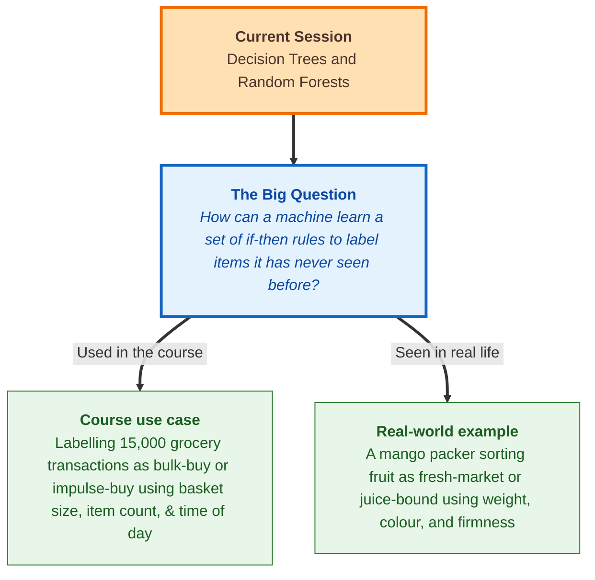

## <span style="color:#2F7DDE">Decision Trees and Random Forests</span>

### <span style="color:#2F7DDE">Mental Map</span>



---

### <span style="color:#2F7DDE">What You'll Learn</span>

Have you ever wondered how a packing machine picks which mangoes go to market?

By the end of this session, you will be able to:

- <span style="color:#D9660B">**Describe**</span> how a classifier splits records into groups, one yes-or-no question at a time.
- <span style="color:#D9660B">**Explain**</span> why fifty classifiers voting together produce a more stable answer than one.
- <span style="color:#D9660B">**Apply**</span> a depth limit and minimum group size to stop a classifier memorising its training data.
- <span style="color:#D9660B">**Use**</span> three mango features to train a single-tree classifier on labelled rows.
- <span style="color:#D9660B">**Differentiate**</span> numbers the model calculates during training from numbers you set before it starts.
- <span style="color:#D9660B">**Build**</span> a multi-tree classifier on the mango data and label fruit the model has not seen.

> <span style="color:#2F7DDE">**Topics you will meet:**</span> Decision tree splits, Training a decision tree,
> Limiting tree depth, Parameter vs hyperparameter, Bagging: many samples, one vote, Random forest.
>
> Join the session to learn each of these in detail.

---

### <span style="color:#2F7DDE">Why You Are Learning This Topic</span>

Imagine a mango farm that packs 5,000 pieces of fruit each day. Workers sort each one by eye. The firm, golden ones go to the market. The soft or underweight ones go to the juice line.

A <span style="color:#D9660B">**decision tree**</span> means a set of if-then rules learned from labelled examples. Each rule splits records into two groups until every group has one label.

This course uses this approach to classify real datasets.

> <span style="color:#2F7DDE">**Think about it:**</span> The first rule checks weight above 180 g. Where does a 181 g mango go?

---

### <span style="color:#2F7DDE">The Mango Sorting Puzzle</span>

Here are three rows from the packing log.

| Mango | Weight (g) | Colour (1–10) | Firmness (1–5) | Label |
|:------|:----------:|:-------------:|:--------------:|:-----:|
| M1 | 210 | 8 | 4 | Fresh |
| M2 | 145 | 6 | 2 | Juice |
| M3 | 190 | 7 | 3 | Fresh |

<span style="color:#D9660B">**What you want to happen:**</span>

- Learn sorting rules from the three labelled rows above.
- Label a new mango: weight 165 g, colour 7, firmness 3.
- Keep the rules simple enough for fruit the model has never seen.

Here is how it might start. No need to understand it yet.

```python
from sklearn.tree import DecisionTreeClassifier
X = [[210,8,4],[145,6,2],[190,7,3]]
y = ["Fresh","Juice","Fresh"]
```

> <span style="color:#D9660B">**Wonder about this:**</span>
>
> - What goes wrong if the classifier is allowed to split data without any limit?
> - Why might fifty sorters, each on a different batch, give a more reliable result than one?

---

### <span style="color:#2F7DDE">Think It Through</span>

There is no wrong first try. Keep your guesses for the session.

**1. The machine asks: "Is the weight above 170 g?" What happens to M2, which weighs 145 g?**
Hint: Think of it as a gate — each mango goes left or right.

**2. The depth is set to 2. Why might that limit help on new fruit?**
Hint: Think about what happens when a sorter memorises only one batch.

**3. Which was chosen before training: the split threshold, or the maximum number of splits?**
Hint: One number came from the data. The other was set before training began.

---

### <span style="color:#2F7DDE">One Question to Carry Into the Session</span>

> <span style="color:#2F7DDE">**If fifty sorters each train on a different batch and vote, why is their answer more trustworthy?**</span>
>
> What does it mean when fifty batches agree on the same label?
