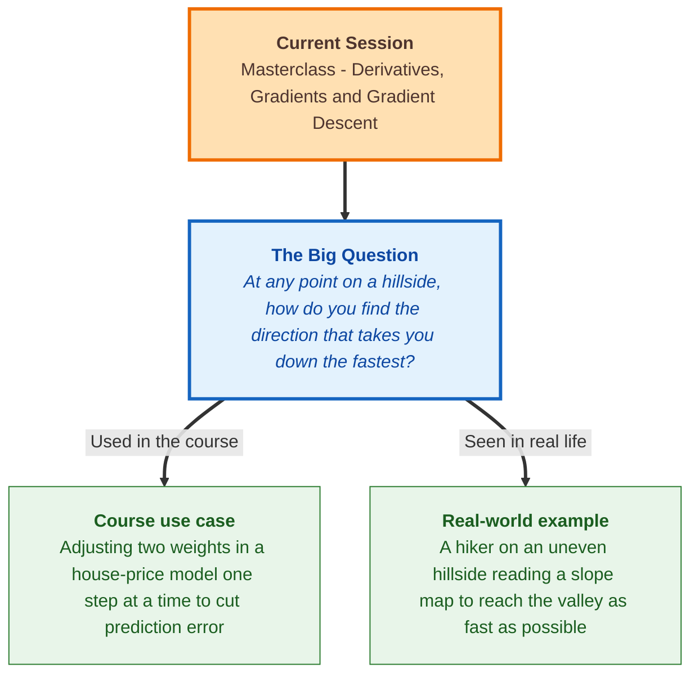

## <span style="color:#2F7DDE">Masterclass - Derivatives, Gradients and Gradient Descent</span>

### <span style="color:#2F7DDE">Mental Map</span>



---

### <span style="color:#2F7DDE">What You'll Learn</span>

Have you ever wondered how a hiker finds the fastest step downhill?

By the end of this session, you will be able to:

- <span style="color:#D9660B">**Interpret**</span> what a slope arrow tells you about the steepest uphill direction.
- <span style="color:#D9660B">**Calculate**</span> the exact steepness at one point on a trail from a height formula.
- <span style="color:#D9660B">**Apply**</span> a two-step rule to find the rate of change when one measure wraps around another.
- <span style="color:#D9660B">**Solve**</span> how much a small step changes the gap between a predicted altitude and the real one.
- <span style="color:#D9660B">**Demonstrate**</span> how small downhill steps, taken one at a time, find the valley floor.
- <span style="color:#D9660B">**Build**</span> an arrow pointing to the steepest uphill direction at any hillside spot.

> <span style="color:#2F7DDE">**Topics you will meet:**</span> Power rule derivative, Chain rule, Gradient vector, Steepest ascent, Gradient of squared error, Gradient descent.
>
> Join the session to learn each of these in detail.

---

### <span style="color:#2F7DDE">Why You Are Learning This Topic</span>

Imagine you stand on a hill with a map of heights. You want to reach the valley. You look around and pick the steepest downhill direction. Each step uses the slope right where you stand.

A <span style="color:#D9660B">**gradient**</span> means an arrow that points toward the steepest uphill direction at any one spot.

Machine learning models use the same idea to cut their prediction error step by step.

> <span style="color:#2F7DDE">**Think about it:**</span> Can a hiker who always takes the steepest step get stuck before the valley?

---

### <span style="color:#2F7DDE">The Hiker's Puzzle</span>

A hiker records height above the valley at five points along the trail.

| Distance along trail (m) | Height above valley (m) |
|:---:|:---:|
| 0 | 100 |
| 25 | 60 |
| 50 | 30 |
| 75 | 10 |
| 100 | 0 |

<span style="color:#D9660B">**What you want to happen:**</span>

- Find the exact steepness at each point, not only the rough drop between rows.
- Know which direction is steepest when the hill curves in two directions at once.
- Take steps that shrink as the trail flattens, so you land at the lowest point.

Here is how it might start. You do not need to understand it yet.

```python
h = lambda x: (x - 100) ** 2
x = 0
x = x - 0.1 * 2 * (x - 100)
```

> <span style="color:#D9660B">**Wonder about this:**</span>
>
> - As the trail gets flatter near the valley, do the steps shrink automatically?
> - What happens if you start at a point that is equally steep in every direction?

---

### <span style="color:#2F7DDE">Think It Through</span>

There is no wrong first try. Keep your guesses for the session.

**1. The trail drops 30 m in the first 25 m stretch. It drops 20 m in the next 25 m stretch. Which stretch is steeper?**
Hint: Steepness is drop per metre walked.

**2. The hill slopes gently toward the river and steeply toward the valley. You have a steepness number for each direction. Which direction gives the fastest descent?**
Hint: Two numbers, one per direction, combine into a single arrow.

**3. A hiker's step equals 10 % of the steepness where they stand. What happens to that step size as the trail near the valley flattens?**
Hint: Think about 10 % of a near-zero number.

---

### <span style="color:#2F7DDE">One Question to Carry Into the Session</span>

> <span style="color:#2F7DDE">**What rule turns a height formula into a slope number at any single point?**</span>
>
> Once you have that rule, can you chain it when one formula wraps inside another?
