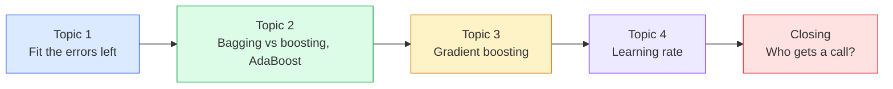
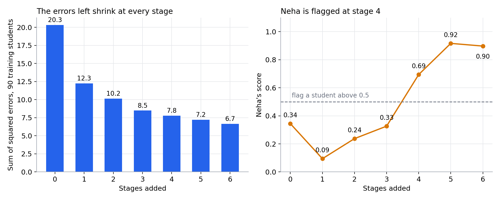
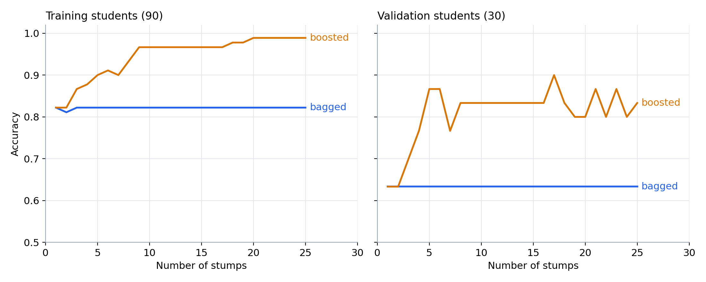
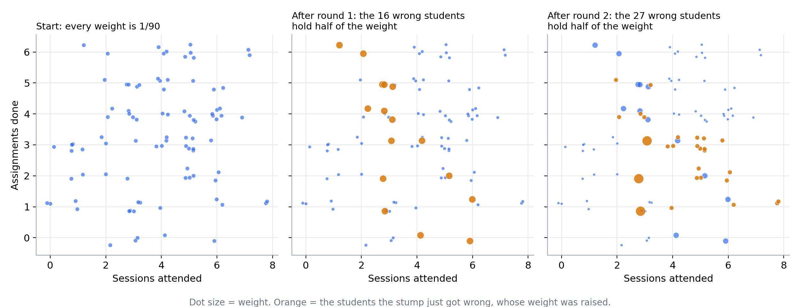
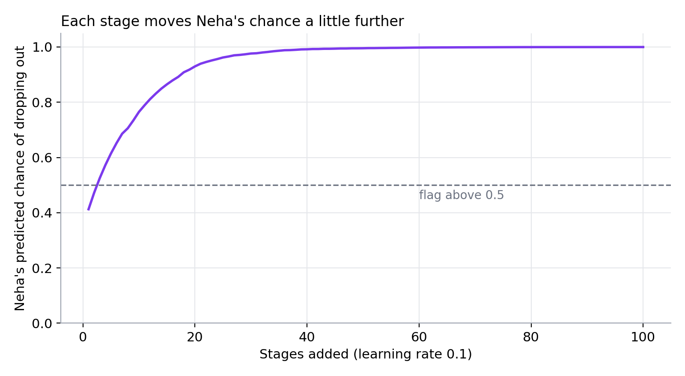
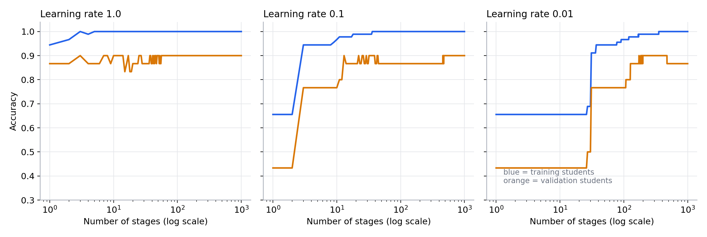
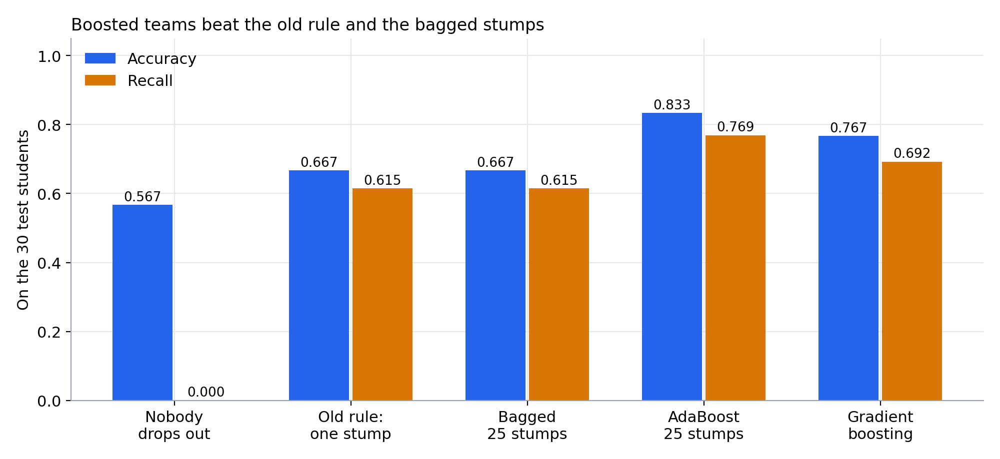

# <font color='#1d4ed8'>Lecture Script: From Bagging to Boosting</font>

---

## <font color='blue'>Agenda</font>

The lecture runs as four topics. Each topic ends with a quiz.

| Topic | What we do | Learning objectives covered | Minutes |
|:-:|:--|:--|:-:|
| 1 | Fit each new small tree to the errors left behind | Describe boosting as fitting each new learner to the errors left by the previous stage | 25 |
| 2 | Set bagging against boosting, then reweight with AdaBoost | Compare bagging and boosting on how each successive model in the ensemble is fitted<br>Describe how AdaBoost reweights misclassified examples between rounds | 30 |
| 3 | Train a gradient boosting model | Train a gradient boosting model on a tabular dataset | 25 |
| 4 | Shrink each stage with the learning rate | Explain the role of the learning rate in shrinking each boosting stage's contribution | 25 |
| — | Closing: Outcome & Summary | | 15 |
| | **Total** | | **120** |

> <font color="red">**🎯 Instructor Note**</font> Pace: in Topic 1 spend the time on the first stage by hand, then move quickly through the repeat and the follow-Neha check. In Topic 2 the AdaBoost weights are the slower half; the bagging comparison is one short example.
> In Topic 3 train the model first and spend the rest on Neha's score by hand. In Topic 4 spend about 15 minutes on the three learning-rate tables.

---

## <font color='blue'>Scenario</font>

A PhysicsWallah-style learning app runs eight-week courses. At the end of week 2 the student success team can phone only a few students, so it must choose whom to call. Here are two learners who both look fine on attendance:

**Aarav** attended 7 of the 8 live sessions, submitted 5 of the 6 assignments, has a quiz average of 78, and last logged in 2 days ago. He finishes the course.

**Neha** attended 5 of the 8 live sessions, submitted none of the 6 assignments, has a quiz average of 45, last logged in 12 days ago, and works full time. She quits in week 6.

The team's old rule is "call a student who attended fewer than 4 sessions". It skips both learners. Neha is our test student: 5 sessions, 0 assignments, quiz average 45, 12 days since the last login, 0 doubts asked, and a working professional.

> <font color="red">**🎯 Instructor Note**</font> PhysicsWallah is only the setting. Do not claim it uses this data; the 150 students in `data/student_dropout.csv`, Aarav and Neha are invented for teaching.
> Learners need Python 3 with pandas 2 or later, numpy and scikit-learn 1.4 or later. Every split and model uses `random_state=42`, so every output matches.

---

## <font color='blue'>Problem Statement</font>

The success team used one rule: call anyone who attended fewer than 4 sessions in the first 2 weeks. Neha attended 5, so nobody called her. She had submitted no assignments, and she quit in week 6. The rule looked at one clue and ignored the rest. In our 150 past students, 86 attended 4 or more sessions, and 17 of them (about 1 in 5) still dropped out. Ten of those 17 had submitted one assignment or none.

Two colleagues suggest a fix. One says, "Copy the rule many times on random samples of the students and let the copies vote." The other says, "Build the next rule only from the students the first rule got wrong, and keep adding rules like that."

> <font color='purple'>**How do we build a model that keeps learning from the students it still gets wrong, and how big a step should each new correction take?**</font>

> <font color="red">**🎯 Instructor Note**</font> Poll: "One small rule is right for about 2 in 3 new students. Which team of 25 copies do you expect to do better on new students: A) each copy learns from its own random sample, then they vote, or B) each copy learns from the mistakes the earlier copies left?" Give learners 30 seconds to respond in chat. Reveal the answer in the Closing.

---

## <font color='blue'>What We Will Use</font>

Everything the lecture needs, in one place. Each topic uses these terms without repeating them.

| Term | Meaning | In our students |
|:--|:--|:--|
| **Stage** | One small model added to the team, built after the earlier ones | stage 1, stage 2, ... |
| **Stump** | A tree with one yes or no question (`max_depth=1`) | "attended 3 sessions or fewer?" |
| **Error left (residual)** | The target minus the team's current score for a student | $r = y - F$ |
| **Boosting** | Build the team one stage at a time, each stage fitted to the errors the earlier stages left | a chain of stumps |
| **Bagging** | The random forest session's idea: each model learns from its own bootstrap sample, then they vote | a forest |
| **AdaBoost** | A boosting method that gives every student a weight and raises the weight of the students the last model got wrong | `AdaBoostClassifier` |
| **Gradient boosting** | A boosting method where each new tree is fitted to the errors left, measured as a gradient of the loss | `GradientBoostingClassifier` |
| **Learning rate $\nu$** | A number between 0 and 1 that scales each stage before it is added | `learning_rate` |
| `n_estimators` | The number of stages. A hyperparameter we set before `fit` | 100 |

Our columns, all measured at the end of week 2: `sessions_attended` (live sessions attended, 0 to 8), `assignments_done` (assignments submitted, out of 6 set), `avg_quiz_score` (0 to 100), `days_since_login` (days since the last login), `doubts_asked` (doubts raised), `working_professional` (1 = works full time). The target is `dropped_out`: 1 = the student left before week 8. Dropped out is the positive class.

The three formulas of the lecture. The team's score after stage $m$, the AdaBoost weight change with $\varepsilon_m$ the total weight of the wrongly classified students, and the error a stage must fix:

$$\boxed{F_m(x) = F_{m-1}(x) + \nu\, h_m(x)} \qquad \boxed{w_i \leftarrow w_i \cdot \frac{1-\varepsilon_m}{\varepsilon_m} \text{ if student } i \text{ was wrong, then divide all } w_i \text{ by their sum}} \qquad \boxed{r_i = y_i - F_{m-1}(x_i)}$$

---

## <font color='blue'>How: Walking Through the Dropout Model</font>



---

## <font color='blue'>Topic 1: Fit Each New Small Tree to the Errors Left Behind</font> `25 min`

In the decision trees and random forests session you grew a random forest: many trees, each on its own bootstrap sample, then one vote. You also limited a tree with `max_depth`, and you split data into training, validation and test sets in the ML workflow session. Today the trees are tiny and they are not independent: each one is built after the last.

> <font color='purple'>**A one-question rule missed Neha. What if the next small tree learned only from the mistakes the first one left?**</font>

### <font color='green'>Example: look at the students</font>

> <font color='purple'>**What does one row look like, and how many of the 150 students dropped out?**</font>

**Predict before running: What will happen?**

> <font color="red">**🎯 Instructor Note**</font> Expected: 150 rows and 8 columns, with 89 students who stayed and 61 who dropped out. Common guess: learners forget the student id is a column.

```python
import numpy as np
import pandas as pd

df = pd.read_csv("data/student_dropout.csv")
print(df.shape)
print(df.head(5).to_string())
print(df["dropped_out"].value_counts())
```

**Output**

```
(150, 8)
  student_id  sessions_attended  assignments_done  avg_quiz_score  days_since_login  doubts_asked  working_professional  dropped_out
0       S001                  4                 5              67                14             0                     0            0
1       S002                  4                 4              67                 6             0                     0            0
2       S003                  3                 4              76                 5             1                     0            0
3       S004                  3                 0              61                 9             2                     0            1
4       S005                  4                 3              55                11             1                     1            1
dropped_out
0    89
1    61
Name: count, dtype: int64
```

#### <font color='#c2410c'>Code Explanation</font>

- **Lines 1 and 2** Load numpy and pandas.
- **Line 4** Reads the student file into a table called `df`.
- **Line 5** Prints the size as (rows, columns).
- **Line 6** Shows the first 5 students as a full table.
- **Line 7** Counts how many students carry each value of `dropped_out`.

> <font color='green'>**Result**</font> Each row is one student with six clues and a target. Of the 150 students, 61 dropped out (about 41%) and 89 stayed.

### <font color='green'>Extending it: how well did the old rule do on all 150 students?</font>

> <font color='purple'>**How many dropped-out students did "fewer than 4 sessions" miss, and who were they?**</font>

**Predict before running: What will happen?**

> <font color="red">**🎯 Instructor Note**</font> Ask: "How many of the 61 dropped-out students did the rule miss?" Give learners 30 seconds to respond in chat. Expected: 17.

```python
rule = df["sessions_attended"] < 4
print(pd.crosstab(rule, df["dropped_out"], rownames=["fewer than 4 sessions"], colnames=["dropped_out"]))
print(df.loc[df["sessions_attended"] >= 4].groupby("assignments_done")["dropped_out"].agg(["count", "sum"]).T)
```

**Output**

```
dropped_out             0   1
fewer than 4 sessions        
False                  69  17
True                   20  44
assignments_done  0   1   2   3   4   5   6
count             4  11  11  17  18  14  11
sum               4   6   3   4   0   0   0
```

#### <font color='#c2410c'>Code Explanation</font>

- **Line 1** Marks True for every student with fewer than 4 sessions: the students the old rule would call.
- **Line 2** Counts called and not-called students against whether they dropped out.
- **Line 3** Takes the students the rule skipped (4 or more sessions) and counts, for each number of assignments, how many students there are and how many of them dropped out. `.T` turns the table sideways so it fits on one line.

> <font color='green'>**Result**</font> The rule called 64 students and 44 of them dropped out. It skipped 86 students, and 17 of those dropped out. Of the skipped students with no assignment, 4 of 4 dropped out; with 1 assignment, 6 of 11 did. A second clue, assignments, is hiding in the mistakes of the first.

### <font color='green'>Example: keep some students aside and build the first small tree</font>

> <font color='purple'>**Which students may the trees learn from, and what does one question about sessions give us?**</font>

You split data three ways in the ML workflow session. Do the same here, then fit the smallest tree there is: a stump with one yes or no question.

**Predict before running: What will happen?**

> <font color="red">**🎯 Instructor Note**</font> Expected: 90 training, 30 validation and 30 test students; 59 stayed and 31 dropped out in training. The stump will ask about `sessions_attended`.

```python
from sklearn.model_selection import train_test_split

features = ["sessions_attended", "assignments_done", "avg_quiz_score", "days_since_login", "doubts_asked", "working_professional"]
X, y = df[features], df["dropped_out"]
X_train, X_rest, y_train, y_rest = train_test_split(X, y, test_size=0.4, random_state=42)
X_val, X_test, y_val, y_test = train_test_split(X_rest, y_rest, test_size=0.5, random_state=42)
train = X_train.assign(dropped_out=y_train)
print(len(X_train), len(X_val), len(X_test))
print(y_train.value_counts())
```

**Output**

```
90 30 30
dropped_out
0    59
1    31
Name: count, dtype: int64
```

#### <font color='#c2410c'>Code Explanation</font>

- **Line 3** Lists the six clue columns.
- **Line 4** `X` is the clue columns and `y` is the target.
- **Lines 5 and 6** Set 40% of the students aside with a fixed seed, then split that 40% in half: validation and test.
- **Line 7** Joins the clues and the target for the training students, so the labels travel with the students when we resample them.
- **Lines 8 and 9** Print the three sizes and the class counts in training.

> <font color='green'>**Result**</font> The trees learn from 90 students. The 30 validation and 30 test students stay hidden until we judge a model.

**Predict before running: What will happen?**

> <font color="red">**🎯 Instructor Note**</font> Expected: the question is `sessions_attended <= 3.5`, which is the old rule. Training accuracy 0.822 (16 wrong), validation 0.633. Neha gets class 0 with a 0.094 chance of dropping out.

```python
from sklearn.tree import DecisionTreeClassifier, export_text

stump = DecisionTreeClassifier(max_depth=1, random_state=42).fit(X_train, y_train)
print(export_text(stump, feature_names=features))
wrong = stump.predict(X_train) != y_train
print(round(stump.score(X_train, y_train), 3), round(stump.score(X_val, y_val), 3), wrong.sum())
neha = pd.DataFrame([[5, 0, 45, 12, 0, 1]], columns=features)
print(stump.predict(neha), stump.predict_proba(neha).round(3))
```

**Output**

```
|--- sessions_attended <= 3.50
|   |--- class: 1
|--- sessions_attended >  3.50
|   |--- class: 0

0.822 0.633 16
[0] [[0.906 0.094]]
```

#### <font color='#c2410c'>Code Explanation</font>

- **Line 3** Builds a tree with one question (`max_depth=1`) and fits it on the training students.
- **Line 4** Prints the question. Class 1 means dropped out.
- **Line 5** Marks the training students the stump gets wrong.
- **Line 6** Prints the training accuracy, the validation accuracy and the number of wrong training students.
- **Line 7** Builds Neha as a one-row table.
- **Line 8** Prints the stump's class and its chances (stayed, dropped out) for Neha.

> <font color='green'>**Result**</font> The best single question is the old rule: 3 sessions or fewer. It is right for 0.822 of the training students but only 0.633 of the validation students, and it tells Neha she is safe (a chance of 0.094). It leaves 16 training students wrong. Those are the errors left behind.

### <font color='green'>Example: fit the next tree to the errors left</font>

> <font color='purple'>**If every student starts with the same score, what error does each student carry, and can a stump fitted to those errors shrink them?**</font>

Stage 0 gives every student the same score: the share of training students who dropped out. The error each student carries is the target minus that score:

$$\boxed{r_i = y_i - F_{m-1}(x_i)} \qquad F_0 = \frac{31}{90} = 0.3444, \qquad r = 1 - 0.3444 = 0.656 \text{ (dropped out)}, \quad r = 0 - 0.3444 = -0.344 \text{ (stayed)}$$

A stump is now fitted to these errors, not to the 0 and 1 labels. Its output is added to the score: $F_1 = F_0 + h_1$. For now every stage is added in full, so $\nu = 1$.

**Predict before running: What will happen?**

> <font color="red">**🎯 Instructor Note**</font> Expected: two error values, -0.344 and 0.656. The sum of squared errors falls from 20.32 to 12.26. The stump asks about sessions again, with 0.358 on the 3-sessions-or-fewer side and -0.25 on the other.

```python
from sklearn.tree import DecisionTreeRegressor

F0 = np.full(len(y_train), y_train.mean())
resid0 = y_train - F0
h1 = DecisionTreeRegressor(max_depth=1, random_state=42).fit(X_train, resid0)
F1 = F0 + h1.predict(X_train)
print(round(y_train.mean(), 4), sorted(resid0.round(3).unique().tolist()))
print(round((resid0 ** 2).sum(), 2), round(((y_train - F1) ** 2).sum(), 2))
print(features[h1.tree_.feature[0]], h1.tree_.threshold[0], h1.tree_.value.ravel()[1:].round(3))
```

**Output**

```
0.3444 [-0.344, 0.656]
20.32 12.26
sessions_attended 3.5 [ 0.358 -0.25 ]
```

#### <font color='#c2410c'>Code Explanation</font>

- **Line 1** Loads the tree that predicts a number, not a class.
- **Line 3** Stage 0: the same score, 0.3444, for all 90 students.
- **Line 4** The error each student carries: the target minus the score.
- **Line 5** Fits a stump to those errors.
- **Line 6** Stage 1: the new score is the old score plus the stump's output.
- **Line 7** Prints the stage-0 score and the two different errors.
- **Line 8** Prints the sum of squared errors before stage 1 and after it.
- **Line 9** Prints the stump's question, its cut and its two outputs (the 3-or-fewer side first).

> <font color='green'>**Result**</font> The error each student carries is 0.656 if they dropped out and -0.344 if they stayed. One stump fitted to these errors cuts the sum of squared errors from 20.32 to 12.26. Students with 4 or more sessions now score $0.3444 - 0.25 = 0.094$, the same chance the stump gave Neha. The errors that remain are the work for stage 2.

### <font color='green'>Extending it: repeat, stage after stage</font>

> <font color='purple'>**If we repeat the same move, fitting a stump to the errors that are left, what do stages 2 to 6 ask about?**</font>

**Predict before running: What will happen?**

> <font color="red">**🎯 Instructor Note**</font> Ask: "Will stage 2 ask about sessions again?" Give learners 30 seconds to respond in chat. Expected: no, it asks about assignments, the clue hiding in the stage-1 errors.

```python
def boost(X, y, n_stages):
    F, stages = np.full(len(y), y.mean()), []
    for _ in range(n_stages):
        h = DecisionTreeRegressor(max_depth=1, random_state=42).fit(X, y - F)
        F = F + h.predict(X)
        stages.append(h)
    return stages

def score(stages, X, base): return base + sum(h.predict(X) for h in stages)
print(len(boost(X_train, y_train, 3)), "stages built")
```

**Output**

```
3 stages built
```

```python
base = y_train.mean()
for k in range(1, 7):
    st = boost(X_train, y_train, k)
    s_tr, s_va = score(st, X_train, base), score(st, X_val, base)
    print(k, features[st[-1].tree_.feature[0]], st[-1].tree_.threshold[0], round(((y_train - s_tr) ** 2).sum(), 2),
          ((s_tr > 0.5) == y_train).mean().round(3), ((s_va > 0.5) == y_val).mean().round(3))
```

**Output**

```
1 sessions_attended 3.5 12.26 0.822 0.633
2 assignments_done 3.5 10.15 0.822 0.633
3 avg_quiz_score 71.5 8.49 0.867 0.7
4 assignments_done 0.5 7.78 0.878 0.767
5 avg_quiz_score 48.0 7.22 0.9 0.867
6 avg_quiz_score 82.5 6.66 0.911 0.867
```

#### <font color='#c2410c'>Code Explanation</font>

- **`boost`** Starts every student at the base score, then loops: fit a stump to the errors left, add its output to every score, keep the stump. It returns the list of stumps.
- **`score`** Adds the base score and the output of every stump to give a student's final score.
- **Loop over `k`** Rebuilds the team with `k` stages, and prints the stage number, the question of its last stump, its cut, the sum of squared errors left, and the training and validation accuracy. A student is flagged when the score is above 0.5.

> <font color='green'>**Result**</font> Stage 1 asks about sessions, stage 2 about assignments, stage 3 about the quiz average. Each stage looks at what the earlier stages left. The squared error falls from 12.26 to 6.66 by stage 6, training accuracy rises from 0.822 to 0.911, and validation accuracy from 0.633 to 0.867.

### <font color='green'>Extending it: follow Neha through the stages</font>

> <font color='purple'>**At which stage does the team start to flag Neha?**</font>

**Predict before running: What will happen?**

> <font color="red">**🎯 Instructor Note**</font> Ask: "After how many stages does Neha's score pass 0.5?" Give learners 30 seconds to respond in chat. Expected: 4.

```python
st = boost(X_train, y_train, 6)
for k in range(0, 7):
    s = base + sum(h.predict(neha)[0] for h in st[:k])
    print(k, round(s, 3), "flag" if s > 0.5 else "no flag")
```

**Output**

```
0 0.344 no flag
1 0.094 no flag
2 0.237 no flag
3 0.326 no flag
4 0.694 flag
5 0.917 flag
6 0.897 flag
```

#### <font color='#c2410c'>Code Explanation</font>

- **Line 1** Rebuilds the 6-stage team.
- **Line 2** Takes the number of stages `k` from 0 to 6.
- **Line 3** Neha's score: the base score plus the outputs of the first `k` stumps.
- **Line 4** Prints the stage count, the score, and whether she is flagged (above 0.5).

By hand, stage 2 asks "assignments at most 3?". Neha has 0, so she gets its output of 0.143: $0.094 + 0.143 = 0.237$.

<p align="center"></p>

> <font color='green'>**Result**</font> The first stump said Neha was safe (0.094). Stages 2 and 3 move her up a little (0.237, 0.326), and stage 4, which asks "no assignment at all?", pushes her to 0.694, above 0.5. She is flagged. This is boosting: each new learner is fitted to the errors left by the previous stage.

> <font color='#b45309'>**Common mistake**</font> Fitting every new stump to the original 0 and 1 labels. Then every stump would ask the same question. The stump must be fitted to the errors left.

### <font color='purple'>Quiz 1</font>

**Question:** At stage 0 every student has the score 0.3444. Aman dropped out (target 1). What target does the stump of stage 1 see for Aman?

**Options:**
- A) 1, the original label
- B) 0.656, the error left: 1 - 0.3444
- C) 0.3444, the current score
- D) -0.344, the error left for a student who stayed

**Correct Answer:** B

**Explanation:**
- **A)** Wrong: the stump is fitted to the errors left, not to the original labels. Fitting to 1 would repeat the first tree.
- **B)** Correct: the error left is the target minus the current score, $1 - 0.3444 = 0.656$.
- **C)** Wrong: 0.3444 is the score the team already gives Aman, not the error it leaves.
- **D)** Wrong: -0.344 is the error for a student who stayed (target 0), $0 - 0.3444$.

---

## <font color='blue'>Topic 2: Set Bagging Against Boosting, Then Reweight with AdaBoost</font> `30 min`

> <font color='purple'>**The random forest also used many trees. If we build 25 stumps both ways, which team learns more, and what does a second way of boosting, AdaBoost, do to the students the last stump got wrong?**</font>

### <font color='green'>Example: 25 bagged stumps and 25 boosted stumps</font>

> <font color='purple'>**Do the successive stumps ask different questions when each one is fitted on a random sample, and when each one is fitted on the errors left?**</font>

Bagging fits every stump on its own bootstrap sample, as in the forest. Boosting fits every stump on the errors the earlier ones left, as in Topic 1.

**Predict before running: What will happen?**

> <font color="red">**🎯 Instructor Note**</font> Expected: the bagged stumps all ask about a few of the same columns (here 3 of 6, mostly sessions); the boosted stumps ask about all 6. Common guess: learners expect the bagged stumps to be as varied as the boosted ones.

```python
def bag_stump(i):
    b = train.sample(frac=1, replace=True, random_state=i)
    return DecisionTreeClassifier(max_depth=1, random_state=42).fit(b[features], b["dropped_out"])

bagged = [bag_stump(i) for i in range(25)]
boosted = boost(X_train, y_train, 25)
q = lambda t: features[t.tree_.feature[0]] + " <= " + str(round(t.tree_.threshold[0], 1))
col = lambda ts: sorted(set(features[t.tree_.feature[0]] for t in ts))
print("bagged: ", [q(t) for t in bagged[:4]], col(bagged))
print("boosted:", [q(t) for t in boosted[:4]], col(boosted))
```

**Output**

```
bagged:  ['sessions_attended <= 3.5', 'sessions_attended <= 2.5', 'sessions_attended <= 3.5', 'sessions_attended <= 3.5'] ['assignments_done', 'sessions_attended', 'working_professional']
boosted: ['sessions_attended <= 3.5', 'assignments_done <= 3.5', 'avg_quiz_score <= 71.5', 'assignments_done <= 0.5'] ['assignments_done', 'avg_quiz_score', 'days_since_login', 'doubts_asked', 'sessions_attended', 'working_professional']
```

#### <font color='#c2410c'>Code Explanation</font>

- **Lines 1 to 3** `bag_stump(i)` draws bootstrap sample `i` of the 90 training students and fits a stump on it.
- **Line 5** Grows 25 stumps, each on its own sample.
- **Line 6** Grows 25 boosted stumps with the `boost` function from Topic 1.
- **Line 7** `q` turns a stump into a readable question.
- **Line 8** `col` lists the different columns a set of stumps asks about.
- **Lines 9 and 10** Print the first 4 questions and the columns used, for each team.

> <font color='green'>**Result**</font> The first four bagged stumps ask almost the same question, about sessions, and across all 25 they use only 3 columns. The first four boosted stumps ask four different questions and the 25 together use all 6 columns. A bagged stump never sees the other stumps; a boosted stump is fitted to what the earlier stumps left.

**Predict before running: What will happen?**

> <font color="red">**🎯 Instructor Note**</font> Ask: "After 25 stumps, which team scores higher on the training students?" Give learners 30 seconds to respond in chat. Expected: boosted, 0.989 against 0.822. Bagged stays at the single stump's score.

```python
def vote(ts, X): return (np.mean([t.predict(X) for t in ts], axis=0) > 0.5).astype(int)

sets = ((X_train, y_train), (X_val, y_val))
for k in (1, 5, 10, 25):
    bt, bv = [(vote(bagged[:k], X) == y).mean().round(3) for X, y in sets]
    gt, gv = [((score(boosted[:k], X, base) > 0.5) == y).mean().round(3) for X, y in sets]
    print(k, bt, bv, gt, gv)
```

**Output**

```
1 0.822 0.633 0.822 0.633
5 0.822 0.633 0.9 0.867
10 0.822 0.633 0.967 0.833
25 0.822 0.633 0.989 0.833
```

#### <font color='#c2410c'>Code Explanation</font>

- **Line 1** `vote` takes the majority answer of a list of stumps.
- **Line 3** The two sets of students to score: training and validation.
- **Line 4** Takes the first 1, 5, 10 and 25 stumps of each team.
- **Line 5** Bagged team: the accuracy of the vote on training and on validation.
- **Line 6** Boosted team: the accuracy of the summed score on training and on validation.
- **Line 7** Prints the number of stumps, then the four accuracies: bagged training, bagged validation, boosted training, boosted validation.

<p align="center"></p>

#### <font color='#c2410c'>Logic Explanation</font>

| | Bagging | Boosting |
|:--|:--|:--|
| What each new model is fitted on | its own bootstrap sample of the students | the errors left by the models before it |
| Does it need the earlier models? | No: the models are fitted independently, in any order | Yes: stage $m$ cannot be built until stage $m-1$ exists |
| How the models are combined | one vote, every model counts the same | one sum, every stage is added to the score |
| What the 25 stumps do here | ask almost the same question, so the vote stays at the stump's accuracy | ask different questions, so each stage adds something new |

> <font color='green'>**Result**</font> The bagged vote stays exactly where one stump was: 0.822 on training and 0.633 on validation, because the stumps are alike and a vote of alike models changes nothing. The boosted team climbs, from 0.822 to 0.989 on training and from 0.633 to 0.833 on validation, because each stage is fitted to what the others left. The two ensembles differ in how each successive model is fitted: independently on a resample, or on the errors left.

### <font color='green'>Example: AdaBoost raises the weight of the students it got wrong</font>

> <font color='purple'>**Instead of fitting the next stump to the errors, what if we make the wrong students count more?**</font>

AdaBoost gives every student a weight $w_i$. Round 1 starts equal: $w_i = \tfrac{1}{90}$. A stump is fitted with these weights, and $\varepsilon$ is the total weight of the students it gets wrong. Then every wrong student's weight is multiplied by $\tfrac{1-\varepsilon}{\varepsilon}$, and all weights are divided by their sum so they add to 1:

$$\boxed{w_i \leftarrow w_i \cdot \frac{1-\varepsilon}{\varepsilon} \text{ for each wrong student, then divide by the sum}}$$

Round 1 by hand: the stump from Topic 1 gets 16 of 90 students wrong, so $\varepsilon = \tfrac{16}{90} = 0.1778$ and the factor is $\tfrac{1-0.1778}{0.1778} = 4.625$. Before dividing, a wrong student holds $\tfrac{4.625}{90}$ and a right student holds $\tfrac{1}{90}$. The total is $\tfrac{16 \times 4.625 + 74}{90} = \tfrac{148}{90}$. After dividing, a wrong student holds $\tfrac{4.625}{148} = \tfrac{1}{32}$ and a right student holds $\tfrac{1}{148}$. The 16 wrong students together now hold $\tfrac{16}{32} = 0.5$.

**Predict before running: What will happen?**

> <font color="red">**🎯 Instructor Note**</font> Expected: round 1 prints 16 wrong, 0.1778, 4.625 and total weight 0.5 on the wrong students, with the smallest weight 0.00676 and the largest 0.03125. Ask what weight the wrong students hold in rounds 2 and 3. Expected: also 0.5.

```python
w = np.full(len(y_train), 1 / len(y_train))
for r in range(1, 4):
    s = DecisionTreeClassifier(max_depth=1, random_state=42).fit(X_train, y_train, sample_weight=w)
    wrong = s.predict(X_train) != y_train.values
    eps = w[wrong].sum()
    w = np.where(wrong, w * (1 - eps) / eps, w)
    w = w / w.sum()
    print(r, q(s), wrong.sum(), round(eps, 4), round((1 - eps) / eps, 3), round(w[wrong].sum(), 3), round(w.min(), 5), round(w.max(), 5))
```

**Output**

```
1 sessions_attended <= 3.5 16 0.1778 4.625 0.5 0.00676 0.03125
2 assignments_done <= 3.5 27 0.2559 2.908 0.5 0.00454 0.06106
3 avg_quiz_score <= 68.0 31 0.2663 2.754 0.5 0.00309 0.04161
```

#### <font color='#c2410c'>Code Explanation</font>

- **Line 1** Round 1 starts with equal weights, $\tfrac{1}{90}$ each.
- **Line 2** Runs three rounds.
- **Line 3** Fits a stump that counts each student by their weight (`sample_weight`).
- **Line 4** Marks the students the stump gets wrong.
- **Line 5** $\varepsilon$: the total weight of the wrong students.
- **Lines 6 and 7** Multiplies the wrong students' weights by $\tfrac{1-\varepsilon}{\varepsilon}$, then divides all weights by their sum.
- **Line 8** Prints the round, the stump's question, the number wrong, $\varepsilon$, the factor, the new total weight on the wrong students, and the smallest and largest weight.

<p align="center"></p>

> <font color='green'>**Result**</font> After round 1 the 16 wrong students hold 0.5 of all the weight, up from $\tfrac{16}{90} = 0.178$. The next stump, built with these weights, has to get them right, so it asks a new question: assignments, not sessions. After round 2 the 27 students the new stump got wrong hold half the weight, so the weight moves again to whoever is still wrong. AdaBoost reweights misclassified examples between rounds.

### <font color='green'>Extending it: check the hand numbers against scikit-learn</font>

> <font color='purple'>**Does `AdaBoostClassifier` find the same errors, and what say does each stump get in the final vote?**</font>

**Predict before running: What will happen?**

> <font color="red">**🎯 Instructor Note**</font> Ask: "Will the three errors match our 0.1778, 0.2559, 0.2663?" Give learners 30 seconds to respond in chat. Expected: yes. The vote weight is $\ln\tfrac{1-\varepsilon}{\varepsilon}$: 1.5315, 1.0673, 1.0132.

```python
from sklearn.ensemble import AdaBoostClassifier

stump_t = DecisionTreeClassifier(max_depth=1)
ada3 = AdaBoostClassifier(estimator=stump_t, n_estimators=3, random_state=42).fit(X_train, y_train)
print(ada3.estimator_errors_.round(4), ada3.estimator_weights_.round(4))
print(np.log((1 - ada3.estimator_errors_) / ada3.estimator_errors_).round(4))
ada = AdaBoostClassifier(estimator=stump_t, n_estimators=25, random_state=42).fit(X_train, y_train)
print(round(ada.score(X_train, y_train), 3), round(ada.score(X_val, y_val), 3))
```

**Output**

```
[0.1778 0.2559 0.2663] [1.5315 1.0673 1.0132]
[1.5315 1.0673 1.0132]
0.978 0.867
```

#### <font color='#c2410c'>Code Explanation</font>

- **Lines 1 and 3** Load the AdaBoost classifier and a stump to use as its small model.
- **Line 4** Fits 3 rounds. Its default learning rate is 1.
- **Line 5** Prints the weighted error of each round and the weight each stump gets in the final vote.
- **Line 6** The same vote weight worked out by hand as $\ln\tfrac{1-\varepsilon}{\varepsilon}$.
- **Lines 7 and 8** Fit 25 rounds and print the training and validation accuracy.

> <font color='green'>**Result**</font> The three errors are the ones we found by hand (0.1778, 0.2559, 0.2663), and the vote weights match $\ln\tfrac{1-\varepsilon}{\varepsilon}$: a more accurate stump gets a bigger say. With 25 rounds AdaBoost scores 0.978 on training and 0.867 on validation. For two classes, scikit-learn's vote weight is exactly this logarithm, without a factor of one half.

> <font color='#b45309'>**Common mistake**</font> Thinking the weights are changed once. They are changed after every round, and each stump is fitted to the weights the last round produced.

### <font color='purple'>Quiz 2</font>

**Question:** A stump gets 20 of 100 equally weighted students wrong. After the AdaBoost reweighting and the division by the sum, what total weight do those 20 students hold?

**Options:**
- A) 0.20, the same share as before
- B) 0.80, the total before dividing by the sum
- C) 1.00, all of the weight
- D) 0.50, half of the weight

**Correct Answer:** D

**Explanation:**
- **A)** Wrong: 0.20 is their weight before reweighting. The point of the update is to raise it.
- **B)** Wrong: $\varepsilon = 0.2$, the factor is $\tfrac{0.8}{0.2} = 4$, so the 20 students hold $20 \times 0.04 = 0.8$ before dividing. The right students hold $80 \times 0.01 = 0.8$, so the sum is 1.6 and we must divide by it.
- **C)** Wrong: the right students keep $\tfrac{0.8}{1.6} = 0.5$ of the weight; they do not drop to zero.
- **D)** Correct: after dividing by 1.6 the 20 wrong students hold $\tfrac{0.8}{1.6} = 0.5$. After every round the wrong students hold exactly half.

---

## <font color='blue'>Topic 3: Train a Gradient Boosting Model</font> `25 min`

In the gradient descent masterclass you computed the gradient of a squared-error loss and walked downhill. Topic 1 fitted every stump to the error left, and now you can see why that is a gradient step.

> <font color='purple'>**Fitting a tree to the errors left looks like a trick. Why is it called gradient boosting, and can scikit-learn train the whole team for us?**</font>

### <font color='green'>Example: why the errors left are a gradient</font>

> <font color='purple'>**Which way should a student's score move to lower the squared error?**</font>

Take one student with target $y$ and score $F$. The squared-error loss is $L = \tfrac{1}{2}(y - F)^2$. By the chain rule, with respect to the score $F$, not to a coefficient:

$$\boxed{\frac{\partial L}{\partial F} = -(y - F)} \qquad \Rightarrow \qquad -\frac{\partial L}{\partial F} = y - F = r$$

#### <font color='#c2410c'>Logic Explanation</font>

- The downhill direction of the loss, for each student's score, is the error left $y - F$. For Aman in the quiz, $y - F = 0.656$: raise his score.
- Gradient descent changes a number by a small step downhill. Boosting does the same in score space: a tree is fitted to the downhill direction, and adding the tree moves every student's score downhill.
- `GradientBoostingClassifier` keeps the score $F$ as log-odds, as in the logistic regression session, turns it into a chance with the sigmoid $p = \tfrac{1}{1+e^{-F}}$, and uses the log loss. Its downhill direction is $y - p$: the target minus the chance. Each new tree is fitted to those values.

> <font color='green'>**Result**</font> Fitting a stump to the errors left is a step down the gradient of the loss, which is why the method is called gradient boosting. With the squared error it is exactly the loop of Topic 1.

### <font color='green'>Example: train a gradient boosting model</font>

> <font color='purple'>**How does a gradient boosting model score on the training and validation students, next to the stump and the random forest?**</font>

**Predict before running: What will happen?**

> <font color="red">**🎯 Instructor Note**</font> Expected: it prints 100 stages, a learning rate of 0.1 and a tree depth of 3. Gradient boosting scores 1.0 on training and 0.867 on validation; the stump 0.822 and 0.633; the forest 1.0 and 0.833. Always saying "stays" scores 0.433.

```python
from sklearn.ensemble import GradientBoostingClassifier, RandomForestClassifier

gb = GradientBoostingClassifier(random_state=42).fit(X_train, y_train)
rf = RandomForestClassifier(random_state=42).fit(X_train, y_train)
print(gb.n_estimators_, gb.learning_rate, gb.max_depth)
for name, m in (("one stump", stump), ("gradient boosting", gb), ("random forest", rf)):
    print(f"{name:18s}", round(m.score(X_train, y_train), 3), round(m.score(X_val, y_val), 3))
print("nobody drops out:", round(1 - y_val.mean(), 3))
```

**Output**

```
100 0.1 3
one stump          0.822 0.633
gradient boosting  1.0 0.867
random forest      1.0 0.833
nobody drops out: 0.433
```

#### <font color='#c2410c'>Code Explanation</font>

- **Line 1** Loads the gradient boosting classifier and the random forest.
- **Line 3** Builds the boosting model with its default settings and fits it on the training students.
- **Line 4** Builds and fits a random forest the same way, for comparison.
- **Line 5** Prints the number of stages actually built, the learning rate and the depth of each tree.
- **Lines 6 and 7** Print each model's training and validation accuracy.
- **Line 8** Prints the validation accuracy of the baseline that says nobody drops out.

> <font color='green'>**Result**</font> The model built 100 stages, each a tree with depth up to 3, and each added with a learning rate of 0.1. It scores 1.0 on the training students and 0.867 on the validation students, against 0.633 for the one stump and 0.833 for the forest. The forest is one student behind on 30 validation students, so the two are level; both are clearly ahead of the stump, and all three beat the 0.433 of the baseline. Training accuracy 1.0 means the team fits every training student; validation is the honest number.

### <font color='green'>Extending it: Neha's score by hand</font>

> <font color='purple'>**How does the model turn 100 trees into one chance for Neha?**</font>

**Predict before running: What will happen?**

> <font color="red">**🎯 Instructor Note**</font> Ask: "Will our hand sum match `predict_proba`?" Give learners 30 seconds to respond in chat. Expected: yes, 8.5942 as a score and 0.9998 as a chance.

```python
p0 = y_train.mean()
raw0 = np.log(p0 / (1 - p0))
raw = raw0 + gb.learning_rate * sum(t[0].predict(neha.to_numpy())[0] for t in gb.estimators_)
print(round(raw0, 4), round(raw, 4), round(1 / (1 + np.exp(-raw)), 4))
print(gb.decision_function(neha).round(4), gb.predict_proba(neha)[0].round(4))
```

**Output**

```
-0.6436 8.5942 0.9998
[8.5942] [2.000e-04 9.998e-01]
```

#### <font color='#c2410c'>Code Explanation</font>

- **Line 1** The share of training students who dropped out, 0.3444.
- **Line 2** The starting score in log-odds: $\ln\tfrac{p_0}{1-p_0}$.
- **Line 3** Adds the learning rate times each of the 100 trees' outputs for Neha.
- **Line 4** Prints the starting score, Neha's final score, and the sigmoid of it.
- **Line 5** Prints scikit-learn's own score and chances (stayed, dropped out) for Neha.

By hand: $F_{100} = F_0 + \nu \sum_{m=1}^{100} h_m(x)$ with $F_0 = \ln\tfrac{0.3444}{0.6556} = -0.6436$ and $\nu = 0.1$, giving $F_{100} = 8.5942$ and $p = \tfrac{1}{1+e^{-8.5942}} = 0.9998$.

<p align="center"></p>

> <font color='green'>**Result**</font> Our hand sum equals scikit-learn's score and chance. The model starts everyone at log-odds $-0.6436$, adds a tenth of each tree's output, and turns the final score into a chance. Neha's chance of dropping out is 0.9998, so she is called. A chance this close to 1 comes from a model fitted to only 90 students; read it as "very likely", not as 99.98%.

### <font color='green'>Extending it: how big may each tree be?</font>

> <font color='purple'>**Does the team still work when each tree is only a stump?**</font>

**Predict before running: What will happen?**

> <font color="red">**🎯 Instructor Note**</font> Ask: "Will stumps beat trees of depth 3 on validation?" Give learners 30 seconds to respond in chat. Expected: depth 1 scores 0.9 against 0.867. That is one student out of 30, so it is not a real difference.

```python
for d in (1, 2, 3):
    m = GradientBoostingClassifier(max_depth=d, random_state=42).fit(X_train, y_train)
    print(d, round(m.score(X_train, y_train), 3), round(m.score(X_val, y_val), 3))
```

**Output**

```
1 0.967 0.9
2 1.0 0.867
3 1.0 0.867
```

#### <font color='#c2410c'>Code Explanation</font>

- **Line 1** Tries tree depths 1, 2 and 3.
- **Line 2** Trains a boosting model with that `max_depth`, as the hyperparameter from the decision tree session.
- **Line 3** Prints the depth and the training and validation accuracy.

> <font color='green'>**Result**</font> Even stumps make a good team (0.967 on training, 0.9 on validation), and deeper trees fit the training students perfectly. One student out of 30 is 0.033, so 0.9 against 0.867 does not tell us a depth is better. Boosting works with small trees because each stage only has to fix a little.

### <font color='purple'>Quiz 3</font>

**Question:** You run `GradientBoostingClassifier(random_state=42).fit(X_train, y_train)`. Which statement describes what it builds?

**Options:**
- A) 100 trees of depth up to 3, one after another, each fitted to the errors left by the trees before; the score is the base log-odds plus 0.1 times each tree's output
- B) 100 trees fitted at the same time on bootstrap samples, combined by one vote
- C) One tree of depth 3, fitted to the original 0 and 1 labels
- D) 100 trees whose learning rate is chosen automatically on the validation students

**Correct Answer:** A

**Explanation:**
- **A)** Correct: this is what the printed settings (100, 0.1, 3) and our hand sum of $F_0 + 0.1 \sum h_m$ showed.
- **B)** Wrong: that is bagging or a random forest. Boosting trees are built one after another, not independently.
- **C)** Wrong: one tree on the original labels is the first tree only. Later trees are fitted to the errors left.
- **D)** Wrong: the learning rate is a hyperparameter we set before `fit`; scikit-learn does not tune it on validation.

---

## <font color='blue'>Topic 4: Shrink Each Stage with the Learning Rate</font> `25 min`

> <font color='purple'>**Every tree in the model was added at a tenth of its size. What does that tenth do, and what happens when we change it?**</font>

### <font color='green'>Example: one stage, three learning rates</font>

> <font color='purple'>**How far does the first tree move Neha's score when the learning rate is 1.0, 0.5 and 0.1?**</font>

The learning rate $\nu$ scales each tree before it is added. Starting from the base score $F_0$ and a first tree $h_1$:

$$\boxed{F_1(x) = F_0 + \nu\, h_1(x)}$$

For Neha the first tree outputs $h_1 = 2.9032$ and $F_0 = -0.6436$. By hand, with $\nu = 0.1$: $-0.6436 + 0.1 \times 2.9032 \approx -0.3532$.

**Predict before running: What will happen?**

> <font color="red">**🎯 Instructor Note**</font> Expected: the tree's output is the same, 2.9032, for every rate, but the score moves by 2.9032, 1.4516 and 0.2903. The scores are 2.2597, 0.8081 and -0.3532, and the chances 0.9055, 0.6917 and 0.4126.

```python
for lr in (1.0, 0.5, 0.1):
    m1 = GradientBoostingClassifier(n_estimators=1, learning_rate=lr, random_state=42).fit(X_train, y_train)
    v = m1.estimators_[0, 0].predict(neha.to_numpy())[0]
    print(lr, round(v, 4), m1.decision_function(neha).round(4), round(raw0 + lr * v, 4), m1.predict_proba(neha)[0, 1].round(4))
```

**Output**

```
1.0 2.9032 [2.2597] 2.2597 0.9055
0.5 2.9032 [0.8081] 0.8081 0.6917
0.1 2.9032 [-0.3532] -0.3532 0.4126
```

#### <font color='#c2410c'>Code Explanation</font>

- **Line 1** Tries the rates 1.0, 0.5 and 0.1.
- **Line 2** Trains a model with only one stage at that rate.
- **Line 3** Reads the output of that one tree for Neha.
- **Line 4** Prints the rate, the tree's output, scikit-learn's score, our hand score $F_0 + \nu h_1$ and the chance.

> <font color='green'>**Result**</font> The tree says the same thing in all three runs (2.9032). The learning rate only scales how much of it is added: all of it (score 2.2597, chance 0.9055), half (0.8081, 0.6917) or a tenth (-0.3532, 0.4126). With a rate of 0.1, one stage is not enough to flag Neha; with 1.0 it is.

### <font color='green'>Extending it: the same 100 stages at five rates</font>

> <font color='purple'>**If we keep 100 stages and change only the rate, what happens to the training and validation accuracy?**</font>

**Predict before running: What will happen?**

> <font color="red">**🎯 Instructor Note**</font> Ask: "Which rate will do worst with only 100 stages?" Give learners 30 seconds to respond in chat. Expected: 0.01, which scores 0.767 on validation.

```python
for lr in (1.0, 0.3, 0.1, 0.03, 0.01):
    m = GradientBoostingClassifier(learning_rate=lr, random_state=42).fit(X_train, y_train)
    print(lr, round(m.score(X_train, y_train), 3), round(m.score(X_val, y_val), 3))
```

**Output**

```
1.0 1.0 0.9
0.3 1.0 0.867
0.1 1.0 0.867
0.03 0.989 0.9
0.01 0.967 0.767
```

#### <font color='#c2410c'>Code Explanation</font>

- **Line 1** Tries five rates from 1.0 down to 0.01.
- **Line 2** Trains 100 stages at that rate.
- **Line 3** Prints the rate and the training and validation accuracy.

> <font color='green'>**Result**</font> Rates from 1.0 to 0.03 all reach 0.867 to 0.9 on validation, which is within one student. The rate 0.01 falls to 0.767 (and 0.967 on training): each stage adds only a hundredth of its tree, so after 100 stages the scores have moved much less than at 0.1 (every training student's chance is still between 0.14 and 0.74), and the model has not learned enough. A smaller rate needs more stages.

### <font color='green'>Extending it: a small rate with many stages</font>

> <font color='purple'>**How many stages does each rate need, and does a small rate catch up if we give it more?**</font>

`n_estimators` is a hyperparameter, like the tree depth. We grow 1000 stages and look at the first 100, 300 and all 1000, plus the first stage at which the training accuracy reaches 0.9.

**Predict before running: What will happen?**

> <font color="red">**🎯 Instructor Note**</font> Expected: stages to reach 0.9 on training are 1, 3 and 31. Validation at 100, 300 and 1000 stages: rate 1.0 is 0.9 throughout; rate 0.1 is 0.867, 0.867, 0.9; rate 0.01 is 0.767, 0.9, 0.867.

```python
for lr in (1.0, 0.1, 0.01):
    m = GradientBoostingClassifier(n_estimators=1000, learning_rate=lr, random_state=42).fit(X_train, y_train)
    tr = [(p == y_train).mean() for p in m.staged_predict(X_train)]
    va = [(p == y_val).mean() for p in m.staged_predict(X_val)]
    print(lr, 1 + int(np.argmax(np.array(tr) >= 0.9)), round(va[99], 3), round(va[299], 3), round(va[-1], 3))
```

**Output**

```
1.0 1 0.9 0.9 0.9
0.1 3 0.867 0.867 0.9
0.01 31 0.767 0.9 0.867
```

#### <font color='#c2410c'>Code Explanation</font>

- **Line 1** Takes the rates 1.0, 0.1 and 0.01.
- **Line 2** Trains 1000 stages at that rate.
- **Lines 3 and 4** Collect the training and validation accuracy after each stage, using `staged_predict`.
- **Line 5** Prints the rate, the first stage with training accuracy of at least 0.9, and the validation accuracy after 100, 300 and 1000 stages.

<p align="center"></p>

#### <font color='#c2410c'>Logic Explanation</font>

- Each stage adds $\nu\, h_m$, so a smaller $\nu$ moves the score less per stage and needs more stages to travel the same distance: 1, 3 and 31 stages to reach 0.9 on training.
- A large $\nu$ lets the first stages do most of the work; a small $\nu$ lets many stages share it, each fixing a little of what is left.
- The rate and the number of stages are hyperparameters, set before `fit`, and are chosen on the validation students together.

> <font color='green'>**Result**</font> At rate 1.0 one stage already reaches 0.9 on training; at 0.1 it takes 3; at 0.01 it takes 31. Given 300 stages, the rate 0.01 reaches 0.9 on validation, which it did not reach at 100. Validation moves by single students (0.033), so the 1.0, 0.1 and 0.01 curves end within one student of each other. We keep 0.1 with 100 stages, scikit-learn's default, and report on the test students once.

> <font color='#b45309'>**Common mistake**</font> Judging a small learning rate after too few stages. At 0.01 and 100 stages it looks worst, yet with more stages it catches up. Choose the rate and the number of stages together, on validation, never on the test students.

### <font color='purple'>Quiz 4</font>

**Question:** The first tree outputs 2.9032 for a student. With a learning rate of 0.1, how far does stage 1 move that student's score?

**Options:**
- A) 2.9032, because the tree always adds its full output
- B) 0.0290, because the rate divides the output by 100
- C) 0.2903, because stage 1 adds the rate times the tree's output
- D) 3.0032, because the rate is added to the output

**Correct Answer:** C

**Explanation:**
- **A)** Wrong: that is what happens at a rate of 1.0. A rate of 0.1 adds only a tenth.
- **B)** Wrong: the rate multiplies the output; it does not divide it by 100. $0.1 \times 2.9032 = 0.2903$.
- **C)** Correct: $F_1 = F_0 + \nu h_1$, so the move is $0.1 \times 2.9032 = 0.2903$.
- **D)** Wrong: the rate scales the output; it is not added to it.

---

## <font color='blue'>Closing: Outcome & Summary</font> `15 min`

We started with a rule that looked at one clue and missed Neha, and two ideas for a fix. Now we answer the Problem Statement, using each topic once.

> <font color='purple'>**1. How does a model keep learning from the students it still gets wrong? (Topic 1)**</font>

Start every student at the base score, fit a small tree to the errors left, add it, and repeat. The first stump was the old rule and gave Neha 0.094. Stage 2 looked at assignments, and stage 4 at "no assignment at all?", and Neha's score rose to 0.694, above 0.5. Each new learner is fitted to the errors left by the previous stage.

> <font color='purple'>**2. Is a team of copies fitted on random samples as good as a team fitted on the errors left? (Topic 2)**</font>

Now the test students are used once. Recall, from the classification metrics session, is the share of the students who dropped out that the model flags.

```python
from sklearn.metrics import accuracy_score, recall_score

preds = {"nobody drops out": np.zeros(len(y_test), dtype=int), "old rule: one stump": stump.predict(X_test),
         "bagged 25 stumps": vote(bagged, X_test), "AdaBoost 25 stumps": ada.predict(X_test)}
for name, p in preds.items():
    print(f"{name:20s} accuracy {accuracy_score(y_test, p):.3f}  recall {recall_score(y_test, p):.3f}")
print("test students who dropped out:", y_test.sum(), "of", len(y_test))
```

**Output**

```
nobody drops out     accuracy 0.567  recall 0.000
old rule: one stump  accuracy 0.667  recall 0.615
bagged 25 stumps     accuracy 0.667  recall 0.615
AdaBoost 25 stumps   accuracy 0.833  recall 0.769
test students who dropped out: 13 of 30
```

#### <font color='#c2410c'>Code Explanation</font>

- **Line 1** Loads the two scores.
- **Lines 3 and 4** Collect the test predictions of four models: the baseline that says nobody drops out, the old rule (one stump), the 25 bagged stumps and 25 AdaBoost stumps from Topic 2.
- **Lines 5 and 6** Print each model's accuracy and recall on the 30 test students.
- **Line 7** Prints how many of the 30 test students dropped out.

> <font color='purple'>**3. Which chance does the final model give Neha, and how does it compare? (Topics 3 and 4)**</font>

The final model is the gradient boosting model from Topic 3, with the learning rate 0.1 and 100 stages chosen in Topic 4.

```python
p = gb.predict(X_test)
print("gradient boosting    accuracy", round(accuracy_score(y_test, p), 3), " recall", round(recall_score(y_test, p), 3))
print(gb.predict_proba(neha)[0, 1].round(4), gb.learning_rate, gb.n_estimators_)
```

**Output**

```
gradient boosting    accuracy 0.767  recall 0.692
0.9998 0.1 100
```

#### <font color='#c2410c'>Code Explanation</font>

- **Line 1** The test predictions of the gradient boosting model (Topic 3).
- **Line 2** Prints its test accuracy and recall.
- **Line 3** Prints Neha's chance of dropping out, then the learning rate and the number of stages (Topic 4).

<p align="center"></p>

### <font color='green'>Outcome</font>

| | Nobody drops out | Old rule (one stump) | Bagged 25 stumps | AdaBoost 25 stumps | Gradient boosting |
|:--|:-:|:-:|:-:|:-:|:-:|
| How each new model is fitted | none | none | on its own bootstrap sample | on students the last stump got wrong, reweighted | on the errors left, added at a rate of 0.1 |
| Accuracy on the 30 test students | 0.567 | 0.667 | 0.667 | 0.833 | 0.767 |
| Recall: dropped-out students flagged (of 13) | 0 | 8 | 8 | 10 | 9 |

> <font color='green'>**Therefore,**</font> a team built from the mistakes the earlier models left does better than the one-question rule and a vote of copies. The bagged stumps score exactly the same as the rule, because they ask almost the same question. AdaBoost is right for 25 of the 30 test students and gradient boosting for 23, against 20 for the rule; they flag 10 and 9 of the 13 students who dropped out, against 8. The test set has only 30 students, so read these as a few students each: the 5-student gain of AdaBoost is the clearest, while the 1- and 2-student gaps (gradient boosting against the rule on recall, AdaBoost against gradient boosting) are too small to rank the models. A small learning rate and enough stages let each correction stay small, and Neha now gets a chance of 0.9998 and a phone call.

> <font color="red">**🎯 Instructor Note**</font> Reveal the opening poll: B, the team that learns from the mistakes of the earlier copies. 25 AdaBoost stumps are right for 25 of the 30 test students (0.833); 25 bagged stumps for 20 (0.667), the same as one rule.

### <font color='green'>Summary</font>

| Learning objective | Takeaway |
|:--|:--|
| Boosting idea | Start every student at a base score, fit a small tree to the errors left, add it, and repeat; each new learner is fitted to the errors left by the previous stage |
| Bagging vs boosting | Bagging fits each model independently on its own sample and takes a vote; boosting fits each model to the errors left by the models before it and adds them up |
| AdaBoost reweighting | After each round the wrong students' weights are multiplied by $\tfrac{1-\varepsilon}{\varepsilon}$ and all weights are divided by their sum, so the wrong students hold half the weight |
| Gradient boosting model | `GradientBoostingClassifier(...).fit(X_train, y_train)` builds trees one after another on the downhill direction of the loss; its score is the base log-odds plus the rate times each tree |
| Learning rate | Each stage is added as $\nu\, h_m$, so a smaller rate moves the score less per stage and needs more stages; choose it with the number of stages on validation data |
| **Practical value** | You can turn a table of past outcomes into a model that keeps correcting its own mistakes, check it against a bagged team on held-out data, and set the learning rate and the number of stages with care |

---

# <font color='red'>Launch the Feedback Poll</font>

> <font color="red">**🎯 Instructor Note**</font> Reminder: launch the feedback poll now to collect learner feedback.
