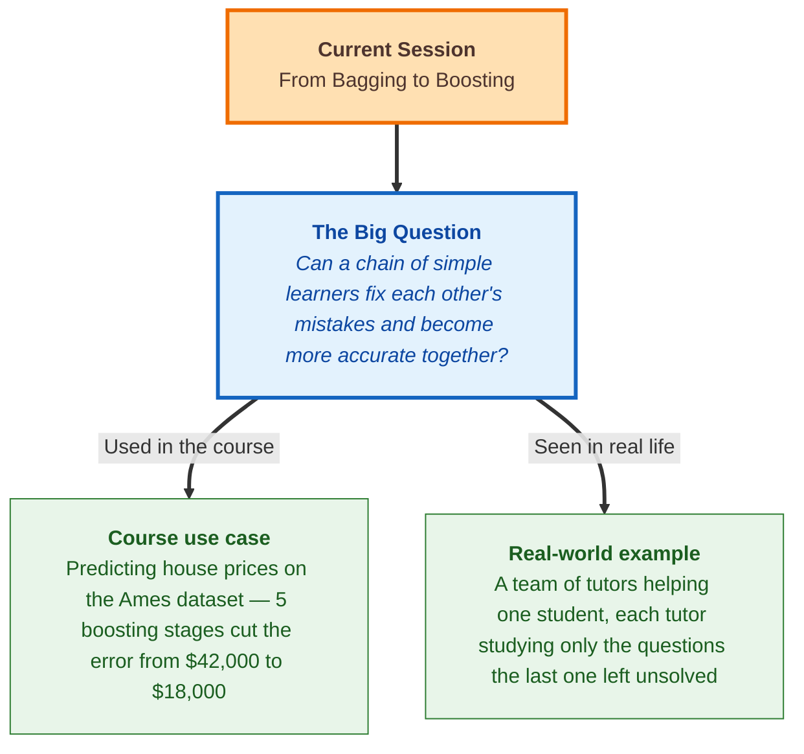

## <span style="color:#2F7DDE">From Bagging to Boosting</span>

### <span style="color:#2F7DDE">Mental Map</span>



---

### <span style="color:#2F7DDE">What You'll Learn</span>

Have you ever wondered how each tutor in a chain knows exactly which questions you still got wrong?

By the end of this session, you will be able to:

- <span style="color:#D9660B">**Describe**</span> how a chain of simple learners targets only the mistakes left by the one before it.
- <span style="color:#D9660B">**Explain**</span> how a scoring system marks wrong examples and raises their weight for the next round.
- <span style="color:#D9660B">**Summarise**</span> how a small step size controls how much each correction shifts the final answer.
- <span style="color:#D9660B">**Demonstrate**</span> how to run a step-by-step error-correction model on a table of student scores.
- <span style="color:#D9660B">**Compare**</span> learners working in parallel with a chain where each one corrects the last.

> <span style="color:#2F7DDE">**Topics you will meet:**</span> Boosting idea; Bagging vs boosting; AdaBoost reweighting; Gradient boosting model; Boosting learning rate.
>
> Join the session to learn each of these in detail.

---

### <span style="color:#2F7DDE">Why You Are Learning This Topic</span>

Imagine you have one tutor who teaches you everything once. You still miss questions. A second tutor explains only the ones you got wrong. A third tutor does the same for what the second one missed.

A <span style="color:#D9660B">**boosting method**</span> means each new learner targets the errors the previous ones left.

In this course, one tree often misses patterns that a chain of learners catches.

> <span style="color:#2F7DDE">**Think about it:**</span> If each tutor only teaches what you got wrong, can ten short sessions beat one long one?

---

### <span style="color:#2F7DDE">The Tutoring Chain Puzzle</span>

These scores show four students across three rounds of tutoring.

| Student | Round 1 | Round 2 | Round 3 | Wrong after Round 3 |
|---------|---------|---------|---------|---------------------|
| Priya | 55 | 72 | 83 | 4 |
| James | 48 | 65 | 79 | 5 |
| Lena | 60 | 74 | 88 | 3 |
| Omar | 42 | 70 | 85 | 4 |

<span style="color:#D9660B">**What you want to happen:**</span>

- Find which questions Priya and Omar missed each round.
- Predict each student's score in a fourth round.
- Pick a step size that stops scores from overshooting.

Here is how it might start. You do not need to understand it yet.

```python
from sklearn.ensemble import GradientBoostingClassifier
clf = GradientBoostingClassifier(n_estimators=5, learning_rate=0.1)
clf.fit(round_scores, passed)
```

> <span style="color:#D9660B">**Wonder about this:**</span>
>
> - Will scores keep improving if the fourth tutor gives a full correction, or will they wobble?
> - What if a tutor focused on Priya's errors, even though James has more wrong answers?

---

### <span style="color:#2F7DDE">Think It Through</span>

There is no wrong first try. Keep your guesses for the session.

**1. James scored 48 in round 1 and Priya scored 55. Which student will the second tutor focus on more?**
Hint: Who has more errors to fix?

**2. If each round applies the same full correction, could a student's score jump past the right answer?**
Hint: What if corrections are not scaled down?

**3. Five tutors each work alone on the full topic. Five tutors each build only on what the last one missed. Which group leaves fewer wrong answers?**
Hint: Does one round's result feed into the next?

---

### <span style="color:#2F7DDE">One Question to Carry Into the Session</span>

> <span style="color:#2F7DDE">**Can a chain of small corrections add up to a highly accurate final answer?**</span>
>
> And how small should each correction be to keep helping?
