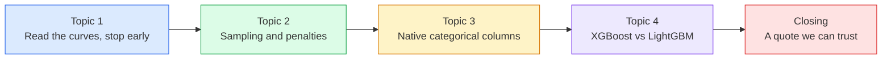
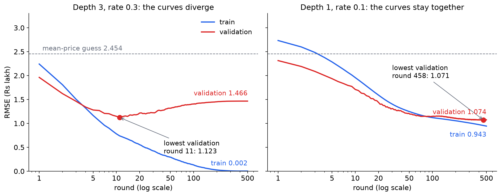
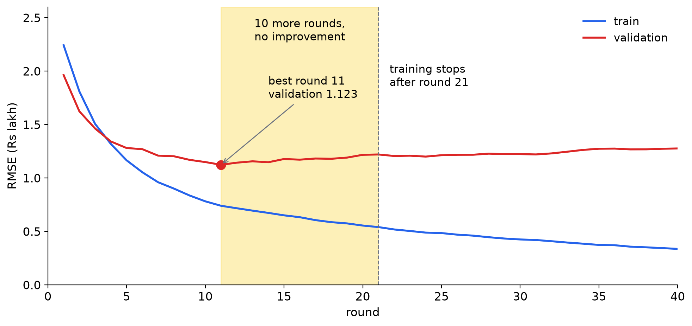
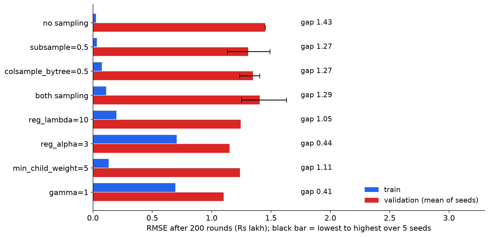
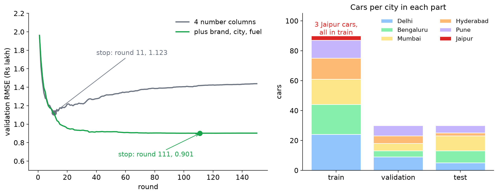
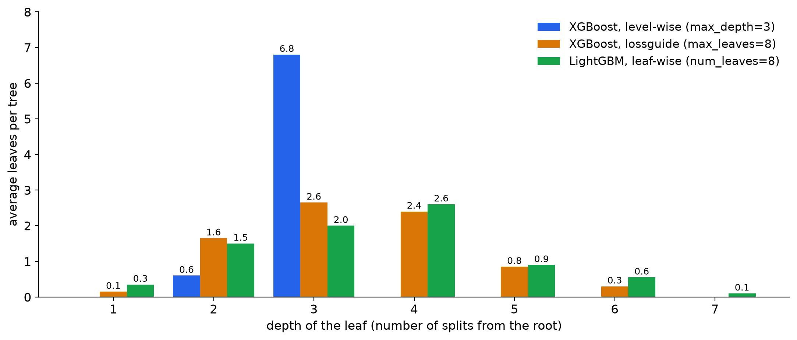
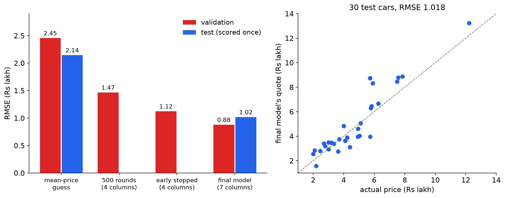

# <font color='#1d4ed8'>Lecture Script: Tuning an XGBoost Model</font>

---

## <font color='blue'>Agenda</font>

The lecture runs as four topics. Each topic ends with a quiz.

| Topic | What we do | Learning objectives covered | Minutes |
|:-:|:--|:--|:-:|
| 1 | Read the curves, then stop at the best round | Diagnose an overfitting boosted model from diverging train and validation curves<br>Train an XGBoost model with early stopping on a validation set | 30 |
| 2 | Limit what each tree can memorise | Configure row sampling, column sampling and regularisation in a boosted ensemble | 25 |
| 3 | Let the model read brand, city and fuel | Configure native categorical feature support in a gradient boosting library | 25 |
| 4 | Set XGBoost beside LightGBM | Compare XGBoost and LightGBM on tree growth and split-finding strategy | 25 |
| — | Closing: Outcome & Summary | | 15 |
| | **Total** | | **120** |

> <font color="red">**🎯 Instructor Note**</font> Pace: in Topic 1 spend the time on reading the curves and on what early stopping keeps; the patience loop is a quick check. In Topic 2 the hand check of one leaf matters most; the two tables of settings are quick, and every number in them comes from 30 validation cars.
> In Topic 3 the dtype and the flag are the point; keep LightGBM to one short check. In Topic 4 spend about 10 minutes on the tree-shape table and keep the comparison short.

---

## <font color='blue'>Scenario</font>

A Cars24-style used-car marketplace gives every seller an instant offer the moment they enter their car's details. A boosted tree model, trained on past sales, sets the offer from the car's showroom price, age, kilometres and owners, and from its brand, city and fuel.

**The risk:** a model that has memorised its past sales quotes new cars badly. A quote that is too low sends the seller away, and one that is too high loses the marketplace money on resale.

> <font color="red">**🎯 Instructor Note**</font> Cars24 is only the setting. Do not claim it uses this data; the 150 cars in `data/used_cars.csv` are invented for teaching (repeated ages and owners, 5 missing kilometres, 2 missing fuel values, a floor of Rs 2 lakh, and Jaipur with only 3 cars).
> Outputs come from Python 3.14, pandas 3.0.1, numpy 2.4.4, scikit-learn 1.8.0, xgboost 3.4.1 and lightgbm 4.7.0. In Colab, if either library is missing, run `!pip install xgboost lightgbm` once. Every model uses `n_jobs=1` and a fixed seed, so outputs repeat; other versions may give slightly different numbers.

---

## <font color='blue'>Problem Statement</font>

The pricing team trained a boosted model on showroom price, age, kilometres and owners, and let it run for 500 rounds. Its error on the 90 past sales it learned from fell to 0.002 lakh, almost perfect, so the team switched it on. Then the owner of car C019, a 3-year-old Maruti with a showroom price of Rs 7.92 lakh, was offered Rs 3.00 lakh. The car sold for Rs 6.66 lakh. On 30 cars the model had never seen, its typical error was Rs 1.47 lakh, and a plain guess of the average price scores 2.45. A near-perfect score on past sales had told the team nothing about new cars.

> <font color='purple'>**How do we stop a boosted model from memorising its past sales, and which settings keep its quotes honest on cars it has never seen?**</font>

> <font color="red">**🎯 Instructor Note**</font> Poll: "A model trained for 500 rounds has a training error of 0.002 and a validation error of 1.47. What do you try first? A) train 500 more rounds because training error is still falling, B) keep the round where validation error was lowest and limit how much each tree can fit, C) delete the validation set so the score looks better, D) raise the learning rate so training finishes sooner." Give learners 30 seconds to respond in chat. Reveal the answer in the Closing.

---

## <font color='blue'>What We Will Use</font>

Two boosting libraries, with the scikit-learn-style classes you already know from `fit` and `predict`. One round means one new tree added to the ensemble. Errors are RMSE in Rs lakh (1 lakh = Rs 100,000), and the gap is validation RMSE minus train RMSE.

| Topic | Tools | In one line |
|:-:|:--|:--|
| 1 | `XGBRegressor`, `eval_set`, `evals_result()`, `early_stopping_rounds`, `best_iteration` | Train, record the train and validation error of every round, and stop when validation stops improving |
| 2 | `subsample`, `colsample_bytree`, `reg_lambda`, `reg_alpha`, `min_child_weight`, `gamma` | Six settings that limit what each tree can memorise |
| 3 | pandas `category` dtype, `enable_categorical=True`, `tree_method="hist"`, `LGBMRegressor`, `lgb.early_stopping`, `min_data_per_group` | Let both libraries split on words as sets of levels |
| 4 | `grow_policy`, `max_leaves`, `num_leaves`, `tree_method`, `max_bin` | See how the two libraries grow trees and choose cuts |

---

## <font color='blue'>How: Walking Through the Used-Car Quote Model</font>



---

## <font color='blue'>Topic 1: Read the Curves, Then Stop at the Best Round</font> `30 min`

In the From Bagging to Boosting session you trained a gradient boosting model and saw how the learning rate shrinks each stage. In the ML workflow session you split data into train, validation and test sets, in the multiple regression session you compared training and validation error, and in the decision trees session you limited a tree's depth and leaf size. Today the model is `XGBRegressor`, a boosting library with the same ideas, and we use RMSE (the typical size of the error, in lakh) as the score.

> <font color='purple'>**The 500-round model scored almost zero on the cars it learned and failed on C019. How do we see that coming, and where do we stop?**</font>

### <font color='green'>Example: set three parts aside and read 500 rounds of curves</font>

> <font color='purple'>**What does one car look like, and how well does a plain guess of the average price do?**</font>

The target is `price_lakh`. The columns `brand`, `city` and `fuel` hold words; `showroom_lakh` is the price when the car was new, and `km_thousand` is thousands of kilometres. The four number columns are `showroom_lakh`, `age_years`, `km_thousand` and `owners`.

**Predict before running: What will happen?**

> <font color="red">**🎯 Instructor Note**</font> Expected: 150 rows and 9 columns, with 5 missing `km_thousand` values and 2 missing `fuel` values. Common guess: learners expect the missing values to be a problem for XGBoost.

```python
import numpy as np
import pandas as pd

df = pd.read_csv("data/used_cars.csv")
print(df.shape)
print(df.head(5).to_string())
print(df.isna().sum()[df.isna().sum() > 0].to_dict())
```

**Output**

```
(150, 9)
  car_id     brand       city    fuel  age_years  km_thousand  owners  showroom_lakh  price_lakh
0   C001    Maruti      Delhi  Petrol          9         81.0       2           6.01        2.00
1   C002     Honda  Bengaluru  Petrol          7         80.0       3           7.54        2.90
2   C003   Hyundai      Delhi  Diesel          4         37.0       1          11.19        5.57
3   C004    Toyota  Bengaluru  Petrol          6         70.0       1          18.97        9.90
4   C005  Mahindra     Mumbai  Petrol         10        113.0       2          15.98        3.44
{'fuel': 2, 'km_thousand': 5}
```

#### <font color='#c2410c'>Code Explanation</font>

- **Lines 1 and 2** Load numpy and pandas.
- **Line 4** Reads the car file into a table called `df`.
- **Line 5** Prints the size as (rows, columns).
- **Line 6** Shows the first 5 cars.
- **Line 7** Lists the columns that have empty values and how many each has.

> <font color='green'>**Result**</font> Each row is one car with 7 clues and a price. 5 cars have no kilometre reading and 2 have no fuel value. XGBoost accepts empty values in a number column as they are: at every split it learns which side the empty cars should go. We do not fill them in.

**Predict before running: What will happen?**

> <font color="red">**🎯 Instructor Note**</font> Expected: 90 training, 30 validation and 30 test cars. The guess of the average training price gives a validation RMSE of about 2.45 lakh; this is the baseline to beat.

```python
from sklearn.model_selection import train_test_split

num_cols = ["showroom_lakh", "age_years", "km_thousand", "owners"]
cat_cols = ["brand", "city", "fuel"]
X, y = df[num_cols + cat_cols].copy(), df["price_lakh"]
X_train, X_rest, y_train, y_rest = train_test_split(X, y, test_size=0.4, random_state=42)
X_val, X_test, y_val, y_test = train_test_split(X_rest, y_rest, test_size=0.5, random_state=42)
print(len(X_train), len(X_val), len(X_test))
print("mean-price guess, validation RMSE:", round(float(np.sqrt(((y_val - y_train.mean()) ** 2).mean())), 3))
```

**Output**

```
90 30 30
mean-price guess, validation RMSE: 2.454
```

#### <font color='#c2410c'>Code Explanation</font>

- **Lines 3 and 4** Name the four number columns and the three word columns.
- **Line 5** `X` holds the seven clue columns (a copy, so changing it leaves `df` alone) and `y` the price.
- **Lines 6 and 7** Set 40% of the cars aside with a fixed seed, then split that 40% in half: validation and test, as in the ML workflow session.
- **Line 8** Prints the three sizes.
- **Line 9** The baseline: guess the average training price for every validation car and compute the RMSE.

> <font color='green'>**Result**</font> The model learns from 90 cars. The 30 validation cars choose the round and the settings, and the 30 test cars stay untouched until the very end, when they are scored once. A guess of the average price has a validation RMSE of 2.454 lakh.

> <font color='purple'>**If we let the model run for 500 rounds, does the error on unseen cars keep falling as the error on the training cars does?**</font>

`XGBRegressor` adds one tree per round. We hand it two sets to measure after every round: the training cars first and the validation cars second. `evals_result()` returns the RMSE of both sets for every round.

**Predict before running: What will happen?**

> <font color="red">**🎯 Instructor Note**</font> Ask: "Will the validation RMSE keep falling for 500 rounds?" Give learners 30 seconds to respond in chat. Expected: no; it reaches its lowest value early and then rises.

```python
from xgboost import XGBRegressor

params = dict(learning_rate=0.3, max_depth=3, tree_method="hist", eval_metric="rmse", n_jobs=1, random_state=42)
long = XGBRegressor(n_estimators=500, **params)
long.fit(X_train[num_cols], y_train, eval_set=[(X_train[num_cols], y_train), (X_val[num_cols], y_val)], verbose=False)
curve = long.evals_result()
print(list(curve.keys()), list(curve["validation_0"].keys()))
train_rmse = np.array(curve["validation_0"]["rmse"])
val_rmse = np.array(curve["validation_1"]["rmse"])
print(len(train_rmse), len(val_rmse))
```

**Output**

```
['validation_0', 'validation_1'] ['rmse']
500 500
```

#### <font color='#c2410c'>Code Explanation</font>

- **Line 3** The settings every model in this lecture shares: `learning_rate=0.3` (the shrink rate from the boosting session; 0.3 is XGBoost's default), `max_depth=3` (small trees), `tree_method="hist"` (the histogram method, the default in recent versions; we write it so every version behaves the same), `eval_metric="rmse"` (the number recorded each round), `n_jobs=1` (one thread, so results repeat) and a fixed seed.
- **Line 4** Builds a model that will add 500 trees.
- **Line 5** `fit` takes the 4 number columns of the training cars. `eval_set` lists the two sets to measure, and `verbose=False` stops it printing every round.
- **Line 6** `evals_result()` returns a dictionary of the recorded errors.
- **Line 7** The keys are `validation_0` (the first set, our training cars) and `validation_1` (the second, our validation cars). Each holds the metric `rmse`.
- **Lines 8 to 10** Turn the two lists into arrays and check that each has one value per round.

**Predict before running: What will happen?**

> <font color="red">**🎯 Instructor Note**</font> Expected: train RMSE falls to 0.002. Validation RMSE bottoms out at 1.123 in round 11 and climbs back to 1.466.

```python
for k in [1, 5, 10, 20, 50, 100, 500]:
    print(f"round {k:3d}  train {train_rmse[k-1]:.3f}  validation {val_rmse[k-1]:.3f}  gap {val_rmse[k-1] - train_rmse[k-1]:.3f}")
low = val_rmse.argmin()
print("lowest validation RMSE:", round(val_rmse[low], 3), "at round", low + 1)
```

**Output**

```
round   1  train 2.241  validation 1.962  gap -0.279
round   5  train 1.165  validation 1.280  gap 0.115
round  10  train 0.781  validation 1.148  gap 0.367
round  20  train 0.554  validation 1.216  gap 0.662
round  50  train 0.294  validation 1.318  gap 1.024
round 100  train 0.131  validation 1.406  gap 1.274
round 500  train 0.002  validation 1.466  gap 1.464
lowest validation RMSE: 1.123 at round 11
```

#### <font color='#c2410c'>Code Explanation</font>

- **Lines 1 and 2** For seven chosen rounds, print the train error, the validation error and their gap.
- **Line 3** `argmin` finds the position of the lowest validation error; rounds are counted from 1, so we add 1.
- **Line 4** Prints that lowest value and its round.

<p align="center"></p>

> <font color='green'>**Result**</font> Training error falls all the way from 2.241 to 0.002, but validation error reaches its lowest value, 1.123, in round 11 and then climbs to 1.466. The gap grows from -0.279 in round 1 to 1.464 in round 500. When the train curve keeps falling while the validation curve turns up, the model is fitting noise in the 90 training cars. This is the overfitting signature from the multiple regression session, now read from a boosted model.

### <font color='green'>Extending it: put a number on the divergence and compare with a curve that behaves</font>

> <font color='purple'>**Can one function tell a diverging pair of curves from a healthy one?**</font>

For each model, find the round with the lowest validation error, then see how validation and train changed after it, and what the final gap is. The second model uses stumps (`max_depth=1`) and a rate of 0.1.

**Predict before running: What will happen?**

> <font color="red">**🎯 Instructor Note**</font> Ask: "Which of the two will show validation rising after its best round?" Give learners 30 seconds to respond in chat. Expected: the first; the stump model's validation barely moves.

```python
def fit_xgb(cols, n=500, **kw):
    m = XGBRegressor(n_estimators=n, **{**params, **kw})
    return m.fit(X_train[cols], y_train, eval_set=[(X_train[cols], y_train), (X_val[cols], y_val)], verbose=False)
def diagnose(m):
    c = m.evals_result()
    tr, va = np.array(c["validation_0"]["rmse"]), np.array(c["validation_1"]["rmse"])
    b = va.argmin()
    return f"lowest validation at round {b + 1}, then validation {va[-1] / va[b] - 1:+.1%}, train {tr[-1] / tr[b] - 1:+.1%}, final gap {va[-1] - tr[-1]:.3f}"
print("500 rounds, depth 3, rate 0.3:", diagnose(long))
print("500 rounds, depth 1, rate 0.1:", diagnose(fit_xgb(num_cols, max_depth=1, learning_rate=0.1)))
```

**Output**

```
500 rounds, depth 3, rate 0.3: lowest validation at round 11, then validation +30.6%, train -99.7%, final gap 1.464
500 rounds, depth 1, rate 0.1: lowest validation at round 458, then validation +0.3%, train -1.3%, final gap 0.131
```

#### <font color='#c2410c'>Code Explanation</font>

- **Lines 1 to 3** `fit_xgb` fits a model on the chosen columns and measures train and validation after every round. Any settings passed in `kw` override the shared `params`.
- **Lines 4 to 8** `diagnose` reads the two curves, finds the best validation round `b`, and describes the changes after it.
- **Line 9** Diagnoses the 500-round model from the first Example.
- **Line 10** Fits and diagnoses the stump model.

> <font color='green'>**Result**</font> The first model's validation error rose 30.6% after its best round while its training error fell 99.7%, and its final gap is 1.464: diverging curves, so it is overfitting. The stump model's validation error changed by +0.3% and its gap is 0.131: the curves stay together, so there is no sign of overfitting. Thirty validation cars can only show a large divergence, not a small one, so a change of 0.3% means nothing.

> <font color='#b45309'>**Common mistake**</font> Trusting the training error. A training RMSE of 0.002 looks perfect, but it only says that the model has memorised the cars it was shown. Always read the validation curve beside it.

### <font color='green'>Extending it: stop when validation stops improving</font>

> <font color='purple'>**Instead of picking the round by eye, can XGBoost stop itself and keep the best round?**</font>

Setting `early_stopping_rounds=10` tells XGBoost to stop once the validation error has not improved for 10 rounds in a row, and to remember the best round.

**Predict before running: What will happen?**

> <font color="red">**🎯 Instructor Note**</font> Expected: best round 11, so `best_iteration` is 10 (counted from 0); 21 rounds built; `predict` uses the first 11. Early stopping watches the last `eval_set` entry, so the validation set goes last.
> `early_stopping_rounds` and `eval_metric` are constructor arguments from xgboost 1.6; older code passed them to `fit`. Here `predict` already uses the best round, and we check it by recomputing the RMSE.

```python
stop = XGBRegressor(n_estimators=500, early_stopping_rounds=10, **params)
stop.fit(X_train[num_cols], y_train, eval_set=[(X_train[num_cols], y_train), (X_val[num_cols], y_val)], verbose=False)
built = len(stop.evals_result()["validation_1"]["rmse"])
print("best_iteration:", stop.best_iteration, " best_score:", round(stop.best_score, 4))
print("rounds built:", built, " rounds used by predict:", stop.best_iteration + 1)
pred = stop.predict(X_val[num_cols])
print("validation RMSE from predict:", round(float(np.sqrt(((y_val - pred) ** 2).mean())), 4))
```

**Output**

```
best_iteration: 10  best_score: 1.1229
rounds built: 21  rounds used by predict: 11
validation RMSE from predict: 1.1229
```

#### <font color='#c2410c'>Code Explanation</font>

- **Line 1** The same model as before, but with `early_stopping_rounds=10`.
- **Line 2** The same `fit` call. The validation set is the last entry, so it is the one watched.
- **Line 3** Counts how many rounds were actually built.
- **Line 4** `best_iteration` is counted from 0, so 10 means round 11. `best_score` is the validation RMSE of that round.
- **Line 5** Rounds built equal the best round plus the 10 patience rounds, and `predict` uses only the best 11 trees.
- **Lines 6 and 7** Predict the validation cars and recompute the RMSE by hand.

<p align="center"></p>

> <font color='green'>**Result**</font> Training stopped after 21 rounds, kept the 11 best, and the validation RMSE of 1.1229 matches `best_score`. The 479 remaining rounds were never built.

**Predict before running: What will happen?**

> <font color="red">**🎯 Instructor Note**</font> Expected: C019 gets a quote nearer to 6.66 after early stopping than after 500 rounds, but it is still low. One car is an illustration, not a test.

```python
car = X_val.loc[[18], num_cols]
print("C019 sold for", y_val[18], "lakh")
print(f"quote after 500 rounds: {long.predict(car)[0]:.2f}   quote with early stopping: {stop.predict(car)[0]:.2f}")
```

**Output**

```
C019 sold for 6.66 lakh
quote after 500 rounds: 3.00   quote with early stopping: 4.70
```

#### <font color='#c2410c'>Code Explanation</font>

- **Line 1** Takes car C019 (row label 18) from the validation cars, with the four number columns.
- **Line 2** Prints what it sold for.
- **Line 3** Asks the 500-round model and the early-stopped model for a quote.

> <font color='green'>**Result**</font> The 500-round model quoted 3.00 lakh and the early-stopped model quotes 4.70 lakh, against a sale price of 6.66. Stopping at the best round helps, and the quote is still 1.96 lakh low. The model sees only four number columns, not the car's brand, city or fuel.

### <font color='green'>Extending it: how patient should the stopping rule be?</font>

> <font color='purple'>**Does the best round change if we wait 5, 10, 20 or 50 rounds before stopping?**</font>

**Predict before running: What will happen?**

> <font color="red">**🎯 Instructor Note**</font> Expected: the same best round every time. Only the number of rounds built changes, always the best round plus the patience.

```python
for patience in (5, 10, 20, 50):
    m = fit_xgb(num_cols, early_stopping_rounds=patience)
    built = len(m.evals_result()["validation_1"]["rmse"])
    print(f"early_stopping_rounds={patience:2d}  best_iteration={m.best_iteration}  best_score={m.best_score:.4f}  rounds built={built}")
```

**Output**

```
early_stopping_rounds= 5  best_iteration=10  best_score=1.1229  rounds built=16
early_stopping_rounds=10  best_iteration=10  best_score=1.1229  rounds built=21
early_stopping_rounds=20  best_iteration=10  best_score=1.1229  rounds built=31
early_stopping_rounds=50  best_iteration=10  best_score=1.1229  rounds built=61
```

#### <font color='#c2410c'>Code Explanation</font>

- **Line 1** Loops over four values of `early_stopping_rounds`.
- **Line 2** Fits the model with each one.
- **Line 3** Counts the rounds built.
- **Line 4** Prints the patience, the best round (from 0), the best validation RMSE and the rounds built.

> <font color='green'>**Result**</font> Every run picks `best_iteration=10` and the same validation RMSE, 1.1229. The rounds built are 16, 21, 31 and 61, which is 11 plus the patience each time. A longer patience costs rounds, and it protects against stopping on a short flat stretch; here the validation curve had a clear minimum, so all four agree.

### <font color='green'>Extending it: why the validation score is slightly optimistic</font>

> <font color='purple'>**If the best round was picked because validation was lowest there, can we still trust the 1.1229 as the error on new cars?**</font>

#### <font color='#c2410c'>Logic Explanation</font>

- Early stopping looked at the validation RMSE of every round and kept the lowest one. The 1.1229 is the best of many looks at the same 30 cars, so on average it is a little better than what new cars will give.
- The same holds for any setting that is chosen because it scored best on the validation cars.
- That is why the 30 test cars have been set aside. Nothing has looked at them, and they are scored exactly once, after every choice is made.

> <font color="red">**🎯 Instructor Note**</font> Ask: "Why is the best validation score slightly optimistic?" Give learners 30 seconds to respond in chat. Expected: we picked the round and settings that scored best on those very cars.

### <font color='purple'>Quiz 1</font>

**Question:** A model is trained with `early_stopping_rounds=20`. Its validation RMSE is lowest at round 15 (so `best_iteration` is 14) and never improves again. How many rounds are built, and how many does `predict` use?

**Options:**
- A) 15 built and 15 used
- B) 35 built and 35 used
- C) 35 built and 15 used
- D) 34 built and 14 used

**Correct Answer:** C

**Explanation:**
- **A)** Wrong: after the best round XGBoost waits 20 more rounds before it stops, so those 20 are built too.
- **B)** Wrong: the 20 patience rounds are built, but `predict` uses only the trees up to the best round.
- **C)** Correct: the best round is 14 + 1 = 15, and 15 + 20 patience rounds = 35 built; `predict` uses the first 15.
- **D)** Wrong: this treats the 0-based `best_iteration` of 14 as a round number; the round is 15.

---

## <font color='blue'>Topic 2: Limit What Each Tree Can Memorise</font> `25 min`

In the multiple regression session you added an L2 penalty (Ridge) and an L1 penalty (Lasso) to stop a linear model from chasing noise, and in the decision trees and random forests session each tree learned from its own random sample of the rows. XGBoost has settings of both kinds for the trees of a boosted model.

> <font color='purple'>**Round 11 was the best this model could do before it began memorising the 90 cars. What can we change inside each tree so that it memorises less?**</font>

### <font color='green'>Example: one leaf by hand, with and without the penalty</font>

> <font color='purple'>**How does `reg_lambda` change the value of a leaf, and can we reproduce it by hand?**</font>

Six settings, with their defaults:

| Setting | What it does | Default |
|:--|:--|:-:|
| `subsample` | Each tree is fitted on a random share of the training cars, drawn again for every tree (row sampling) | 1 |
| `colsample_bytree` | Each tree may use only a random share of the columns (column sampling) | 1 |
| `reg_lambda` | An L2 penalty on the leaf values; it shrinks every leaf towards 0 | 1 |
| `reg_alpha` | An L1 penalty on the leaf values; it can push small leaves to exactly 0 | 0 |
| `min_child_weight` | A split must leave at least this much weight in each child; for squared error each car weighs 1, so it is roughly "at least this many cars in a leaf" | 1 |
| `gamma` | The least drop in the loss a split must bring to be allowed | 0 |

For squared error, a leaf's output (with `reg_alpha` at 0) is the sum of the errors still left in the leaf, divided by the number of cars plus $\lambda$, times the learning rate $\eta$:

$$\boxed{w = \eta \cdot \frac{\sum_{i \in \text{leaf}} (y_i - \hat{y}_i)}{n_{\text{leaf}} + \lambda}}$$

With $\lambda = 0$ this is the average error in the leaf. A larger $\lambda$ pulls the value towards 0, and it pulls hardest when $n_{\text{leaf}}$ is small, because the factor is $\tfrac{n}{n+\lambda}$. For $\lambda = 10$ it is $\tfrac{26}{36} = 0.72$ for 26 cars and $\tfrac{13}{23} = 0.57$ for 13 cars. We build a single stump (`n_estimators=1`, `learning_rate=1.0`) starting from the average price, so the error left is each car's price minus that average.

**Predict before running: What will happen?**

> <font color="red">**🎯 Instructor Note**</font> Expected: the by-hand numbers match the model's leaf values exactly. With the penalty the cut moves (14.57 to 11.00), because the gain also uses $\lambda$.

```python
def stump(lam):
    m = XGBRegressor(n_estimators=1, max_depth=1, learning_rate=1.0, reg_lambda=lam, base_score=float(y_train.mean()), tree_method="hist", n_jobs=1)
    return m.fit(X_train[num_cols], y_train).get_booster().trees_to_dataframe()
resid = y_train - y_train.mean()
for lam in (0, 10):
    t = stump(lam)
    small = X_train[t.Feature[0]] < t.Split[0]
    hand = [round(float(resid[k].sum() / (k.sum() + lam)), 4) for k in (small, ~small)]
    print(f"reg_lambda={lam:2d} cut {t.Feature[0]} < {t.Split[0]:.2f}  rows {int(small.sum())}/{int((~small).sum())}  model {t.Gain[1:].round(4).tolist()}  by hand {hand}")
```

**Output**

```
reg_lambda= 0 cut showroom_lakh < 14.57  rows 77/13  model [-0.8785, 5.2037]  by hand [-0.8785, 5.2037]
reg_lambda=10 cut showroom_lakh < 11.00  rows 64/26  model [-1.1607, 2.386]  by hand [-1.1607, 2.386]
```

#### <font color='#c2410c'>Code Explanation</font>

- **Lines 1 to 3** `stump` fits one tree of depth 1 with a given `reg_lambda`, starting from the average training price (`base_score`), and returns the tree as a table.
- **Line 4** The error left for each training car: its price minus the average price.
- **Line 5** Tries $\lambda = 0$ and $\lambda = 10$.
- **Line 6** Fits the stump for that $\lambda$.
- **Line 7** `t.Feature[0]` and `t.Split[0]` are the root's column and cut; `small` marks the cars below the cut, which go to the Yes leaf.
- **Line 8** The formula: the errors summed in each leaf, divided by the cars in it plus $\lambda$.
- **Line 9** Prints the cut, the car counts, the two leaf values the model stored (the `Gain` column of the leaf rows) and the by-hand values.

> <font color='green'>**Result**</font> The hand calculation matches the model: -0.8785 and 5.2037 with no penalty, and -1.1607 and 2.386 with $\lambda = 10$. The 26-car leaf holds 2.386; the same cars would hold about 3.3 without the penalty. A penalty shrinks the leaves, and the smallest leaves, the ones that rest on a few cars, shrink most.

### <font color='green'>Extending it: row and column sampling</font>

> <font color='purple'>**If each tree sees only half the cars, or half the columns, does the gap between train and validation shrink?**</font>

Sampling uses random numbers, so one seed is one draw. We train 200 rounds with no early stopping, average five seeds, and print the range of the validation error across them.

**Predict before running: What will happen?**

> <font color="red">**🎯 Instructor Note**</font> Expected: the gap shrinks a little (from 1.43 to about 1.27 to 1.29), but the validation range over seeds (for example 1.131 to 1.491) is wider than those differences.

```python
def gap(seeds=range(5), **kw):
    rows = []
    for s in seeds:
        c = fit_xgb(num_cols, n=200, random_state=s, **kw).evals_result()
        rows.append((c["validation_0"]["rmse"][-1], c["validation_1"]["rmse"][-1]))
    a = np.array(rows)
    g = a[:, 1] - a[:, 0]
    return f"train {a[:, 0].mean():.3f}  validation {a[:, 1].mean():.3f} (range {a[:, 1].min():.3f} to {a[:, 1].max():.3f})  gap {g.mean():.3f}"
print(f"{'no sampling':21s}", gap(seeds=[42]))
```

**Output**

```
no sampling           train 0.026  validation 1.451 (range 1.451 to 1.451)  gap 1.425
```

```python
sampling = {"subsample=0.5": dict(subsample=0.5), "colsample_bytree=0.5": dict(colsample_bytree=0.5),
            "both": dict(subsample=0.5, colsample_bytree=0.5)}
for name, kw in sampling.items():
    print(f"{name:21s}", gap(**kw))
```

**Output**

```
subsample=0.5         train 0.033  validation 1.307 (range 1.131 to 1.491)  gap 1.275
colsample_bytree=0.5  train 0.074  validation 1.347 (range 1.234 to 1.404)  gap 1.272
both                  train 0.112  validation 1.405 (range 1.251 to 1.630)  gap 1.293
```

#### <font color='#c2410c'>Code Explanation</font>

- **Lines 1 to 8 of the first block** `gap` fits 200 rounds for each seed, keeps the final train and validation RMSE, and returns the mean train, the mean validation, the validation range and the mean gap.
- **Last line of the first block** Runs it once for the model with no sampling (a fixed seed, so no randomness).
- **Second block** Runs five seeds for each sampling setting: `subsample=0.5` (half the cars per tree), `colsample_bytree=0.5` (2 of the 4 columns per tree) and both.

> <font color='green'>**Result**</font> Sampling lowered the gap a little, from 1.425 to between 1.272 and 1.293. But the validation error moves by more than that from one seed to the next: `subsample=0.5` runs from 1.131 to 1.491. A difference of 0.1 or 0.15 between two settings is smaller than the noise from the seed and from having only 30 validation cars, so we cannot say that any of these settings is better.

### <font color='green'>Extending it: the four penalty settings</font>

> <font color='purple'>**Which of `reg_lambda`, `reg_alpha`, `min_child_weight` and `gamma` narrows the gap the most?**</font>

These four use no random numbers, so one run is enough.

**Predict before running: What will happen?**

> <font color="red">**🎯 Instructor Note**</font> Ask: "Which two settings will hold the training error up the most?" Give learners 30 seconds to respond in chat. Expected: `reg_alpha=3` and `gamma=1`, with gaps near 0.4.

```python
penalties = {"reg_lambda=10": dict(reg_lambda=10), "reg_alpha=3": dict(reg_alpha=3),
             "min_child_weight=5": dict(min_child_weight=5), "gamma=1": dict(gamma=1)}
for name, kw in penalties.items():
    print(f"{name:21s}", gap(seeds=[42], **kw))
```

**Output**

```
reg_lambda=10         train 0.198  validation 1.245 (range 1.245 to 1.245)  gap 1.047
reg_alpha=3           train 0.706  validation 1.150 (range 1.150 to 1.150)  gap 0.444
min_child_weight=5    train 0.133  validation 1.238 (range 1.238 to 1.238)  gap 1.105
gamma=1               train 0.694  validation 1.102 (range 1.102 to 1.102)  gap 0.408
```

#### <font color='#c2410c'>Code Explanation</font>

- **Lines 1 and 2** Four settings, each changed alone: `reg_lambda=10`, `reg_alpha=3`, `min_child_weight=5` (at least 5 cars per leaf) and `gamma=1`.
- **Lines 3 and 4** For each one, run `gap` with the fixed seed 42 and print the result.

<p align="center"></p>

> <font color='green'>**Result**</font> All four narrow the gap, and the training error rises as they hold the trees back: `reg_alpha=3` and `gamma=1` bring it to 0.44 and 0.41, and the validation error falls from 1.451 to 1.150 and 1.102. `reg_lambda=10` and `min_child_weight=5` move the gap to 1.047 and 1.105. These runs have no randomness, but they all rest on the same 30 validation cars, so read them as "the gap narrowed", not as "this value is best".

### <font color='green'>Extending it: put early stopping and the settings together</font>

> <font color='purple'>**With early stopping switched on, do the four settings lower the validation error beyond what early stopping gave?**</font>

We keep `subsample=0.8`, `colsample_bytree=0.75`, `reg_lambda=10` and `min_child_weight=5`, run five seeds each way, and let early stopping (patience 20) choose the round.

**Predict before running: What will happen?**

> <font color="red">**🎯 Instructor Note**</font> Expected: the train error at the chosen round is higher with the settings, so the gap is narrower, but the validation error is about the same, with a wide range over seeds.

```python
chosen = dict(subsample=0.8, colsample_bytree=0.75, reg_lambda=10, min_child_weight=5)
for name, kw in {"early stopping only": {}, "with the four settings": chosen}.items():
    r = []
    for s in range(5):
        m = fit_xgb(num_cols, early_stopping_rounds=20, random_state=s, **kw)
        r.append((m.best_iteration + 1, m.evals_result()["validation_0"]["rmse"][m.best_iteration], m.best_score))
    a = np.array(r)
    print(f"{name:23s} round {a[:, 0].mean():5.1f}  train {a[:, 1].mean():.3f}  validation {a[:, 2].mean():.3f} (range {a[:, 2].min():.3f} to {a[:, 2].max():.3f})")
```

**Output**

```
early stopping only     round  11.0  train 0.739  validation 1.123 (range 1.123 to 1.123)
with the four settings  round  43.8  train 0.896  validation 1.134 (range 1.040 to 1.258)
```

#### <font color='#c2410c'>Code Explanation</font>

- **Line 1** The four chosen settings, kept in a dictionary named `chosen`.
- **Line 2** Loops over the two ways: early stopping only, and early stopping with the settings.
- **Lines 3 to 6** For each of five seeds, fits with patience 20 and records the best round, the train RMSE at that round and the validation RMSE.
- **Lines 7 and 8** Average the five runs and print the round, the train error, the validation error and its range.

> <font color='green'>**Result**</font> With the four settings the model trains for longer (round 43.8 on average against 11), the train error at the chosen round is 0.896 against 0.739, and the gap is 0.238 against 0.384. The validation error is 1.134 against 1.123, with a range of 1.040 to 1.258 over the seeds. The settings narrowed the gap here but did not lower the validation error beyond what early stopping gave, and we do not claim they do.

> <font color='#b45309'>**Common mistake**</font> Choosing a setting because one run gave a lower number. Run a few seeds for settings that use random numbers, and ask whether the difference is larger than the spread.

### <font color='purple'>Quiz 2</font>

**Question:** In one tree of a squared-error model, a leaf holds 20 training cars whose remaining errors sum to 30 lakh. With `reg_lambda=10`, `reg_alpha=0` and `learning_rate=0.3`, what is the leaf's value?

**Options:**
- A) 0.30
- B) 0.45
- C) 1.00
- D) 0.90

**Correct Answer:** A

**Explanation:**
- **A)** Correct: $0.3 \times \tfrac{30}{20 + 10} = 0.3 \times 1 = 0.30$.
- **B)** Wrong: $0.3 \times \tfrac{30}{20} = 0.45$ forgets $\lambda$ in the denominator, which is the case $\lambda = 0$.
- **C)** Wrong: $\tfrac{30}{20 + 10} = 1.00$ forgets to multiply by the learning rate 0.3.
- **D)** Wrong: $0.3 \times \tfrac{30}{10} = 0.90$ divides by $\lambda$ alone instead of the number of cars plus $\lambda$.

---

## <font color='blue'>Topic 3: Let the Model Read Brand, City and Fuel</font> `25 min`

So far the model has seen only four number columns. `brand`, `city` and `fuel` hold words. Many tools need each word turned into numbers first, either one 0 or 1 column for every level, or a code such as 0, 1, 2 that wrongly suggests an order. XGBoost and LightGBM can read the words as they are.

> <font color='purple'>**The model has never seen a car's brand, city or fuel. Can it read those words as they are?**</font>

### <font color='green'>Example: turn the word columns into a category type</font>

> <font color='purple'>**How many levels does each word column have, and where do the rare levels land in our three parts?**</font>

pandas has a `category` type: a column that holds one of a fixed list of levels. We give each column the list of its levels, then rebuild the three parts with the same seed, so the same cars land in the same parts.

**Predict before running: What will happen?**

> <font color="red">**🎯 Instructor Note**</font> Expected: 6 brands, 6 cities and 3 fuels, with 2 empty `fuel` values. Jaipur has only 3 cars, and all three are in the training part.

```python
print(df[cat_cols].nunique().to_dict(), df[cat_cols].isna().sum().to_dict())
for c in cat_cols:
    X[c] = X[c].astype(pd.CategoricalDtype(sorted(X[c].dropna().unique())))
X_train, X_rest, y_train, y_rest = train_test_split(X, y, test_size=0.4, random_state=42)
X_val, X_test, y_val, y_test = train_test_split(X_rest, y_rest, test_size=0.5, random_state=42)
print(X.dtypes.astype(str).to_dict())
print(pd.concat({"train": X_train.city.value_counts(), "validation": X_val.city.value_counts(), "test": X_test.city.value_counts()}, axis=1))
```

**Output**

```
{'brand': 6, 'city': 6, 'fuel': 3} {'brand': 0, 'city': 0, 'fuel': 2}
{'showroom_lakh': 'float64', 'age_years': 'int64', 'km_thousand': 'float64', 'owners': 'int64', 'brand': 'category', 'city': 'category', 'fuel': 'category'}
           train  validation  test
city                              
Delhi         24           9     5
Bengaluru     20           4     8
Mumbai        17           5    10
Hyderabad     14           5     2
Pune          12           7     5
Jaipur         3           0     0
```

#### <font color='#c2410c'>Code Explanation</font>

- **Line 1** Counts the levels and the empty values in each word column.
- **Lines 2 and 3** Gives each column in `X` a fixed list of its levels (sorted), so every part shares the same list. Empty values stay empty; they are not a level.
- **Lines 4 and 5** Repeat the split of Topic 1 with the same seed, now on the converted table.
- **Line 6** Shows the type of every column.
- **Line 7** Counts cars per city in each part.

> <font color='green'>**Result**</font> The three word columns are now `category`, and the four number columns are unchanged. Jaipur is a rare level: 3 cars, all in training, none in validation or test. A level seen so rarely cannot be learned reliably, and no held-out car can tell us how well it is handled.

### <font color='green'>Extending it: tell XGBoost to read the categories</font>

> <font color='purple'>**What happens if we hand XGBoost a category column without the flag, and how much does the model gain once it can read the words?**</font>

The flag is `enable_categorical=True`. Categorical splits also need the histogram method, `tree_method="hist"`, which we already use.

**Predict before running: What will happen?**

> <font color="red">**🎯 Instructor Note**</font> Expected: a ValueError asking for `enable_categorical=True`. xgboost 3.4.1 defaults the flag to True, so we pass False to show the message; older versions default to False. Always write it out.

```python
all_cols = num_cols + cat_cols
try:
    XGBRegressor(n_estimators=5, enable_categorical=False, **params).fit(X_train[all_cols], y_train)
except ValueError as e:
    print(e)
```

**Output**

```
DataFrame.dtypes for data must be int, float, bool or category. When categorical type is supplied, the experimental DMatrix parameter`enable_categorical` must be set to `True`.  Invalid columns:brand: category, city: category, fuel: category
```

#### <font color='#c2410c'>Code Explanation</font>

- **Line 1** Makes a list of all seven columns.
- **Lines 2 to 5** Try to fit with the flag switched off, and print the error text instead of stopping.

**Predict before running: What will happen?**

> <font color="red">**🎯 Instructor Note**</font> Expected: with the three word columns the validation error is about 0.9, below 1.12. Patience 10 stops at round 39, patience 20 at round 111, and the two scores differ by about 0.01.

```python
for patience in (10, 20):
    m = fit_xgb(all_cols, early_stopping_rounds=patience, enable_categorical=True)
    print(f"early_stopping_rounds={patience}  round {m.best_iteration + 1:3d}  validation RMSE {m.best_score:.4f}")
print("4 number columns only   : round", stop.best_iteration + 1, " validation RMSE", round(stop.best_score, 4), "(early_stopping_rounds=10)")
```

**Output**

```
early_stopping_rounds=10  round  39  validation RMSE 0.9137
early_stopping_rounds=20  round 111  validation RMSE 0.9014
4 number columns only   : round 11  validation RMSE 1.1229 (early_stopping_rounds=10)
```

#### <font color='#c2410c'>Code Explanation</font>

- **Line 1** Tries two patience values.
- **Line 2** Fits the model on all seven columns with `enable_categorical=True`.
- **Line 3** Prints the patience, the best round and the validation RMSE.
- **Line 4** Prints the number-columns-only result from Topic 1 for comparison.

<p align="center"></p>

> <font color='green'>**Result**</font> With the flag off, XGBoost refuses the category columns. With it on, the model reads brand, city and fuel directly, and the validation RMSE drops from 1.1229 to 0.9014 (about 20%). It is one split of 30 cars, so the size of the drop is rough. A patience of 10 stopped at round 39 with 0.9137 on a flat stretch, and a patience of 20 waited past it to 0.9014 at round 111. That difference is small next to the noise of 30 cars, but it shows how a short patience can stop on a flat stretch.

> <font color='#b45309'>**Common mistake**</font> Using `tree_method="exact"` with category columns. The exact method does not support them and stops with an error; use `hist` (or `approx`).

### <font color='green'>Extending it: what does a split on words look like?</font>

> <font color='purple'>**How does a tree split on `brand`, which has no order?**</font>

We fit one stump on the three word columns alone, so its root must be a word split, and read its table.

**Predict before running: What will happen?**

> <font color="red">**🎯 Instructor Note**</font> Expected: the root splits on `brand` and sends a group of five brands down the Yes branch, which holds 79 of the 90 cars. The one brand left out holds the other 11.

```python
one = fit_xgb(cat_cols, n=1, enable_categorical=True, max_depth=1, learning_rate=1.0)
t = one.get_booster().trees_to_dataframe()
f, codes, yes = t.Feature[0], t.Category[0], t.Yes[0]
levels = X_train[f].cat.categories
inside = X_train[f].isin([levels[i] for i in codes])
print(f, "levels sent to Yes:", [levels[i] for i in codes], " cover of the Yes leaf:", t[t.ID == yes].Cover.iloc[0])
print("training cars with those levels:", int(inside.sum()), "of", len(X_train))
```

**Output**

```
brand levels sent to Yes: ['Honda', 'Hyundai', 'Mahindra', 'Maruti', 'Tata']  cover of the Yes leaf: 79.0
training cars with those levels: 79 of 90
```

#### <font color='#c2410c'>Code Explanation</font>

- **Line 1** Fits one tree of depth 1 on the word columns, with a rate of 1.0.
- **Line 2** Reads the tree as a table.
- **Line 3** Takes the root's column, its `Category` list (the level numbers sent to the Yes branch) and the Yes child's id.
- **Line 4** The levels of that column, in order, so we can turn level numbers into names.
- **Line 5** Marks the training cars whose brand is in that list.
- **Lines 6 and 7** Print the names, the number of cars in the Yes leaf (`Cover`) and the number of cars whose brand is in the list.

> <font color='green'>**Result**</font> The stump splits `brand` as a set: Honda, Hyundai, Mahindra, Maruti and Tata go Yes (79 of 90 cars), and the remaining level, Toyota, goes No. The two counts agree. The library groups levels into two sides, so no order between the brands is assumed. Two more settings control this: `max_cat_to_onehot` (below this many levels it makes one-level-against-the-rest splits instead of grouping) and `max_cat_threshold` (the most levels a split may group).

### <font color='green'>Extending it: the same columns in LightGBM</font>

> <font color='purple'>**Does LightGBM read the same category columns, and does it need the same flag?**</font>

LightGBM detects `category` columns on its own (its `categorical_feature` option defaults to `"auto"`), so there is no flag. We write a helper that fits it with early stopping. `num_leaves=8` caps the leaves per tree, and `min_child_samples=5` lowers the fewest cars in a leaf (default 20, too big for 90 cars). The other settings make the run repeat and silent.

> <font color="red">**🎯 Instructor Note**</font> lightgbm 4.7.0 warns that `eval_set` is deprecated in favour of `eval_X` and `eval_y`; older versions only know `eval_set`, so we keep it and silence the warning.
> Early stopping is the `lgb.early_stopping` callback; since lightgbm 4.0 `fit` no longer takes `early_stopping_rounds`.

**Predict before running: What will happen?**

> <font color="red">**🎯 Instructor Note**</font> Expected: only the version line, 4.7.0, and no warning; the helper is defined but not yet run.

```python
import lightgbm as lgb
import warnings

warnings.filterwarnings("ignore", message="The argument 'eval_set'")
lgb_params = dict(learning_rate=0.3, num_leaves=8, min_child_samples=5, metric="rmse", n_jobs=1, random_state=42, deterministic=True, force_row_wise=True, verbose=-1)
def fit_lgb(cols, patience=10, n=500, **kw):
    m = lgb.LGBMRegressor(n_estimators=n, **{**lgb_params, **kw})
    cb = [lgb.early_stopping(patience, verbose=False)] if patience else None
    return m.fit(X_train[cols], y_train, eval_set=[(X_train[cols], y_train), (X_val[cols], y_val)], callbacks=cb)
print("lightgbm", lgb.__version__)
```

**Output**

```
lightgbm 4.7.0
```

#### <font color='#c2410c'>Code Explanation</font>

- **Lines 1 and 2** Load LightGBM and the `warnings` module.
- **Line 4** Hides only the `eval_set` deprecation message.
- **Line 5** The shared LightGBM settings; `metric="rmse"` makes it record RMSE, as XGBoost does.
- **Lines 6 to 9** `fit_lgb` builds the model, adds the early stopping callback unless `patience` is None, and fits it with the training and validation cars.
- **Line 10** Prints the installed version.

LightGBM's categorical settings have defaults made for large tables. When it groups several levels on one side of a split, each group must hold at least `min_data_per_group` cars (default 100). A column with at most 4 levels (`max_cat_to_onehot`, default 4) is split one level against the rest instead, and this rule does not apply there. We try the default and a value of 5, and count the splits on each word column.

**Predict before running: What will happen?**

> <font color="red">**🎯 Instructor Note**</font> Expected: with the default of 100 and only 90 training cars, no split ever groups brand or city levels, so they get 0 splits; fuel, with 3 levels, is still split. With 5 all three are used.

```python
for g in (100, 5):
    m = fit_lgb(all_cols, min_data_per_group=g)
    t = m.booster_.trees_to_dataframe()
    used = t[t.tree_index < m.best_iteration_].split_feature.value_counts()
    print(f"min_data_per_group={g:3d}  best_iteration_={m.best_iteration_:3d}  validation RMSE {m.best_score_['valid_1']['rmse']:.4f}")
    print("    splits on brand, city, fuel:", [int(used.get(c, 0)) for c in cat_cols])
```

**Output**

```
min_data_per_group=100  best_iteration_=  7  validation RMSE 0.9640
    splits on brand, city, fuel: [0, 0, 8]
min_data_per_group=  5  best_iteration_= 43  validation RMSE 0.6352
    splits on brand, city, fuel: [23, 11, 31]
```

#### <font color='#c2410c'>Code Explanation</font>

- **Line 1** Loops over two values of `min_data_per_group`.
- **Line 2** Fits LightGBM on all seven columns with early stopping (patience 10).
- **Lines 3 and 4** Read the trees as a table and count the splits on each column in the trees up to the best round.
- **Line 5** Prints the best round (`best_iteration_`, counted from 1) and the validation RMSE, read from `best_score_` under the key `valid_1`.
- **Line 6** Prints the number of splits on brand, city and fuel.

> <font color='green'>**Result**</font> With the default of 100, LightGBM never split on brand or city: grouping their 6 levels needs groups of 100 cars, and there are only 90. It split on fuel 8 times, one level against the rest, stopped at round 7 and scored 0.9640. With `min_data_per_group=5` it used all three word columns, ran to round 43 and scored 0.6352. This is one split of 30 cars, so take the lesson, not the number: a categorical default made for large tables can leave word columns unused on a small one, so check these settings.

### <font color='purple'>Quiz 3</font>

**Question:** A pandas column `fuel` holds the words Petrol, Diesel and CNG. Which setup lets XGBoost split on it as a set of levels?

**Options:**
- A) Replace the words with the codes 0, 1 and 2 and keep the column as a number
- B) Keep the column as text and set `tree_method="exact"`
- C) Drop the column
- D) Convert the column to the `category` type and fit with `enable_categorical=True` and `tree_method="hist"`

**Correct Answer:** D

**Explanation:**
- **A)** Wrong: codes 0, 1, 2 make the tree treat fuel as an ordered number and split it as "less than 1.5", which invents an order.
- **B)** Wrong: XGBoost does not accept a text column, and the exact method does not support categorical features.
- **C)** Wrong: this avoids the problem by throwing away a column that carries information about price.
- **D)** Correct: the `category` type gives the fixed list of levels, the flag switches on categorical support, and `hist` is a method that supports it.

---

## <font color='blue'>Topic 4: Set XGBoost Beside LightGBM</font> `25 min`

You fitted both libraries in Topic 3 and they accepted the same columns. Both build the same kind of ensemble, trees added one round at a time. They differ in how they grow a tree and in how they search for cuts.

> <font color='purple'>**Both libraries add trees one round at a time. Do they grow each tree the same way, and how do they pick where to split?**</font>

### <font color='green'>Example: how do the trees differ in shape?</font>

> <font color='purple'>**With about 8 leaves each, how deep do XGBoost and LightGBM trees go?**</font>

#### <font color='#c2410c'>Logic Explanation</font>

| | XGBoost | LightGBM |
|:--|:--|:--|
| Tree growth | Level-wise by default (`grow_policy="depthwise"`): every node at one level is split before the next level, and `max_depth` caps the levels | Leaf-wise: each step splits the one leaf, anywhere in the tree, whose split lowers the loss the most; `num_leaves` caps the leaves and `max_depth` is -1 (no cap) by default |
| Split finding | `tree_method`: `exact` tries every distinct value of a column as a cut; `approx` and `hist` use a limited set of candidate cuts built from the data; `hist` is the default in xgboost 2.0 and later | Histogram-based: each number column is cut into at most `max_bin` bins first (default 255), and only bin edges are tried as cuts |
| Shared idea | `hist` bins each number column once before training and then tries only bin edges as cuts | The same idea, used for every model |

XGBoost can also grow leaf-wise (`grow_policy="lossguide"` with `max_leaves`), so growth is a setting, not a property of a library.

XGBoost gets `max_depth=3` (at most 8 leaves). LightGBM gets `num_leaves=8` and no depth cap. We fit 20 rounds with no early stopping and print the leaves and the depth of the first 6 trees. Depth counts splits from the root to the deepest leaf.

**Predict before running: What will happen?**

> <font color="red">**🎯 Instructor Note**</font> Ask: "Will LightGBM's trees also stop at depth 3?" Give learners 30 seconds to respond in chat. Expected: no; they have 8 leaves but reach depth 4 to 6.

```python
xg = fit_xgb(all_cols, n=20, enable_categorical=True)
lg = fit_lgb(all_cols, patience=None, n=20, min_data_per_group=5)
def shape_xgb(m):
    return [(d.count("leaf="), max(line.count("\t") for line in d.split("\n"))) for d in m.get_booster().get_dump()]
def shape_lgb(m):
    g = m.booster_.trees_to_dataframe().groupby("tree_index")
    return list(zip(g.split_feature.apply(lambda s: int(s.isna().sum())), g.node_depth.max() - 1))
for k in range(6):
    print(f"tree {k}  XGBoost leaves {shape_xgb(xg)[k][0]} depth {shape_xgb(xg)[k][1]}   LightGBM leaves {shape_lgb(lg)[k][0]} depth {shape_lgb(lg)[k][1]}")
```

**Output**

```
tree 0  XGBoost leaves 8 depth 3   LightGBM leaves 8 depth 5
tree 1  XGBoost leaves 8 depth 3   LightGBM leaves 8 depth 4
tree 2  XGBoost leaves 7 depth 3   LightGBM leaves 8 depth 4
tree 3  XGBoost leaves 7 depth 3   LightGBM leaves 8 depth 5
tree 4  XGBoost leaves 7 depth 3   LightGBM leaves 8 depth 6
tree 5  XGBoost leaves 7 depth 3   LightGBM leaves 8 depth 6
```

#### <font color='#c2410c'>Code Explanation</font>

- **Lines 1 and 2** Fit 20 rounds of XGBoost (depth 3) and of LightGBM (8 leaves) on all seven columns.
- **Lines 3 and 4** `shape_xgb` reads each tree from XGBoost's text dump: it counts the `leaf=` lines for leaves and the tab indents for depth.
- **Lines 5 to 7** `shape_lgb` reads LightGBM's tree table: leaves are the rows with no split column, and depth is the deepest `node_depth` minus 1, since the root is counted as 1.
- **Lines 8 and 9** Print the first 6 trees side by side.

> <font color='green'>**Result**</font> XGBoost's trees stop at depth 3 and have 7 or 8 leaves; a node that cannot be split, for example because no split lowers the loss or keeps the minimum weight in each child, stays a leaf. LightGBM's trees always have 8 leaves, but they reach depth 4, 5 and 6, because it keeps splitting the most useful leaf wherever it is, so its trees are lopsided.

### <font color='green'>Extending it: growth is a setting</font>

> <font color='purple'>**Can XGBoost grow leaf-wise, and can LightGBM be held to a depth?**</font>

XGBoost with `grow_policy="lossguide"`, `max_depth=0` (no depth cap) and `max_leaves=8`; LightGBM with `max_depth=3`.

**Predict before running: What will happen?**

> <font color="red">**🎯 Instructor Note**</font> Expected: XGBoost's trees now have 8 leaves and depth 4 or 5. LightGBM's trees stop at depth 3, and with a cap of 8 leaves they hold 6 or 7.

```python
xl = fit_xgb(all_cols, n=20, enable_categorical=True, grow_policy="lossguide", max_depth=0, max_leaves=8)
ld = fit_lgb(all_cols, patience=None, n=20, min_data_per_group=5, max_depth=3)
for k in range(6):
    print(f"tree {k}  XGBoost lossguide leaves {shape_xgb(xl)[k][0]} depth {shape_xgb(xl)[k][1]}   LightGBM max_depth=3 leaves {shape_lgb(ld)[k][0]} depth {shape_lgb(ld)[k][1]}")
```

**Output**

```
tree 0  XGBoost lossguide leaves 8 depth 4   LightGBM max_depth=3 leaves 6 depth 3
tree 1  XGBoost lossguide leaves 8 depth 4   LightGBM max_depth=3 leaves 7 depth 3
tree 2  XGBoost lossguide leaves 8 depth 4   LightGBM max_depth=3 leaves 6 depth 3
tree 3  XGBoost lossguide leaves 8 depth 4   LightGBM max_depth=3 leaves 6 depth 3
tree 4  XGBoost lossguide leaves 8 depth 5   LightGBM max_depth=3 leaves 6 depth 3
tree 5  XGBoost lossguide leaves 8 depth 4   LightGBM max_depth=3 leaves 6 depth 3
```

#### <font color='#c2410c'>Code Explanation</font>

- **Line 1** XGBoost leaf-wise: `lossguide` growth, no depth cap, at most 8 leaves.
- **Line 2** LightGBM with a depth cap of 3 added to its 8-leaf limit.
- **Lines 3 and 4** Print the first 6 trees of each, using the helpers from the last block.

<p align="center"></p>

> <font color='green'>**Result**</font> Switched to `lossguide`, XGBoost now grows lopsided trees with 8 leaves and depth 4 or 5, and held to `max_depth=3`, LightGBM's trees have 6 or 7 leaves and depth 3. The chart shows 20 trees of three set-ups: level-wise XGBoost puts almost all of its leaves at depth 3, while the two leaf-wise set-ups spread theirs from depth 1 to depth 7. Tree growth is a choice of policy that either library can make.

### <font color='green'>Extending it: how do they choose cuts?</font>

> <font color='purple'>**How many different cuts on `showroom_lakh` does each method use, and what happens with 8 bins?**</font>

We fit 30 rounds on the four number columns and count the different cut values used on `showroom_lakh`. In the XGBoost call `tree_method="exact"` tries every distinct value, and `max_bin` sets how many bins the histogram methods use. With 256 bins and only 84 different values, XGBoost's `hist` gives every value its own bin, so it can try the same cuts as `exact`. With 8 bins there are at most 7 places to cut.

**Predict before running: What will happen?**

> <font color="red">**🎯 Instructor Note**</font> Expected: `exact` and `hist` with 256 bins use dozens of cuts. With 8 bins both libraries are left with only a handful, here 6 each.

```python
def cuts(lib, **kw):
    if lib == "xgb":
        t = XGBRegressor(n_estimators=30, **{**params, **kw}).fit(X_train[num_cols], y_train).get_booster().trees_to_dataframe()
        return t[t.Feature == "showroom_lakh"].Split.nunique()
    t = lgb.LGBMRegressor(n_estimators=30, **{**lgb_params, **kw}).fit(X_train[num_cols], y_train).booster_.trees_to_dataframe()
    return t[t.split_feature == "showroom_lakh"].threshold.nunique()
print("showroom_lakh has", X_train.showroom_lakh.nunique(), "different values in the 90 training cars")
for lib, kw in [("xgb", dict(tree_method="exact")), ("xgb", dict(max_bin=256)), ("xgb", dict(max_bin=8)), ("lgb", dict(max_bin=255)), ("lgb", dict(max_bin=8))]:
    print(f"{lib}  {str(kw):26s} different cuts used for showroom_lakh: {cuts(lib, **kw)}")
```

**Output**

```
showroom_lakh has 84 different values in the 90 training cars
xgb  {'tree_method': 'exact'}   different cuts used for showroom_lakh: 53
xgb  {'max_bin': 256}           different cuts used for showroom_lakh: 46
xgb  {'max_bin': 8}             different cuts used for showroom_lakh: 6
lgb  {'max_bin': 255}           different cuts used for showroom_lakh: 24
lgb  {'max_bin': 8}             different cuts used for showroom_lakh: 6
```

#### <font color='#c2410c'>Code Explanation</font>

- **Lines 1 to 6** `cuts` fits 30 rounds on the four number columns and returns the number of different cut values used on `showroom_lakh`, read from XGBoost's table (`Split`) or LightGBM's (`threshold`).
- **Lines 7 to 9** Print how many different showroom prices the 90 training cars have, then the count for each setting.

> <font color='green'>**Result**</font> The 90 cars hold 84 different showroom prices. XGBoost's exact method used 53 different cuts and its histogram method with 256 bins used 46; both could try every value here, so the gap comes from the trees growing differently, not from the bins. With 8 bins XGBoost was left with 6. LightGBM used 24 with 255 bins (it also needs at least 3 cars per bin, `min_data_in_bin`, so rare values share a bin) and 6 with 8 bins. Fewer bins mean fewer possible cuts. The counts are not comparable between the two libraries, since their trees differ, and we make no claim about speed: 90 cars cannot show it.

### <font color='green'>Extending it: score them on the same cars</font>

> <font color='purple'>**On the same validation cars, which library scores better?**</font>

**Predict before running: What will happen?**

> <font color="red">**🎯 Instructor Note**</font> Ask: "Does a lower score on one split mean LightGBM is better?" Give learners 30 seconds to respond in chat. Expected: no; read the next block before deciding.

```python
xm = fit_xgb(all_cols, early_stopping_rounds=20, enable_categorical=True)
lm = fit_lgb(all_cols, patience=20, min_data_per_group=5)
print(f"XGBoost   round {xm.best_iteration + 1:3d}  validation RMSE {xm.best_score:.4f}")
print(f"LightGBM  round {lm.best_iteration_:3d}  validation RMSE {lm.best_score_['valid_1']['rmse']:.4f}")
```

**Output**

```
XGBoost   round 111  validation RMSE 0.9014
LightGBM  round  43  validation RMSE 0.6352
```

#### <font color='#c2410c'>Code Explanation</font>

- **Lines 1 and 2** Fit XGBoost (patience 20, categorical flag on) and LightGBM (patience 20, `min_data_per_group=5`) on all seven columns.
- **Lines 3 and 4** Print the best round and the validation RMSE of each.

Now repeat on five other ways to split the same 120 training and validation cars into 90 and 30. The 30 test cars are not touched.

**Predict before running: What will happen?**

> <font color="red">**🎯 Instructor Note**</font> Expected: neither library wins every split; LightGBM is lower in 3 of the 5 and XGBoost in 2.

```python
X_dev, y_dev = pd.concat([X_train, X_val]), pd.concat([y_train, y_val])
def rmse_both(seed):
    a, v, ya, yv = train_test_split(X_dev, y_dev, test_size=0.25, random_state=seed)
    xm = XGBRegressor(n_estimators=500, early_stopping_rounds=20, enable_categorical=True, **params).fit(a, ya, eval_set=[(v, yv)], verbose=False)
    lm = lgb.LGBMRegressor(n_estimators=500, min_data_per_group=5, **lgb_params).fit(a, ya, eval_set=[(v, yv)], callbacks=[lgb.early_stopping(20, verbose=False)])
    return xm.best_score, lm.best_score_["valid_0"]["rmse"]
res = np.array([rmse_both(s) for s in range(5)])
print(res.round(3).tolist())
print("mean validation RMSE  XGBoost", res[:, 0].mean().round(3), " LightGBM", res[:, 1].mean().round(3))
```

**Output**

```
[[1.272, 1.284], [1.07, 0.893], [0.753, 0.718], [0.887, 0.557], [0.705, 0.837]]
mean validation RMSE  XGBoost 0.937  LightGBM 0.858
```

#### <font color='#c2410c'>Code Explanation</font>

- **Line 1** Joins the training and validation cars into 120; the test cars stay out.
- **Lines 2 to 6** `rmse_both` splits the 120 cars with a seed, fits XGBoost and LightGBM with early stopping and returns the two validation RMSEs.
- **Line 7** Runs seeds 0 to 4 and collects the pairs (XGBoost first, LightGBM second).
- **Lines 8 and 9** Print the pairs and the two means.

> <font color='green'>**Result**</font> On our main split LightGBM scored 0.6352 against 0.9014 for XGBoost. On the five other splits each library had the lower error in some of them: LightGBM in 3 of the 5, XGBoost in 2. The means were 0.858 for LightGBM and 0.937 for XGBoost, but the differences within a pair run from 0.01 to 0.33 and go both ways. The settings of the two libraries were not matched or tuned equally, and each validation set has only 30 cars, so this comparison does not rank them. The real differences are the two ideas above: level-wise against leaf-wise growth, and the ways each one searches for cuts.

### <font color='purple'>Quiz 4</font>

**Question:** XGBoost is fitted with its default `grow_policy` and `max_depth=3`. LightGBM is fitted with `num_leaves=8` and its default `max_depth=-1`. Which statement is true?

**Options:**
- A) Both libraries split every node of a level before going deeper, so all their trees have depth 3
- B) XGBoost's trees stop at depth 3, while LightGBM's trees can have the same 8 leaves but reach a greater depth
- C) Only XGBoost uses histograms to find cuts; LightGBM tries every distinct value
- D) LightGBM's trees always have exactly 3 levels because 8 leaves is $2^3$

**Correct Answer:** B

**Explanation:**
- **A)** Wrong: only XGBoost's default growth is level-wise; LightGBM splits the single most useful leaf next, wherever it is.
- **B)** Correct: `max_depth=3` caps XGBoost's levels, and LightGBM, which only caps the leaves, grew trees of depth 4 to 6 in our run.
- **C)** Wrong: LightGBM is histogram-based, and XGBoost's `hist` is a histogram method too; only `exact` tries every distinct value.
- **D)** Wrong: 8 leaves would give 3 levels only if the tree were balanced, and leaf-wise trees are not.

---

## <font color='blue'>Closing: Outcome & Summary</font> `15 min`

We started with a model that scored 0.002 on the cars it had learned and quoted C019 at 3.00 lakh. Now we answer the Problem Statement, using each topic once.

> <font color='purple'>**1. How do we see a boosted model memorising, and where do we stop? (Topic 1)**</font>

Read the two curves together. The model with 500 rounds had a train RMSE of 0.002 and a validation RMSE of 1.466, which had risen 30.6% from its low of 1.123 in round 11. Early stopping (`early_stopping_rounds`) finds that low point itself: it stopped after 21 rounds and kept the best 11. The validation score of the kept round is slightly optimistic, which is why the test cars were set aside.

> <font color='purple'>**2. Which settings keep each tree from memorising? (Topic 2)**</font>

`subsample` and `colsample_bytree` sample rows and columns, and `reg_lambda`, `reg_alpha`, `min_child_weight` and `gamma` limit the leaves and the splits. In our run the four chosen settings narrowed the gap from 0.384 to 0.238 at the chosen round, and left the validation error at about the same value (1.134 against 1.123, with a seed range of 1.040 to 1.258). They narrow the gap; on 30 cars they did not clearly lower the error.

> <font color='purple'>**3. Can the model read brand, city and fuel, and what quote does the finished model give C019? (Topic 3)**</font>

The finished model uses all seven columns with the category type and `enable_categorical=True`, early stopping with patience 20, and the four settings.

**Predict before running: What will happen?**

> <font color="red">**🎯 Instructor Note**</font> Expected: a validation RMSE near 0.9 and a C019 quote much closer to 6.66 than 4.70.

```python
chosen_params = dict(early_stopping_rounds=20, enable_categorical=True, **chosen)
final = fit_xgb(all_cols, **chosen_params)
r = final.evals_result()
print("final model: round", final.best_iteration + 1, " train RMSE", round(r["validation_0"]["rmse"][final.best_iteration], 3), " validation RMSE", round(final.best_score, 3))
car = X_val.loc[[18], all_cols]
print("C019 sold for", y_val[18], f"lakh, final quote: {final.predict(car)[0]:.2f}")
```

**Output**

```
final model: round 111  train RMSE 0.155  validation RMSE 0.878
C019 sold for 6.66 lakh, final quote: 5.85
```

#### <font color='#c2410c'>Code Explanation</font>

- **Line 1** Bundles early stopping (Topic 1), the categorical flag (Topic 3) and the four settings (Topic 2) into one dictionary.
- **Line 2** Fits the final model on all seven columns, with the two sets measured as in Topic 1.
- **Lines 3 and 4** Print the round kept, the train RMSE at that round and the validation RMSE.
- **Lines 5 and 6** Ask for a quote on C019 with all seven columns and print it beside its sale price.

> <font color='purple'>**4. Which library should we use? (Topic 4)**</font>

Neither is proven better on this data. They differ in how they grow a tree (XGBoost level-wise by default, LightGBM leaf-wise) and in how they search for cuts (`exact`, `approx` or `hist` against LightGBM's histograms), and either can be set to grow like the other. On five splits of the same 120 cars LightGBM was lower in 3 of 5 and XGBoost in 2, by amounts from 0.01 to 0.33. We keep XGBoost for the final quote, and the choice is not a verdict on LightGBM.

> <font color='purple'>**5. How does the final model do on cars nobody has looked at?**</font>

The 30 test cars are scored now, once. The mean-price guess is scored on the same cars for comparison.

**Predict before running: What will happen?**

> <font color="red">**🎯 Instructor Note**</font> Expected: a test RMSE a little above the validation 0.878, and far below the mean-price guess.

```python
test_pred = final.predict(X_test[all_cols])
print("test RMSE, scored once:", round(float(np.sqrt(((y_test - test_pred) ** 2).mean())), 3))
print("mean-price guess on the same 30 cars:", round(float(np.sqrt(((y_test - y_train.mean()) ** 2).mean())), 3))
```

**Output**

```
test RMSE, scored once: 1.018
mean-price guess on the same 30 cars: 2.144
```

#### <font color='#c2410c'>Code Explanation</font>

- **Line 1** Quotes the 30 test cars with the final model.
- **Line 2** Computes and prints the test RMSE with the same formula as in Topic 1, scored once.
- **Line 3** The same RMSE for a guess of the average training price.

<p align="center"></p>

### <font color='green'>Outcome</font>

| | First model (Topic 1) | Final model |
|:--|:-:|:-:|
| Columns used | 4 number columns | 4 number columns and brand, city, fuel |
| Rounds kept | 500 | 111 |
| Settings | depth 3, rate 0.3 | early stopping 20, `subsample` 0.8, `colsample_bytree` 0.75, `reg_lambda` 10, `min_child_weight` 5 |
| Train RMSE | 0.002 | 0.155 |
| Validation RMSE | 1.466 | 0.878 |
| Gap (validation minus train) | 1.464 | 0.723 |
| Quote for C019 (sold for 6.66) | 3.00 | 5.85 |
| Test RMSE, scored once | not scored | 1.018 (mean-price guess: 2.144) |

> <font color='green'>**Therefore,**</font> we stop the model at the round where validation error is lowest, limit what each tree can memorise, and let it read brand, city and fuel. Validation error fell from 1.466 to 0.878, and the quote for C019 moved from 3.00 to 5.85 lakh against a sale price of 6.66. The test error of 1.018 is higher than the validation error of 0.878, which fits the warning that a validation score used for choosing is slightly optimistic (with 30 cars, chance plays a part too), and it is well below 2.144 for the average-price guess. Most of the gain came from stopping at the right round and from adding the word columns; the last settings changed the validation error by less than the seed-to-seed spread of Topic 2, so we treat them as a way to narrow the gap, not as a proven gain. Thirty cars per set keeps all of these numbers rough.

> <font color="red">**🎯 Instructor Note**</font> Reveal the opening poll: B, keep the round where validation error was lowest and limit how much each tree can fit. Option A makes the gap grow, C hides the problem, and D speeds up training without helping unseen cars.

### <font color='green'>Summary</font>

| Learning objective | Takeaway |
|:--|:--|
| Diagnose an overfitting boosted model | Read `evals_result()` for the train and validation curves; if train keeps falling while validation turns up and the gap grows, the model is memorising (1.123 rising to 1.466 while train fell to 0.002) |
| Train an XGBoost model with early stopping | Set `early_stopping_rounds` in the constructor and put the validation set last in `eval_set`; it keeps the best round (`best_iteration`, from 0), and the validation score is slightly optimistic, so score the test set once at the end |
| Row sampling, column sampling and regularisation | `subsample` and `colsample_bytree` sample cars and columns; `reg_lambda` and `reg_alpha` shrink leaves, $w = \eta \sum (y - \hat{y}) / (n + \lambda)$; `min_child_weight` and `gamma` limit splits; they narrowed the gap, and small validation sets make differences noisy |
| Native categorical support | Convert to the `category` type and set `enable_categorical=True` with `tree_method="hist"` in XGBoost; LightGBM detects the type itself, but on 90 cars its `min_data_per_group` default of 100 blocked every split on brand and city |
| Compare XGBoost and LightGBM | XGBoost grows level-wise by default (`max_depth`), LightGBM leaf-wise (`num_leaves`); both find cuts from histograms by default, and XGBoost also has `exact` and `approx`; growth is a setting either can change |
| **Practical value** | You can tell when a boosted model is memorising, stop it at the right round with a held-out set, set the main regularisation knobs without over-reading a small validation set, and read word columns directly in either library |

---

# <font color='red'>Launch the Feedback Poll</font>

> <font color="red">**🎯 Instructor Note**</font> Reminder: launch the feedback poll now to collect learner feedback.
