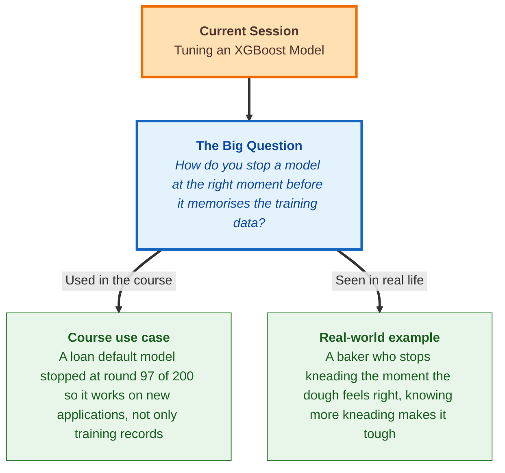

## <span style="color:#2F7DDE">Tuning an XGBoost Model</span>

### <span style="color:#2F7DDE">Mental Map</span>



---

### <span style="color:#2F7DDE">What You'll Learn</span>

Have you ever wondered how a baker knows the exact moment to stop kneading — before the dough goes tough?

By the end of this session, you will be able to:

- <span style="color:#D9660B">**Apply**</span> a patience rule so a model stops training when the held-out score stops rising.
- <span style="color:#D9660B">**Demonstrate**</span> how limiting which rows and columns each round sees reduces a model's tendency to overfit.
- <span style="color:#D9660B">**Use**</span> category labels such as flour type in a model, without converting them to numbers.
- <span style="color:#D9660B">**Trace**</span> the point where train and validation scores pull apart to spot when a model starts memorising.
- <span style="color:#D9660B">**Compare**</span> two training tools on how each grows its structure and finds the best split.

> <span style="color:#2F7DDE">**Topics you will meet:**</span> Early stopping; Sampling and regularisation settings; Native categorical features; Overfitting curves; XGBoost vs LightGBM.
>
> Join the session to learn each of these in detail.

---

### <span style="color:#2F7DDE">Why You Are Learning This Topic</span>

A baker kneads dough until it feels right, then stops. More kneading after that moment makes the loaf tough.

A prediction model works the same way — each round sharpens the fit until it starts memorising noise. An <span style="color:#D9660B">**overfitting**</span> model means one that fits training data so precisely it fails on new examples.

The baker's trick is to hold a piece of dough aside and taste it. In the course, that piece is a validation set.

> <span style="color:#2F7DDE">**Think about it:**</span> If the baker's clock stopped at 20 minutes, would she end up with a perfect loaf?

---

### <span style="color:#2F7DDE">The Baker's Puzzle</span>

Here are Priya's five kneading trials.

| Trial | Kneading min | Flour type | Train score | Validation score |
|---|---|---|---|---|
| Loaf A | 6 | All-purpose | 0.70 | 0.68 |
| Loaf B | 10 | Bread flour | 0.82 | 0.80 |
| Loaf C | 14 | Whole wheat | 0.91 | 0.78 |
| Loaf D | 18 | Bread flour | 0.95 | 0.65 |
| Loaf E | 22 | All-purpose | 0.97 | 0.56 |

<span style="color:#D9660B">**What you want to happen:**</span>

- The model stops when the validation score stops rising.
- Flour type stays as a label, not as a number.
- Each round uses a random fraction of rows and columns.

Here is how it might start. You do not need to understand it yet.

```python
from xgboost import XGBClassifier
model = XGBClassifier(n_estimators=200, early_stopping_rounds=10)
model.fit(X_train, y_train, eval_set=[(X_val, y_val)], verbose=False)
```

> <span style="color:#D9660B">**Wonder about this:**</span>
>
> - If the model runs all 200 rounds, would the training score end up higher or lower?
> - What if Priya coded flour type as 1, 2, 3 instead of a label?

---

### <span style="color:#2F7DDE">Think It Through</span>

There is no wrong first try. Keep your guesses for the session.

**1. At which loaf should Priya have stopped, and why?**
Hint: Look for the first row where the validation score drops below the row before it.

**2. If Priya's model sees only 60% of rows each round, what might change?**
Hint: Seeing different rows each round means no single noisy row shapes the whole model.

**3. If flour type is coded as 1, 2, 3, what could go wrong?**
Hint: Numbers carry an ordering that labels do not.

---

### <span style="color:#2F7DDE">One Question to Carry Into the Session</span>

> <span style="color:#2F7DDE">**If a baker stops kneading when the dough tastes perfect, is that the best loaf possible?**</span>
>
> Does stopping early always find the true best point?
