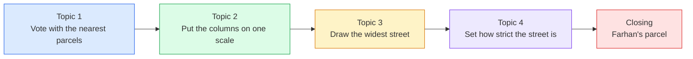
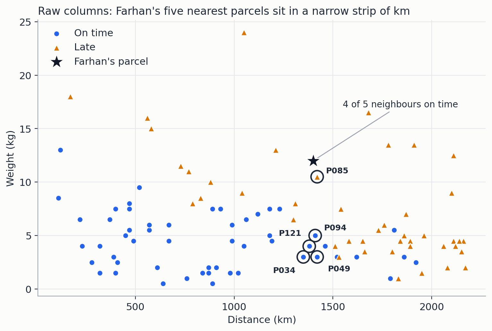
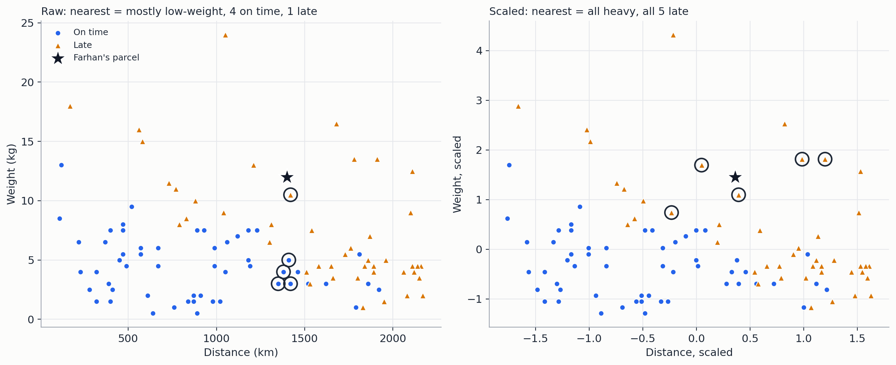
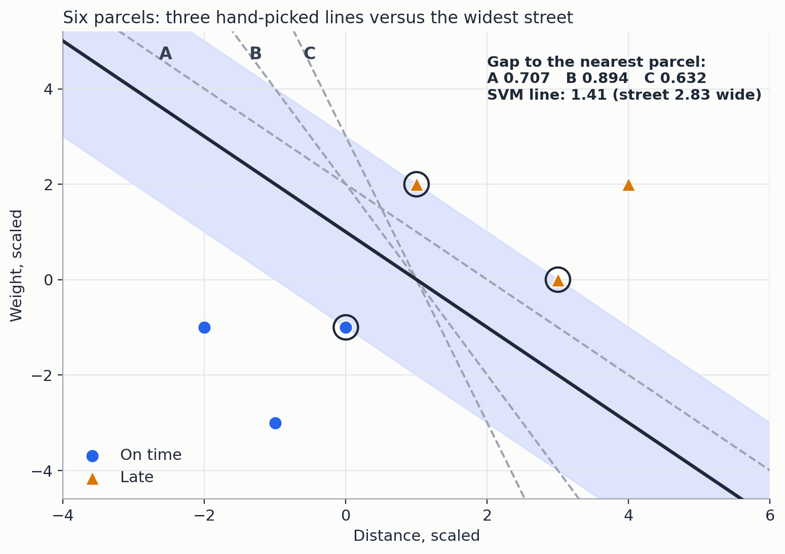
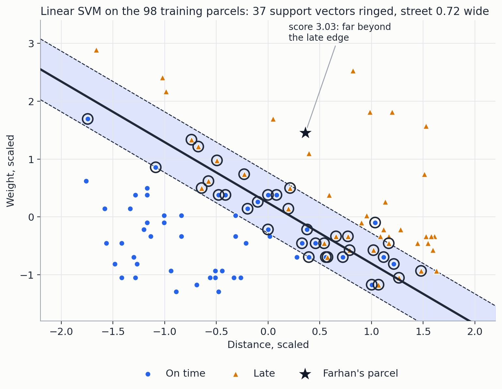
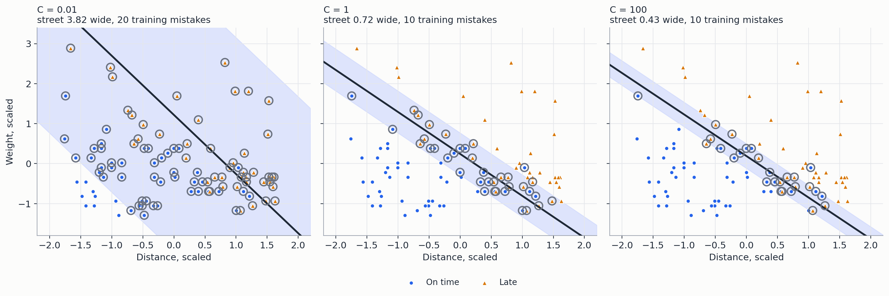
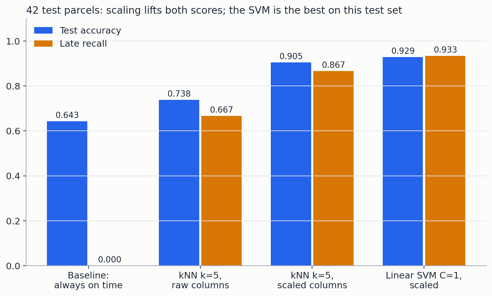

# <font color='#1d4ed8'>Lecture Script: KNN and SVM Classifiers</font>

---

## <font color='blue'>Agenda</font>

The lecture runs as four topics. Each topic ends with a quiz.

| Topic | What we do | Learning objectives covered | Minutes |
|:-:|:--|:--|:-:|
| 1 | Vote with the nearest parcels | Describe how kNN assigns a label from the classes of its nearest neighbours<br>Train a kNN classifier with a stated value of k | 30 |
| 2 | Put the columns on one scale | Explain why distance-based classifiers require features on a common scale | 25 |
| 3 | Draw the widest street | Describe how a support vector machine finds a maximum-margin separating boundary<br>Train a linear support vector machine classifier | 30 |
| 4 | Set how strict the street is | Explain how the C parameter trades margin width against training misclassifications | 20 |
| — | Closing: Outcome & Summary | | 15 |
| | **Total** | | **120** |

> <font color="red">**🎯 Instructor Note**</font> Pace: in Topic 1 spend about 10 minutes on the nearest-neighbour idea and the hand distance, and the rest on fitting. Topic 2 and Topic 4 each rest on one idea, so give them time to land.
> In Topic 3 keep the six-parcel example slow; the fit on the real parcels then goes quickly.

---

## <font color='blue'>Scenario</font>

At 11 pm, a Delhivery-style courier network is loading trucks at its Mumbai hub. The supervisor has two lanes. Standard trucks are cheap and slow. Express trucks cost more and arrive sooner, and there are only a few of them. Every parcel is promised a delivery date, and a parcel that arrives after it earns a refund and an angry phone call.

Farhan runs a small bakery in Delhi. His new oven part is a 12 kg box, and it must travel 1,400 km by road. The supervisor cannot test every parcel by hand. What she has is a table of 140 past parcels with their distance, their weight and whether each one arrived late.

> <font color="red">**🎯 Instructor Note**</font> The courier is only the setting. Do not claim any real courier uses this data; the 140 parcels in `data/parcels.csv` and Farhan are invented for teaching.
> Learners use Google Colab with pandas 2 or later and scikit-learn 1.4 or later. Upload the file into a `data` folder first; the split uses `random_state=42`, so every output matches.

---

## <font color='blue'>Problem Statement</font>

Last month the data team built a quick "look up similar parcels" check. For Farhan's oven part it found five past parcels that looked like it. Four had arrived on time, so the check said "on time". The part went on a standard truck and arrived two days late. Farhan's bakery stayed shut for a day, and the courier paid a refund.

Four of those five past parcels weighed only 3 to 5 kg. Farhan's parcel weighs 12 kg. Something in the check had stopped weight from mattering, and nobody noticed.

> <font color='purple'>**How can the hub label a new parcel as late or on time from past parcels, so that distance in km cannot drown out weight in kg, and which rule should it trust?**</font>

> <font color="red">**🎯 Instructor Note**</font> Poll: "A 12 kg parcel is going 1,400 km. Will it arrive late or on time?" Give learners 30 seconds to respond in chat. Note the split; reveal the answer in the Closing.

---

## <font color='blue'>What We Will Use</font>

Everything runs in Google Colab with pandas and scikit-learn. Each tool is explained when we first use it. The data is `data/parcels.csv`: 140 parcels with `distance_km`, `weight_kg` and `late`, where `late = 1` (the positive class) means the parcel arrived after its promised date.

| Topic | Tools | In one line |
|:-:|:--|:--|
| 1 | `train_test_split`, `KNeighborsClassifier`, `fit`, `predict`, `predict_proba`, `score` | Label a parcel by the vote of its k nearest training parcels |
| 2 | `StandardScaler` | Put distance and weight on one scale before measuring nearness |
| 3 | `SVC(kernel="linear")`, `coef_`, `intercept_`, `support_`, `decision_function` | Find the straight boundary with the widest empty street |
| 4 | the `C` setting of `SVC` | Decide how strictly the street is kept clear |

---

## <font color='blue'>How: Walking Through the Late-Parcel Check</font>



---

## <font color='blue'>Topic 1: Vote with the Nearest Parcels</font> `30 min`

In the last sessions you trained logistic regression and tree models for yes or no targets, and you judged them against a baseline. Today two more classifiers answer the same late-or-on-time question in new ways. The first needs no formula to learn: to label a new parcel, it looks up the past parcels most like it and lets them vote. You will reuse the train and test split from the ML workflow session, and the positive class from the logistic regression session: `late = 1`.

> <font color='purple'>**Farhan's parcel is 1,400 km and 12 kg. Which past parcels look most like it, and what do they say?**</font>

### <font color='green'>Example: find Farhan's five nearest parcels</font>

> <font color='purple'>**What does one row look like, and how many parcels were late?**</font>

**Predict before running: What will happen?**

> <font color="red">**🎯 Instructor Note**</font> Expected: shape (140, 3), because the parcel id is the row label and not a column. 59 parcels late and 81 on time.
> Common guess: 4 columns.

```python
import pandas as pd, numpy as np

df = pd.read_csv("data/parcels.csv", index_col="parcel_id")
print(df.shape)
print(df.head(5))
print(df["late"].value_counts())
```

**Output**

```
(140, 3)
           distance_km  weight_kg  late
parcel_id                              
P001              2110        5.0     1
P002               520        9.5     0
P003              1840        4.5     1
P004               400        7.5     0
P005              1170        2.5     0
late
0    81
1    59
Name: count, dtype: int64
```

#### <font color='#c2410c'>Code Explanation</font>

- **Line 1** Loads pandas for tables and numpy for number arrays.
- **Line 3** Reads the parcel file and uses `parcel_id` as the row label.
- **Line 4** Prints the size as (rows, columns).
- **Line 5** Shows the first 5 parcels.
- **Line 6** Counts how many parcels carry each value of `late`.

> <font color='green'>**Result**</font> Each row is one past parcel: a distance and a weight (the features) and whether it was late (the target). 59 of the 140 arrived late.

> <font color='purple'>**Which parcels may the classifier look up, and which must it never see while we build it?**</font>

**Predict before running: What will happen?**

> <font color="red">**🎯 Instructor Note**</font> Expected: 98 training and 42 test parcels (70% and 30%). Ask learners which part the classifier may look up.
> Expected: only the training parcels.

```python
from sklearn.model_selection import train_test_split

X, y = df[["distance_km", "weight_kg"]], df["late"]
Xtr, Xte, ytr, yte = train_test_split(X, y, test_size=0.3, random_state=42)
print(len(Xtr), len(Xte))
print(ytr.value_counts())
```

**Output**

```
98 42
late
0    54
1    44
Name: count, dtype: int64
```

#### <font color='#c2410c'>Code Explanation</font>

- **Line 3** `X` is the two feature columns as a table; `y` is the target.
- **Line 4** Sets 30% of the parcels aside as the test set, with a fixed seed so every learner gets the same split.
- **Line 5** Prints the size of each part.
- **Line 6** Counts late and on-time parcels in the training part.

> <font color='green'>**Result**</font> kNN will look up 98 training parcels, of which 44 were late and 54 on time. The 42 test parcels stay hidden until we judge the model.

> <font color='purple'>**How far is each past parcel from Farhan's, and which five are closest?**</font>

Nearness is the straight-line distance between two parcels, using both columns:

$$\boxed{d = \sqrt{(\text{km}_1 - \text{km}_2)^2 + (\text{kg}_1 - \text{kg}_2)^2}}$$

By hand for training parcel P094 (1,410 km, 5.0 kg) and Farhan's parcel (1,400 km, 12 kg):

$$d = \sqrt{(1410 - 1400)^2 + (5.0 - 12.0)^2} = \sqrt{100 + 49} = \sqrt{149} \approx 12.21$$

**Predict before running: What will happen?**

> <font color="red">**🎯 Instructor Note**</font> Expected: P094 comes first with 12.21, which matches the hand answer. Ask for a guess of how many of the five were late.
> Expected: only 1.

```python
new = np.array([1400, 12.0])
d = np.sqrt(((Xtr.values - new) ** 2).sum(axis=1))
near = Xtr.assign(late=ytr, dist=d.round(2)).nsmallest(5, "dist")
print(near)
print("late votes:", near["late"].sum(), "of 5")
```

**Output**

```
           distance_km  weight_kg  late   dist
parcel_id                                     
P094              1410        5.0     0  12.21
P085              1420       10.5     1  20.06
P121              1380        4.0     0  21.54
P049              1420        3.0     0  21.93
P034              1350        3.0     0  50.80
late votes: 1 of 5
```

#### <font color='#c2410c'>Code Explanation</font>

- **Line 1** Stores Farhan's parcel as an array: 1,400 km and 12 kg.
- **Line 2** Subtracts it from every training row, squares, adds the two columns and takes the square root: one distance per training parcel.
- **Line 3** Adds the label and the distance to the table and keeps the 5 smallest distances.
- **Lines 4 and 5** Print the five neighbours and count how many were late.

<p align="center"></p>

> <font color='green'>**Result**</font> The five nearest parcels are P094, P085, P121, P049 and P034. Four were on time and one was late, so the majority vote says on time. This is the answer the data team's check gave.

### <font color='green'>Extending it: let scikit-learn do the vote</font>

> <font color='purple'>**Can scikit-learn run the same vote with k = 5 and report how sure it is?**</font>

The number of neighbours, $k$, is a hyperparameter: we choose it before fitting, and fitting does not learn it. Here we state $k = 5$.

**Predict before running: What will happen?**

> <font color="red">**🎯 Instructor Note**</font> Expected: label 0 (on time) with probabilities 0.8 and 0.2, the same 4 to 1 vote. Ask what the 0.8 means.
> Expected: 4 of 5 neighbours voted on time.

```python
from sklearn.neighbors import KNeighborsClassifier

new_df = pd.DataFrame({"distance_km": [1400], "weight_kg": [12.0]})
knn = KNeighborsClassifier(n_neighbors=5)
knn.fit(Xtr, ytr)
print(knn.predict(new_df), knn.predict_proba(new_df))
print(round(knn.score(Xte, yte), 3))
```

**Output**

```
[0] [[0.8 0.2]]
0.738
```

#### <font color='#c2410c'>Code Explanation</font>

- **Line 1** Imports the kNN classifier.
- **Line 3** Puts Farhan's parcel in a one-row table with the same column names as `X`.
- **Line 4** Creates a classifier with $k = 5$.
- **Line 5** Fits it. For kNN this only stores the 98 training parcels; there is no line or coefficient to learn.
- **Line 6** `predict` gives the winning label. `predict_proba` gives the share of votes for each class, in the order on time (0) then late (1).
- **Line 7** `score` is the accuracy on the 42 test parcels.

> <font color='green'>**Result**</font> scikit-learn gives the same vote: on time, with 80% of the votes. On the test parcels the classifier is right 73.8% of the time, which is 31 of 42.

### <font color='green'>Extending it: what changes with k?</font>

> <font color='purple'>**What if one neighbour votes, or fifteen?**</font>

**Predict before running: What will happen?**

> <font color="red">**🎯 Instructor Note**</font> Ask: "Will the label stay the same for k = 1, 5 and 15?" Give learners 30 seconds to respond in chat.
> Expected: on time for k = 1 and 5, late for k = 15.

```python
for k in (1, 5, 15):
    m = KNeighborsClassifier(n_neighbors=k).fit(Xtr, ytr)
    idx = m.kneighbors(new_df, return_distance=False)[0]
    lo, hi = Xtr.iloc[idx]["distance_km"].agg(["min", "max"])
    votes, label = ytr.iloc[idx].sum(), m.predict(new_df)[0]
    print(f"k={k:<2} late votes={votes}/{k} label={label} km {lo} to {hi}")
```

**Output**

```
k=1  late votes=0/1 label=0 km 1410 to 1410
k=5  late votes=1/5 label=0 km 1350 to 1420
k=15 late votes=8/15 label=1 km 1210 to 1580
```

#### <font color='#c2410c'>Code Explanation</font>

- **Line 1** Loops over three values of $k$.
- **Line 2** Fits a classifier with that $k$.
- **Line 3** `kneighbors` returns the row positions of the $k$ nearest training parcels.
- **Line 4** Finds the shortest and longest route, in km, among those neighbours.
- **Line 5** Counts the late votes and gets the label.
- **Line 6** Prints the votes, the label and the km range.

> <font color='green'>**Result**</font> With $k = 1$ one parcel decides, and it was on time. With $k = 15$ the vote reaches parcels from 1,210 to 1,580 km and 8 of the 15 were late, so the label flips to late. The label depends on $k$, so $k$ must be stated every time.

> <font color='#b45309'>**Common mistake**</font> Using an even $k$ such as 4 on two classes, because the vote can tie at 2 to 2. Use an odd $k$ for a clean majority.

### <font color='purple'>Quiz 1</font>

**Question:** With $k = 5$, a new parcel's five nearest training parcels, nearest first, are: late, on time, on time, late, on time. What label does kNN give?

**Options:**
- A) Late, because the single nearest parcel was late
- B) Late, because at least one neighbour was late
- C) On time, because 3 of the 5 neighbours voted on time
- D) No label, because the vote is mixed

**Correct Answer:** C

**Explanation:**
- **A)** Wrong: using only the nearest parcel is the rule for $k = 1$; with $k = 5$ all five vote.
- **B)** Wrong: kNN does not label a parcel late because of one late neighbour; the majority wins.
- **C)** Correct: 3 on time against 2 late is a majority for on time.
- **D)** Wrong: a mixed vote still has a winner; only an exact tie would need a rule, and an odd $k$ cannot tie on two classes.

---

## <font color='blue'>Topic 2: Put the Columns on One Scale</font> `25 min`

In the regression session you scaled features before Ridge and Lasso, and in the ML workflow session you learned to fit a scaler on training rows only. Both lessons return here, because kNN is built on distances.

> <font color='purple'>**Four of the five neighbours were 3 to 5 kg parcels, but Farhan's weighs 12 kg. Did weight get a fair say in who counted as near?**</font>

### <font color='green'>Example: where does the distance come from?</font>

> <font color='purple'>**For each of the five neighbours, how much of the squared distance comes from km and how much from kg?**</font>

**Predict before running: What will happen?**

> <font color="red">**🎯 Instructor Note**</font> Ask: "Which column will supply most of the distance?" Give learners 30 seconds to respond in chat.
> Expected: km, with 67% to 99% of the squared distance, even where the weight gap is 7 to 9 kg.

```python
sq = ((Xtr.loc[near.index] - new) ** 2).add_suffix("_gap_sq")
sq["km_share"] = (sq.iloc[:, 0] / sq.sum(axis=1)).round(2)
print(sq)
print(Xtr.std(ddof=0).round(1))
```

**Output**

```
           distance_km_gap_sq  weight_kg_gap_sq  km_share
parcel_id                                                
P094                    100.0             49.00      0.67
P085                    400.0              2.25      0.99
P121                    400.0             64.00      0.86
P049                    400.0             81.00      0.83
P034                   2500.0             81.00      0.97
distance_km    608.1
weight_kg        4.2
dtype: float64
```

#### <font color='#c2410c'>Code Explanation</font>

- **Line 1** For the five neighbours, takes each column's gap to Farhan's parcel and squares it. These are the two terms inside the square root.
- **Line 2** Divides the km term by the total of both terms: the share of squared distance that comes from km.
- **Line 3** Prints the squared gaps and the share.
- **Line 4** Prints the spread (standard deviation) of each training column.

> <font color='green'>**Result**</font> Distance in km supplies 67% to 99% of every neighbour's squared distance. P121 is 8 kg lighter, yet that gap adds only 64 to a km term of 400. The spread of km is about 145 times the spread of kg, so a typical km gap runs to hundreds while a typical kg gap is a few units.

### <font color='green'>Extending it: put both columns on one scale</font>

> <font color='purple'>**How do we make 1 km and 1 kg count in comparable amounts?**</font>

Subtract the training mean and divide by the training standard deviation, so every column has mean 0 and spread 1:

$$\boxed{z = \frac{x - \mu}{\sigma}}$$

By hand for Farhan's parcel, with the training mean and spread of each column:

$$z_{\text{km}} = \frac{1400 - 1180.8}{608.1} \approx 0.36 \qquad z_{\text{kg}} = \frac{12 - 5.9}{4.2} \approx 1.45$$

**Predict before running: What will happen?**

> <font color="red">**🎯 Instructor Note**</font> Expected: means near 1,181 and 5.9, spreads near 608 and 4.2, and z-values near 0.36 and 1.45, matching the hand answer.
> Ask why Farhan's weight is the more unusual of the two. Expected: 1.45 spreads above the mean versus 0.36.

```python
from sklearn.preprocessing import StandardScaler

scaler = StandardScaler().fit(Xtr)
Ztr, Zte = scaler.transform(Xtr), scaler.transform(Xte)
z_new = scaler.transform(new_df)
print(scaler.mean_.round(1), scaler.scale_.round(1))
print(z_new.round(2))
```

**Output**

```
[1180.8    5.9] [608.1   4.2]
[[0.36 1.45]]
```

#### <font color='#c2410c'>Code Explanation</font>

- **Line 3** Learns the mean and spread of each column from the training parcels only.
- **Line 4** Applies those numbers to the training and the test parcels.
- **Line 5** Applies the same numbers to Farhan's parcel.
- **Line 6** Prints the learned means and spreads.
- **Line 7** Prints Farhan's parcel in scaled units: 0.36 spreads above the mean distance and 1.45 above the mean weight.

> <font color='green'>**Result**</font> Both columns are now measured in "spreads from the mean", so a gap of one unit means the same thing in km and in kg.

### <font color='green'>Extending it: ask kNN again</font>

> <font color='purple'>**With both columns on one scale, who are Farhan's five nearest parcels now, and what do they say?**</font>

**Predict before running: What will happen?**

> <font color="red">**🎯 Instructor Note**</font> Ask: "Will the neighbours change?" Give learners 30 seconds to respond in chat.
> Expected: all five are heavy parcels (9 to 13.5 kg), all late, so the label becomes late and the test accuracy rises.

```python
knn_s = KNeighborsClassifier(n_neighbors=5).fit(Ztr, ytr)
idx = knn_s.kneighbors(z_new, return_distance=False)[0]
print(Xtr.iloc[idx].assign(late=ytr.iloc[idx]))
print(knn_s.predict(z_new), knn_s.predict_proba(z_new))
print("accuracy raw:", round(knn.score(Xte, yte), 3), "scaled:", round(knn_s.score(Zte, yte), 3))
print("baseline:", round((yte == 0).mean(), 3))
```

**Output**

```
           distance_km  weight_kg  late
parcel_id                              
P085              1420       10.5     1
P098              1210       13.0     1
P113              1780       13.5     1
P062              1910       13.5     1
P060              1040        9.0     1
[1] [[0. 1.]]
accuracy raw: 0.738 scaled: 0.905
baseline: 0.643
```

#### <font color='#c2410c'>Code Explanation</font>

- **Line 1** Fits kNN with $k = 5$ on the scaled training parcels.
- **Lines 2 and 3** Find the five nearest neighbours in scaled space and show their original km and kg.
- **Line 4** Prints the label and vote shares for Farhan's parcel.
- **Line 5** Compares the test accuracy with raw columns and with scaled columns.
- **Line 6** Prints the accuracy of the baseline that always says "on time".

<p align="center"></p>

> <font color='green'>**Result**</font> The five neighbours are now P085, P098, P113, P062 and P060, all heavy parcels and all late, so Farhan's parcel is labelled late with 100% of the votes. Test accuracy rises from 0.738 to 0.905, and the baseline "always on time" scores 0.643.

### <font color='green'>Extending it: change one unit</font>

> <font color='purple'>**What if the weight column were stored in grams instead of kg?**</font>

**Predict before running: What will happen?**

> <font color="red">**🎯 Instructor Note**</font> Ask: "Should the answer for the same parcels change because we wrote the weight in grams?" Give learners 30 seconds to respond in chat.
> Expected: it should not, but the raw model's answer changes while the scaled model's does not.

```python
def to_g(t): return t.assign(weight_g=t["weight_kg"] * 1000).drop(columns="weight_kg")
Xg, Xg_te, new_g = to_g(Xtr), to_g(Xte), to_g(new_df)
raw_g = KNeighborsClassifier(n_neighbors=5).fit(Xg, ytr)
print("raw, grams:   ", raw_g.predict(new_g), round(raw_g.score(Xg_te, yte), 3))
sg = StandardScaler().fit(Xg)
sc_g = KNeighborsClassifier(n_neighbors=5).fit(sg.transform(Xg), ytr)
print("scaled, grams:", sc_g.predict(sg.transform(new_g)), round(sc_g.score(sg.transform(Xg_te), yte), 3))
```

**Output**

```
raw, grams:    [1] 0.929
scaled, grams: [1] 0.905
```

#### <font color='#c2410c'>Code Explanation</font>

- **Line 1** Defines a helper that turns the weight column into grams.
- **Line 2** Applies it to the training, test and Farhan's rows.
- **Lines 3 and 4** Fit and score kNN on the raw columns, now in km and grams.
- **Lines 5 to 7** Scale the km and gram columns, then fit and score again.

> <font color='green'>**Result**</font> Writing weight in grams moves Farhan's raw label from on time to late and the raw accuracy from 0.738 to 0.929, because a 1 kg gap now counts as 1,000 and weight takes over the distance instead of km. After scaling the label (late) and the accuracy (0.905) are the same as with kg. A rule whose answer depends on the unit you wrote is not a rule about parcels.

> <font color='#b45309'>**Common mistake**</font> Fitting the scaler on all parcels, including the test ones. Fit it on the training parcels only, then apply the same numbers to the test parcels, as you did in the ML workflow session.

### <font color='purple'>Quiz 2</font>

**Question:** Why must `distance_km` and `weight_kg` be put on a common scale before kNN?

**Options:**
- A) kNN adds squared gaps of all columns, so the column with the larger numbers decides who is nearest
- B) kNN cannot read a column that has decimals
- C) Scaling changes the label of every training parcel
- D) Scaling is only needed to make `fit` run faster

**Correct Answer:** A

**Explanation:**
- **A)** Correct: the km gaps are hundreds and the kg gaps are single digits, so km swamps the distance unless both are rescaled.
- **B)** Wrong: kNN reads decimals without trouble; the weight column already has them.
- **C)** Wrong: scaling changes the numbers of the features, never the labels.
- **D)** Wrong: speed is not the reason; the neighbours and the answer change.

---

## <font color='blue'>Topic 3: Draw the Widest Street</font> `30 min`

kNN has to carry all 98 training parcels and search them for every new parcel. Logistic regression carried only a line. Many straight lines can split late parcels from on-time ones, so which line should we trust? A support vector machine (SVM) answers that, and because it measures distances too, we use the scaled columns from Topic 2.

> <font color='purple'>**If many lines separate the late parcels from the on-time ones, which one is the safest?**</font>

### <font color='green'>Example: three lines on six parcels</font>

> <font color='purple'>**Three lines all separate six parcels correctly. Which one keeps the biggest gap to the nearest parcel?**</font>

Six parcels in scaled units, invented for teaching: three late and three on time. A line is $w_1 z_1 + w_2 z_2 + b = 0$, and a parcel is late when its score is above 0. The gap from a parcel to the line is:

$$\boxed{\text{gap} = \frac{|w_1 z_1 + w_2 z_2 + b|}{\sqrt{w_1^2 + w_2^2}}}$$

By hand for line A, $z_1 + z_2 - 2 = 0$, and the late parcel $(1, 2)$: the score is $1 + 2 - 2 = 1$, so the gap is $\dfrac{1}{\sqrt{1^2 + 1^2}} \approx 0.707$.

**Predict before running: What will happen?**

> <font color="red">**🎯 Instructor Note**</font> Expected: all three lines separate the six parcels. Line B has the largest gap, 0.894, then A with 0.707 and C with 0.632.
> Ask learners to guess the best of the three first.

```python
toy = pd.DataFrame({"km_scaled": [3, 1, 4, 0, -2, -1], "kg_scaled": [0, 2, 2, -1, -1, -3]})
toy_y = np.array([1, 1, 1, 0, 0, 0])
lines = {"A": (1, 1, -2), "B": (2, 1, -2), "C": (3, 1, -3)}
for name, (w1, w2, b) in lines.items():
    score = w1 * toy["km_scaled"] + w2 * toy["kg_scaled"] + b
    gap = (score.abs() / np.hypot(w1, w2)).min()
    print(name, "separates:", bool(((score > 0) == (toy_y == 1)).all()), "gap:", round(gap, 3))
```

**Output**

```
A separates: True gap: 0.707
B separates: True gap: 0.894
C separates: True gap: 0.632
```

#### <font color='#c2410c'>Code Explanation</font>

- **Lines 1 and 2** Build the six parcels and their labels (1 is late).
- **Line 3** Lists three candidate lines as $(w_1, w_2, b)$.
- **Line 4** Loops over the three lines.
- **Line 5** Computes each parcel's score for the line.
- **Line 6** Divides each absolute score by $\sqrt{w_1^2 + w_2^2}$ and keeps the smallest: the gap to the nearest parcel.
- **Line 7** Checks that every late parcel scores above 0 and every on-time parcel below, then prints the gap.

> <font color='green'>**Result**</font> All three lines separate the six parcels, but their gaps differ: 0.707, 0.894 and 0.632. A line with a bigger gap leaves more room for a new parcel to land on the right side.

### <font color='green'>Extending it: let the SVM find the widest street</font>

> <font color='purple'>**Is there a line with a bigger gap than any of the three?**</font>

An SVM looks for the line whose empty street is widest. Write late as $y = +1$ and on time as $y = -1$. The street edges are where the score is $+1$ and $-1$, and the street is $\dfrac{2}{\lVert \mathbf{w} \rVert}$ wide, so the widest street comes from the smallest $\lVert \mathbf{w} \rVert$:

$$\boxed{\min_{\mathbf{w}, b}\ \tfrac{1}{2}\lVert \mathbf{w} \rVert^2 \quad \text{subject to} \quad y_i\,(\mathbf{w}\cdot \mathbf{z}_i + b) \ge 1 \ \text{ for every parcel } i}$$

**Predict before running: What will happen?**

> <font color="red">**🎯 Instructor Note**</font> Expected: $w$ near (0.5, 0.5), $b$ near -0.5, three support vectors, a gap of 1.41 and a street width of 2.83.
> That gap beats all three hand-picked lines.

```python
from sklearn.svm import SVC

svm_toy = SVC(kernel="linear").fit(toy, toy_y)
w, b = svm_toy.coef_[0], svm_toy.intercept_[0]
print("w =", w.round(3), "b =", round(b, 3))
print("support vectors:", svm_toy.support_)
print("gap:", round(1 / np.linalg.norm(w), 2), "street width:", round(2 / np.linalg.norm(w), 2))
```

**Output**

```
w = [0.5 0.5] b = -0.5
support vectors: [3 0 1]
gap: 1.41 street width: 2.83
```

#### <font color='#c2410c'>Code Explanation</font>

- **Line 3** Fits a linear SVM on the six parcels, with the default settings.
- **Line 4** Reads the learned weights $\mathbf{w}$ and the intercept $b$.
- **Line 5** Prints them.
- **Line 6** Prints the row numbers of the support vectors: the parcels sitting on the street edges.
- **Line 7** The gap is $1 / \lVert \mathbf{w} \rVert$ and the street is twice that.

<p align="center"></p>

> <font color='green'>**Result**</font> The SVM line is $0.5\,z_1 + 0.5\,z_2 - 0.5 = 0$, with a gap of 1.41 on each side and a street 2.83 wide. That gap is about 1.6 times the best hand-picked line (0.894). The parcels on the street edges, rows 0, 1 and 3, are the support vectors.

### <font color='green'>Extending it: train a linear SVM on the real parcels</font>

> <font color='purple'>**What street does the SVM draw through the 98 scaled training parcels, and which side is Farhan's parcel on?**</font>

The score is $f(\mathbf{z}) = w_1 z_1 + w_2 z_2 + b$, and a positive score means late. By hand with the weights from the output below and Farhan's scaled values:

$$f = 1.998 \times 0.36 + 1.905 \times 1.45 - 0.463 \approx 3.02$$

**Predict before running: What will happen?**

> <font color="red">**🎯 Instructor Note**</font> Expected: a positive score near 3, so late. The hand answer is 3.02 and the code says 3.03 because we rounded the inputs.
> Ask: "Is a score of 3 inside the street?" Expected: no; the street edge is at 1.

```python
svm = SVC(kernel="linear").fit(Ztr, ytr)
print(svm.coef_.round(3), svm.intercept_.round(3))
print("support vectors:", len(svm.support_), "of", len(Ztr))
print("Farhan:", svm.predict(z_new), svm.decision_function(z_new).round(3))
print("test accuracy:", round(svm.score(Zte, yte), 3))
```

**Output**

```
[[1.998 1.905]] [-0.463]
support vectors: 37 of 98
Farhan: [1] [3.029]
test accuracy: 0.929
```

#### <font color='#c2410c'>Code Explanation</font>

- **Line 1** Fits a linear SVM on the scaled training parcels.
- **Line 2** Prints the weights (one per column) and the intercept.
- **Line 3** Counts the support vectors among the 98 training parcels.
- **Line 4** `predict` gives the label and `decision_function` gives the score $f$ for Farhan's parcel.
- **Line 5** Prints the accuracy on the 42 test parcels.

<p align="center"></p>

> <font color='green'>**Result**</font> The SVM labels Farhan's parcel late with a score of 3.03, about three times the edge score of 1. Its street is $2 / \lVert \mathbf{w} \rVert \approx 0.72$ wide, and 37 of the 98 parcels are support vectors: they sit on its edges, inside it or on the wrong side. Test accuracy is 0.929, which is 39 of 42.

### <font color='green'>Extending it: do the other parcels matter?</font>

> <font color='purple'>**If we keep only the support vectors and throw the rest away, does the line move?**</font>

**Predict before running: What will happen?**

> <font color="red">**🎯 Instructor Note**</font> Ask: "Does the line move?" Give learners 30 seconds to respond in chat.
> Expected: no; the weights and intercept are the same.

```python
sv = svm.support_
svm_sv = SVC(kernel="linear").fit(Ztr[sv], ytr.iloc[sv])
print(svm.coef_.round(3), svm.intercept_.round(3))
print(svm_sv.coef_.round(3), svm_sv.intercept_.round(3))
print("parcels kept:", len(sv), "of", len(Ztr))
```

**Output**

```
[[1.998 1.905]] [-0.463]
[[1.998 1.905]] [-0.463]
parcels kept: 37 of 98
```

#### <font color='#c2410c'>Code Explanation</font>

- **Line 1** Takes the row numbers of the support vectors.
- **Line 2** Fits a second SVM on those parcels alone.
- **Lines 3 and 4** Print the weights and intercept of both models.
- **Line 5** Prints how many parcels were kept.

> <font color='green'>**Result**</font> Both models have the same line. The 61 parcels that are not support vectors lie outside the street, on the correct side, and removing them changes nothing. The boundary is fixed only by the parcels closest to it.

### <font color='purple'>Quiz 3</font>

**Question:** In a trained linear SVM, which parcels fix the position of the boundary?

**Options:**
- A) All parcels equally, like an average
- B) The parcels farthest from the boundary, because they are the clearest cases
- C) The heaviest parcels in the training data
- D) Only the support vectors, the parcels on the street edges, inside the street or on the wrong side

**Correct Answer:** D

**Explanation:**
- **A)** Wrong: the line is not an average; parcels far from the street have no effect on it.
- **B)** Wrong: the parcels farthest away are exactly the ones that can be removed without moving the line.
- **C)** Wrong: weight does not decide it; closeness to the boundary does.
- **D)** Correct: the line is set by the support vectors, and refitting on them alone gives the same line.

---

## <font color='blue'>Topic 4: Set How Strict the Street Is</font> `20 min`

In Topic 3 the six parcels split cleanly, but the 98 real parcels overlap: two parcels with almost the same distance and weight can end differently. No straight line can get every parcel right, so the SVM must decide how many parcels may break the rules of the street. The setting that decides is `C`. Like tree depth and $k$, it is a hyperparameter: you set it before fitting.

> <font color='purple'>**When some parcels must break the street, how many should the SVM allow, and what does that do to the street?**</font>

### <font color='green'>Example: fit the SVM with four values of C</font>

> <font color='purple'>**What happens to the street width and the training mistakes as C rises?**</font>

A parcel that sits inside the street or on the wrong side is charged a penalty $\xi_i$, which grows with how far it is past its street edge. The SVM balances a wide street against the total penalty, and $C$ is the price per unit of penalty:

$$\boxed{\min_{\mathbf{w}, b}\ \tfrac{1}{2}\lVert \mathbf{w} \rVert^2 + C \sum_i \xi_i}$$

A small $C$ makes rule-breaking cheap, so the street can be wide. A large $C$ makes it expensive, so the street narrows to avoid breaking it. Until now we used the default, $C = 1$.

**Predict before running: What will happen?**

> <font color="red">**🎯 Instructor Note**</font> Ask: "As C rises, does the street get wider or narrower? Do training mistakes go up or down?" Give learners 30 seconds to respond in chat.
> Expected: narrower and fewer, down to a floor; the C = 1 row matches Topic 3.

```python
for C in (0.01, 0.1, 1, 100):
    m = SVC(kernel="linear", C=C).fit(Ztr, ytr)
    width = 2 / np.linalg.norm(m.coef_)
    errors = (m.predict(Ztr) != ytr).sum()
    print(f"C={C:<5} width={width:.2f} train errors={errors} support vectors={len(m.support_)}")
```

**Output**

```
C=0.01  width=3.82 train errors=20 support vectors=89
C=0.1   width=1.54 train errors=13 support vectors=57
C=1     width=0.72 train errors=10 support vectors=37
C=100   width=0.43 train errors=10 support vectors=27
```

#### <font color='#c2410c'>Code Explanation</font>

- **Line 1** Loops over four values of `C`, from very small to large.
- **Line 2** Fits a linear SVM on the scaled training parcels with that `C`.
- **Line 3** The street width is $2 / \lVert \mathbf{w} \rVert$, in scaled units.
- **Line 4** Counts the training parcels the model labels wrongly.
- **Line 5** Prints the width, the mistakes and the number of support vectors.

<p align="center"></p>

> <font color='green'>**Result**</font> At $C = 0.01$ the street is 3.82 wide and the SVM makes 20 training mistakes. At $C = 1$ it narrows to 0.72 with 10 mistakes. At $C = 100$ it narrows to 0.43, and the mistakes stay at 10.

### <font color='green'>Extending it: where does Farhan's parcel land?</font>

> <font color='purple'>**Does the answer for Farhan's parcel depend on C?**</font>

**Predict before running: What will happen?**

> <font color="red">**🎯 Instructor Note**</font> Expected: late at every C, with a score that grows as the street narrows. At C = 0.01 the score is below 1, so the parcel sits inside the street.
> Ask what that says about how sure the model is.

```python
for C in (0.01, 1, 100):
    m = SVC(kernel="linear", C=C).fit(Ztr, ytr)
    f = m.decision_function(z_new)[0]
    print(f"C={C:<5} label={m.predict(z_new)[0]} score={f:.2f} inside street={abs(f) < 1}")
```

**Output**

```
C=0.01  label=1 score=0.23 inside street=True
C=1     label=1 score=3.03 inside street=False
C=100   label=1 score=5.34 inside street=False
```

#### <font color='#c2410c'>Code Explanation</font>

- **Line 1** Loops over a small, the default and a large `C`.
- **Line 2** Fits the SVM with that `C`.
- **Line 3** Gets Farhan's score $f$.
- **Line 4** Prints the label, the score and whether $|f| < 1$, which means the parcel is inside the street.

> <font color='green'>**Result**</font> Farhan's parcel is late for every `C`. At $C = 0.01$ the street is so wide that his parcel sits inside it (score 0.23), a weak answer. At $C = 1$ and $C = 100$ it is well beyond the edge (3.03 and 5.34).

### <font color='green'>Extending it: why do the mistakes stop falling?</font>

> <font color='purple'>**Between C = 1 and C = 100 the training mistakes stay at 10. Why does a stricter fit not fix them?**</font>

#### <font color='#c2410c'>Logic Explanation</font>

- The parcels overlap. P008 (1,860 km, 3.0 kg) was on time, while P015, shorter and lighter at 1,830 km and 1.0 kg, was late. A line that says "longer and heavier means later" cannot get both right.
- No straight line separates all 98 training parcels. A larger $C$ narrows the street but cannot bend the line, so 10 of the 98 stay on the wrong side.
- Beyond this floor, a larger $C$ only squeezes the street, with no gain in training mistakes.

> <font color='green'>**Result**</font> $C$ trades street width for training mistakes only until the straight line runs out of room. After that, a higher $C$ gives a narrower street and nothing else.

> <font color='#b45309'>**Common mistake**</font> Treating a larger $C$ as "better" because the training mistakes fall. Fewer training mistakes are counted on the same parcels the model learned from, so they say little about new parcels.

### <font color='purple'>Quiz 4</font>

**Question:** The hub supervisor wants a wider street and accepts that more training parcels may break it. How should `C` change?

**Options:**
- A) Raise `C` to 100, because a stricter fit gives a wider street
- B) Lower `C`, for example to 0.01
- C) Keep `C` and add more training parcels
- D) `C` has no effect on the street width

**Correct Answer:** B

**Explanation:**
- **A)** Wrong: a larger `C` punishes rule-breaking harder, so the street narrows (0.43 at $C = 100$).
- **B)** Correct: a smaller `C` makes rule-breaking cheap, so the street widens (3.82 at $C = 0.01$) and more parcels break it (20 training mistakes).
- **C)** Wrong: more parcels do not set how strict the fit is; `C` does.
- **D)** Wrong: the street width changed from 3.82 to 0.43 as `C` went from 0.01 to 100.

---

## <font color='blue'>Closing: Outcome & Summary</font> `15 min`

Back to the problem: how should the hub label Farhan's parcel, and which rule should it trust? We answer it using each topic once.

> <font color='purple'>**1. What did the nearest-parcel check do, and why did it mislead?**</font>

It took the five nearest parcels by raw distance and let them vote with $k = 5$: four on time, one late, so "on time". But distance in km supplied 67% to 99% of each squared distance, so weight barely counted.

> <font color='purple'>**2. What changes when both columns are on one scale?**</font>

Scaled, the five nearest parcels are all heavy and all late, so kNN says late. The SVM, which also works on the scaled columns, agrees with a score of 3.03 at $C = 1$. Now compare the rules on the 42 test parcels, which none of them saw while learning, using accuracy and the late recall from the classification metrics session.

```python
from sklearn.metrics import recall_score

svm_c1 = SVC(kernel="linear", C=1).fit(Ztr, ytr)
preds = {"Baseline: always on time": np.zeros(len(yte), dtype=int),
         "kNN k=5, raw columns": knn.predict(Xte), "kNN k=5, scaled columns": knn_s.predict(Zte),
         "Linear SVM C=1, scaled": svm_c1.predict(Zte)}
for name, p in preds.items():
    print(f"{name:25} accuracy={(p == yte).mean():.3f} late recall={recall_score(yte, p):.3f}")
```

**Output**

```
Baseline: always on time  accuracy=0.643 late recall=0.000
kNN k=5, raw columns      accuracy=0.738 late recall=0.667
kNN k=5, scaled columns   accuracy=0.905 late recall=0.867
Linear SVM C=1, scaled    accuracy=0.929 late recall=0.933
```

#### <font color='#c2410c'>Code Explanation</font>

- **Line 3** Fits the linear SVM with `C = 1` on the scaled parcels (Topic 3 and Topic 4).
- **Lines 4 to 6** Collect the test-set predictions of four rules: the baseline, kNN on raw columns (Topic 1), kNN on scaled columns (Topic 2) and the SVM.
- **Lines 7 and 8** For each rule, print the share of test parcels it labels correctly, and the share of the 15 late test parcels it catches (recall for the positive class).

<p align="center"></p>

### <font color='green'>Outcome</font>

| | kNN, raw columns | kNN, scaled columns | Linear SVM, scaled |
|:--|:-:|:-:|:-:|
| Label for Farhan's parcel | on time | late | late |
| Test accuracy | 0.738 | 0.905 | 0.929 |
| Late parcels caught (recall) | 0.667 | 0.867 | 0.933 |
| What it keeps | all 98 training parcels | all 98 training parcels | a line, with 37 support vectors |

> <font color='green'>**Therefore,**</font> the hub should label Farhan's parcel late and put it on an express truck. Label parcels with kNN or an SVM only after scaling the columns; the raw kNN check missed 5 of the 15 late test parcels, while the scaled kNN misses 2 and the SVM misses 1. The scaled kNN and the SVM differ by one parcel out of 42, so on this test set neither is clearly better, and the SVM is the lighter rule to store: one line.

> <font color="red">**🎯 Instructor Note**</font> Reveal the opening poll next to the table: the correct answer is late. Compare it with learners' guesses and with the raw kNN check that said on time.

### <font color='green'>Summary</font>

| Learning objective | Takeaway |
|:--|:--|
| kNN idea | A new parcel gets the majority label of its $k$ nearest training parcels by straight-line distance |
| Train a kNN classifier | `KNeighborsClassifier(n_neighbors=5).fit(X, y)` stores the training parcels; state $k$ before fitting |
| Common scale | Distance-based classifiers add squared gaps, so the column with larger numbers dominates; scale with $z = (x - \mu)/\sigma$, fitted on training parcels only |
| Maximum-margin boundary | Of all separating lines, the SVM picks the one with the widest empty street, $2/\lVert \mathbf{w} \rVert$, fixed by the support vectors |
| Train a linear SVM | `SVC(kernel="linear").fit(Z, y)` gives weights, an intercept and a score $f$; positive means late |
| C and margin | A small `C` gives a wide street and more training mistakes; a large `C` gives a narrow street and fewer mistakes, down to a floor |
| **Practical value** | You can label a new item from past examples with either rule, and you know to scale the columns first, so one unit never decides the answer |

---

# <font color='red'>Launch the Feedback Poll</font>

> <font color="red">**🎯 Instructor Note**</font> Reminder: launch the feedback poll now to collect learner feedback.
