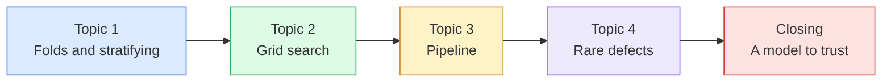
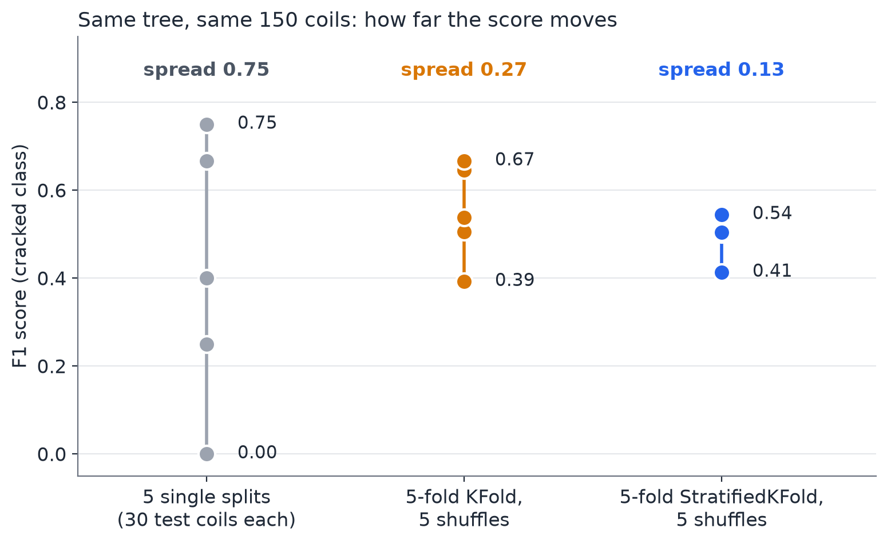
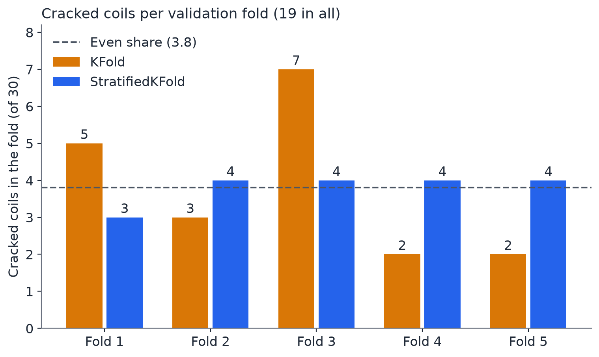
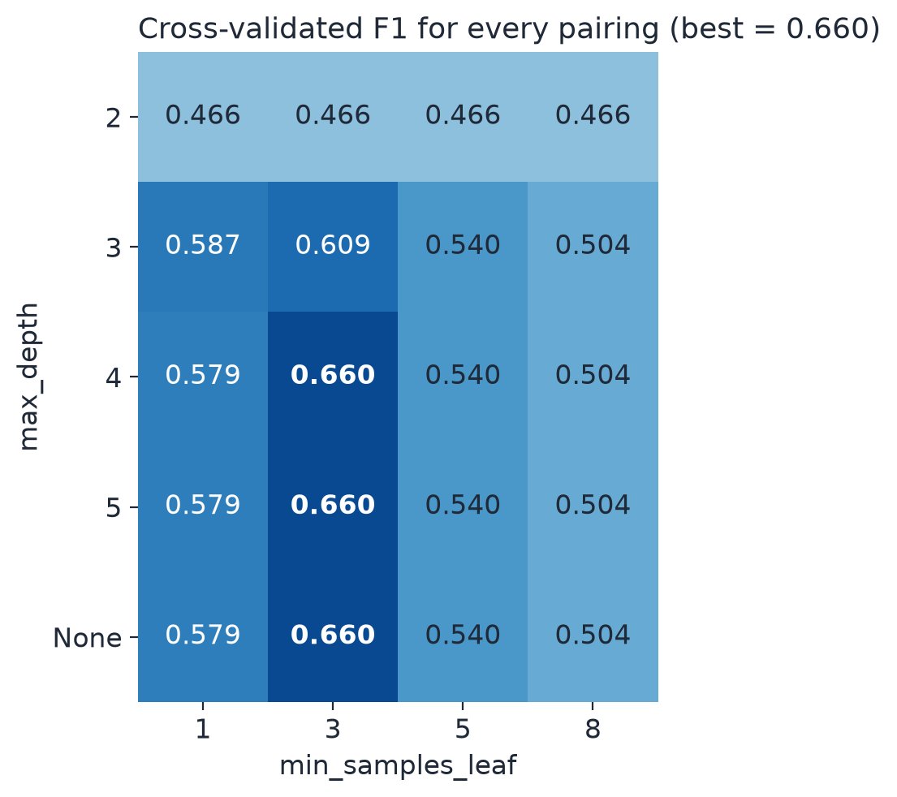
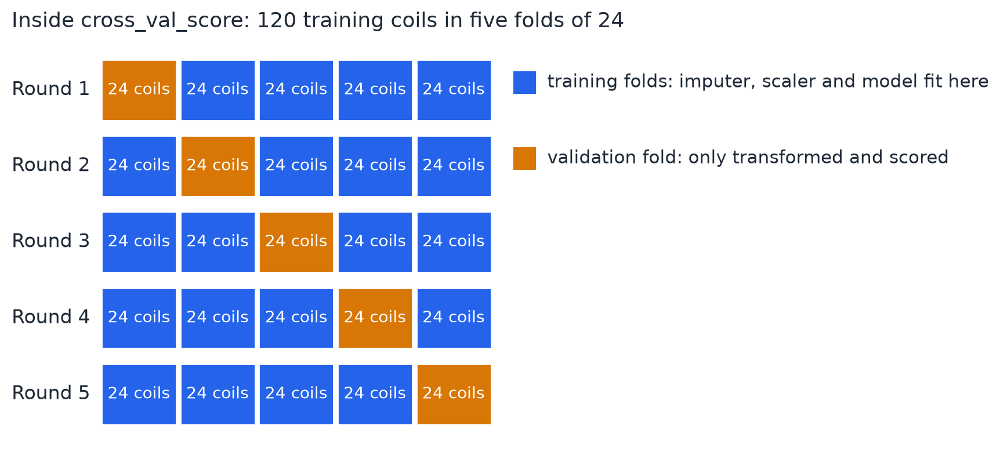
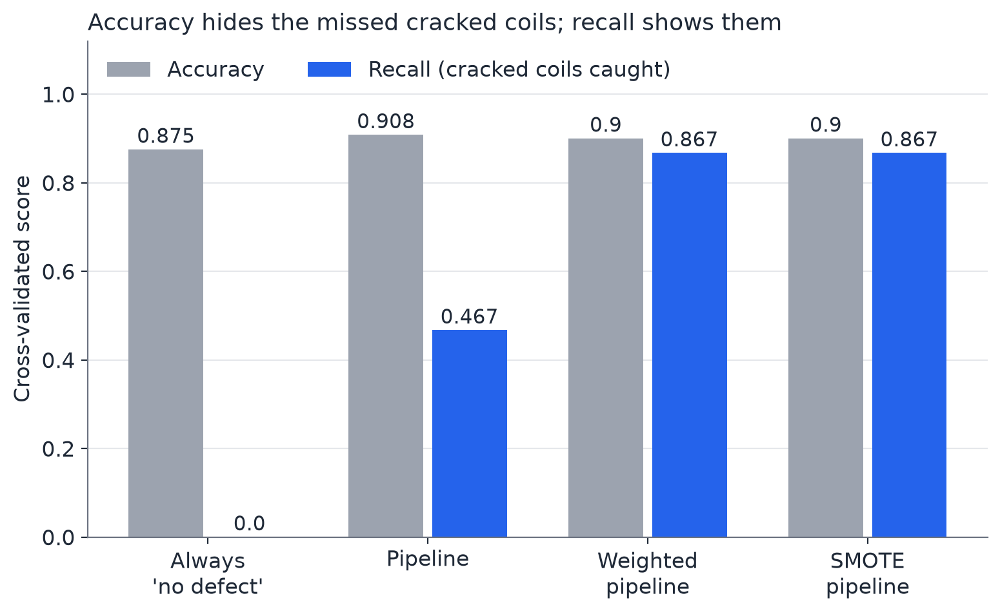
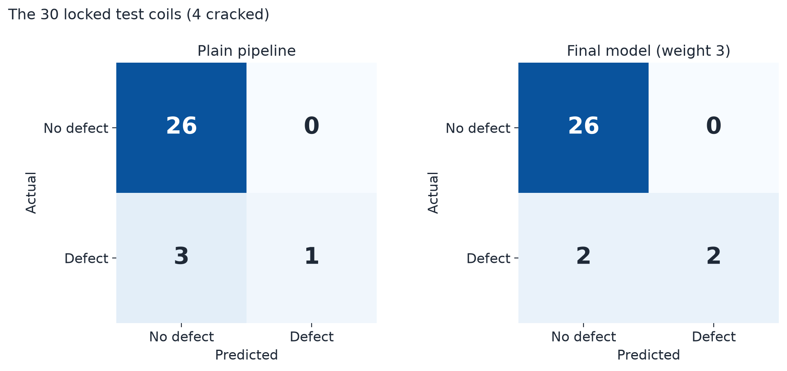

# <font color='#1d4ed8'>Lecture Script: Cross-Validation, Tuning, Pipelines and Rare Classes</font>

---

## <font color='blue'>Agenda</font>

The lecture runs as four topics. Each topic ends with a quiz.

| Topic | What we do | Learning objectives covered | Minutes |
|:-:|:--|:--|:-:|
| 1 | Score the model on every fold, and keep the defect share in each | Apply k-fold cross-validation to obtain a stable estimate of model performance<br>Apply stratified splitting to preserve class proportions in each fold | 30 |
| 2 | Try every setting and keep the best | Tune a model's hyperparameters using cross-validated grid search | 25 |
| 3 | Chain the steps so nothing leaks | Build a scikit-learn Pipeline chaining preprocessing steps to an estimator | 25 |
| 4 | Make the rare defect count | Apply class weighting or resampling to a training set with a rare positive class | 25 |
| — | Closing: Outcome & Summary | | 15 |
| | **Total** | | **120** |

> <font color="red">**🎯 Instructor Note**</font> Pace: in Topic 1 spend about 15 minutes on k-fold and 15 on stratifying; the repeated-shuffle runs are the proof, so let them land. Topic 2 is a short search with one table to read.
> Topic 3 is mostly building one object. In Topic 4 slow down at the weight table and at the leak example; they are what learners will use at work.

---

## <font color='blue'>Scenario</font>

A Tata Steel-style steel plant inspects every cold-rolled coil before it is shipped to a car-parts maker. A cracked coil is rare, but one that reaches the customer stops a production line. The quality team keeps one row per coil:

| Column | What it holds | Gaps |
|:--|:--|:-:|
| `speed_mpm` | Line speed, in metres per minute | none |
| `temp_c` | Annealing temperature, in degrees Celsius | none |
| `thick_um` | Thickness deviation from the target, in microns | none |
| `carbon_pct` | Carbon content, in percent | none |
| `force_kn` | Rolling force, in kilonewtons | none |
| `emul_c` | Temperature of the cooling emulsion, in degrees Celsius | 7 coils |
| `defect` | 1 = cracked coil, 0 = good coil | none |

> <font color="red">**🎯 Instructor Note**</font> The plant is only the setting. Do not claim any real plant uses this data; the 150 coils in `data/coil_inspection.csv` (19 cracked) are invented for teaching.
> Outputs come from Python 3, pandas 3.0.1, numpy 2.4.4, scikit-learn 1.8.0 and imbalanced-learn 0.14.2 (in Colab run `!pip install imbalanced-learn` once). Other versions may differ in the last digit. Every split and model uses a fixed `random_state`.

---

## <font color='blue'>Problem Statement</font>

Ravi, a quality engineer, trained a model on past coil records to flag cracked coils before shipping. He set 30 coils aside, scored the model once, liked the number and sent the model to the line. A month later a batch of cracked coils reached the customer, the customer's line stopped for a day, and the plant paid for the stoppage.

Four things were wrong. One score from one random set of 30 coils is partly luck. Nobody had tried other settings for the model. The gaps were filled and the columns scaled using every coil, the 30 set-aside coils included, so the test was not a clean test. And only 19 of our 150 coils are cracked, so a rule that passes every coil is right for 131 of 150 coils (87%) and catches nothing.

> <font color='purple'>**How do we get a score we can trust, choose the model's settings fairly, prepare the data without leaking, and make a model that actually catches the rare cracked coil?**</font>

> <font color="red">**🎯 Instructor Note**</font> Poll: "The same model, tested on five different random sets of 30 coils, scored F1 anywhere from 0.0 to 0.75. Which score should Ravi report?" Give learners 30 seconds to respond in chat. Reveal the answer in the Closing.

---

## <font color='blue'>What We Will Use</font>

Four groups of tools, one per topic. Each topic explains its tools where they are first used.

| Topic | Tools | In one line |
|:-:|:--|:--|
| 1 | `KFold`, `StratifiedKFold`, `cross_val_score`, `train_test_split` | Cut the coils into folds, score every fold, keep the defect share in each part |
| 2 | `GridSearchCV` | Try every combination of settings on every fold and keep the best |
| 3 | `Pipeline`, `SimpleImputer`, `StandardScaler`, `LogisticRegression` | Chain fill-gaps, scale and fit so each step learns from training rows only |
| 4 | `DummyClassifier`, `cross_validate`, `class_weight`, imbalanced-learn `SMOTE`, `RandomOverSampler`, `ImbPipeline` | Compare against a baseline, then make the rare defect coils count more, or make more of them |

---

## <font color='blue'>How: Walking Through the Coil Inspection</font>



---

## <font color='blue'>Topic 1: Score the Model on Every Fold, and Keep the Defect Share in Each</font> `30 min`

> <font color='purple'>**A model scored well on one set of 30 test coils. Would it score the same on another set?**</font>

Last session you trained a kNN and a linear SVM and judged each with one score on held-out data. Earlier you split data into train and test, trained a decision tree and limited its depth, and measured precision, recall and F1 for a rare positive class. Today we ask how far one such score can be trusted. A cracked coil is the positive class, coded 1.

### <font color='green'>Example: from one test set to five folds</font>

> <font color='purple'>**What do the coils look like?**</font>

**Predict before running: What will happen?**

> <font color="red">**🎯 Instructor Note**</font> Expected: 150 rows, 8 columns (the coil id counts), 19 cracked coils, about 12.7%. A gap in `emul_c` shows as `NaN`.

```python
import pandas as pd

df = pd.read_csv("data/coil_inspection.csv")
print(df.shape)
print(df["defect"].value_counts())
print(df["defect"].mean().round(3))
print(df.head(4))
```

**Output**

```
(150, 8)
defect
0    131
1     19
Name: count, dtype: int64
0.127
  coil_id  speed_mpm  temp_c  thick_um  carbon_pct  force_kn  emul_c  defect
0    C001        474     673      12.8       0.042     10040    52.4       0
1    C002        416     680      17.4       0.078     12230    56.4       0
2    C003        485     673       9.2       0.060      9900    53.8       0
3    C004        453     697      24.6       0.082     10410     NaN       0
```

#### <font color='#c2410c'>Code Explanation</font>

- **Line 3** Reads the coil file into a table called `df`.
- **Line 4** Prints the size as (rows, columns).
- **Line 5** Counts good coils (0) and cracked coils (1).
- **Line 6** The mean of a 0/1 column is the share of 1s: the cracked share.
- **Line 7** Shows the first four coils; `NaN` is a gap in the data.

> <font color='green'>**Result**</font> 150 coils, 19 of them cracked: about 1 coil in 8.

> <font color='purple'>**If we change only which 30 coils are held out, how much does the score move?**</font>

Set up the five columns the model uses, and a small decision tree:

```python
from sklearn.model_selection import train_test_split
from sklearn.tree import DecisionTreeClassifier
from sklearn.metrics import f1_score

features = ["speed_mpm", "temp_c", "thick_um", "carbon_pct", "force_kn"]
X, y = df[features], df["defect"]
tree = DecisionTreeClassifier(max_depth=3, random_state=42)
print(X.shape)
```

**Output**

```
(150, 5)
```

#### <font color='#c2410c'>Code Explanation</font>

- **Lines 1 to 3** Import the splitter, the decision tree and the F1 score.
- **Line 5** The five numeric columns without gaps; `emul_c` joins later, once we can fill its gaps.
- **Line 6** `X` holds the features and `y` the 0/1 target.
- **Line 7** A tree limited to depth 3, with a fixed `random_state`.
- **Line 8** Confirms 150 rows and 5 columns.

**Predict before running: What will happen?**

> <font color="red">**🎯 Instructor Note**</font> Ask for a range before revealing. Common wrong guess: "all five scores will be close, because the model and the data are the same."

```python
for seed in range(5):
    Xa, Xb, ya, yb = train_test_split(X, y, test_size=0.2, random_state=seed)
    pred = tree.fit(Xa, ya).predict(Xb)
    print(seed, yb.sum(), round(f1_score(yb, pred), 3))
```

**Output**

```
0 6 0.25
1 7 0.4
2 4 0.667
3 2 0.0
4 4 0.75
```

#### <font color='#c2410c'>Code Explanation</font>

- **Line 1** Tries five different random splits, numbered 0 to 4.
- **Line 2** Holds out 20% of the coils (30) as the test set; `random_state=seed` decides which 30.
- **Line 3** Trains the tree on the other 120 coils and predicts the 30 held-out coils.
- **Line 4** Prints the seed, how many cracked coils landed in the test set, and the F1 score for the cracked class.

> <font color='green'>**Result**</font> Same model, same 150 coils, F1 from 0.0 to 0.75. Only the luck of which 30 coils were held out changed.

> <font color='purple'>**What if every coil takes a turn in the test set, and we average the scores?**</font>

This is **k-fold cross-validation**. Cut the 150 coils into $k = 5$ folds of 30. In each round one fold is the validation fold and the other four are the training folds. The model is trained five times.

| Round | Validation fold | Training folds |
|:-:|:-:|:--|
| 1 | Fold 1 | Folds 2, 3, 4, 5 |
| 2 | Fold 2 | Folds 1, 3, 4, 5 |
| 3 | Fold 3 | Folds 1, 2, 4, 5 |
| 4 | Fold 4 | Folds 1, 2, 3, 5 |
| 5 | Fold 5 | Folds 1, 2, 3, 4 |

$$\boxed{\text{CV score} = \frac{1}{k}\sum_{i=1}^{k} \text{score}_i}$$

**Predict before running: What will happen?**

> <font color="red">**🎯 Instructor Note**</font> Expected: five F1 scores, one per fold, and their mean near 0.36. Ask: "Will every fold look like the mean?" Expected: no, the folds differ a lot.

```python
from sklearn.model_selection import KFold, cross_val_score

kf = KFold(n_splits=5, shuffle=True, random_state=42)
scores = cross_val_score(tree, X, y, cv=kf, scoring="f1")
print(scores.round(3))
print(round(scores.mean(), 3), round(scores.std(), 3))
```

**Output**

```
[0.444 0.    0.667 0.667 0.   ]
0.356 0.301
```

#### <font color='#c2410c'>Code Explanation</font>

- **Line 3** Builds the fold maker: 5 folds, shuffled first, with a fixed `random_state`.
- **Line 4** Trains and scores the tree five times and returns one F1 per fold.
- **Line 5** Prints the five scores.
- **Line 6** Prints their mean (the CV score) and their standard deviation (how much the folds disagree).

By hand: $(0.444 + 0 + 0.667 + 0.667 + 0) \div 5 = 1.778 \div 5 = 0.356$.

<p align="center"></p>

> <font color='green'>**Result**</font> The CV score is 0.356. Every coil was used for training in four rounds and for scoring in one.

### <font color='green'>Extending it: does every coil get scored exactly once?</font>

> <font color='purple'>**How big is each training set and validation fold, and how often is each coil scored?**</font>

> <font color="red">**🎯 Instructor Note**</font> Ask learners to predict the two sizes first. Expected: 120 and 30, and every coil scored once.

```python
import numpy as np

scored = np.zeros(len(df), dtype=int)
for train_idx, val_idx in kf.split(X):
    scored[val_idx] += 1
print(len(train_idx), len(val_idx), np.unique(scored))
```

**Output**

```
120 30 [1]
```

#### <font color='#c2410c'>Code Explanation</font>

- **Line 3** Starts a counter of 0 for each of the 150 coils.
- **Lines 4 and 5** For each round, adds 1 to every coil in the validation fold.
- **Line 6** Prints the training size, the validation size and the distinct counts.

> <font color='green'>**Result**</font> Each round trains on 120 coils and scores 30. Every coil is scored exactly once, so the five folds together cover all 150.

### <font color='green'>Extending it: is the average steadier than one split?</font>

> <font color='purple'>**If we repeat the whole 5-fold run with five different shuffles, how far do the averages move?**</font>

> <font color="red">**🎯 Instructor Note**</font> Ask: "Will the five averages spread as wide as the five single splits (0.0 to 0.75)?" Give learners 30 seconds to respond in chat. Expected: narrower, but still not tight.

```python
for seed in range(5):
    cv = KFold(n_splits=5, shuffle=True, random_state=seed)
    mean = cross_val_score(tree, X, y, cv=cv, scoring="f1").mean()
    print(seed, round(mean, 3))
```

**Output**

```
0 0.505
1 0.645
2 0.667
3 0.392
4 0.537
```

#### <font color='#c2410c'>Code Explanation</font>

- **Line 1** Repeats with five shuffle seeds.
- **Line 2** Builds a 5-fold maker with that shuffle.
- **Line 3** Computes the average F1 over the five folds.
- **Line 4** Prints the seed and the average.

> <font color='green'>**Result**</font> On these five shuffles the averages run from 0.392 to 0.667, a spread of about 0.27, against 0.75 for single splits. Averaging over folds is steadier, but not yet steady.

### <font color='green'>Extending it: how many cracked coils land in each fold?</font>

> <font color='purple'>**Only 19 coils are cracked. Does a shuffled split share them out evenly across the five folds?**</font>

A cracked coil is rare, so the way a split shares the 19 around matters. If the split kept the cracked share equal in every fold, each fold of 30 would hold about $30 \times \frac{19}{150} = 3.8$ cracked coils. **Stratified splitting** does exactly that: it splits the good coils and the cracked coils separately, so every fold gets its fair share of each.

**Predict before running: What will happen?**

> <font color="red">**🎯 Instructor Note**</font> Expected: `KFold` gives uneven counts (some folds with 2, one with 7); `StratifiedKFold` gives 3 or 4 in every fold. Ask learners to guess the largest `KFold` count first.

```python
from sklearn.model_selection import StratifiedKFold

skf = StratifiedKFold(n_splits=5, shuffle=True, random_state=42)
for name, cv in [("KFold", kf), ("StratifiedKFold", skf)]:
    counts = [int(y.iloc[val].sum()) for _, val in cv.split(X, y)]
    print(name, counts)
```

**Output**

```
KFold [5, 3, 7, 2, 2]
StratifiedKFold [3, 4, 4, 4, 4]
```

#### <font color='#c2410c'>Code Explanation</font>

- **Line 3** Builds the stratified fold maker, with the same 5 folds, shuffle and seed as before.
- **Line 4** Loops over the plain maker and the stratified maker.
- **Line 5** For each fold, counts the cracked coils in the validation part (`val` holds the row positions).
- **Line 6** Prints the five counts.

<p align="center"></p>

> <font color='green'>**Result**</font> Plain `KFold` put 7 cracked coils in one fold and 2 in two others. `StratifiedKFold` put 3 or 4 in every fold, close to the 3.8 an even share gives.

### <font color='green'>Extending it: is the stratified average steadier?</font>

> <font color='purple'>**Repeat the five shuffles with `StratifiedKFold`. Do the averages move less than before?**</font>

> <font color="red">**🎯 Instructor Note**</font> Ask for a guess: wider or narrower than 0.27? Expected: narrower.

```python
for seed in range(5):
    cv = StratifiedKFold(n_splits=5, shuffle=True, random_state=seed)
    mean = cross_val_score(tree, X, y, cv=cv, scoring="f1").mean()
    print(seed, round(mean, 3))
```

**Output**

```
0 0.5
1 0.544
2 0.505
3 0.504
4 0.413
```

#### <font color='#c2410c'>Code Explanation</font>

- **Lines 1 to 4** The same loop as before, with `StratifiedKFold` in place of `KFold`.

> <font color='green'>**Result**</font> The five averages now run from 0.413 to 0.544, a spread of about 0.13, less than half of the 0.27 from plain folds. Same tree, same coils: only the folds changed. Five shuffles are a small sample, but the pattern matches the fold counts above.

### <font color='green'>Extending it: ten folds with only 19 cracked coils</font>

> <font color='purple'>**What happens to the counts if we ask for 10 folds of 15 coils?**</font>

> <font color="red">**🎯 Instructor Note**</font> Ask: "With 19 cracked coils and 10 plain folds, can a fold get none?" Expected: yes.

```python
for name, C in [("KFold", KFold), ("Stratified", StratifiedKFold)]:
    cv = C(n_splits=10, shuffle=True, random_state=42)
    print(name, [int(y.iloc[val].sum()) for _, val in cv.split(X, y)])
```

**Output**

```
KFold [4, 1, 0, 3, 2, 5, 2, 0, 1, 1]
Stratified [1, 2, 2, 2, 2, 2, 2, 2, 2, 2]
```

#### <font color='#c2410c'>Code Explanation</font>

- **Line 1** Loops over the two fold makers (the classes, not yet built).
- **Line 2** Builds each with 10 folds.
- **Line 3** Prints the cracked-coil count of each of the ten validation folds.

> <font color='green'>**Result**</font> Plain `KFold` gives two folds with no cracked coil at all. Such a fold has nothing to catch, so its recall and F1 come out as 0 whatever the model does (scikit-learn also prints a warning). `StratifiedKFold` gives every fold 1 or 2.

### <font color='green'>Extending it: lock away a test set that keeps the share</font>

> <font color='purple'>**How do we set 30 coils aside for the final check without changing the cracked share?**</font>

`train_test_split` takes `stratify=` for the same job. From here on, only the 120 training coils are used for scoring and choosing; the 30 test coils stay locked until the final check.

> <font color="red">**🎯 Instructor Note**</font> Ask which split keeps the share closer to 12.7%. Expected: the stratified one.

```python
train, test = train_test_split(df, test_size=0.2, stratify=df["defect"], random_state=42)
print(len(train), train["defect"].mean().round(3), len(test), test["defect"].mean().round(3))
plain_tr, plain_te = train_test_split(df, test_size=0.2, random_state=42)
print(len(plain_tr), plain_tr["defect"].mean().round(3), len(plain_te), plain_te["defect"].mean().round(3))
```

**Output**

```
120 0.125 30 0.133
120 0.117 30 0.167
```

#### <font color='#c2410c'>Code Explanation</font>

- **Line 1** Splits the whole table 80/20 and keeps the cracked share equal in both parts.
- **Line 2** Prints each part's size and cracked share.
- **Lines 3 and 4** Do the same split without `stratify` for comparison.

> <font color='green'>**Result**</font> The stratified parts hold 12.5% and 13.3% cracked coils, both near the overall 12.7%. The plain split gives 11.7% and 16.7%. The training part has 15 cracked coils and the test part 4; split into five stratified folds of 24, the training coils give exactly 3 cracked coils per fold.

### <font color='purple'>Quiz 1</font>

**Question:** In 5-fold cross-validation on 150 coils, what happens?

**Options:**
- A) One model is trained on 120 coils and scored once on the other 30 coils.
- B) Five models are each trained on all 150 coils and scored on the same 150 coils.
- C) Five models are each trained on 120 coils and scored on the 30 coils left out; every coil is scored exactly once.
- D) One model is trained on 30 coils and scored on the other 120 coils, five times.

**Correct Answer:** C

**Explanation:**
- **A)** Wrong: that is a single train/test split, which gave the shaky 0.0 to 0.75 scores.
- **B)** Wrong: scoring on the coils the model trained on tells us nothing about new coils.
- **C)** Correct: five rounds, each with 4 folds of 30 for training (120) and 1 fold of 30 for scoring.
- **D)** Wrong: this reverses the sizes; the training part is the big part (120), not the small one.

---

## <font color='blue'>Topic 2: Try Every Setting and Keep the Best</font> `25 min`

> <font color='purple'>**Which depth and leaf size should the tree use, and can we let the computer search instead of guessing?**</font>

Last session you set C for a linear SVM, and earlier you set `max_depth` for a tree. Both are hyperparameters: you type them before `fit`, and `fit` never changes them. In Topic 1 we always used `max_depth=3`. Now we score the 120 training coils with the stratified folds `skf`.

### <font color='green'>Example: from one setting by hand to a grid search</font>

> <font color='purple'>**Which `max_depth` gives the best cross-validated F1: no limit, 2, 3 or 4?**</font>

**Predict before running: What will happen?**

> <font color="red">**🎯 Instructor Note**</font> Ask which depth wins. Expected: depth 3, with 0.587. Common wrong guess: "no limit is best because the tree sees more." It scores 0.579.

```python
Xt, yt = train[features], train["defect"]
for depth in (None, 2, 3, 4):
    model = DecisionTreeClassifier(max_depth=depth, random_state=42)
    score = cross_val_score(model, Xt, yt, cv=skf, scoring="f1").mean()
    print(depth, round(score, 3))
```

**Output**

```
None 0.579
2 0.466
3 0.587
4 0.579
```

#### <font color='#c2410c'>Code Explanation</font>

- **Line 1** Takes the five feature columns and the target from the 120 training coils.
- **Line 2** Tries four values of `max_depth`; `None` means no limit.
- **Line 3** Builds a tree with that setting.
- **Line 4** Computes its cross-validated F1 on the stratified folds.
- **Line 5** Prints the setting and its score.

> <font color='green'>**Result**</font> Depth 3 scores best (0.587), only just ahead of no limit and depth 4 (0.579); with 15 cracked coils a gap that small can be luck. Depth 2 is clearly too shallow (0.466). One setting is easy by hand, but we also want to tune the leaf size.

> <font color='purple'>**How do we try every pairing of depth and leaf size, each scored by 5-fold CV?**</font>

A **grid** lists the values to try for each hyperparameter. `GridSearchCV` tries every pairing, scores each with cross-validation, and keeps the best. `min_samples_leaf` is the smallest number of coils a leaf may hold.

$$\boxed{\text{fits} = (\text{values of } A) \times (\text{values of } B) \times k}$$

Here $5 \times 4 \times 5 = 100$ fits.

**Predict before running: What will happen?**

> <font color="red">**🎯 Instructor Note**</font> Expected: a best pairing near depth 3 or 4 with leaf size 3, and 100 fits. Ask learners for the number of fits first.

```python
from sklearn.model_selection import GridSearchCV

grid = {"max_depth": [2, 3, 4, 5, None], "min_samples_leaf": [1, 3, 5, 8]}
gs = GridSearchCV(DecisionTreeClassifier(random_state=42), grid, cv=skf, scoring="f1")
gs.fit(Xt, yt)
print(gs.best_params_, round(gs.best_score_, 3))
n = len(gs.cv_results_["params"])
print(n, "settings x 5 folds =", n * 5, "fits")
```

**Output**

```
{'max_depth': 4, 'min_samples_leaf': 3} 0.66
20 settings x 5 folds = 100 fits
```

#### <font color='#c2410c'>Code Explanation</font>

- **Line 3** The grid: a dictionary from each hyperparameter name to its list of values.
- **Line 4** Builds the search: the model to tune, the grid, the folds and the score to maximise.
- **Line 5** Runs the search on the training coils. When it finishes it also refits the winner on all 120 coils.
- **Line 6** Prints the winning pairing and its cross-validated F1.
- **Lines 7 and 8** Count the settings tried and multiply by 5 folds.

> <font color='green'>**Result**</font> The best pairing is `max_depth=4` with `min_samples_leaf=3`, with a cross-validated F1 of 0.66. The search ran 20 settings times 5 folds, 100 fits.

### <font color='green'>Extending it: read the whole table, not only the winner</font>

> <font color='purple'>**How close were the runners-up, and why do some settings tie?**</font>

> <font color="red">**🎯 Instructor Note**</font> Ask: "Could two different settings get exactly the same score?" Expected: yes, if they build the same tree.

```python
res = pd.DataFrame(gs.cv_results_).rename(columns=lambda c: c.replace("param_", ""))
cols = ["max_depth", "min_samples_leaf", "mean_test_score", "rank_test_score"]
print(res[cols].nsmallest(5, "rank_test_score").round(3))
print(DecisionTreeClassifier(min_samples_leaf=3, random_state=42).fit(Xt, yt).get_depth())
```

**Output**

```
   max_depth  min_samples_leaf  mean_test_score  rank_test_score
9          4                 3            0.660                1
13         5                 3            0.660                1
17      None                 3            0.660                1
5          3                 3            0.609                4
4          3                 1            0.587                5
4
```

#### <font color='#c2410c'>Code Explanation</font>

- **Line 1** Turns the search record into a table and shortens the column names.
- **Line 2** Picks the four columns to show.
- **Line 3** Shows the five best settings by rank.
- **Line 4** Grows a tree with no depth limit but leaves of at least 3 coils, and prints how deep it gets.

<p align="center"></p>

> <font color='green'>**Result**</font> Three settings tie at rank 1 (0.66). With leaves of at least 3 coils, the tree stops at depth 4 on its own, so limits of 4, 5 and `None` build the same tree. `GridSearchCV` keeps the first of a tie, depth 4.

### <font color='green'>Extending it: what does a bigger grid cost?</font>

> <font color='purple'>**What if we also tried 3 values of a third setting?**</font>

> <font color="red">**🎯 Instructor Note**</font> Ask learners to multiply before showing the line. Expected: 300 fits.

#### <font color='#c2410c'>Logic Explanation</font>

- Settings: $5 \times 4 \times 3 = 60$. Each is scored on 5 folds: $60 \times 5 = 300$ fits.
- Every new hyperparameter multiplies the work, so keep each list short and add a hyperparameter only when it matters.
- The best score of 60 tries is picked because it was the highest, so it can be a little too hopeful. The locked-away test coils are the honest check, because no search has seen them.

> <font color='green'>**Result**</font> The number of fits is the product of all the list lengths, times the number of folds.

> <font color='#b45309'>**Common mistake**</font> Tuning on the test set. The search must see only the training coils; the test coils are used once, at the end.

### <font color='purple'>Quiz 2</font>

**Question:** A grid has 4 values of `max_depth` and 3 values of `min_samples_leaf`, with 5-fold cross-validation. How many model fits does `GridSearchCV` run while searching (not counting the final refit)?

**Options:**
- A) 60
- B) 12
- C) 15
- D) 35

**Correct Answer:** A

**Explanation:**
- **A)** Correct: $4 \times 3 = 12$ settings, each scored on 5 folds, so $12 \times 5 = 60$ fits.
- **B)** Wrong: 12 is the number of settings; each setting is fitted once per fold.
- **C)** Wrong: $3 \times 5 = 15$ forgets the 4 values of `max_depth`.
- **D)** Wrong: $(4 + 3) \times 5 = 35$ adds the list lengths; a grid pairs every value with every other, so it multiplies them.

---

## <font color='blue'>Topic 3: Chain the Steps so Nothing Leaks</font> `25 min`

> <font color='purple'>**How do we fill the gaps, scale the columns and fit the model so that every step learns only from the training part of each fold?**</font>

Last session you saw that kNN and the SVM need features on a common scale. Earlier you learned to fit a scaler on the training rows only, and that Ridge and Lasso need scaled columns. The plant now adds a sixth column, `emul_c`, which has gaps, and moves to logistic regression, the classifier you trained earlier. It needs complete numbers on a common scale.

### <font color='green'>Example: from a refused fit to a Pipeline</font>

> <font color='purple'>**What does logistic regression do with a column that has gaps?**</font>

**Predict before running: What will happen?**

> <font color="red">**🎯 Instructor Note**</font> Expected: an error, because logistic regression cannot accept `NaN`. The training coils hold 6 of the 7 gaps; the test coils hold 1.

```python
from sklearn.linear_model import LogisticRegression

features6 = features + ["emul_c"]
Xt6 = train[features6]
print(Xt6.isna().sum().sum(), "gaps in the training coils")
try:
    LogisticRegression().fit(Xt6, yt)
except ValueError as err:
    print(str(err).splitlines()[0])
```

**Output**

```
6 gaps in the training coils
Input X contains NaN.
```

#### <font color='#c2410c'>Code Explanation</font>

- **Line 3** Adds `emul_c` to the five columns used so far.
- **Line 4** Takes those six columns from the training coils.
- **Line 5** Counts the gaps in the training coils.
- **Lines 6 to 9** Try to fit logistic regression and print the first line of the error if it fails.

> <font color='green'>**Result**</font> The model refuses the gaps. We must fill them first, and the scale must be fixed too, without letting validation coils leak into either step.

> <font color='purple'>**How do we chain fill, scale and fit into one object?**</font>

A `Pipeline` is a list of named steps. Every step but the last is a preprocessing step with `fit` and `transform`; the last is the model. `SimpleImputer` fills each gap with a number learned from the training rows (here the median). `StandardScaler` subtracts the mean and divides by the standard deviation, as you did earlier.

**Predict before running: What will happen?**

> <font color="red">**🎯 Instructor Note**</font> Ask: "Will the fit fail again on the gaps?" Expected: no; it prints three step names and ten predictions.

```python
from sklearn.pipeline import Pipeline
from sklearn.impute import SimpleImputer
from sklearn.preprocessing import StandardScaler

pipe = Pipeline([("impute", SimpleImputer(strategy="median")),
                 ("scale", StandardScaler()),
                 ("model", LogisticRegression())])
print(list(pipe.named_steps))
print(pipe.fit(Xt6, yt).predict(Xt6)[:10])
```

**Output**

```
['impute', 'scale', 'model']
[0 0 0 0 0 0 0 0 0 0]
```

#### <font color='#c2410c'>Code Explanation</font>

- **Lines 5 to 7** Three named steps in order: fill gaps with the median, scale, then fit logistic regression.
- **Line 8** Prints the step names.
- **Line 9** `fit` runs every step in order on the training coils; `predict` then passes rows through the same steps and prints the first ten answers (0 = good coil).

> <font color='green'>**Result**</font> One object now holds fill, scale and model, and it accepts raw rows with gaps.

### <font color='green'>Extending it: cross-validate the whole Pipeline</font>

> <font color='purple'>**How does the Pipeline score on the same stratified folds?**</font>

> <font color="red">**🎯 Instructor Note**</font> Expected: five F1 scores and a mean near 0.5. Ask: "Which is lower, the tuned tree's 0.66 or this pipeline's mean?"

```python
scores = cross_val_score(pipe, Xt6, yt, cv=skf, scoring="f1")
print(scores.round(3))
print(round(scores.mean(), 3))
```

**Output**

```
[0.    0.8   0.571 0.4   0.8  ]
0.514
```

#### <font color='#c2410c'>Code Explanation</font>

- **Line 1** For each fold, clones the Pipeline, fits all three steps on the four training folds, and scores the validation fold.
- **Lines 2 and 3** Print the five F1 scores and their mean.

> <font color='green'>**Result**</font> The Pipeline scores 0.514, with one fold at 0.0. That is lower than the tuned tree's 0.66, though the tree's figure is the best of 20 tries and so a little hopeful.

### <font color='green'>Extending it: what the Pipeline does inside a fold</font>

> <font color='purple'>**Does the scaler in a fold see the validation coils?**</font>

> <font color="red">**🎯 Instructor Note**</font> Ask: "Will the two sets of means be identical?" Expected: close, but not identical.

```python
from sklearn.base import clone

tr_idx, va_idx = next(skf.split(Xt6, yt))
in_fold = clone(pipe).fit(Xt6.iloc[tr_idx], yt.iloc[tr_idx])
on_all = clone(pipe).fit(Xt6, yt)
print(len(tr_idx), len(va_idx))
print(in_fold.named_steps["scale"].mean_[:3].round(1))
print(on_all.named_steps["scale"].mean_[:3].round(1))
```

**Output**

```
96 24
[452.  691.5  16. ]
[452.3 691.4  16.2]
```

#### <font color='#c2410c'>Code Explanation</font>

- **Line 3** Takes the training and validation positions of the first fold.
- **Line 4** Fits a fresh copy (`clone`) of the Pipeline on that fold's 96 training coils only.
- **Line 5** Fits another copy on all 120 coils.
- **Line 6** Prints the training and validation sizes.
- **Lines 7 and 8** Print the first three column means each scaler learned: speed, temperature, thickness.

<p align="center"></p>

> <font color='green'>**Result**</font> The fold's scaler learned its means from 96 coils and never saw the 24 validation coils, so its means differ from the all-120 ones. A Pipeline inside `cross_val_score` repeats this in every fold, which keeps the score honest.

### <font color='green'>Extending it: tune any step of the Pipeline</font>

> <font color='purple'>**Can `GridSearchCV` tune the model's `C` and the imputer's strategy at once?**</font>

In a Pipeline a setting is named `step__setting`, with two underscores. In logistic regression a small `C` means a stronger penalty, like a large Ridge alpha.

> <font color="red">**🎯 Instructor Note**</font> Ask learners for the number of fits first. Expected: $5 \times 2 \times 5 = 50$.

```python
grid = {"model__C": [0.01, 0.1, 1, 10, 100], "impute__strategy": ["mean", "median"]}
gs2 = GridSearchCV(pipe, grid, cv=skf, scoring="f1").fit(Xt6, yt)
print(gs2.best_params_, round(gs2.best_score_, 3))
new = pd.DataFrame([[470, 700, 22.0, 0.05, 11200, None]], columns=features6)
print(gs2.predict(new), gs2.predict_proba(new).round(3))
```

**Output**

```
{'impute__strategy': 'mean', 'model__C': 10} 0.603
[0] [[0.63 0.37]]
```

#### <font color='#c2410c'>Code Explanation</font>

- **Line 1** A grid over two Pipeline settings: `C` of the model step and `strategy` of the imputer step. That is $5 \times 2 \times 5 = 50$ fits.
- **Line 2** Searches the whole Pipeline, so each fold fills, scales and fits on its own training part.
- **Line 3** Prints the winning settings and score.
- **Line 4** Builds one new coil whose emulsion temperature is missing.
- **Line 5** Passes it straight in: the Pipeline fills the gap and scales before predicting. Prints the class and the two probabilities.

> <font color='green'>**Result**</font> Using the mean to fill gaps and `C=10` scores best (0.603). A raw coil with a gap goes straight into the fitted search without extra code.

### <font color='purple'>Quiz 3</font>

**Question:** Why do we put the imputer and the scaler inside the Pipeline when we cross-validate?

**Options:**
- A) It makes the model train faster.
- B) It lets every fold use the means of all 120 coils, so the numbers are more accurate.
- C) It removes the need for a model at the end.
- D) In every round the imputer and scaler learn from the training folds only, then transform the validation fold.

**Correct Answer:** D

**Explanation:**
- **A)** Wrong: a Pipeline is about correctness, not speed.
- **B)** Wrong: using all 120 coils would let the validation coils shape the scaler, which is leakage and makes scores too hopeful.
- **C)** Wrong: the last step of a Pipeline is the model; the other steps only prepare the data.
- **D)** Correct: each round refits every step on its own training folds, so the validation fold stays unseen.

---

## <font color='blue'>Topic 4: Make the Rare Defect Count</font> `25 min`

> <font color='purple'>**The Pipeline looks fine on accuracy. How many of the cracked coils does it actually catch?**</font>

In Classification Metrics and Model Choice, on the TB screening data, you saw that accuracy misleads when the positive class is rare, and you built a baseline a model must beat. Our Pipeline scored F1 0.514, with one fold at 0.0. Which cracked coils is it missing?

### <font color='green'>Example: the baseline and the Pipeline, on four scores</font>

> <font color='purple'>**What does a model that always says "no defect" score, and how does our Pipeline compare?**</font>

Set up four scores. Precision gets `zero_division=0` so a model that never flags a coil scores 0 instead of raising a warning. The helper `report` cross-validates any model on the training coils.

```python
from sklearn.dummy import DummyClassifier
from sklearn.metrics import make_scorer, precision_score
from sklearn.model_selection import cross_validate

scoring = {"accuracy": "accuracy", "recall": "recall", "f1": "f1",
           "precision": make_scorer(precision_score, zero_division=0)}
def report(model):
    out = cross_validate(model, Xt6, yt, cv=skf, scoring=scoring)
    return {k[5:]: round(float(v.mean()), 3) for k, v in out.items() if k.startswith("test_")}
print(list(scoring))
```

**Output**

```
['accuracy', 'recall', 'f1', 'precision']
```

#### <font color='#c2410c'>Code Explanation</font>

- **Lines 1 to 3** Import the baseline model, a way to build a custom score, and `cross_validate`, which computes several scores in one run.
- **Lines 5 and 6** Four scores to compute on every fold.
- **Lines 7 to 9** The helper: cross-validates a model and returns each score's average over the five folds, dropping the `test_` prefix from the names.
- **Line 10** Prints the four score names.

**Predict before running: What will happen?**

> <font color="red">**🎯 Instructor Note**</font> Expected: the baseline has accuracy 0.875 and recall 0. The Pipeline's accuracy is only a little higher, and its recall is below 0.5.

```python
print("baseline", report(DummyClassifier(strategy="most_frequent")))
print("pipeline", report(pipe))
```

**Output**

```
baseline {'accuracy': 0.875, 'recall': 0.0, 'f1': 0.0, 'precision': 0.0}
pipeline {'accuracy': 0.908, 'recall': 0.467, 'f1': 0.514, 'precision': 0.6}
```

#### <font color='#c2410c'>Code Explanation</font>

- **Line 1** The baseline always answers the majority class, "no defect".
- **Line 2** Our Pipeline from Topic 3, scored the same way.

> <font color='green'>**Result**</font> The baseline is 87.5% accurate and catches no cracked coil. The Pipeline is 90.8% accurate, but its recall is 0.467: across the five validation folds it caught 7 of the 15 cracked coils and missed 8.

### <font color='green'>Extending it: class weights</font>

> <font color='purple'>**Can we tell the model that a missed cracked coil costs more than a false alarm?**</font>

With `class_weight="balanced"`, each coil counts in the training loss with a weight that is larger for the rarer class. For $n$ rows, $K$ classes and $n_c$ rows in class $c$:

$$\boxed{w_c = \frac{n}{K \, n_c}}$$

For our 120 training coils, 105 good and 15 cracked:

$$w_{0} = \frac{120}{2 \times 105} = 0.5714 \qquad w_{1} = \frac{120}{2 \times 15} = 4.0$$

**Predict before running: What will happen?**

> <font color="red">**🎯 Instructor Note**</font> Expected: the two weights from the formula. Ask which class gets the larger weight. Expected: the cracked class.

```python
from sklearn.utils.class_weight import compute_class_weight

print(yt.value_counts().to_dict())
w = compute_class_weight("balanced", classes=np.unique(yt), y=yt)
print(w.round(4))
weighted = clone(pipe).set_params(model__class_weight="balanced")
print("weighted", report(weighted))
```

**Output**

```
{0: 105, 1: 15}
[0.5714 4.    ]
weighted {'accuracy': 0.9, 'recall': 0.867, 'f1': 0.696, 'precision': 0.599}
```

#### <font color='#c2410c'>Code Explanation</font>

- **Line 3** Counts the two classes in the training coils.
- **Line 4** Asks scikit-learn for the balanced weights of class 0 and class 1.
- **Line 5** Prints them; they match the hand calculation.
- **Line 6** Copies the Pipeline and sets the model's `class_weight` to `"balanced"`. The fit now counts each cracked coil 4.0 times and each good coil 0.5714 times.
- **Line 7** Scores the weighted Pipeline with the same four scores.

<p align="center"></p>

> <font color='green'>**Result**</font> Weighting lifts recall from 0.467 to 0.867: 13 of the 15 cracked coils caught across the folds, against 7. Accuracy barely moves (0.908 to 0.9), which is why accuracy alone hid the problem. With only 15 cracked coils, each one moves recall by about 0.07, so read these as rough figures.

### <font color='green'>Extending it: how strong should the weight be?</font>

> <font color='purple'>**What happens as the cracked-coil weight goes from 1 up to 10?**</font>

**Predict before running: What will happen?**

> <font color="red">**🎯 Instructor Note**</font> Ask: "Does recall keep rising with the weight?" Give learners 30 seconds to respond in chat. Expected: it rises, then stays at 0.867 while precision falls.

```python
for wt in (1, 3, 7, 10):
    r = report(clone(pipe).set_params(model__class_weight={0: 1, 1: wt}))
    print(wt, r["recall"], r["precision"], r["f1"], r["accuracy"])
```

**Output**

```
1 0.467 0.6 0.514 0.908
3 0.867 0.737 0.788 0.942
7 0.867 0.566 0.677 0.892
10 0.867 0.566 0.677 0.892
```

#### <font color='#c2410c'>Code Explanation</font>

- **Line 1** Tries four weights for the cracked class, keeping the good-coil weight at 1.
- **Line 2** Scores each weighted Pipeline; the dictionary `{0: 1, 1: wt}` sets one weight per class.
- **Line 3** Prints the weight, then recall, precision, F1 and accuracy.

> <font color='green'>**Result**</font> Weight 1 is the unweighted Pipeline. Weight 3 raises recall to 0.867 and precision to 0.737. Weights 7 and 10 catch no more cracked coils but raise more false alarms, so precision drops to 0.566. The weight is a hyperparameter, so a grid can choose it. Weight 7 has the same 7-to-1 ratio as `"balanced"` ($4.0 \div 0.5714 = 7$); its scores differ a little because the balanced weights add up to 120 instead of 210 (96 instead of 168 inside each fold), which makes the penalty relatively stronger.

### <font color='green'>Extending it: resampling with SMOTE</font>

> <font color='purple'>**Instead of weighting the cracked coils, can we make more of them for the model to learn from?**</font>

**SMOTE** builds new cracked coils on the line between a real cracked coil and one of its nearest cracked neighbours. It must run only on the training part of each fold, so it goes inside a Pipeline. scikit-learn's own `Pipeline` rejects a resampling step, so we use the `Pipeline` from imbalanced-learn.

**Predict before running: What will happen?**

> <font color="red">**🎯 Instructor Note**</font> Expected: recall close to the weighted Pipeline's 0.867. Install once with `pip install imbalanced-learn` (version 0.14.2 here).

```python
from imblearn.pipeline import Pipeline as ImbPipeline
from imblearn.over_sampling import SMOTE

smote = ImbPipeline([("impute", SimpleImputer(strategy="median")),
                     ("scale", StandardScaler()),
                     ("resample", SMOTE(random_state=42)),
                     ("model", LogisticRegression())])
print("smote", report(smote))
```

**Output**

```
smote {'accuracy': 0.9, 'recall': 0.867, 'f1': 0.69, 'precision': 0.58}
```

#### <font color='#c2410c'>Code Explanation</font>

- **Lines 1 and 2** Import imbalanced-learn's Pipeline (renamed `ImbPipeline`) and `SMOTE`.
- **Lines 4 to 7** The Topic 3 steps plus a `resample` step before the model. In each round the training folds hold 96 coils, 12 of them cracked; SMOTE adds 72 new cracked coils to match the 84 good ones. The validation fold is never resampled.
- **Line 8** Scores it with the same four scores.

> <font color='green'>**Result**</font> SMOTE reaches the same recall, 0.867, with precision 0.58 against 0.599 for balanced weights. On 15 cracked coils the two cannot be told apart. Weighting and resampling are two routes to the same goal; weighting is simpler because it adds no new rows.

### <font color='green'>Extending it: resampling before the split leaks</font>

> <font color='purple'>**What if we oversample all 120 training coils first, then cross-validate?**</font>

**Predict before running: What will happen?**

> <font color="red">**🎯 Instructor Note**</font> Ask: "Will recall go up or down?" Expected: up, to a number that looks too good. The proper version inside the Pipeline stays at 0.867.

```python
from imblearn.over_sampling import RandomOverSampler

Xr, yr = RandomOverSampler(random_state=42).fit_resample(Xt6, yt)
leak = cross_val_score(pipe, Xr, yr, cv=skf, scoring="recall").mean()
ros = clone(smote).set_params(resample=RandomOverSampler(random_state=42))
right = cross_val_score(ros, Xt6, yt, cv=skf, scoring="recall").mean()
print(len(Xr), int(yr.sum()), round(leak, 3), round(right, 3))
```

**Output**

```
210 105 0.981 0.867
```

#### <font color='#c2410c'>Code Explanation</font>

- **Line 3** Copies cracked coils at random until both classes have 105 rows; this runs on all 120 coils before any split.
- **Line 4** Cross-validates the Pipeline on those 210 rows.
- **Line 5** Builds the proper version: the same copying, but as a step inside the Pipeline.
- **Line 6** Scores the proper version on the original 120 coils.
- **Line 7** Prints the new size, the cracked count, the leaky recall and the proper recall.

> <font color='green'>**Result**</font> The leaky recall is 0.981; the proper recall is 0.867. After copying, the same cracked coil sits in both a training fold and a validation fold, so the model is scored on coils it has already seen.

> <font color='#b45309'>**Common mistake**</font> Resampling before splitting. Put the resampler inside the Pipeline so it only touches the training folds.

### <font color='purple'>Quiz 4</font>

**Question:** A training set has 200 coils, 10 of them cracked. With `class_weight="balanced"`, what weight does a cracked coil get?

**Options:**
- A) 0.526
- B) 10
- C) 19
- D) 20

**Correct Answer:** B

**Explanation:**
- **A)** Wrong: $200 \div (2 \times 190) = 0.526$ is the weight of a good coil.
- **B)** Correct: $w_1 = \dfrac{200}{2 \times 10} = 10$.
- **C)** Wrong: 19 is the ratio $190 \div 10$ of good to cracked coils, not the balanced weight.
- **D)** Wrong: $200 \div 10 = 20$ forgets to divide by the number of classes, 2.

---

## <font color='blue'>Closing: Outcome & Summary</font> `15 min`

Back to the problem: Ravi needs a score he can trust, settings chosen fairly, preparation that does not leak, and a model that catches rare cracked coils. We answer it using each topic once.

> <font color='purple'>**1. Which score do we trust?**</font>

Not one score from one set of 30 coils: five such sets gave F1 from 0.0 to 0.75. Ravi should report the cross-validated average from stratified folds, which keep the cracked share in every fold.

> <font color='purple'>**2. How do we choose the settings fairly?**</font>

With a grid search scored by cross-validation on the training coils only, so the 30 locked-away coils stay unseen. The tuned tree reached 0.66, against 0.579 with no limit; as the best of 20 tries, 0.66 is a little hopeful.

> <font color='purple'>**3. How do we keep the preparation honest?**</font>

Fill gaps, scale and fit inside one Pipeline, so every fold prepares itself from its own training part and the validation coils never shape the imputer or the scaler.

> <font color='purple'>**4. How do we make the model catch cracked coils?**</font>

Let the grid choose the cracked-coil weight along with `C`. Then open the locked test coils once.

```python
from sklearn.metrics import confusion_matrix

grid = {"model__class_weight": [{0: 1, 1: 1}, {0: 1, 1: 3}, {0: 1, 1: 7}],
        "model__C": [0.1, 1, 10]}
final = GridSearchCV(pipe, grid, cv=skf, scoring="f1").fit(Xt6, yt)
print(final.best_params_, round(final.best_score_, 3))
for name, m in [("plain", pipe), ("final", final)]:
    print(name, confusion_matrix(test["defect"], m.predict(test[features6])).ravel())
```

**Output**

```
{'model__C': 1, 'model__class_weight': {0: 1, 1: 3}} 0.788
plain [26  0  3  1]
final [26  0  2  2]
```

#### <font color='#c2410c'>Code Explanation</font>

- **Line 3** The grid (Topic 2) over the cracked-coil weight (Topic 4) and `C`, with the Pipeline's `step__setting` names (Topic 3).
- **Line 5** Searches the Pipeline on the stratified folds (Topic 1), using the training coils only.
- **Line 6** Prints the winning pairing and its cross-validated F1.
- **Lines 7 and 8** Predicts the 30 locked test coils with the plain Pipeline from Topic 3 and with the final search, and prints the four counts in the order true negatives, false positives, false negatives, true positives.

<p align="center"></p>

### <font color='green'>Outcome</font>

| Cross-validated on 120 training coils | Always "no defect" | Pipeline, no weights | Pipeline, cracked weight 3 |
|:--|:-:|:-:|:-:|
| Accuracy | 0.875 | 0.908 | 0.942 |
| Recall (cracked coils caught) | 0.0 | 0.467 | 0.867 |
| Precision (alarms that are right) | 0.0 | 0.6 | 0.737 |
| F1 | 0.0 | 0.514 | 0.788 |
| Cracked coils caught among the 4 locked test coils | 0 | 1 | 2 |
| False alarms among the 26 good test coils | 0 | 0 | 0 |

> <font color='green'>**Therefore,**</font> Ravi should report the cross-validated numbers from stratified folds, and ship the weighted Pipeline: in cross-validation it caught 13 of the 15 cracked training coils with about 3 in 4 alarms right, where the unweighted one caught 7. On the 30 locked coils it caught 2 of the 4 cracked coils with no false alarm. With so few cracked coils (15 in training, 4 in test) every figure is rough, and the plant should keep collecting inspected coils to tighten it.

> <font color="red">**🎯 Instructor Note**</font> Reveal the opening poll next to the table: none of the five single scores (0.0 to 0.75). Report the cross-validated average. Remind learners that the test set is opened once.

### <font color='green'>Summary</font>

| Learning objective | Takeaway |
|:--|:--|
| k-fold cross-validation | Train and score $k$ times so every row is scored once, and average: $\frac{1}{k}\sum \text{score}_i$ is steadier than one split |
| Stratified splitting | `StratifiedKFold` and `stratify=` keep the cracked share in every fold, so rare-class scores depend less on luck |
| Grid search tuning | `GridSearchCV` tries every pairing on every fold; fits = settings $\times$ $k$; keep the test set out of it |
| Scikit-learn Pipeline | Chain imputer, scaler and model so each fold learns every step from its training part only; tune with `step__setting` |
| Class weights and resampling | `class_weight` or SMOTE inside the Pipeline raises recall on a rare class; resampling before the split leaks |
| **Practical value** | Any model for a rare event (fraud, defects, disease) is reported with a stratified cross-validated score, tuned by grid search, built as a Pipeline and checked for recall, not accuracy |

---

# <font color='red'>Launch the Feedback Poll</font>

> <font color="red">**🎯 Instructor Note**</font> Reminder: launch the feedback poll now to collect learner feedback.
