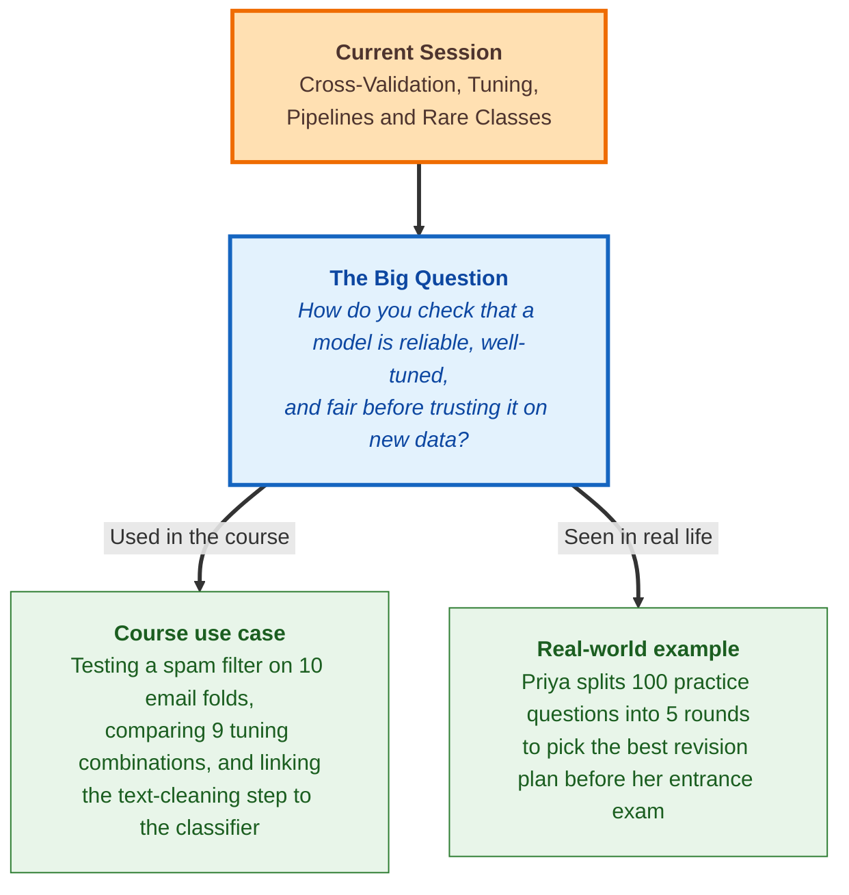

## <span style="color:#2F7DDE">Cross-Validation, Tuning, Pipelines and Rare Classes</span>

### <span style="color:#2F7DDE">Mental Map</span>



---

### <span style="color:#2F7DDE">What You'll Learn</span>

Have you ever wondered why sitting five practice exams tells you more about your readiness than sitting only one?

By the end of this session, you will be able to:

- <span style="color:#D9660B">**Use**</span> five rotating test rounds to get a more reliable score than a single attempt.
- <span style="color:#D9660B">**Apply**</span> the same mix of question topics in every round so each test stays fair.
- <span style="color:#D9660B">**Determine**</span> the best revision settings by testing all combinations over the same five rounds.
- <span style="color:#D9660B">**Demonstrate**</span> how to give rare-topic questions extra weight so your revision stays balanced.
- <span style="color:#D9660B">**Build**</span> a study routine that links every step into one repeatable flow.

> <span style="color:#2F7DDE">**Topics you will meet:**</span> k-fold cross-validation, stratified splitting, grid search tuning, scikit-learn Pipeline, class weights and resampling.
>
> Join the session to learn each of these in detail.

---

### <span style="color:#2F7DDE">Why You Are Learning This Topic</span>

Priya has 100 practice questions for her entrance exam. She scores 82 on one paper and 61 on the next. She is unsure which result to trust.

A <span style="color:#D9660B">**cross-validation**</span> means testing on each part of a set in turn, then averaging the results.

She also notices that only 8 questions cover physics. If one round skips physics entirely, its score is misleading.

In this course, you apply these ideas to machine learning models. You test them on rotating data, tune settings, and handle rare cases.

> <span style="color:#2F7DDE">**Think about it:**</span> Priya's five scores are 82, 61, 74, 78, and 69. Which single number describes her true readiness?

---

### <span style="color:#2F7DDE">The Practice Round Puzzle</span>

Priya divides her 100 questions into five rounds.

| Round | Questions tested | Physics questions | Score |
|:-----:|:----------------:|:-----------------:|:-----:|
| 1 | 1–20 | 1 | 82% |
| 2 | 21–40 | 0 | 61% |
| 3 | 41–60 | 3 | 74% |
| 4 | 61–80 | 2 | 78% |
| 5 | 81–100 | 2 | 69% |

<span style="color:#D9660B">**What you want to happen:**</span>

- Each round holds a fair share of physics questions.
- All five rounds run for each of the three revision plans.
- The plan with the highest average score wins.

Here is how it might start. You do not need to understand it.

```python
from sklearn.model_selection import cross_val_score
scores = cross_val_score(model, X, y, cv=5)
print(round(scores.mean(), 2))
```

> <span style="color:#D9660B">**Wonder about this:**</span>
>
> - Round 2 had no physics questions. Could that explain why the score dropped to 61%?
> - Priya runs two revision plans over five rounds. How does she pick the winner?

---

### <span style="color:#2F7DDE">Think It Through</span>

There is no wrong first try. Keep your guesses for the session.

**1. Priya's five scores are 82, 61, 74, 78, and 69. Which number best describes her level?**
Hint: What can one number say that five numbers cannot?

**2. Round 2 had no physics questions. How might that explain the 61% score?**
Hint: What changes in a score when a topic is completely missing?

**3. Priya tries three revision plans across all five rounds. How does she pick the winner?**
Hint: What stays the same across all three plans?

---

### <span style="color:#2F7DDE">One Question to Carry Into the Session</span>

> <span style="color:#2F7DDE">**If a model scores 95% overall but misses almost every rare case, is it truly reliable?**</span>
>
> What would you change about how you build and test it?
