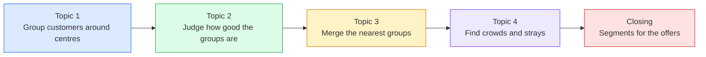
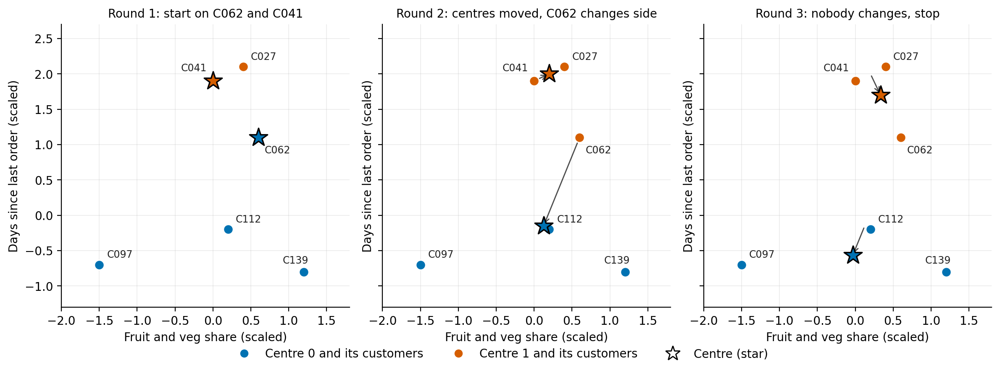
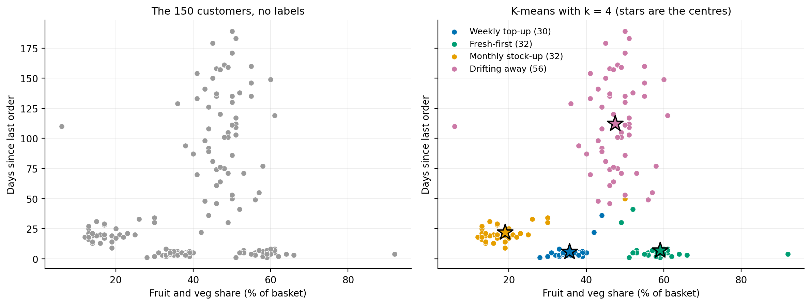
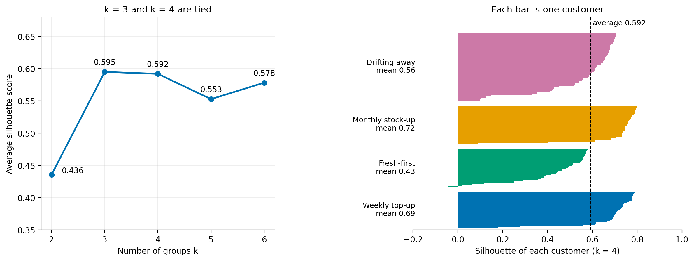
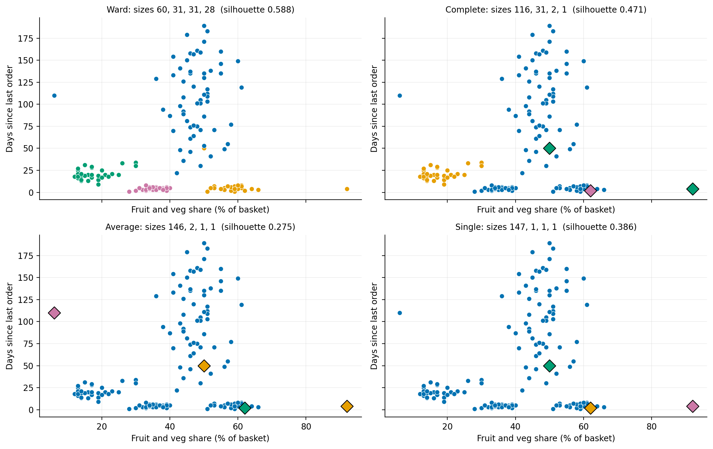
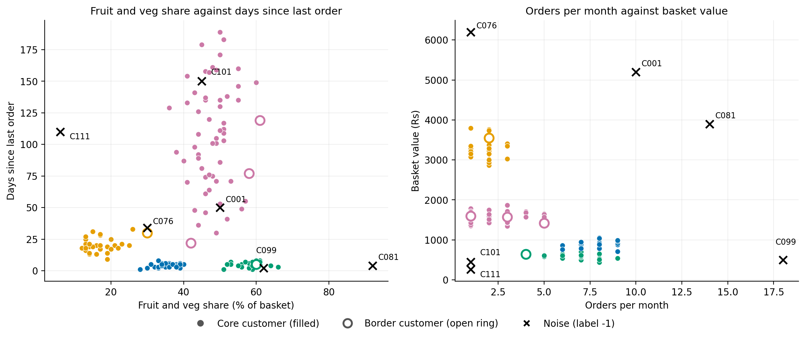
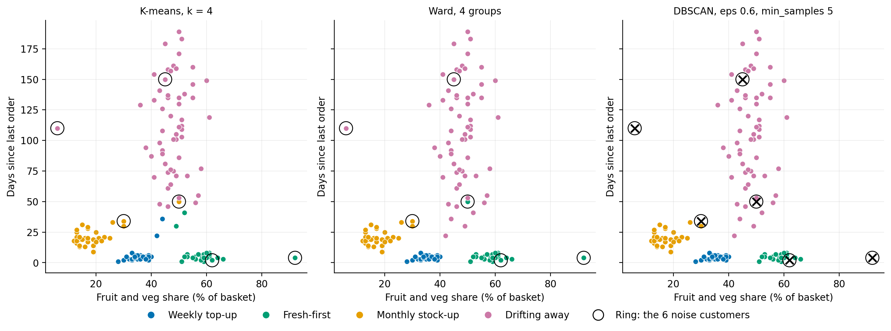

# <font color='#1d4ed8'>Lecture Script: Clustering for Customer Segments</font>

---

## <font color='blue'>Agenda</font>

The lecture runs as four topics. Each topic ends with a quiz.

| Topic | What we do | Learning objectives covered | Minutes |
|:-:|:--|:--|:-:|
| 1 | Group customers around centres | Explain how k-means alternates between assigning points to centroids and recomputing centroids<br>Cluster a scaled numeric dataset into k groups using k-means | 30 |
| 2 | Judge how good the groups are | Interpret a silhouette score as a measure of cluster cohesion and separation | 25 |
| 3 | Merge the nearest groups | Cluster a dataset using agglomerative clustering with a stated linkage | 25 |
| 4 | Find crowds and strays | Describe how DBSCAN classifies points as core, border or noise<br>Cluster a dataset using DBSCAN with chosen eps and min_samples | 25 |
| — | Closing: Outcome & Summary | | 15 |
| | **Total** | | **120** |

> <font color="red">**🎯 Instructor Note**</font> Pace: in Topic 1 spend about 12 minutes on the six-customer hand example, because every later run in Topic 1 repeats the same assign-and-recompute loop. Topic 2 rests on one idea, so work one customer by hand and then read the table of k.
> Keep Topic 3 to its idea (start alone, merge the nearest, state the linkage) and give Topic 4 the saved time for core, border and noise.

---

## <font color='blue'>Scenario</font>

A BigBasket-style grocery delivery app keeps one row per customer. Here are five of the 150 rows in this extract:

| Customer | Orders per month | Basket value (Rs) | Days since last order | Fruit and veg share (%) | Segment |
|:-:|:-:|:-:|:-:|:-:|:-:|
| C002 | 6 | 640 | 7 | 61 | ? |
| C003 | 1 | 3,080 | 31 | 15 | ? |
| C004 | 7 | 690 | 5 | 60 | ? |
| C005 | 4 | 1,690 | 55 | 57 | ? |
| C006 | 3 | 3,030 | 25 | 20 | ? |

The marketing team can run four different offers, but the table has no Segment column. Nobody has ever written down which customer is which kind.

> <font color="red">**🎯 Instructor Note**</font> BigBasket is only the setting. Do not claim it uses this data; the 150 customers in `data/customers.csv` are invented for teaching.
> Learners use Google Colab with pandas and scikit-learn; upload the file into a `data` folder first. Outputs here come from scikit-learn 1.8 with fixed seeds, so a later version may differ in the last digit.

---

## <font color='blue'>Problem Statement</font>

Last Diwali week the team split customers at a basket value of Rs 1,000 and sent every "big spender" the same Rs 200 coupon. Meera orders fresh fruit and vegetables six times a month in baskets of about Rs 650, so the rule called her a small spender and sent her nothing. Imran stopped ordering four months ago and was also called a small spender, so he got nothing either. Meera moved to a neighbourhood vendor by the end of the month, and Imran never came back.

One cut on basket value had hidden different kinds of customers. The team now wants the table to show the groups itself, but there is no label column to check against, and a few customers may not belong to any group at all.

> <font color='purple'>**How can the team find the customer segments hidden in a table with no labels, decide how many are real, and spot the customers who belong to none?**</font>

> <font color="red">**🎯 Instructor Note**</font> Poll: "How many kinds of customers are in this table: 2, 3, 4 or 5?" Give learners 30 seconds to respond in chat. Note the split; reveal the answer in the Closing.

---

## <font color='blue'>What We Will Use</font>

Everything runs in Google Colab with pandas and scikit-learn. Each tool is explained when we first use it. The data is `data/customers.csv`: 150 customers with four numeric columns, `orders_per_month`, `basket_value` (in rupees), `days_since_last_order` and `fruit_veg_share` (the percent of the basket spent on fruit and vegetables). There is no target column.

| Topic | Tools | In one line |
|:-:|:--|:--|
| 1 | `StandardScaler`, `KMeans`, `make_pipeline`, `labels_`, `cluster_centers_`, `inertia_` | Put the columns on one scale, then group customers around k centres |
| 2 | `silhouette_samples`, `silhouette_score` | Score how tight and how separate the groups are |
| 3 | `AgglomerativeClustering` with `linkage` | Start with every customer alone and keep merging the nearest groups |
| 4 | `DBSCAN` with `eps` and `min_samples`, `NearestNeighbors` | Let crowds of close customers form groups and call the rest noise |

---

## <font color='blue'>How: Walking Through the Customer Segments</font>



---

## <font color='blue'>Topic 1: Group Customers Around Centres</font> `30 min`

In the ML workflow session you separated supervised from unsupervised learning. Every model since then, from regression to trees, boosting, kNN and SVM, had a target column to learn from. This table has none, so there is nothing to predict and nothing to score against. Two older ideas return. From the KNN and SVM session you reuse the straight-line distance between two rows and the reason to put columns on one scale. From the cross-validation session you reuse the scikit-learn Pipeline, to chain the scaler to the model.

> <font color='purple'>**If nobody has labelled the 150 customers, can the table itself show us which customers are alike?**</font>

### <font color='green'>Example: look at the table, then put the columns on one scale</font>

> <font color='purple'>**What does one row hold, and is any column a label?**</font>

**Predict before running: What will happen?**

> <font color="red">**🎯 Instructor Note**</font> Expected: shape (150, 4), because the customer id is the row label and not a column. All four columns are numbers and none says which kind of customer a row is.
> Common guess: 5 columns.

```python
import pandas as pd, numpy as np

pd.set_option("display.width", 120)
pd.set_option("display.max_columns", 20)
df = pd.read_csv("data/customers.csv", index_col="customer_id")
print(df.shape)
print(df.head(5))
print(df.agg(["min", "max"]))
```

**Output**

```
(150, 4)
             orders_per_month  basket_value  days_since_last_order  fruit_veg_share
customer_id
C001                       10          5200                     50               50
C002                        6           640                      7               61
C003                        1          3080                     31               15
C004                        7           690                      5               60
C005                        4          1690                     55               57
     orders_per_month  basket_value  days_since_last_order  fruit_veg_share
min                 1           260                      1                6
max                18          6200                    189               92
```

#### <font color='#c2410c'>Code Explanation</font>

- **Line 1** Loads pandas for tables and numpy for number arrays.
- **Lines 3 and 4** Widen the printed table so all four columns show on one line.
- **Line 5** Reads the file and uses `customer_id` as the row label.
- **Line 6** Prints the size as (rows, columns).
- **Line 7** Shows the first 5 customers.
- **Line 8** Prints the smallest and largest value of every column.

> <font color='green'>**Result**</font> Each row is one customer described by four numbers. Basket values run from Rs 260 to Rs 6,200, while orders per month run only from 1 to 18, so the columns sit on very different scales.

> <font color='purple'>**If distance decides who is alike, how do we stop basket value in rupees from drowning out the other three columns?**</font>

Scale each column to a mean of 0 and a standard deviation of 1, the same $z$-score you used for kNN:

$$\boxed{z = \frac{x - \mu}{\sigma}}$$

By hand for customer C001, whose basket is Rs 5,200 (the column has $\mu = 1666.8$ and $\sigma = 1086.03$):

$$z = \frac{5200 - 1666.8}{1086.03} \approx 3.25$$

There is no test set here, because we are describing these 150 customers and not predicting for new ones. So the scaler is fitted on all 150 rows.

**Predict before running: What will happen?**

> <font color="red">**🎯 Instructor Note**</font> Expected: every column has mean 0 and standard deviation 1, and C001's basket becomes 3.25, the same as the hand answer.
> Ask what the 3.25 says. Expected: this basket is more than 3 standard deviations above the average.

```python
from sklearn.preprocessing import StandardScaler

cols = list(df.columns)
Z = StandardScaler().fit_transform(df[cols])
print(df.mean().round(1).tolist(), df.std(ddof=0).round(2).tolist())
print(Z.mean(axis=0).round(2) + 0.0, Z.std(axis=0).round(2))
print(df.loc["C001"].tolist(), Z[0].round(2))
```

**Output**

```
[4.3, 1666.8, 49.2, 41.5] [3.05, 1086.03, 54.49, 15.47]
[0. 0. 0. 0.] [1. 1. 1. 1.]
[10, 5200, 50, 50] [1.86 3.25 0.01 0.55]
```

#### <font color='#c2410c'>Code Explanation</font>

- **Line 3** Keeps the four column names in one list.
- **Line 4** Fits the scaler on the 150 rows and returns a new array `Z` with every column scaled.
- **Line 5** Prints each column's mean and its population standard deviation (`ddof=0`, the same one `StandardScaler` uses).
- **Line 6** The scaled columns now have mean 0 and standard deviation 1. The `+ 0.0` only stops numpy printing `-0.`.
- **Line 7** Prints customer C001 before and after scaling. The basket changed from 5200 to 3.25.

> <font color='green'>**Result**</font> All four columns are now measured in standard deviations, so a gap in basket value no longer counts more than a gap in orders per month.

> <font color='purple'>**How would a centre-based method turn six customers into two groups, by hand?**</font>

K-means needs a number of groups $k$ and a starting centre for each group. Then it repeats two moves until nothing changes. The distance between a customer $x_i$ and a centre $\mu_j$ is the straight-line distance you used in kNN.

$$\boxed{\text{Assign: } \text{label}(i) = \arg\min_j \lVert x_i - \mu_j \rVert \qquad \text{Recompute: } \mu_j = \frac{1}{|S_j|} \sum_{i \in S_j} x_i}$$

Here $S_j$ is the set of customers assigned to centre $j$. To draw it, take six customers and two scaled columns, fruit and veg share and days since last order, rounded to one decimal. We use $k = 2$ and start the centres on C062 and C041.

By hand for customer C027 at $(0.4, 2.1)$, the distance to centre C062 at $(0.6, 1.1)$ and to centre C041 at $(0.0, 1.9)$:

$$d_{062} = \sqrt{(0.4 - 0.6)^2 + (2.1 - 1.1)^2} = \sqrt{1.04} \approx 1.02 \qquad d_{041} = \sqrt{(0.4 - 0.0)^2 + (2.1 - 1.9)^2} = \sqrt{0.20} \approx 0.45$$

**Predict before running: What will happen?**

> <font color="red">**🎯 Instructor Note**</font> Expected: C027 gets 1.02 and 0.45, so it joins the centre at C041. Ask who joins which centre.
> Expected: C062 and the three low-days customers go to centre 0; C041 and C027 go to centre 1.

```python
two = ["fruit_veg_share", "days_since_last_order"]
S = pd.DataFrame(Z, index=df.index, columns=cols)[two].round(1) + 0.0
six = S.loc[["C062", "C041", "C027", "C112", "C097", "C139"]]
pts, cent = six.to_numpy(), six.to_numpy()[:2].copy()
d = np.linalg.norm(pts[:, None] - cent[None], axis=2).round(2)
print(six.assign(to_C062=d[:, 0], to_C041=d[:, 1], nearest_centre=d.argmin(axis=1)))
```

**Output**

```
             fruit_veg_share  days_since_last_order  to_C062  to_C041  nearest_centre
customer_id
C062                     0.6                    1.1     0.00     1.00               0
C041                     0.0                    1.9     1.00     0.00               1
C027                     0.4                    2.1     1.02     0.45               1
C112                     0.2                   -0.2     1.36     2.11               0
C097                    -1.5                   -0.7     2.77     3.00               0
C139                     1.2                   -0.8     1.99     2.95               0
```

#### <font color='#c2410c'>Code Explanation</font>

- **Line 1** Names the two columns we will draw.
- **Line 2** Keeps those two scaled columns for all customers, rounded to one decimal.
- **Line 3** Picks the six customers.
- **Line 4** `pts` holds the six points; `cent` holds the first two as the starting centres (C062 and C041).
- **Line 5** Subtracts every centre from every point and takes the straight-line length: one distance per customer per centre.
- **Line 6** Adds the two distance columns and the number of the nearest centre.

> <font color='green'>**Result**</font> C027 is 1.02 from C062 and 0.45 from C041, matching the hand answer, so it is assigned to centre 1. C062 is assigned to centre 0, which is itself.

> <font color='purple'>**After the assignment, where should each centre move, and does anyone change sides?**</font>

Recompute each centre as the mean of its customers. Centre 0 holds C062, C112, C097 and C139, so its fruit and veg value is $(0.6 + 0.2 - 1.5 + 1.2)/4 = 0.125$ and its days value is $(1.1 - 0.2 - 0.7 - 0.8)/4 = -0.15$. Centre 1 holds C041 and C027, so it moves to $(0.2,\ 2.0)$.

**Predict before running: What will happen?**

> <font color="red">**🎯 Instructor Note**</font> Ask: "After the centres move, does C062 stay with centre 0?" Give learners 30 seconds to respond in chat.
> Expected: no. In round 2 C062 is closer to the moved centre 1, and round 3 changes nothing, so the loop stops.

```python
for rnd in (1, 2, 3):
    d = np.linalg.norm(pts[:, None] - cent[None], axis=2)
    lab = d.argmin(axis=1)                      # assign each customer to its nearest centre
    print("round", rnd, "labels", lab, "centres", cent.round(3).tolist())
    cent = np.array([pts[lab == j].mean(axis=0) for j in range(2)])   # recompute the centres
```

**Output**

```
round 1 labels [0 1 1 0 0 0] centres [[0.6, 1.1], [0.0, 1.9]]
round 2 labels [1 1 1 0 0 0] centres [[0.125, -0.15], [0.2, 2.0]]
round 3 labels [1 1 1 0 0 0] centres [[-0.033, -0.567], [0.333, 1.7]]
```

#### <font color='#c2410c'>Code Explanation</font>

- **Line 1** Repeats the two moves three times.
- **Line 2** Distance from each customer to each current centre.
- **Line 3** Assign: the number of the nearest centre for each customer.
- **Line 4** Prints the round, who is with which centre, and the centres that were used for that assignment.
- **Line 5** Recompute: each centre becomes the mean of the customers assigned to it.

> <font color='green'>**Result**</font> In round 1 the centres are the two starting customers. In round 2 they have moved to $(0.125, -0.15)$ and $(0.2, 2.0)$, and C062 changes sides. In round 3 the centres are $(-0.033, -0.567)$ and $(0.333, 1.7)$ and nobody changes sides, so k-means stops. The three high-days customers are one group and the three low-days customers are the other.

<p align="center"></p>

> <font color='purple'>**Does the same loop work on all 150 customers and four columns?**</font>

**Predict before running: What will happen?**

> <font color="red">**🎯 Instructor Note**</font> Expected: the total squared distance to the nearest centre falls every round and then stops moving after about 4 rounds. Ask what "stops" means.
> Expected: the centres no longer move, so the assignment cannot change.

```python
cent = Z[[0, 1, 2, 3]]                      # four starting centres: the first four customers
for rnd in range(1, 9):
    d = np.linalg.norm(Z[:, None] - cent[None], axis=2)
    lab = d.argmin(axis=1)                  # assign
    print(rnd, round((d.min(axis=1) ** 2).sum(), 1), np.bincount(lab, minlength=4))
    new = np.array([Z[lab == j].mean(axis=0) for j in range(4)])   # recompute
    if np.allclose(new, cent): break        # stop when the centres no longer move
    cent = new
```

**Output**

```
1 543.2 [ 2 60 43 45]
2 186.2 [ 2 58 32 58]
3 132.2 [ 2 56 31 61]
4 130.9 [ 2 56 31 61]
```

#### <font color='#c2410c'>Code Explanation</font>

- **Line 1** The first four customers (C001 to C004) become the four starting centres.
- **Lines 3 and 4** Assign: the distance of all 150 customers to the 4 centres, then the nearest centre for each.
- **Line 5** Prints the round, the total squared distance of customers to their centre, and the group sizes.
- **Line 6** Recompute: each centre becomes the mean of its customers in all four scaled columns.
- **Lines 7 and 8** Stops when the new centres equal the old ones; otherwise moves on with the new centres.

> <font color='green'>**Result**</font> The total squared distance falls from 543.2 to 186.2, then 132.2, then 130.9, and the loop stops after round 4 with groups of 2, 56, 31 and 61 customers. Assigning and recomputing never increase that total.

> <font color='purple'>**Does scikit-learn's `KMeans` do the same loop, and is this a good set of groups?**</font>

**Predict before running: What will happen?**

> <font color="red">**🎯 Instructor Note**</font> Expected: the same total, 130.9, and the same sizes 2, 56, 31 and 61, because `KMeans` is given the same four starting customers. Ask why a group of 2 is a worry.
> Expected: a poor start gave a lopsided answer; a better start, with several tries, fixes it.

```python
from sklearn.cluster import KMeans

km1 = KMeans(n_clusters=4, init=Z[[0, 1, 2, 3]], n_init=1).fit(Z)
print(round(km1.inertia_, 1), np.bincount(km1.labels_), km1.n_iter_)
```

**Output**

```
130.9 [ 2 56 31 61] 4
```

#### <font color='#c2410c'>Code Explanation</font>

- **Line 1** Imports the k-means class.
- **Line 3** Starts from the same four customers. `n_init=1` means a single start. `inertia_` is the total squared distance to the nearest centre, the number we printed each round.
- **Line 4** Prints the total, the group sizes and how many rounds scikit-learn needed.

> <font color='green'>**Result**</font> scikit-learn reaches the same 130.9 in 4 rounds with groups of 2, 56, 31 and 61. The group of 2 is C001 and C081, two unusual customers, and one centre was spent on them. K-means can settle into a poor answer close to its starting point, so the start matters.

> <font color='purple'>**How do we fit k-means on the scaled customers with a better start and keep the scaling attached?**</font>

We state $k = 4$, because the team can run four offers. We chain the scaler and the model in a Pipeline. `n_init=10` runs ten starts and keeps the one with the lowest total, and `random_state=42` makes the run repeatable.

**Predict before running: What will happen?**

> <font color="red">**🎯 Instructor Note**</font> Expected: four groups of sensible size and a total below 130.9. Ask what the four rows of centres say about each group.
> Expected: one group orders rarely with a big basket, one orders often with small baskets, and so on.

```python
from sklearn.pipeline import make_pipeline

pipe = make_pipeline(StandardScaler(), KMeans(n_clusters=4, n_init=10, random_state=42))
df["kmeans"] = pipe.fit_predict(df[cols])
km = pipe[-1]
print(df["kmeans"].value_counts().sort_index().to_dict(), round(km.inertia_, 1))
centres = pd.DataFrame(pipe[0].inverse_transform(km.cluster_centers_), columns=cols)
print(centres.round(0).astype(int))
```

**Output**

```
{0: 56, 1: 30, 2: 32, 3: 32} 124.1
   orders_per_month  basket_value  days_since_last_order  fruit_veg_share
0                 2          1550                    112               47
1                 8           929                      6               36
2                 2          3467                     22               19
3                 7           762                      7               59
```

#### <font color='#c2410c'>Code Explanation</font>

- **Line 3** Builds a Pipeline: scale first, then k-means with 4 groups and 10 starts.
- **Line 4** Fits the whole pipeline and stores each customer's group number in a new column `kmeans`.
- **Line 5** `pipe[-1]` is the fitted `KMeans` step.
- **Line 6** Prints how many customers each group holds, and the lowest total squared distance found.
- **Line 7** `cluster_centers_` are in scaled units; `inverse_transform` turns them back into orders, rupees, days and percent.
- **Line 8** Prints the four centres rounded to whole numbers.

> <font color='green'>**Result**</font> The groups hold 56, 30, 32 and 32 customers, and the total fell from 130.9 to 124.1. Reading the centres in real units: group 0 orders twice a month with a Rs 1,550 basket and last ordered about 112 days ago (drifting away), group 1 orders 8 times with a Rs 929 basket every 6 days (weekly top-up), group 2 orders twice with a Rs 3,467 basket (monthly stock-up), and group 3 orders 7 times with a Rs 762 basket and a 59% fruit and veg share (fresh-first). The group numbers themselves are arbitrary.

<p align="center"></p>

### <font color='green'>Extending it: what if we skip the scaling?</font>

> <font color='purple'>**What does k-means do when the columns are left in rupees, orders and days?**</font>

**Predict before running: What will happen?**

> <font color="red">**🎯 Instructor Note**</font> Ask: "Which column will decide the groups?" Give learners 30 seconds to respond in chat.
> Expected: basket value, because it is the largest number. The groups will be bands of basket value.

```python
raw = KMeans(n_clusters=4, n_init=10, random_state=42).fit_predict(df[cols])
print(pd.crosstab(raw, df["kmeans"], rownames=["raw"], colnames=["scaled"]))
print(df.groupby(raw)["basket_value"].agg(["min", "max"]))
```

**Output**

```
scaled   0   1   2   3
raw
0        2  28   0  29
1        0   0  30   1
2       54   2   0   2
3        0   0   2   0
    min   max
0   260  1060
1  2870  3900
2  1340  1870
3  5200  6200
```

#### <font color='#c2410c'>Code Explanation</font>

- **Line 1** Fits k-means on the raw columns, with no scaler.
- **Line 2** Counts how many customers each raw group shares with each scaled group.
- **Line 3** Prints the smallest and largest basket value inside each raw group.

> <font color='green'>**Result**</font> The raw groups are four bands of basket value that do not overlap: Rs 260 to 1,060, Rs 1,340 to 1,870, Rs 2,870 to 3,900 and Rs 5,200 to 6,200. The weekly top-up and fresh-first customers (28 and 29 of them) fall into one raw group, and one raw group is made of just 2 customers with huge baskets.

> <font color='#b45309'>**Common mistake**</font> Running a distance-based method on raw columns. Scale first, as you did for kNN, or the column with the biggest numbers decides everything.

### <font color='green'>Extending it: does the starting point matter?</font>

> <font color='purple'>**If we run k-means once from six different starts, do we always get the same total?**</font>

**Predict before running: What will happen?**

> <font color="red">**🎯 Instructor Note**</font> Ask: "Will all six starts reach the same total?" Give learners 30 seconds to respond in chat.
> Expected: no. Some starts reach 124.1 and others stop near 134, which is why we ran ten starts.

```python
for seed in range(6):
    one = KMeans(n_clusters=4, n_init=1, random_state=seed).fit(Z)
    print(seed, round(one.inertia_, 1), np.sort(np.bincount(one.labels_)))
```

**Output**

```
0 134.7 [28 31 32 59]
1 124.1 [30 32 32 56]
2 134.6 [29 31 32 58]
3 134.4 [29 30 32 59]
4 124.1 [30 32 32 56]
5 134.6 [29 31 32 58]
```

#### <font color='#c2410c'>Code Explanation</font>

- **Line 1** Tries six different random seeds, so six different starting centres.
- **Line 2** Fits one start each time (`n_init=1`).
- **Line 3** Prints the seed, the total squared distance and the sorted group sizes.

> <font color='green'>**Result**</font> Seeds 1 and 4 reach 124.1, the best total, and the other four stop near 134 with a slightly different split of the customers. A single start can end in a worse answer, so use `n_init=10` or more and keep the lowest total.

### <font color='purple'>Quiz 1</font>

**Question:** Two centres sit at 0 and 6 on a line, and three customers sit at 1, 2 and 5. After one assign move and one recompute move, where are the two centres?

**Options:**
- A) 0 and 6, because the centres do not move until a second round
- B) 1.5 and 5, the means of the customers each centre won
- C) 1 and 5, the customer nearest to each centre
- D) 2.67 and 2.67, the mean of all three customers

**Correct Answer:** B

**Explanation:**
- **A)** Wrong: the recompute move is part of the same round, and it moves each centre to the mean of its customers.
- **B)** Correct: customers 1 and 2 are nearer to 0, and customer 5 is nearer to 6, so the new centres are $(1+2)/2 = 1.5$ and $5$.
- **C)** Wrong: a centre moves to the mean of its customers, not to one customer.
- **D)** Wrong: $8/3 \approx 2.67$ is the mean of all three, which would only happen if every customer belonged to one centre.

---

## <font color='blue'>Topic 2: Judge How Good the Groups Are</font> `25 min`

The k-means run gave four groups, and the team asked for four. The marketing head now asks two plain questions: are the customers in a group really close to each other, and is each group clearly apart from the next one? You will use a number for this, and the same straight-line distance on the scaled columns that k-means used.

> <font color='purple'>**For one customer, how does the distance to its own group compare with the distance to the nearest other group?**</font>

### <font color='green'>Example: the silhouette of one customer, by hand</font>

> <font color='purple'>**For customer C002, what is the average distance to the others in its group, and to the nearest other group?**</font>

For customer $i$, let $a(i)$ be the average distance to the other customers in its own group (cohesion), and $b(i)$ the average distance to the customers of the nearest other group (separation). The silhouette is

$$\boxed{s(i) = \frac{b(i) - a(i)}{\max\left(a(i),\, b(i)\right)}}$$

$s(i)$ lies between $-1$ and $+1$. A value near $+1$ means the customer is much closer to its own group than to any other. A value near $0$ means it sits on the border between two groups. A negative value means it is closer, on average, to another group than to its own.

**Predict before running: What will happen?**

> <font color="red">**🎯 Instructor Note**</font> Expected: $a$ is smaller than $b$, so $s$ is positive; a hand calculation from the two printed averages must match the score from scikit-learn.
> Ask for a guess: is $s$ above or below 0.5? Expected: just above, 0.57.

```python
from sklearn.metrics import silhouette_samples, silhouette_score

lab, i = df["kmeans"].to_numpy(), df.index.get_loc("C002")
dist = np.linalg.norm(Z - Z[i], axis=1)
a = dist[(lab == lab[i]) & (np.arange(len(Z)) != i)].mean()
b = min(dist[lab == j].mean() for j in set(lab) if j != lab[i])
print(round(a, 3), round(b, 3), round((b - a) / max(a, b), 3))
print(round(silhouette_samples(Z, lab)[i], 3))
```

**Output**

```
0.771 1.794 0.57
0.57
```

#### <font color='#c2410c'>Code Explanation</font>

- **Line 3** `lab` holds every customer's k-means group; `i` is the row position of C002.
- **Line 4** Distance from C002 to all 150 customers, on the scaled columns.
- **Line 5** $a$: the mean distance to the other customers in C002's group (C002 itself is left out).
- **Line 6** $b$: the mean distance to each other group, keeping the smallest.
- **Line 7** Prints $a$, $b$ and the hand formula $(b - a)/\max(a, b)$.
- **Line 8** Asks scikit-learn for the same customer's silhouette.

> <font color='green'>**Result**</font> For C002, $a = 0.771$ and $b = 1.794$, so $s = (1.794 - 0.771)/1.794 \approx 0.57$, and scikit-learn gives the same value. C002 is more than twice as far from the nearest other group as from its own.

> <font color='purple'>**What is the silhouette of the whole clustering, and which group is the weakest?**</font>

The silhouette score of a clustering is the average of $s(i)$ over all customers.

**Predict before running: What will happen?**

> <font color="red">**🎯 Instructor Note**</font> Expected: an average near 0.6 and one group clearly lower than the others. Ask which group is likely weakest.
> Expected: the group whose customers look most like another group's, here fresh-first beside weekly top-up.

```python
s = silhouette_samples(Z, lab)
print("average silhouette:", round(silhouette_score(Z, lab), 3))
print(pd.Series(s, index=df.index).groupby(lab).agg(["mean", "min"]).round(2))
print("customers with s < 0:", (s < 0).sum())
```

**Output**

```
average silhouette: 0.592
   mean   min
0  0.56  0.10
1  0.69  0.18
2  0.72  0.09
3  0.43 -0.04
customers with s < 0: 1
```

#### <font color='#c2410c'>Code Explanation</font>

- **Line 1** One silhouette value for each of the 150 customers.
- **Line 2** The average of those values: the silhouette score of this clustering.
- **Line 3** Groups the values by k-means group and prints each group's mean and lowest value.
- **Line 4** Counts customers whose silhouette is negative.

> <font color='green'>**Result**</font> The silhouette score is 0.592, a fairly clear structure. Groups 1 and 2 (weekly top-up and monthly stock-up) average 0.69 and 0.72. Group 3 (fresh-first) is the weakest at 0.43, because its customers order, spend and return much like weekly top-up customers and differ mainly in fruit and veg share. Only one customer has a negative value, $-0.04$, which is a customer on the border of two groups.

<p align="center"></p>

### <font color='green'>Extending it: which k does the silhouette prefer?</font>

> <font color='purple'>**If we ask for 2 to 6 groups, does one number of groups score clearly best?**</font>

**Predict before running: What will happen?**

> <font color="red">**🎯 Instructor Note**</font> Ask: "Which k will score highest?" Give learners 30 seconds to respond in chat. Note the guesses.
> Expected: k = 3 and k = 4 score almost the same, and k = 2 scores lowest.

```python
for k in range(2, 7):
    m = KMeans(n_clusters=k, n_init=10, random_state=42).fit(Z)
    print(k, round(silhouette_score(Z, m.labels_), 3), np.sort(np.bincount(m.labels_))[::-1])
```

**Output**

```
2 0.436 [88 62]
3 0.595 [62 56 32]
4 0.592 [56 32 32 30]
5 0.553 [32 30 30 29 29]
6 0.578 [31 31 29 28 28  3]
```

#### <font color='#c2410c'>Code Explanation</font>

- **Line 1** Tries each number of groups from 2 to 6.
- **Line 2** Fits k-means with `n_init=10`.
- **Line 3** Prints k, the silhouette score and the group sizes from largest to smallest.

> <font color='green'>**Result**</font> $k = 2$ scores clearly lowest at 0.436. $k = 3$ (0.595) and $k = 4$ (0.592) differ by 0.003, which is a tie, so the silhouette cannot choose between three and four groups. At $k = 3$ the weekly top-up and fresh-first customers are merged into one group of 62. The team wants to treat them differently, so four groups is a business choice that the score does not contradict.

> <font color='#b45309'>**Common mistake**</font> Picking the k with the highest score when two scores differ by a few thousandths. Treat near-equal scores as a tie and decide with the business need.

### <font color='green'>Extending it: why does k = 5 score lower?</font>

> <font color='purple'>**When we ask for 5 groups, which customers get cut apart?**</font>

**Predict before running: What will happen?**

> <font color="red">**🎯 Instructor Note**</font> Ask: "Which k = 4 group will be split into two?" Give learners 30 seconds to respond in chat.
> Expected: group 0, the drifting-away group, which is stretched along days since last order.

```python
k5 = KMeans(n_clusters=5, n_init=10, random_state=42).fit_predict(Z)
print(pd.crosstab(df["kmeans"], k5, rownames=["k=4"], colnames=["k=5"]))
far = df["kmeans"] == 0
print(df[far].groupby(k5[far])["days_since_last_order"].agg(["count", "min", "max"]))
```

**Output**

```
k=5   0   1   2   3   4
k=4
0     0  27   0  29   0
1     0   1   0   0  29
2     0   0  32   0   0
3    30   2   0   0   0
   count  min  max
1     27   46  112
3     29  109  189
```

#### <font color='#c2410c'>Code Explanation</font>

- **Line 1** Fits k-means with 5 groups.
- **Line 2** Counts how many customers of each k = 4 group landed in each k = 5 group.
- **Line 3** Marks the customers of k = 4 group 0, the drifting-away group.
- **Line 4** Prints the size and the range of days since last order for each piece of that group.

> <font color='green'>**Result**</font> The other three groups stay almost as they were, but group 0 (56 customers) is cut into 27 customers with 46 to 112 days and 29 customers with 109 to 189 days. These customers are one long stretched crowd, and a centre-based method cuts it in the middle when it is given one more centre. That cut helps explain why the score drops from 0.592 to 0.553.

### <font color='purple'>Quiz 2</font>

**Question:** A customer's average distance to the other customers in its own group is 1.2, and its average distance to the nearest other group is 0.8. What is its silhouette, and what does it say?

**Options:**
- A) $+0.33$: the customer is well placed in its group
- B) $0.67$: the customer is clearly separated from other groups
- C) $0$: the customer sits exactly on the border between two groups
- D) $-0.33$: the customer is closer to another group than to its own

**Correct Answer:** D

**Explanation:**
- **A)** Wrong: this has the right size but the wrong sign; $b - a = 0.8 - 1.2$ is negative.
- **B)** Wrong: $0.8/1.2 \approx 0.67$ is just the ratio of the two distances, not the silhouette.
- **C)** Wrong: the silhouette is 0 only when $a = b$, and here $a$ is larger than $b$.
- **D)** Correct: $s = (0.8 - 1.2)/\max(1.2, 0.8) = -0.4/1.2 \approx -0.33$, so the customer is nearer to another group than to its own.

---

## <font color='blue'>Topic 3: Merge the Nearest Groups</font> `25 min`

K-means needed a number of centres and gave every customer to one of them. Agglomerative clustering takes a different route that needs no starting centres. It starts with every customer alone and merges the two nearest groups again and again, until the number of groups you ask for is left.

> <font color='purple'>**If every customer starts alone, which two groups merge first, and how do we measure the distance between two groups that hold several customers?**</font>

### <font color='green'>Example: merge five customers, then state the linkage</font>

> <font color='purple'>**In what order do five customers merge, when the days since their last order are 3, 5, 12, 15 and 40?**</font>

With one column the gaps are easy to see by eye: 3 and 5 are 2 apart, 12 and 15 are 3 apart, and 40 is far from everyone. The distance between two groups needs a rule, called the linkage. Here we use the average of all customer-to-customer gaps.

**Predict before running: What will happen?**

> <font color="red">**🎯 Instructor Note**</font> Expected: first merge is customers 0 and 1 (3 and 5), second is 2 and 3 (12 and 15), third joins those two groups, and 40 joins last.
> The new group made by a merge gets the next free number: 5, 6, 7.

```python
from sklearn.cluster import AgglomerativeClustering

days = np.array([3, 5, 12, 15, 40]).reshape(-1, 1)    # days since last order, five customers
tree = AgglomerativeClustering(n_clusters=None, distance_threshold=0, linkage="average").fit(days)
print(tree.children_.tolist())
print(tree.distances_.round(2).tolist())
```

**Output**

```
[[0, 1], [2, 3], [5, 6], [4, 7]]
[2.0, 3.0, 9.5, 31.25]
```

#### <font color='#c2410c'>Code Explanation</font>

- **Line 1** Imports the agglomerative clustering class.
- **Line 3** Five customers in one column. Customers are numbered 0 to 4.
- **Line 4** `n_clusters=None` with `distance_threshold=0` keeps merging until one group is left, and `linkage="average"` states the rule for the distance between groups.
- **Line 5** `children_` lists the two groups joined at each merge. Numbers 0 to 4 are customers; 5, 6 and 7 are the groups made by the first, second and third merge.
- **Line 6** The distance at which each merge happened.

> <font color='green'>**Result**</font> The merges are (0, 1) at distance 2, then (2, 3) at 3, then groups 5 and 6 at 9.5, and last customer 4 joins at 31.25. The 9.5 is the average of the four gaps between {3, 5} and {12, 15}.

> <font color='purple'>**How much does the choice of linkage change the distance between {3, 5} and {12, 15}?**</font>

Four linkages are common. **Single** uses the closest pair across the two groups. **Complete** uses the farthest pair. **Average** uses the mean of all pairs. **Ward** merges the two groups whose merger adds the least to the total squared distance of customers from their group centre:

$$\boxed{\Delta_{\text{Ward}} = \frac{n_A\, n_B}{n_A + n_B}\,\lVert \mu_A - \mu_B \rVert^2}$$

By hand with the gaps 9, 12, 7 and 10 between the groups: single is $7$, complete is $12$, average is $(9+12+7+10)/4 = 9.5$, and Ward is $\frac{2 \cdot 2}{2 + 2}(13.5 - 4)^2 = 90.25$.

**Predict before running: What will happen?**

> <font color="red">**🎯 Instructor Note**</font> Expected: 7, 12, 9.5 and 90.25, matching the hand answers. Ask which linkage gives the smallest distance.
> Expected: single. Ward is not a gap, so its number is on a different scale.

```python
d = days.ravel()
A, B = d[:2], d[2:4]                      # the two groups {3, 5} and {12, 15}
gaps = np.abs(A[:, None] - B[None])       # every customer in A against every customer in B
ward = len(A) * len(B) / (len(A) + len(B)) * (A.mean() - B.mean()) ** 2
print(gaps)
print("single", gaps.min(), "| complete", gaps.max(), "| average", gaps.mean(), "| ward", ward)
```

**Output**

```
[[ 9 12]
 [ 7 10]]
single 7 | complete 12 | average 9.5 | ward 90.25
```

#### <font color='#c2410c'>Code Explanation</font>

- **Line 1** Flattens the column back into a simple list.
- **Line 2** The two groups, A = {3, 5} and B = {12, 15}.
- **Line 3** The four gaps between a customer in A and a customer in B.
- **Line 4** The Ward cost: group sizes times the squared distance between the two group centres (means).
- **Lines 5 and 6** Print the four gaps and the four linkage distances.

> <font color='green'>**Result**</font> The same two groups are 7 apart under single linkage, 9.5 under average and 12 under complete, and merging them costs 90.25 under Ward. The linkage is a choice, so state it every time.

> <font color='purple'>**What do the four groups look like when we merge the 150 scaled customers with Ward linkage?**</font>

**Predict before running: What will happen?**

> <font color="red">**🎯 Instructor Note**</font> Expected: groups of sensible size, close to the four k-means groups. Ask how many of the 150 customers will change group.
> Expected: only a handful.

```python
agg = AgglomerativeClustering(n_clusters=4, linkage="ward")
df["ward"] = agg.fit_predict(Z)
print(df["ward"].value_counts().sort_index().to_dict(), round(silhouette_score(Z, df["ward"]), 3))
print(pd.crosstab(df["kmeans"], df["ward"]))
```

**Output**

```
{0: 31, 1: 60, 2: 31, 3: 28} 0.588
ward     0   1   2   3
kmeans
0        0  56   0   0
1        0   2   0  28
2        1   0  31   0
3       30   2   0   0
```

#### <font color='#c2410c'>Code Explanation</font>

- **Line 1** Asks for 4 groups with the linkage stated as Ward.
- **Line 2** Merges the customers until 4 groups are left and stores each customer's group in the new column `ward`.
- **Line 3** Prints the group sizes and the silhouette score.
- **Line 4** Counts how many customers each Ward group shares with each k-means group.

> <font color='green'>**Result**</font> Ward gives groups of 31, 60, 31 and 28 customers with a silhouette of 0.588. Against k-means, 145 of the 150 customers land in the matching group. The two methods tell almost the same story here, because Ward also tries to keep each group's total squared distance small.

### <font color='green'>Extending it: change only the linkage</font>

> <font color='purple'>**If we keep 4 groups but change the stated linkage, do the groups stay the same?**</font>

**Predict before running: What will happen?**

> <font color="red">**🎯 Instructor Note**</font> Ask: "Will all four linkages give four groups of sensible size?" Give learners 30 seconds to respond in chat.
> Expected: no. Single, average and complete linkage cut off the unusual customers first.

```python
for link in ["ward", "complete", "average", "single"]:
    g = AgglomerativeClustering(n_clusters=4, linkage=link).fit_predict(Z)
    print(f"{link:9}", np.sort(np.bincount(g))[::-1], round(silhouette_score(Z, g), 3))
```

**Output**

```
ward      [60 31 31 28] 0.588
complete  [116  31   2   1] 0.471
average   [146   2   1   1] 0.275
single    [147   1   1   1] 0.386
```

#### <font color='#c2410c'>Code Explanation</font>

- **Line 1** Loops over the four linkages.
- **Line 2** Merges the 150 customers into 4 groups with that linkage.
- **Line 3** Prints the linkage, the group sizes from largest to smallest and the silhouette score.

> <font color='green'>**Result**</font> Only Ward gives four useful groups (60, 31, 31 and 28). Single, average and complete linkage leave one huge group and groups of 1 or 2 customers, because the unusual customers are far from everyone and are the last to be merged. The scores drop with them, from 0.588 to between 0.275 and 0.471.

> <font color='#b45309'>**Common mistake**</font> Leaving the linkage unstated, or expecting a `predict` method for a new customer. `AgglomerativeClustering` only groups the customers it was fitted on, and the linkage must be written down because it changes the groups.

<p align="center"></p>

### <font color='purple'>Quiz 3</font>

**Question:** Two groups of customers have these customer-to-customer gaps between them: 9, 12, 7 and 10. Which stated linkage measures the distance between the groups as 12?

**Options:**
- A) Complete linkage, the farthest pair
- B) Single linkage, the closest pair
- C) Average linkage, the mean of all pairs
- D) Ward linkage, the cost of merging

**Correct Answer:** A

**Explanation:**
- **A)** Correct: complete linkage takes the largest gap, and the largest of 9, 12, 7 and 10 is 12.
- **B)** Wrong: single linkage takes the smallest gap, which is 7.
- **C)** Wrong: average linkage gives $(9 + 12 + 7 + 10)/4 = 9.5$.
- **D)** Wrong: Ward linkage is not a gap at all; it is the rise in squared distance from the group centres (90.25 for the groups {3, 5} and {12, 15} in the Example).

---

## <font color='blue'>Topic 4: Find Crowds and Strays</font> `25 min`

Ward and k-means both gave every customer to a group, even the unusual ones. In the first k-means run a whole centre was spent on two of them. The marketing team does not want an offer built around a customer who is unlike everyone else. DBSCAN groups customers by crowding and lets the rest stand alone.

> <font color='purple'>**Which customers are in a crowd, which are on the edge of a crowd, and which are alone?**</font>

### <font color='green'>Example: core, border and noise on six customers</font>

> <font color='purple'>**With a radius of 2 days and at least 3 customers, which of six customers are core, border or noise?**</font>

DBSCAN has two settings. `eps` is a radius. `min_samples` is the number of customers that must lie within `eps` of a customer, counting the customer itself, for a crowd to form there. Every customer gets one of three kinds:

| Kind | Rule |
|:--|:--|
| Core | At least `min_samples` customers (itself included) lie within `eps` |
| Border | Not core, but within `eps` of a core customer |
| Noise | Neither: no crowd and no core customer nearby |

Take six customers whose days since last order are 3, 4, 5, 7, 20 and 50, with $\text{eps} = 2$ and $\text{min\_samples} = 3$. By hand: 3 has 3, 4 and 5 within 2, so three customers and core. 4 has 3, 4 and 5, so core. 5 has 3, 4, 5 and 7, so core. 7 has only 5 and 7, so two customers and not core, but it is within 2 of the core customer 5, so border. 20 and 50 have only themselves, so noise.

**Predict before running: What will happen?**

> <font color="red">**🎯 Instructor Note**</font> Expected: counts 3, 3, 4, 2, 1, 1 and kinds core, core, core, border, noise, noise. Ask why 7 is not noise.
> Expected: it is not core, but it lies within 2 of the core customer 5.

```python
x = np.array([3, 4, 5, 7, 20, 50])                  # days since last order, six customers
eps, m = 2, 3
near = np.abs(x[:, None] - x[None]) <= eps          # within eps of each other (a customer counts itself)
core = near.sum(axis=1) >= m
border = ~core & (near & core[None]).any(axis=1)    # not core, but within eps of a core customer
kind = np.where(core, "core", np.where(border, "border", "noise"))
print(pd.DataFrame({"days": x, "within_eps": near.sum(axis=1), "kind": kind}))
```

**Output**

```
   days  within_eps    kind
0     3           3    core
1     4           3    core
2     5           4    core
3     7           2  border
4    20           1   noise
5    50           1   noise
```

#### <font color='#c2410c'>Code Explanation</font>

- **Line 1** The six values of days since last order.
- **Line 2** The two settings: `eps = 2` and `min_samples = 3` (kept in `m`).
- **Line 3** A true or false table: is customer $j$ within `eps` of customer $i$? A customer is within `eps` of itself.
- **Line 4** Core: the number of customers within `eps` is at least `m`.
- **Line 5** Border: not core, but at least one core customer is within `eps`.
- **Lines 6 and 7** Name the kind and print it next to the count.

> <font color='green'>**Result**</font> Customers 3, 4 and 5 days are core, 7 is a border customer, and 20 and 50 are noise, as in the hand answer. The crowd is 3, 4, 5 and 7; the two noise customers belong to no group.

> <font color='purple'>**Does scikit-learn's `DBSCAN` agree with the hand answer?**</font>

**Predict before running: What will happen?**

> <font color="red">**🎯 Instructor Note**</font> Expected: labels 0, 0, 0, 0, -1, -1 and core positions 0, 1, 2. Ask what the label -1 means.
> Expected: noise, a customer in no group.

```python
from sklearn.cluster import DBSCAN

db6 = DBSCAN(eps=2, min_samples=3).fit(x.reshape(-1, 1))
print(db6.labels_, db6.core_sample_indices_)
```

**Output**

```
[ 0  0  0  0 -1 -1] [0 1 2]
```

#### <font color='#c2410c'>Code Explanation</font>

- **Line 1** Imports DBSCAN.
- **Line 3** Fits DBSCAN with the same two settings on the six values.
- **Line 4** `labels_` gives each customer a group number, with -1 for noise. `core_sample_indices_` lists the positions of the core customers.

> <font color='green'>**Result**</font> One group (0) holds the four customers 3, 4, 5 and 7, and -1 marks the two noise customers. The core positions 0, 1 and 2 are the customers at 3, 4 and 5 days, so 7 is a border customer. DBSCAN did not need to be told how many groups to find.

> <font color='purple'>**For the 150 scaled customers, which `eps` and `min_samples` should we try?**</font>

Customers have four scaled columns, so the same rule uses straight-line distance in four dimensions. A common starting rule is `min_samples` of at least one more than the number of columns, so we try 5. For `eps`, ask how far each customer is from its fifth-nearest customer (itself counts as the first). That distance is the smallest `eps` at which the customer would be core.

**Predict before running: What will happen?**

> <font color="red">**🎯 Instructor Note**</font> Expected: most customers have a fifth-nearest distance under 0.7, and the largest few jump to 1 or more. Ask what those few are.
> Expected: the unusual customers, far from any crowd.

```python
from sklearn.neighbors import NearestNeighbors

kd = NearestNeighbors(n_neighbors=5).fit(Z).kneighbors(Z)[0][:, -1]
print(np.percentile(kd, [50, 90, 95]).round(2))
print(np.sort(kd)[-10:].round(2))
```

**Output**

```
[0.35 0.54 0.66]
[0.63 0.66 0.66 0.68 1.03 2.53 2.61 3.29 3.43 4.07]
```

#### <font color='#c2410c'>Code Explanation</font>

- **Line 1** Imports the nearest-neighbour finder.
- **Line 3** For each of the 150 customers, finds the 5 nearest customers (itself first) and keeps the distance to the fifth, called `kd`.
- **Line 4** Prints the median, the 90th and the 95th percentile of those distances.
- **Line 5** Prints the 10 largest.

> <font color='green'>**Result**</font> Half the customers have a fifth neighbour within 0.35 and 95% within 0.66. The largest values climb 0.63, 0.66, 0.66, 0.68 and then jump to 1.03, 2.53, 2.61, 3.29, 3.43 and 4.07. So a radius a little under 0.7 should keep nearly every customer in a crowd, and six customers are far from any crowd. We try `eps = 0.6`.

> <font color='purple'>**Using `eps = 0.6` and `min_samples = 5`, how many groups does DBSCAN find, and how many customers are noise?**</font>

**Predict before running: What will happen?**

> <font color="red">**🎯 Instructor Note**</font> Ask: "How many groups, and how many noise customers?" Give learners 30 seconds to respond in chat.
> Expected: 4 groups and 6 noise customers, because the six large values above are the strays.

```python
db = DBSCAN(eps=0.6, min_samples=5).fit(Z)
df["dbscan"] = db.labels_
core = np.zeros(len(Z), bool); core[db.core_sample_indices_] = True
print(df["dbscan"].value_counts().sort_index().to_dict())
print("core:", core.sum(), "border:", ((db.labels_ >= 0) & ~core).sum(), "noise:", (db.labels_ == -1).sum())
```

**Output**

```
{-1: 6, 0: 28, 1: 30, 2: 58, 3: 28}
core: 139 border: 5 noise: 6
```

#### <font color='#c2410c'>Code Explanation</font>

- **Line 1** Fits DBSCAN with the chosen `eps = 0.6` and `min_samples = 5`.
- **Line 2** Stores each customer's group in a new column, with -1 for noise.
- **Line 3** Builds a true or false list marking the core customers.
- **Line 4** Prints how many customers each group holds, starting with -1 (noise).
- **Line 5** Counts core customers, border customers (in a group but not core) and noise customers.

> <font color='green'>**Result**</font> DBSCAN finds 4 groups of 28, 30, 58 and 28 customers and sets 6 customers aside as noise. Of the 150 customers, 139 are core, 5 are border and 6 are noise. The stretched drifting-away crowd, which k = 5 cut in the middle, stays whole as one group of 58.

<p align="center"></p>

### <font color='green'>Extending it: how sensitive is `eps`?</font>

> <font color='purple'>**What happens to the groups if `eps` is much smaller or much larger?**</font>

**Predict before running: What will happen?**

> <font color="red">**🎯 Instructor Note**</font> Ask: "Too small, what happens to the noise count?" Give learners 30 seconds to respond in chat.
> Expected: too small makes many noise customers and many tiny groups; too large merges crowds into fewer groups.

```python
for e in (0.3, 0.45, 0.6, 0.7, 0.9, 1.5):
    g = DBSCAN(eps=e, min_samples=5).fit_predict(Z)
    print(e, "groups:", g.max() + 1, "noise:", (g == -1).sum())
```

**Output**

```
0.3 groups: 8 noise: 76
0.45 groups: 5 noise: 12
0.6 groups: 4 noise: 6
0.7 groups: 4 noise: 6
0.9 groups: 2 noise: 5
1.5 groups: 2 noise: 5
```

#### <font color='#c2410c'>Code Explanation</font>

- **Line 1** Tries six values of `eps`, keeping `min_samples = 5`.
- **Line 2** Fits DBSCAN and returns the group of every customer.
- **Line 3** `g.max() + 1` is the number of groups, because groups are numbered from 0; the noise count is the number of -1 labels.

> <font color='green'>**Result**</font> At 0.3 DBSCAN makes 8 groups and calls 76 customers noise. At 0.45 it makes 5 groups and 12 noise. At 0.6 and 0.7 it gives the same 4 groups and 6 noise. At 0.9 and at 1.5, groups merge to 2 and the noise falls to 5. The answer is stable only inside a band of `eps`, so check a few values around your choice.

> <font color='#b45309'>**Common mistake**</font> Treating the `eps` that happens to give four groups as the single right answer. Look at how the count of groups and noise changes around it, and keep an `eps` that sits inside a stable range.

### <font color='green'>Extending it: who are the noise customers?</font>

> <font color='purple'>**Which customers does DBSCAN leave out, and what is unusual about them?**</font>

**Predict before running: What will happen?**

> <font color="red">**🎯 Instructor Note**</font> Expected: six customers, each unusual on at least one column, such as a huge basket or an extreme number of orders.
> Ask learners to find the unusual column for each.

```python
print(df[df["dbscan"] == -1][cols])
```

**Output**

```
             orders_per_month  basket_value  days_since_last_order  fruit_veg_share
customer_id
C001                       10          5200                     50               50
C076                        1          6200                     34               30
C081                       14          3900                      4               92
C099                       18           500                      2               62
C101                        1           450                    150               45
C111                        1           260                    110                6
```

#### <font color='#c2410c'>Code Explanation</font>

- **Line 1** Keeps the rows whose DBSCAN label is -1 and prints the four original columns.

> <font color='green'>**Result**</font> The six noise customers are C001, C076, C081, C099, C101 and C111. C001 orders 10 times a month with a Rs 5,200 basket and C076 has a Rs 6,200 basket on one order a month. C081 spends 92% of the basket on fruit and vegetables and C099 orders 18 times a month with a Rs 500 basket. C101 and C111 have tiny baskets (Rs 450 and Rs 260) and last ordered 150 and 110 days ago. None of them sits in a crowd of five or more similar customers, so a segment offer built for a crowd would not fit them, and the team can look at each one separately.

### <font color='purple'>Quiz 4</font>

**Question:** With `min_samples = 4`, a customer has 3 customers within `eps` (itself included), and one of them is a core customer. How does DBSCAN label it?

**Options:**
- A) Core, because it has neighbours within `eps`
- B) Noise, because it has fewer than 4 customers within `eps`
- C) Border, because it is not core but is within `eps` of a core customer
- D) It starts a new group of its own

**Correct Answer:** C

**Explanation:**
- **A)** Wrong: core needs at least `min_samples` customers within `eps`, itself included, and 3 is less than 4.
- **B)** Wrong: noise would need no core customer nearby, but one of its neighbours is core.
- **C)** Correct: it is not core (3 is under 4), yet it lies within `eps` of a core customer, so it joins that crowd as a border customer.
- **D)** Wrong: only a core customer can start a new group.

---

## <font color='blue'>Closing: Outcome & Summary</font> `15 min`

Back to the problem: how can the team find the segments in a table with no labels, decide how many are real, and spot the customers who belong to none? We answer it using each topic once.

> <font color='purple'>**1. What did k-means give the team from a table with no labels?**</font>

After scaling, k-means with $k = 4$ gave groups of 56, 30, 32 and 32 customers, each described by its centre: drifting away, weekly top-up, monthly stock-up and fresh-first. It needed $k$ stated and several starts (`n_init=10`) to avoid a poor answer.

> <font color='purple'>**2. How many groups are real, according to the silhouette?**</font>

The silhouette score was 0.592 for four groups and 0.595 for three, a tie, so the score alone could not choose between three and four. Two groups scored clearly lower (0.436), and five groups cut the drifting-away crowd in two (0.553). The business need for four offers settled it.

> <font color='purple'>**3. Does a method with no centres agree?**</font>

Agglomerative clustering with Ward linkage matched k-means for 145 of the 150 customers. The stated linkage mattered: single, average and complete linkage cut off the unusual customers first.

> <font color='purple'>**4. Which customers belong to no group, and what do the four segments look like?**</font>

DBSCAN found the same four crowds (140 of its 144 grouped customers match a k-means group), kept the stretched drifting-away group whole and set 6 customers aside as noise. We compare the three methods side by side and describe each DBSCAN group in real units.

**Predict before running: What will happen?**

> <font color="red">**🎯 Instructor Note**</font> Expected: the three silhouettes sit close together, around 0.6, and DBSCAN's is computed on 144 customers only, so it is not a fair comparison. The medians are close to the centres from Topic 1.
> Ask learners which group they would send a free-delivery offer.

```python
ok = (df["dbscan"] >= 0).to_numpy()
for name, g in {"k-means": df["kmeans"], "Ward": df["ward"], "DBSCAN": df["dbscan"]}.items():
    keep = ok if name == "DBSCAN" else np.ones(len(df), bool)
    print(f"{name:8} groups={g[keep].nunique()} left out={len(df) - keep.sum()} silhouette={silhouette_score(Z[keep], g[keep]):.3f}")
names = {0: "Fresh-first", 1: "Monthly stock-up", 2: "Drifting away", 3: "Weekly top-up"}
seg = df[ok].groupby("dbscan")[cols].median().rename(index=names)
print(seg.assign(customers=df[ok]["dbscan"].value_counts().rename(index=names)))
```

**Output**

```
k-means  groups=4 left out=0 silhouette=0.592
Ward     groups=4 left out=0 silhouette=0.588
DBSCAN   groups=4 left out=6 silhouette=0.643
                  orders_per_month  basket_value  days_since_last_order  fruit_veg_share  customers
dbscan
Fresh-first                    7.0         595.0                    5.0             59.0         28
Monthly stock-up               2.0        3300.0                   19.5             17.0         30
Drifting away                  2.0        1605.0                  106.5             48.0         58
Weekly top-up                  8.0         880.0                    4.5             35.0         28
```

#### <font color='#c2410c'>Code Explanation</font>

- **Line 1** Marks the customers DBSCAN placed in a group (Topic 4).
- **Lines 2 to 4** For each method, count its groups, the customers it left out and the silhouette of the customers it grouped: k-means (Topic 1), Ward (Topic 3) and DBSCAN (Topic 4). The silhouette is the score from Topic 2.
- **Line 5** Names the four DBSCAN groups from their medians.
- **Lines 6 and 7** Prints each group's median in the real columns and its size.

<p align="center"></p>

### <font color='green'>Outcome</font>

| | k-means (k = 4) | Ward (4 groups) | DBSCAN (eps 0.6, min_samples 5) |
|:--|:-:|:-:|:-:|
| Number of groups stated first | yes | yes | no |
| Group sizes | 56, 32, 32, 30 | 60, 31, 31, 28 | 58, 30, 28, 28 |
| Customers left out | 0 | 0 | 6 |
| Silhouette of the grouped customers | 0.592 | 0.588 | 0.643 |
| Stretched drifting-away crowd | kept whole at k = 4, cut at k = 5 | kept whole | kept whole |

> <font color='green'>**Therefore,**</font> the team should run four offers, one for each segment: a bundle for weekly top-up customers, a fruit and vegetable subscription for fresh-first customers, free delivery above a basket value for monthly stock-up customers, and a win-back coupon for drifting-away customers. The 6 noise customers get no segment offer and are reviewed one by one. K-means and Ward agree almost everywhere, and DBSCAN gives the same four crowds and also names the strays. The three silhouettes (0.592, 0.588 and 0.643) are close and not measured on the same customers, so on this data no method is clearly better than the others.

> <font color="red">**🎯 Instructor Note**</font> Reveal the opening poll next to the table: the silhouette cannot choose between three and four kinds, the four offers settle it at four, and six customers fit none. Compare this with learners' guesses.

### <font color='green'>Summary</font>

| Learning objective | Takeaway |
|:--|:--|
| K-means idea | Choose $k$ and starting centres, then repeat: assign each customer to its nearest centre, and move each centre to the mean of its customers, until nothing changes |
| Cluster with k-means | Scale the columns, then `make_pipeline(StandardScaler(), KMeans(n_clusters=4, n_init=10, random_state=42))`; state $k$ and use several starts |
| Silhouette score | $s = (b - a)/\max(a, b)$ compares the distance to the own group with the distance to the nearest other group; near 1 is tight and separate, near 0 is on a border, negative is likely misplaced |
| Agglomerative clustering | Start with every customer alone and merge the nearest groups until $k$ remain; state the linkage, because single, average, complete and Ward give different groups |
| DBSCAN idea | A core customer has at least `min_samples` customers within `eps`; a border customer is within `eps` of a core customer; everything else is noise |
| Cluster with DBSCAN | `DBSCAN(eps=0.6, min_samples=5)` needs no $k$, finds groups of any shape and labels noise -1; check a few values of `eps` around your choice |
| **Practical value** | You can find customer segments in a table that has no labels, check how well separated they are, and keep unusual customers out of a segment offer |

---

# <font color='red'>Launch the Feedback Poll</font>

> <font color="red">**🎯 Instructor Note**</font> Reminder: launch the feedback poll now to collect learner feedback.
