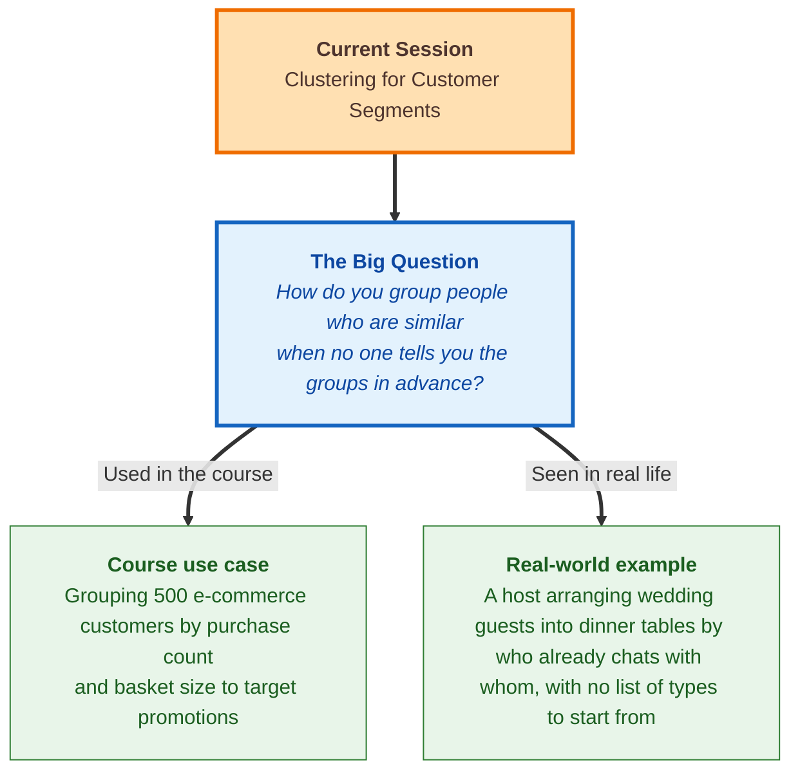

## <span style="color:#2F7DDE">Clustering for Customer Segments</span>

### <span style="color:#2F7DDE">Mental Map</span>



---

### <span style="color:#2F7DDE">What You'll Learn</span>

Have you ever wondered how a wedding host decides who sits together, with no list of types to start from?

By the end of this session, you will be able to:

- <span style="color:#D9660B">**Describe**</span> the two steps of assigning each guest to a table and recentring.
- <span style="color:#D9660B">**Interpret**</span> a fitness score from −1 to 1 as a measure of table fit.
- <span style="color:#D9660B">**Classify**</span> a guest as a core member, an edge guest, or an isolated loner.
- <span style="color:#D9660B">**Use**</span> a grouping method to split 500 customers into a chosen number of segments.
- <span style="color:#D9660B">**Apply**</span> a bottom-up method that starts with every guest alone and joins the two closest.
- <span style="color:#D9660B">**Determine**</span> the neighbourhood radius and minimum group size for separating cliques from solo guests.

> <span style="color:#2F7DDE">**Topics you will meet:**</span> K-means idea; Fitting k-means; Silhouette score; Agglomerative clustering; DBSCAN idea; Fitting DBSCAN.
>
> Join the session to learn each of these in detail.

---

### <span style="color:#2F7DDE">Why You Are Learning This Topic</span>

You are planning a wedding for 60 guests with no seating chart given.
At the reception, guests keep returning to the same small circles.
A <span style="color:#D9660B">**clustering algorithm**</span> means a method that finds natural groups in data without labels.
In this course, clustering finds customer segments that no data column names.

> <span style="color:#2F7DDE">**Think about it:**</span> Two guests talk to the same three people all evening. Should they sit together, even if no one planned it?

---

### <span style="color:#2F7DDE">The Wedding Table Puzzle</span>

The host tracked six guests during welcome drinks.

| Guest | Chats per hour | Mutual friends |
|:------:|:--------------:|:--------------:|
| Arjun | 12 | 5 |
| Priya | 11 | 4 |
| Rahul | 3 | 1 |
| Sneha | 2 | 0 |
| Vikram | 10 | 5 |
| Meera | 4 | 2 |

<span style="color:#D9660B">**What you want to happen:**</span>

- Chatters who share four or more friends end up at one table.
- Guests with no nearby connections get flagged, not forced into a group.
- The host can try different table counts without redoing the work.

Here is how it might start. You do not need to understand it yet.

```python
from sklearn.cluster import KMeans
km = KMeans(n_clusters=3, random_state=42, n_init=10)
km.fit([[12,5],[11,4],[3,1],[2,0],[10,5],[4,2]])
```

> <span style="color:#D9660B">**Wonder about this:**</span>
>
> - If two guests score alike, does that mean they always end up at the same table?
> - What happens to a guest halfway between two table centres?

---

### <span style="color:#2F7DDE">Think It Through</span>

There is no wrong first try. Keep your guesses for the session.

**1. The host places three centres and assigns each guest to the nearest one. What step comes next?**
Hint: Think about whether the centres stay fixed or shift after each assignment round.

**2. The host gets a score of −0.1 for Meera. What does that suggest?**
Hint: A score near 1 signals a tight fit. A score near −1 signals a closer match elsewhere.

**3. The host wants to flag loners with fewer than three nearby guests. Which approach would help?**
Hint: One method treats isolated guests as a category of their own.

---

### <span style="color:#2F7DDE">One Question to Carry Into the Session</span>

> <span style="color:#2F7DDE">**If you have 60 guests and no seating plan, how do you choose the number of tables to try?**</span>
>
> How do you then check whether those groups are valid?
