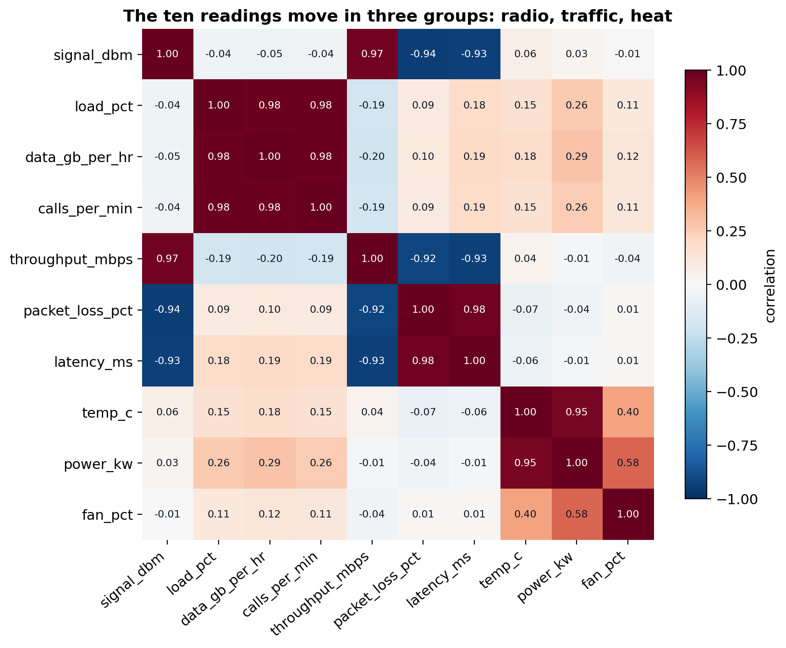
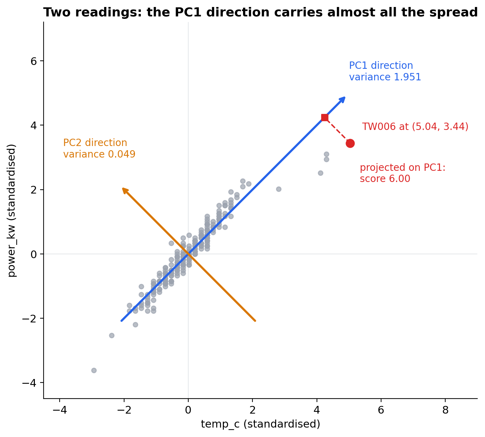
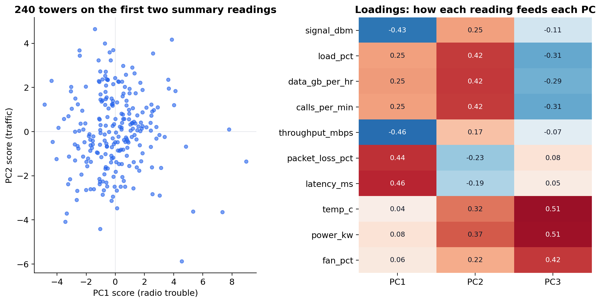
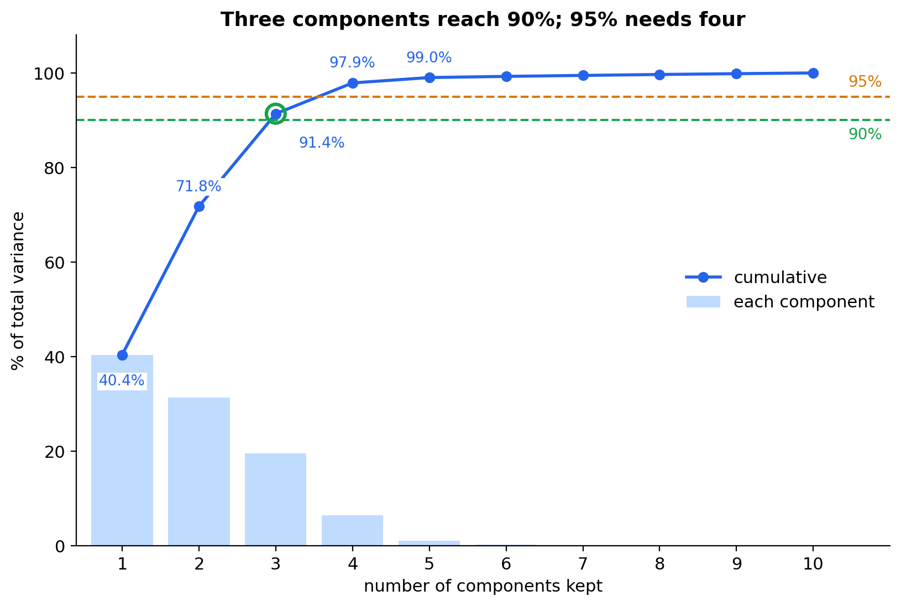
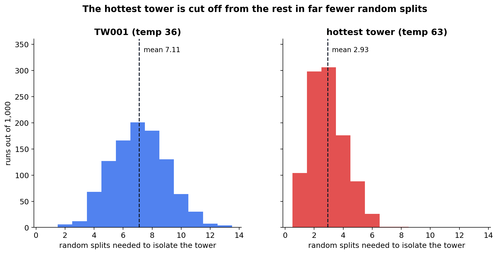
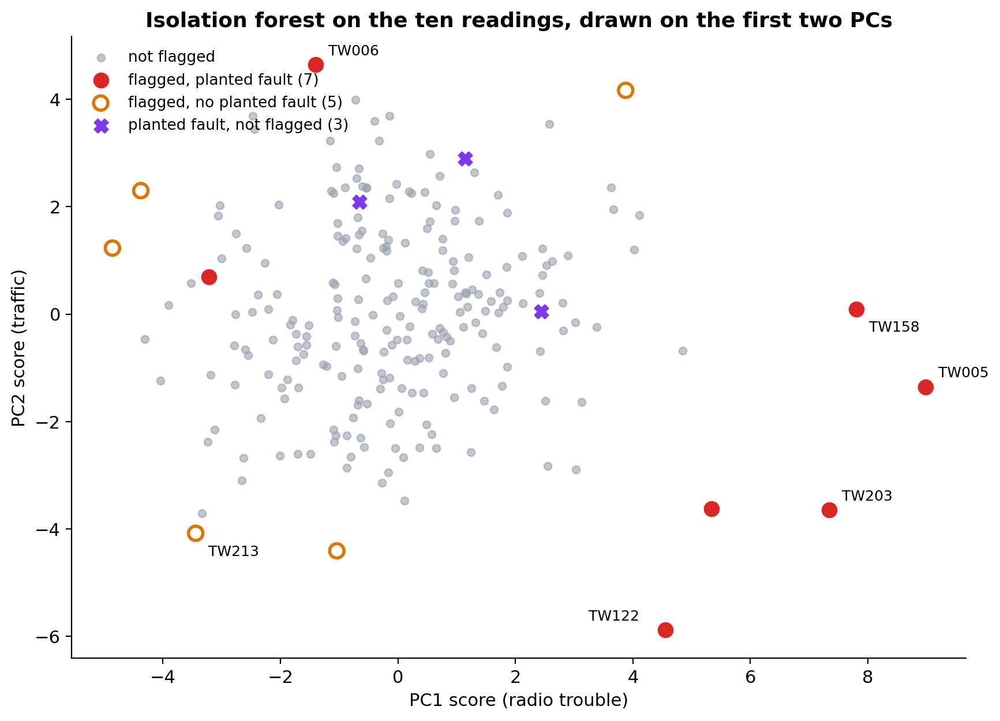

# <font color='#1d4ed8'>Lecture Script: PCA and Anomaly Detection</font>

---

## <font color='blue'>Agenda</font>

The lecture runs as four topics. Each topic ends with a quiz.

| Topic | What we do | Learning objectives covered | Minutes |
|:-:|:--|:--|:-:|
| 1 | See PCA as a projection | Explain PCA as a projection onto orthogonal directions of maximum variance | 30 |
| 2 | Reduce to a stated number of components | Apply PCA to reduce a feature set to a stated number of components | 20 |
| 3 | Choose how many components to keep | Select the number of principal components, justifying by cumulative explained variance | 25 |
| 4 | Isolate and flag the odd towers | Explain how an isolation forest isolates anomalies in fewer random splits<br>Apply an isolation forest to flag anomalous records in a dataset | 30 |
| — | Closing: Outcome & Summary | | 15 |
| | **Total** | | **120** |

> <font color="red">**🎯 Instructor Note**</font> Pace: spend the most care in Topic 1, where the projection idea is built from two readings; Topic 2 is a short, hands-on fit.
> In Topic 4 give about 10 minutes to the by-hand isolation before the scikit-learn forest, then move steadily through the flagged list.

---

## <font color='blue'>Scenario</font>

It is 9 pm in the network operations room of a Jio-style mobile network. Anjali is the engineer on duty for a cluster of 240 towers.

Every hour each tower sends her team ten health readings: signal strength, load, data volume, calls, throughput, packet loss, latency, temperature, power draw and fan speed. The wall of dashboards has one chart per reading, so 2,400 numbers arrive every hour.

Her manager asks for two things by morning: a short view with only a few numbers per tower, and a list of the towers that are behaving oddly.

> <font color="red">**🎯 Instructor Note**</font> The company is only the setting; do not claim it uses this data. The 240 towers in `data/tower_readings.csv` and Anjali are invented for teaching, and `planted_fault` marks 10 towers given a fault, for checking only.
> Outputs come from Python 3, pandas 3.0.1, numpy 2.4.4 and scikit-learn 1.8.0, with fixed seeds. The file has repeated values, 3 towers capped at 100% load, and `data_gb_per_hr` in the thousands while most readings are in the tens.

---

## <font color='blue'>Problem Statement</font>

Anjali's alarms check one reading at a time, for example "temperature above 65 °C". On a monsoon evening tower TW108 ran with its fan at 5% and its power draw at 8.4 kW. Its temperature was 58 °C, under the limit, so no alarm fired. Each reading looked tolerable on its own dashboard; together they said the fan had failed. Later that night the tower shut itself down, and the area around it lost signal for hours.

Nobody could have spotted this by eye. Ten readings make 45 pairs of readings to compare, and in the file we use, not one of the 240 towers ever reached 65 °C; the hottest read 63 °C.

> <font color='purple'>**How can Anjali shrink ten readings per tower into a few that keep most of the story, and find the towers that behave oddly?**</font>

> <font color="red">**🎯 Instructor Note**</font> Poll: "Anjali wants to keep at least 90% of what the ten readings say. How many summary numbers per tower are enough: A) 1, B) 3, C) 6, D) 10?" Give learners 30 seconds to respond in chat. Reveal the answer in the Closing.

---

## <font color='blue'>What We Will Use</font>

One table of terms and the formulas behind them. Each topic uses these without repeating them.

| Term | Meaning | In our towers |
|:--|:--|:--|
| **Variance** | How spread out a reading is: the average squared distance from its mean | $s^2$, in squared units |
| **Correlation** | How closely two readings rise and fall together, from $-1$ to $1$ | `temp_c` and `power_kw` |
| **Standardise** | Subtract the mean and divide by the standard deviation, so every reading has mean 0 and spread 1 | `StandardScaler` |
| **Principal direction** | A unit-length direction through the data. The first keeps the most variance; each next one is at right angles to the ones before | PC1, PC2, PC3 |
| **Score** | A tower's position along a direction | one number per tower per PC |
| **Loading** | How much a reading contributes to a direction | one row per reading |
| **Explained variance ratio** | The share of the total variance that one direction holds | `explained_variance_ratio_` |
| **Isolation forest** | Many random trees. Each tree cuts the readings at random until a tower is alone | `IsolationForest` |
| **Anomaly score** | Near 1 for towers cut off in few splits, around 0.5 or below for ordinary towers | `-score_samples` |

PCA keeps the standardised readings $\mathbf{z}_i$ and finds unit directions $\mathbf{w}_k$ at right angles to each other. The score of tower $i$ on direction $k$ is a projection:

$$\boxed{t_{ik} = \mathbf{z}_i \cdot \mathbf{w}_k \qquad \operatorname{Var}(t_{k}) = \lambda_k \qquad \text{ratio}_k = \frac{\lambda_k}{\sum_j \lambda_j}}$$

An isolation forest turns the average number of splits $E[h(x)]$ into a score, where $n$ is the number of towers each tree sees and $\gamma \approx 0.5772$:

$$\boxed{s(x) = 2^{-E[h(x)]\,/\,c(n)} \qquad c(n) = 2\left(\ln(n-1) + \gamma\right) - \frac{2(n-1)}{n}}$$

> <font color='#b45309'>**Watch out for**</font>
> - Variances add up: the $\lambda_k$ sum to the total variance, so a ratio is a share of a whole.
> - A direction can point either way; its sign may flip between runs or library versions. Read the pattern, not the sign.
> - An isolation forest has no labels. In this file only the 10 planted faults give us something to check against.

---

## <font color='blue'>How: Walking Through the Tower Readings</font>


---

## <font color='blue'>Topic 1: See PCA as a Projection</font> `30 min`

> <font color='purple'>**Anjali cannot draw ten axes at once, so how can she see the shape of 240 towers?**</font>

Last session you clustered customers with k-means and DBSCAN, and with kNN you saw why features need a common scale. We keep that habit here: before we look for directions, we look at the scale of each reading.

### <font color='green'>Example: look at the towers</font>

> <font color='purple'>**What does one row hold, and are the ten readings on the same scale?**</font>

**Predict before running: What will happen?**

> <font color="red">**🎯 Instructor Note**</font> Expected: 240 rows and 12 columns (id, ten readings, `planted_fault`). Common miss: `data_gb_per_hr` is in the thousands while `packet_loss_pct` is below 2.

```python
import numpy as np
import pandas as pd

df = pd.read_csv("data/tower_readings.csv")
cols = df.columns.drop(["tower_id", "planted_fault"])
print(df.shape)
print(df[cols].describe().loc[["mean", "std"]].round(1).T)
```

**Output**

```
(240, 12)
                   mean    std
signal_dbm        -88.7    8.7
load_pct           60.9   17.0
data_gb_per_hr   2632.0  721.4
calls_per_min      40.5    9.0
throughput_mbps    37.2    9.9
packet_loss_pct     1.7    0.8
latency_ms         49.3   11.9
temp_c             35.9    5.4
power_kw            5.4    1.2
fan_pct            52.1   14.2
```

#### <font color='#c2410c'>Code Explanation</font>

- **Lines 1 and 2** Load numpy and pandas.
- **Line 4** Reads the 240 towers.
- **Line 5** Keeps the ten reading names, leaving out the id and the check column `planted_fault`.
- **Line 6** Prints the shape as (rows, columns).
- **Line 7** Shows the mean and standard deviation of each reading, turned on its side to read down.

> <font color='green'>**Result**</font> Each row is one tower with ten readings. The scales differ a lot: the standard deviation of `data_gb_per_hr` is 721.4 while that of `packet_loss_pct` is 0.8. `planted_fault` is only for checking results; PCA and the forest never use it.

### <font color='green'>Extending it: which readings move together?</font>

> <font color='purple'>**Do ten readings really carry ten separate stories?**</font>

> <font color="red">**🎯 Instructor Note**</font> Ask: "Out of the 45 pairs, how many have a correlation above 0.8 in size?" Give learners 30 seconds to respond in chat. Expected: 10.

```python
corr = df[cols].corr().abs()
upper = np.triu(np.ones(corr.shape, dtype=bool), k=1)
pairs = corr.where(upper).stack().dropna().sort_values(ascending=False)
print(len(pairs), "pairs;", (pairs > 0.8).sum(), "above 0.8")
print(pairs.head(5).round(2))
```

**Output**

```
45 pairs; 10 above 0.8
load_pct         calls_per_min      0.98
                 data_gb_per_hr     0.98
data_gb_per_hr   calls_per_min      0.98
packet_loss_pct  latency_ms         0.98
signal_dbm       throughput_mbps    0.97
dtype: float64
```

#### <font color='#c2410c'>Code Explanation</font>

- **Line 1** Computes the correlation of every pair and ignores the sign, so only the strength shows.
- **Line 2** Builds a mask that keeps each pair once, above the diagonal.
- **Line 3** Keeps those pairs, drops the empty cells and sorts from strongest to weakest.
- **Lines 4 and 5** Print the number of pairs, how many are above 0.8, and the top five.

<p align="center"></p>

> <font color='green'>**Result**</font> There are 45 pairs and 10 of them are above 0.8. The readings fall into three groups that move together: radio (signal, throughput, packet loss, latency), traffic (load, data, calls) and heat (temperature, power, fan). Many readings repeat the same story.

### <font color='green'>Extending it: the best direction for two readings</font>

> <font color='purple'>**For the two heat readings, which single direction keeps most of their spread?**</font>

Take `temp_c` and `power_kw` (correlation 0.95). After standardising, each has variance 1, so the total spread is 2. PCA looks for the unit direction $\mathbf{w}_1$ along which the towers, projected onto it, have the largest variance. It then picks $\mathbf{w}_2$ at right angles to it. For the covariance matrix $\Sigma$ of the readings, the directions are the eigenvectors, and their variances are the eigenvalues $\lambda_k$.

$$\boxed{\operatorname{Var}(\mathbf{z}\cdot\mathbf{w}) = \mathbf{w}^{\top}\Sigma\,\mathbf{w} \ \text{ is largest for } \mathbf{w}_1, \qquad \mathbf{w}_1 \cdot \mathbf{w}_2 = 0}$$

**Predict before running: What will happen?**

> <font color="red">**🎯 Instructor Note**</font> Expected: variances near 1.95 and 0.05, adding to 2, and a dot product of 0. Common guess: learners expect the two variances to stay 1 and 1.

```python
two = df[["temp_c", "power_kw"]]
z2 = ((two - two.mean()) / two.std()).to_numpy()
cov = np.cov(z2.T)
vals, vecs = np.linalg.eigh(cov)
vals, vecs = vals[::-1], vecs[:, ::-1]
print(cov.round(3))
print("variances:", vals.round(3))
print("directions:", vecs.T.round(3))
print("dot product:", round(float(vecs[:, 0] @ vecs[:, 1]), 6))
```

**Output**

```
[[1.    0.951]
 [0.951 1.   ]]
variances: [1.951 0.049]
directions: [[ 0.707  0.707]
 [-0.707  0.707]]
dot product: 0.0
```

#### <font color='#c2410c'>Code Explanation</font>

- **Lines 1 and 2** Standardise the two readings by hand into a table of $z$-scores, one row per tower.
- **Line 3** Builds the covariance matrix. Its off-diagonal entry is the correlation, 0.951.
- **Lines 4 and 5** `eigh` returns the variances and directions of the matrix; we reorder them from largest to smallest.
- **Lines 6 to 8** Print the matrix, the two variances and the two directions.
- **Line 9** The dot product of the two directions is 0, so they are at right angles.

<p align="center"></p>

> <font color='green'>**Result**</font> The first direction has variance 1.951 and the second 0.049; together they give the total 2, so no spread is lost, it is only shared out differently. The first direction alone holds almost 98% of the spread.

### <font color='green'>Extending it: project one tower by hand</font>

> <font color='purple'>**Where does tower TW006, the hottest one, land on each direction?**</font>

By hand with the standardised readings $(5.04,\ 3.44)$ and the directions $(0.707,\ 0.707)$ and $(-0.707,\ 0.707)$:

$$t_{1} = 5.04(0.707) + 3.44(0.707) \approx 6.00 \qquad t_{2} = 5.04(-0.707) + 3.44(0.707) \approx -1.13$$

> <font color="red">**🎯 Instructor Note**</font> Ask learners to predict the sign of the PC2 score: TW006 is hotter than its power draw suggests. Expected: negative.

```python
i = df.index[df.tower_id == "TW006"][0]
w1, w2 = vecs[:, 0], vecs[:, 1]
print("standardised readings:", z2[i].round(3))
print("score on PC1:", round(float(z2[i] @ w1), 3))
print("score on PC2:", round(float(z2[i] @ w2), 3))
s1 = z2 @ w1
print("variance of PC1 scores:", round(float(s1.var(ddof=1)), 3))
```

**Output**

```
standardised readings: [5.04 3.44]
score on PC1: 5.996
score on PC2: -1.131
variance of PC1 scores: 1.951
```

#### <font color='#c2410c'>Code Explanation</font>

- **Line 1** Finds the row number of TW006.
- **Line 2** Names the two directions `w1` and `w2`.
- **Lines 3 to 5** Print the tower's standardised readings and its score on each direction, each a dot product.
- **Lines 6 and 7** Project all 240 towers on `w1` and print the variance of those scores.

> <font color='green'>**Result**</font> TW006 has a score of about 6.00 on the first direction (very hot overall) and $-1.13$ on the second (hotter than its power draw suggests). The variance of all 240 scores on the first direction is 1.951, the same number as the eigenvalue.

### <font color='green'>Extending it: is it really the maximum?</font>

> <font color='purple'>**If we try many directions ourselves, does any beat the one PCA found?**</font>

> <font color="red">**🎯 Instructor Note**</font> Ask: "At 0 degrees the direction is the temperature axis alone. What variance do you expect?" Expected: 1.0.

```python
def var_at(deg):
    w = [np.cos(np.radians(deg)), np.sin(np.radians(deg))]
    return (z2 @ w).var(ddof=1)

for deg in (0, 45, 90, 135):
    print(deg, round(var_at(deg), 3))
best = max(range(180), key=var_at)
pc1 = np.degrees(np.arctan2(w1[1], w1[0])) % 180
print("best angle:", best, "PC1 angle:", round(pc1, 1))
```

**Output**

```
0 1.0
45 1.951
90 1.0
135 0.049
best angle: 45 PC1 angle: 45.0
```

#### <font color='#c2410c'>Code Explanation</font>

- **Lines 1 to 3** Define the variance of the towers' scores when projected on a direction at a given angle.
- **Lines 5 and 6** Print the variance at 0, 45, 90 and 135 degrees.
- **Line 7** Tries every whole angle from 0 to 179 and keeps the one with the largest variance.
- **Lines 8 and 9** Convert the PCA direction to an angle and print both.

> <font color='green'>**Result**</font> No angle beats 45 degrees, which is exactly the first PCA direction. At 135 degrees, at right angles to it, the variance is the smallest, 0.049. With two standardised readings that are positively correlated the best direction is always this diagonal.

### <font color='purple'>Quiz 1</font>

**Question:** In the two-reading example the variances along the two PCA directions are 1.951 and 0.049, and the dot product of the directions is 0. What does this say about the second direction?

**Options:**
- A) It is parallel to the first direction and holds the leftover spread
- B) It is at right angles to the first direction and holds the largest spread
- C) It is at right angles to the first direction and holds the largest spread that is left, here 0.049
- D) It points at the faulty towers

**Correct Answer:** C

**Explanation:**
- **A)** Wrong: parallel directions would have a dot product of 1 in size, not 0.
- **B)** Wrong: the first direction already holds the largest spread, 1.951.
- **C)** Correct: a dot product of 0 means right angles, and PCA picks each next direction to keep the most spread that remains.
- **D)** Wrong: PCA never uses `planted_fault` or any label; it only follows spread.

---

## <font color='blue'>Topic 2: Reduce to a Stated Number of Components</font> `20 min`

> <font color='purple'>**Two readings were easy; how do we turn all ten into three summary numbers per tower?**</font>

### <font color='green'>Example: fit PCA with three components</font>

> <font color='purple'>**What does PCA give back when we ask for exactly three components?**</font>

You already scale before you fit, and now the scaled readings go into `PCA`. Here `n_components=3` is the stated number of components.

**Predict before running: What will happen?**

> <font color="red">**🎯 Instructor Note**</font> Expected: 240 rows and 3 columns, one score per tower per component. Common guess: learners expect 3 rows.

```python
from sklearn.preprocessing import StandardScaler
from sklearn.decomposition import PCA

Z = StandardScaler().fit_transform(df[cols])
pca3 = PCA(n_components=3)
scores = pca3.fit_transform(Z)
print(Z.shape, "to", scores.shape)
pcs = pd.DataFrame(scores, index=df.tower_id, columns=["PC1", "PC2", "PC3"])
print(pcs.head(4).round(2))
```

**Output**

```
(240, 10) to (240, 3)
           PC1   PC2   PC3
tower_id
TW001     3.02 -0.15  0.38
TW002     3.67  1.96 -1.99
TW003    -3.12 -2.15  0.42
TW004     0.77 -0.34 -0.00
```

#### <font color='#c2410c'>Code Explanation</font>

- **Lines 1 and 2** Import the scaler and PCA.
- **Line 4** Standardises all ten readings (`StandardScaler` divides by $n$ rather than $n-1$, a difference too small to matter here).
- **Line 5** Creates a PCA that keeps three components.
- **Line 6** Learns the three directions and returns each tower's three scores.
- **Lines 7 to 9** Print the shape change, then put the scores in a table labelled by tower and show four rows.

> <font color='green'>**Result**</font> Each tower now has three numbers, PC1, PC2 and PC3, instead of ten readings. A table of 240 by 10 became 240 by 3.

### <font color='green'>Extending it: read the loadings</font>

> <font color='purple'>**What does each summary number actually measure?**</font>

> <font color="red">**🎯 Instructor Note**</font> Ask: "Which readings will weigh most on the component that separates busy towers from quiet ones?" Expected: load, data and calls.

```python
load = pd.DataFrame(pca3.components_.T, index=cols, columns=["PC1", "PC2", "PC3"])
print(load.round(2))
```

**Output**

```
                  PC1   PC2   PC3
signal_dbm      -0.43  0.25 -0.11
load_pct         0.25  0.42 -0.31
data_gb_per_hr   0.25  0.42 -0.29
calls_per_min    0.25  0.42 -0.31
throughput_mbps -0.46  0.17 -0.07
packet_loss_pct  0.44 -0.23  0.08
latency_ms       0.46 -0.19  0.05
temp_c           0.04  0.32  0.51
power_kw         0.08  0.37  0.51
fan_pct          0.06  0.22  0.42
```

#### <font color='#c2410c'>Code Explanation</font>

- **Line 1** `components_` holds one direction per row; the transpose gives one row per reading, one column per direction.
- **Line 2** Prints the loadings to two decimals.

<p align="center"></p>

> <font color='green'>**Result**</font> PC1 leans on signal, throughput, packet loss and latency, so a high PC1 means weak, slow, lossy radio (TW001 has signal $-100$ dBm and PC1 = 3.02). PC2 leans on load, data and calls, so it is traffic. PC3 leans on temperature, power and fan speed, so it is heat. Unlike the two-reading case, the weights are different for each reading.

### <font color='green'>Extending it: the same fit inside a Pipeline</font>

> <font color='purple'>**Can we chain the scaler and PCA the way you chained steps before?**</font>

In an earlier session you built a scikit-learn `Pipeline`. The scaler and PCA slot in as two steps, so the scaling is always applied before the directions are found.

```python
from sklearn.pipeline import Pipeline

pipe = Pipeline([("scale", StandardScaler()), ("pca", PCA(n_components=3))])
same = pipe.fit_transform(df[cols])
print("same scores as before:", np.allclose(same, scores))
print("components kept:", pipe.named_steps["pca"].n_components_)
```

**Output**

```
same scores as before: True
components kept: 3
```

#### <font color='#c2410c'>Code Explanation</font>

- **Line 1** Imports `Pipeline`.
- **Line 3** Chains a scaler and a PCA with three components.
- **Line 4** Fits both and returns the scores in one call.
- **Line 5** Checks the scores match the earlier ones.
- **Line 6** Reads back the number of components kept from the named PCA step.

> <font color='green'>**Result**</font> The Pipeline returns the same scores, so the pair of steps can be fitted and reused as one object.

### <font color='green'>Extending it: what if we skip the scaling?</font>

> <font color='purple'>**What happens if PCA sees the raw readings?**</font>

> <font color="red">**🎯 Instructor Note**</font> Ask which reading will take over PC1. Expected: `data_gb_per_hr`, since its spread is in the hundreds.

```python
raw = PCA(n_components=3).fit(df[cols])
print("raw readings, % of variance:", *(raw.explained_variance_ratio_ * 100).round(2))
print("scaled readings, % of variance:", *(pca3.explained_variance_ratio_ * 100).round(2))
print("largest raw loading on PC1:", cols[abs(raw.components_[0]).argmax()])
```

**Output**

```
raw readings, % of variance: 99.89 0.06 0.04
scaled readings, % of variance: 40.42 31.38 19.58
largest raw loading on PC1: data_gb_per_hr
```

#### <font color='#c2410c'>Code Explanation</font>

- **Line 1** Fits PCA on the raw readings with no scaling.
- **Lines 2 and 3** Print the percent of variance for each of the three components, raw and then scaled.
- **Line 4** Names the reading with the largest weight on the raw PC1.

> <font color='green'>**Result**</font> On the raw readings PC1 holds 99.89% of the variance and is nearly `data_gb_per_hr` alone, only because that column has the biggest numbers. After scaling the share is spread as 40.42, 31.38 and 19.58.

> <font color='#b45309'>**Common mistake**</font> Running PCA on readings in different units. Standardise first, so a reading does not dominate just because its numbers are large.

### <font color='purple'>Quiz 2</font>

**Question:** `Z` holds 240 towers by 10 standardised readings. What does `PCA(n_components=3).fit_transform(Z)` return?

**Options:**
- A) 240 rows and 3 columns, one score per tower per component
- B) 3 rows and 10 columns, one direction per row
- C) 240 rows and 10 columns, unchanged
- D) 10 rows and 3 columns, the loadings table

**Correct Answer:** A

**Explanation:**
- **A)** Correct: `fit_transform` returns the scores, one row per tower and one column per kept component.
- **B)** Wrong: that is the shape of `components_`, the directions, not of the scores.
- **C)** Wrong: nothing would be reduced; PCA with 3 components cuts the columns from 10 to 3.
- **D)** Wrong: that is the shape of the loadings table, one row per reading, not the scores.

---

## <font color='blue'>Topic 3: Choose How Many Components to Keep</font> `25 min`

> <font color='purple'>**We asked for three components, but was three the right number?**</font>

### <font color='green'>Example: the variance each component holds</font>

> <font color='purple'>**How much of the total variance does each component hold, and how much do the first few hold together?**</font>

Each component holds a share $\lambda_k / \sum_j \lambda_j$ of the total variance. Adding the shares from the first component gives the cumulative explained variance:

$$\boxed{\text{cum}_k = \sum_{j=1}^{k} \frac{\lambda_j}{\sum_{m}\lambda_m}}$$

**Predict before running: What will happen?**

> <font color="red">**🎯 Instructor Note**</font> Expected: shares falling quickly and the cumulative share passing 90% by the third component. Common guess: learners expect ten similar shares of about 10% each.

```python
full = PCA().fit(Z)
ratio = full.explained_variance_ratio_
cum = ratio.cumsum()
table = pd.DataFrame({"ratio": ratio, "cumulative": cum}, index=range(1, 11))
print(table.round(3))
```

**Output**

```
    ratio  cumulative
1   0.404       0.404
2   0.314       0.718
3   0.196       0.914
4   0.065       0.979
5   0.011       0.990
6   0.002       0.993
7   0.002       0.995
8   0.002       0.997
9   0.002       0.998
10  0.002       1.000
```

#### <font color='#c2410c'>Code Explanation</font>

- **Line 1** Fits PCA with all ten components, so none is dropped yet.
- **Line 2** Takes each component's share of the total variance.
- **Line 3** Adds the shares up as a running total.
- **Lines 4 and 5** Put the two columns in a table numbered 1 to 10 and print it.

<p align="center"></p>

> <font color='green'>**Result**</font> The first three components hold 40.4%, 31.4% and 19.6% of the variance. The fourth adds 6.5 points and the fifth only 1.1. The cumulative share is 91.4% at three components.

### <font color='green'>Extending it: pick the smallest number that reaches a target</font>

> <font color='purple'>**How many components do we need for 80%, 90% and 95%?**</font>

> <font color="red">**🎯 Instructor Note**</font> Ask: "Three components hold 91.4%. Will 95% need more?" Give learners 30 seconds to respond in chat. Expected: yes, four.

```python
for target in (0.80, 0.90, 0.95):
    k = int(np.argmax(cum >= target)) + 1
    print(f"at least {target:.0%}: {k} components ({cum[k - 1]:.1%})")
print("PCA(n_components=0.90) keeps:", PCA(n_components=0.90).fit(Z).n_components_)
```

**Output**

```
at least 80%: 3 components (91.4%)
at least 90%: 3 components (91.4%)
at least 95%: 4 components (97.9%)
PCA(n_components=0.90) keeps: 3
```

#### <font color='#c2410c'>Code Explanation</font>

- **Line 1** Loops over three targets.
- **Line 2** Finds the first position where the cumulative share reaches the target and adds 1 to turn it into a count.
- **Line 3** Prints the target, the count and the share actually kept.
- **Line 4** Lets scikit-learn do it: a decimal `n_components` keeps just enough components to reach that share.

> <font color='green'>**Result**</font> 80% and 90% both need three components (91.4%), because two give only 71.8%. 95% needs four (97.9%). Anjali keeps three: 91.4% of the variance is kept, and the fourth component would add only 6.5 points. The target itself is a judgement, not a rule.

### <font color='green'>Extending it: what do the dropped components cost?</font>

> <font color='purple'>**If we rebuild the readings from three numbers, how much do we lose?**</font>

The squared error of the rebuilt readings, added over all ten readings and divided by $n-1$, equals the variance of the dropped components, $\sum_{k>3}\lambda_k$.

```python
back = pca3.inverse_transform(scores)
lost = ((Z - back) ** 2).sum() / (len(Z) - 1)
print("total variance:", round(full.explained_variance_.sum(), 3))
print("lost by 3 components:", round(lost, 3))
print("dropped variance, PC4 to PC10:", round(full.explained_variance_[3:].sum(), 3))
```

**Output**

```
total variance: 10.042
lost by 3 components: 0.866
dropped variance, PC4 to PC10: 0.866
```

#### <font color='#c2410c'>Code Explanation</font>

- **Line 1** Rebuilds the ten standardised readings from the three scores.
- **Line 2** Adds the squared gaps between the original and rebuilt readings and divides by $n-1$.
- **Line 3** Prints the total variance of all ten components. It is 10.042 rather than 10 because PCA divides by $n-1$.
- **Lines 4 and 5** Print the lost variance and the sum of the dropped variances, which should match.

> <font color='green'>**Result**</font> Both numbers are 0.866, which is 8.6% of 10.042 and so the same $100\% - 91.4\%$. The cumulative share is exactly how much of the readings the three numbers keep.

### <font color='purple'>Quiz 3</font>

**Question:** The cumulative explained variance for 1, 2, 3, 4 and 5 components is 40.4%, 71.8%, 91.4%, 97.9% and 99.0%. The team wants to keep at least 95%. How many components should it keep?

**Options:**
- A) 2
- B) 3
- C) 5
- D) 4

**Correct Answer:** D

**Explanation:**
- **A)** Wrong: two components keep only 71.8%, far below 95%.
- **B)** Wrong: three keep 91.4%, which is below 95%.
- **C)** Wrong: five reach 99.0%, which is enough, but it is not the smallest number that does the job.
- **D)** Correct: four is the first count that reaches 95%, at 97.9%.

---

## <font color='blue'>Topic 4: Isolate and Flag the Odd Towers</font> `30 min`

> <font color='purple'>**Three numbers show the shape of the towers, but how do we find the ones that do not belong?**</font>

You have grown decision trees by splitting on a reading and a random forest by averaging many trees. DBSCAN marked some points as noise. Here we use random splits to find the towers that stand apart.

### <font color='green'>Example: cut at random until a tower is alone</font>

> <font color='purple'>**If we cut the temperature range at random, how many cuts leave the hottest tower alone, and how many leave TW001?**</font>

Pick a random cut between the smallest and the largest temperature left. Keep the side that holds our tower. Count the cuts until it is alone. Towers with equal temperatures cannot be told apart by a cut, so the loop also stops when all the towers left have the same value.

**Predict before running: What will happen?**

> <font color="red">**🎯 Instructor Note**</font> Expected: a smaller count for the hottest tower. One run is partly luck, so a count can come out the other way round.

```python
rng = np.random.default_rng(7)
temp = df["temp_c"].to_numpy(float)
def splits_to_isolate(values, target):
    n = 0
    while values.min() < values.max():
        cut = rng.uniform(values.min(), values.max())
        values = values[values <= cut] if target <= cut else values[values > cut]
        n += 1
    return n
print(splits_to_isolate(temp, temp.max()), splits_to_isolate(temp, temp[0]))
```

**Output**

```
2 9
```

#### <font color='#c2410c'>Code Explanation</font>

- **Line 1** Creates a random number generator with a fixed seed.
- **Line 2** Takes the temperatures as numbers.
- **Line 3** Defines a function that counts the cuts needed to isolate a target value.
- **Lines 4 and 5** Start the count at zero and repeat while the towers left still differ in temperature.
- **Line 6** Cuts at a random point between the smallest and largest value left.
- **Lines 7 and 8** Keep the side with the target and count the cut; **line 9** returns the count.
- **Line 10** Runs it once for the hottest tower and once for TW001 (the first row).

> <font color='green'>**Result**</font> In this one run the hottest tower was cut off in 2 splits and TW001 in 9. A single run does not prove anything on its own.

### <font color='green'>Extending it: repeat it 1,000 times</font>

> <font color='purple'>**On average, who is cut off faster?**</font>

```python
typical, odd = temp[0], temp.max()
n_typ = [splits_to_isolate(temp, typical) for _ in range(1000)]
n_odd = [splits_to_isolate(temp, odd) for _ in range(1000)]
print("TW001, temp", typical, "- mean splits:", np.mean(n_typ))
print("hottest tower, temp", odd, "- mean splits:", np.mean(n_odd))
print("towers sharing TW001's temp:", (temp == typical).sum())
```

**Output**

```
TW001, temp 36.0 - mean splits: 7.114
hottest tower, temp 63.0 - mean splits: 2.933
towers sharing TW001's temp: 20
```

#### <font color='#c2410c'>Code Explanation</font>

- **Line 1** Chooses the two towers: TW001 (36 °C) and the hottest (63 °C).
- **Lines 2 and 3** Repeat the random cutting 1,000 times for each and keep every count.
- **Lines 4 and 5** Print the average number of splits for each.
- **Line 6** Counts the towers that share TW001's temperature.

<p align="center"></p>

> <font color='green'>**Result**</font> The hottest tower needs about 2.9 splits on average and TW001 about 7.1. TW001 shares its 36 °C with 19 other towers, so it takes more cuts to separate from the crowd. A tower far from the rest is cut away quickly. This is the whole idea: an anomaly is isolated in fewer random splits.

### <font color='green'>Extending it: an isolation forest on all ten readings</font>

> <font color='purple'>**Can scikit-learn do this for every tower, on every reading at once?**</font>

An isolation forest grows many trees. Each split picks a random reading and a random cut value between its smallest and largest value. The anomaly score is the formula from What We Will Use. scikit-learn's `score_samples` returns the negative of that score, so we flip the sign and a higher number means more anomalous.

**Predict before running: What will happen?**

> <font color="red">**🎯 Instructor Note**</font> Expected: top scores clearly above the median of about 0.4. Common guess: learners think scores must be near 0 or 1.

```python
from sklearn.ensemble import IsolationForest

iso = IsolationForest(n_estimators=100, contamination=0.05, random_state=42)
iso.fit(Z)
anomaly = -iso.score_samples(Z)
print(iso.max_samples_, len(iso.estimators_))
order = np.argsort(-anomaly)[:5]
print(pd.DataFrame({"tower": df.tower_id[order], "score": anomaly[order].round(3)}).to_string(index=False))
print("median score:", round(float(np.median(anomaly)), 3))
```

**Output**

```
240 100
tower  score
TW005  0.686
TW158  0.664
TW122  0.658
TW203  0.640
TW006  0.633
median score: 0.407
```

#### <font color='#c2410c'>Code Explanation</font>

- **Line 1** Imports the forest.
- **Line 3** Creates 100 trees; `contamination=0.05` will flag the 5% of towers with the highest scores, and `random_state=42` fixes the randomness.
- **Line 4** Fits it on the standardised readings.
- **Line 5** Flips the sign so a higher score is more anomalous.
- **Line 6** Prints how many towers each tree sees (`max_samples_`) and the number of trees.
- **Lines 7 and 8** Pick and print the five highest scores.
- **Line 9** Prints the median score.

> <font color='green'>**Result**</font> Each tree sees all 240 towers (the default is the smaller of 256 and the number of rows) and there are 100 trees. TW005 scores highest at 0.686, against a median of 0.407.

### <font color='green'>Extending it: from score back to splits</font>

> <font color='purple'>**Does a high score really mean few splits?**</font>

Turn the score formula around: $E[h(x)] = -c(n)\,\log_2 s(x)$.

```python
def c(n):
    return 2 * (np.log(n - 1) + np.euler_gamma) - 2 * (n - 1) / n

avg_splits = -c(iso.max_samples_) * np.log2(anomaly)
print("c(240) =", round(c(240), 2))
print("average splits, top 5:", avg_splits[order].round(1))
print("average splits, median tower:", round(float(np.median(avg_splits)), 1))
```

**Output**

```
c(240) = 10.12
average splits, top 5: [5.5 6.  6.1 6.5 6.7]
average splits, median tower: 13.1
```

#### <font color='#c2410c'>Code Explanation</font>

- **Lines 1 and 2** Define $c(n)$ from the formula.
- **Line 4** Converts every score into its average number of splits.
- **Lines 5 to 7** Print $c(240)$, the average for the top five towers and the median tower.

> <font color='green'>**Result**</font> The five top towers are cut off in about 5.5 to 6.7 splits on average, and the median tower in about 13.1. The median is above 8 because each tree stops growing at 8 splits for 240 towers, and the formula adds an allowance for towers still sharing a leaf when it stops.

### <font color='green'>Extending it: flag the odd towers and check</font>

> <font color='purple'>**Which towers does the forest flag, and how do they compare with the planted faults?**</font>

`predict` returns $-1$ for the flagged towers. With `contamination=0.05` that is $0.05 \times 240 = 12$ towers. The planted faults are the only ground truth in this file; a real network has no such column.

```python
flag = iso.predict(Z) == -1
planted = df.planted_fault.to_numpy() == 1
print("flagged:", flag.sum(), "of", len(df))
print("planted faults flagged:", (flag & planted).sum(), "of", planted.sum())
print("flagged, no planted fault:", sorted(df.tower_id[flag & ~planted]))
print("planted fault, not flagged:", sorted(df.tower_id[~flag & planted]))
```

**Output**

```
flagged: 12 of 240
planted faults flagged: 7 of 10
flagged, no planted fault: ['TW068', 'TW083', 'TW089', 'TW095', 'TW213']
planted fault, not flagged: ['TW046', 'TW145', 'TW163']
```

#### <font color='#c2410c'>Code Explanation</font>

- **Line 1** Marks the flagged towers.
- **Line 2** Marks the 10 planted faults.
- **Lines 3 and 4** Print how many towers are flagged and how many planted faults are among them.
- **Lines 5 and 6** List the flagged towers with no planted fault and the planted faults that were not flagged.

> <font color='green'>**Result**</font> The forest flags 12 towers, which include 7 of the 10 planted faults, and also 5 towers with no planted fault. It misses TW046, TW145 and TW163.

### <font color='green'>Extending it: why were towers with no planted fault flagged?</font>

> <font color='purple'>**What is unusual about the five towers with no planted fault?**</font>

```python
zdf = pd.DataFrame(Z, columns=cols, index=df.tower_id)
odd_z = zdf[flag & ~planted]
worst = odd_z.abs().idxmax(axis=1)
print(pd.DataFrame({
    "most extreme reading": worst,
    "z-score": [round(odd_z.loc[t, worst[t]], 1) for t in odd_z.index],
}))
```

**Output**

```
         most extreme reading  z-score
tower_id
TW068          data_gb_per_hr      2.9
TW083           calls_per_min     -3.1
TW089         throughput_mbps      2.8
TW095              signal_dbm      2.9
TW213                power_kw     -3.6
```

#### <font color='#c2410c'>Code Explanation</font>

- **Line 1** Puts the standardised readings in a table labelled by tower and reading.
- **Line 2** Keeps the flagged towers with no planted fault.
- **Line 3** Finds each one's most extreme reading.
- **Lines 4 to 7** Print that reading and its $z$-score.

> <font color='green'>**Result**</font> Each is far from the average on at least one reading: very high data volume, very few calls, very high throughput, a very strong signal or very low power draw. They are unusual, not necessarily faulty. The forest scores how isolated a tower is; it cannot tell why.

### <font color='green'>Extending it: how stable is the list, and what about three scores?</font>

> <font color='purple'>**Does a different random seed, or the three PCA scores in place of the ten readings, change how many planted faults the forest finds?**</font>

> <font color="red">**🎯 Instructor Note**</font> Ask: "Do three scores carry less than ten readings, so will it find fewer?" Give learners 30 seconds to respond in chat. This is one dataset and six seeds, so treat the result as a caution.

```python
for seed in (42, 0, 1, 2, 3, 4):
    a = IsolationForest(contamination=0.05, random_state=seed).fit(Z)
    b = IsolationForest(contamination=0.05, random_state=seed).fit(scores)
    fa, fb = a.predict(Z) == -1, b.predict(scores) == -1
    print(seed, "10 readings:", (fa & planted).sum(), "planted found - 3 scores:", (fb & planted).sum())
```

**Output**

```
42 10 readings: 7 planted found - 3 scores: 5
0 10 readings: 9 planted found - 3 scores: 6
1 10 readings: 8 planted found - 3 scores: 6
2 10 readings: 8 planted found - 3 scores: 6
3 10 readings: 8 planted found - 3 scores: 6
4 10 readings: 9 planted found - 3 scores: 5
```

#### <font color='#c2410c'>Code Explanation</font>

- **Line 1** Loops over six `random_state` values.
- **Lines 2 and 3** Fit one forest on the ten standardised readings and one on the three PCA scores, each with the same seed.
- **Line 4** Flags the towers from each.
- **Line 5** Prints the seed and the planted faults found by each.

> <font color='green'>**Result**</font> The ten-reading forest found between 7 and 9 of the 10 planted faults across these six seeds, so a forest is random and its list is not fixed. In each of the six runs the three-score forest found fewer, 5 or 6, which is consistent with some of the oddness sitting in the components we dropped. With one invented dataset, read this as a caution, not a rule.

> <font color='#b45309'>**Common mistake**</font> Assuming that a flagged tower is a faulty tower, or that compressing the readings first always keeps what the detector needs. Check both against what you know about the towers.

### <font color='purple'>Quiz 4</font>

**Question:** Why does an isolation forest give a high anomaly score to a tower whose temperature is far above all the others?

**Options:**
- A) It measures the tower's distance from the average and flags the largest distance
- B) Random splits cut it away from the other towers after only a few splits, so its average number of splits is small
- C) It was trained on the planted_fault labels and learned which towers are faulty
- D) It needs many random splits to separate it from the other towers

**Correct Answer:** B

**Explanation:**
- **A)** Wrong: the forest never measures a distance to the average; it only counts how many random splits isolate a tower.
- **B)** Correct: a tower far from the rest is alone after few random cuts, and few splits mean a high score.
- **C)** Wrong: the forest is fitted without labels; `planted_fault` is used only to check the result.
- **D)** Wrong: it is the other way round; ordinary towers sit in a crowd and need many splits.

---

## <font color='blue'>Closing: Outcome & Summary</font> `15 min`

Back to Anjali's problem: ten readings per tower, and an oddly behaving tower hiding among them. We answer it using each topic once.

> <font color='purple'>**1. How many summary numbers does each tower need? (Topics 1 to 3)**</font>

PCA turns the ten standardised readings into scores along directions at right angles, ordered by variance. Three components keep 91.4% of the variance, the smallest count that reaches 90%, so each tower can be shown as PC1 (radio), PC2 (traffic) and PC3 (heat).

> <font color='purple'>**2. Which towers behave oddly? (Topic 4)**</font>

The forest was fitted on all ten readings. Here is its list of 12, beside each tower's three summary numbers.

```python
view = pcs.round(2)
view["score"] = anomaly.round(3)
view["flagged"] = flag
view["planted"] = df.set_index("tower_id")["planted_fault"]
odd_list = view[view.flagged].sort_values("score", ascending=False)
print(odd_list.to_string())
```

**Output**

```
           PC1   PC2   PC3  score  flagged  planted
tower_id
TW005     8.98 -1.35  2.08  0.686     True        1
TW158     7.80  0.09 -0.68  0.664     True        1
TW122     4.55 -5.88 -0.18  0.658     True        1
TW203     7.34 -3.65  0.59  0.640     True        1
TW006    -1.40  4.64  1.56  0.633     True        1
TW068     3.88  4.17  0.12  0.603     True        0
TW213    -3.44 -4.08 -3.55  0.597     True        0
TW118     5.33 -3.63 -0.07  0.594     True        1
TW083    -1.04 -4.41  3.02  0.588     True        0
TW108    -3.22  0.70  2.94  0.586     True        1
TW089    -4.86  1.23 -0.89  0.572     True        0
TW095    -4.38  2.30 -0.14  0.563     True        0
```

#### <font color='#c2410c'>Code Explanation</font>

- **Line 1** Starts from the three PCA scores of Topic 2, rounded to two decimals.
- **Lines 2 and 3** Add the anomaly score and the flag from Topic 4.
- **Line 4** Adds the planted-fault column, for checking only.
- **Lines 5 and 6** Keep the flagged towers, sort by score and print them.

<p align="center"></p>

### <font color='green'>Outcome</font>

| | Anjali's old view | The new view |
|:--|:-:|:-:|
| Numbers to watch per tower | 10 | 3 |
| Pairs of readings to compare by eye | 45 | 3 |
| Variance of the readings kept | 100% | 91.4% |
| Towers flagged as odd | none by the 65 °C alarm (hottest reading 63 °C) | 12 |
| Planted faults among the flagged | not applicable | 7 of 10 (7 to 9 across six seeds) |

> <font color='green'>**Therefore,**</font> Anjali can show each tower with three numbers that keep 91.4% of the variance, and send the crew a list of 12 towers that the isolation forest isolated fastest. The list holds most, not all, of the planted faults, and it also holds towers with no planted fault that are merely unusual. It is a place to start looking, not a verdict.

> <font color="red">**🎯 Instructor Note**</font> Reveal the opening poll: B) 3, because three components keep 91.4%. Remind learners that the forest list came from all ten readings; in this file, three scores alone found fewer planted faults in all six runs.

### <font color='green'>Summary</font>

| Learning objective | Takeaway |
|:--|:--|
| PCA as a projection | PCA projects standardised readings onto directions at right angles, each chosen to keep the most remaining variance |
| Reduce to a stated number | `PCA(n_components=3)` after scaling turns 240 by 10 readings into 240 by 3 scores |
| Choose the component count | Take the smallest number whose cumulative explained variance reaches the target: 3 gives 91.4%, and 95% needs 4 |
| How an isolation forest isolates | Random splits cut an unusual tower away in fewer splits, which gives it a higher anomaly score |
| Flag anomalous records | `IsolationForest(contamination=0.05).fit(Z)` and `predict` flag 12 towers, 7 of 10 planted faults; the list varies with the seed |
| **Practical value** | A few summary readings and a ranked list of odd records give a team a place to start, without labels and without ten dashboards |

---

# <font color='red'>Launch the Feedback Poll</font>

> <font color="red">**🎯 Instructor Note**</font> Reminder: launch the feedback poll now to collect learner feedback.
