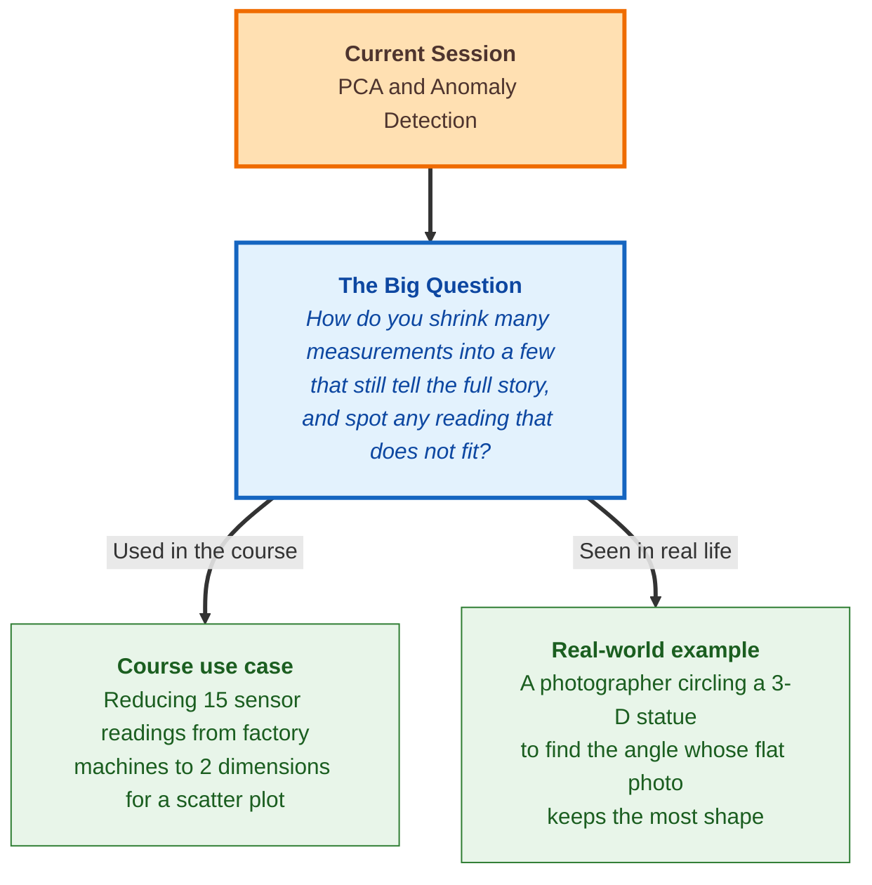

## <span style="color:#2F7DDE">PCA and Anomaly Detection</span>

### <span style="color:#2F7DDE">Mental Map</span>



---

### <span style="color:#2F7DDE">What You'll Learn</span>

Have you ever wondered why one angle of a statue reveals far more of its shape than another?

By the end of this session, you will be able to:

- <span style="color:#D9660B">**Describe**</span> how two directions can keep most of the shape information in a dataset.
- <span style="color:#D9660B">**Explain**</span> why an unusual reading is easier to separate in a few random cuts.
- <span style="color:#D9660B">**Apply**</span> projection to shrink a 10-column dataset down to 2 summary columns.
- <span style="color:#D9660B">**Use**</span> an outlier-spotter to mark any row that stands apart from the rest.
- <span style="color:#D9660B">**Justify**</span> picking 3 summary directions by reading a shape-kept curve.

> <span style="color:#2F7DDE">**Topics you will meet:**</span> PCA projection; reducing to components; choosing component count; isolation forest idea; flagging anomalies.
>
> Join the session to learn each of these in detail.

---

### <span style="color:#2F7DDE">Why You Are Learning This Topic</span>

A photographer walks a full circle around a large marble figure.

The statue has three dimensions but a flat photo captures only two.

From most angles, the shots look nearly the same.

One angle shows the widest spread of curves and depth.

A <span style="color:#D9660B">**principal direction**</span> means the viewing angle that keeps the most variation in what you see.

In machine learning, a dataset often has tens of columns, not three.

Finding the most informative directions is the same task.

> <span style="color:#2F7DDE">**Think about it:**</span> Which two shots from a full circle would best show a stranger the statue's shape?

---

### <span style="color:#2F7DDE">The Sculpture Puzzle</span>

Five shots of the same marble figure, each measured three ways.

| Angle | Width (px) | Height (px) | Depth (px) |
|:------|:----------:|:-----------:|:----------:|
| Front (0°) | 310 | 820 | 45 |
| Side (90°) | 120 | 830 | 295 |
| Back (180°) | 305 | 818 | 42 |
| Three-quarter (45°) | 285 | 795 | 198 |
| Upward tilt (−30°) | 2 | 150 | 1 |

<span style="color:#D9660B">**What you want to happen:**</span>

- Find the two directions that keep the most shape information from all five shots.
- Decide how few directions you need before losing detail.
- Flag the one photo that looks nothing like the other four.

Here is how it might start. You do not need to understand it yet.

```python
from sklearn.decomposition import PCA
pca = PCA(n_components=2)
components = pca.fit_transform([[310,820,45],[120,830,295],[305,818,42],[285,795,198],[2,150,1]])
```

> <span style="color:#D9660B">**Wonder about this:**</span>
>
> - The front and back shots share almost the same numbers. Does one add new information?
> - The upward-tilt shot looks completely different. Is the statue unusual, or is that angle?

---

### <span style="color:#2F7DDE">Think It Through</span>

There is no wrong first try. Keep your guesses for the session.

**1. The front and back shots have almost identical measurements. What does that say about how much either one adds?**
Hint: Think about angles that show something the others do not.

**2. The upward-tilt photo has numbers far outside the other four. How might a system spot that automatically?**
Hint: Think about which photos are easiest to cut away.

**3. If you kept only two measurement columns, how would you pick which two to drop?**
Hint: Think about which column changes least.

---

### <span style="color:#2F7DDE">One Question to Carry Into the Session</span>

> <span style="color:#2F7DDE">**Can a small number of directions keep almost all of a dataset's story?**</span>
>
> If one row stands apart, is there a quick way to find it without scanning everything?
