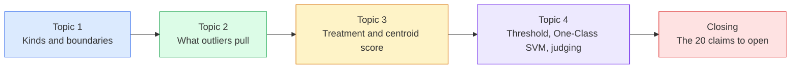
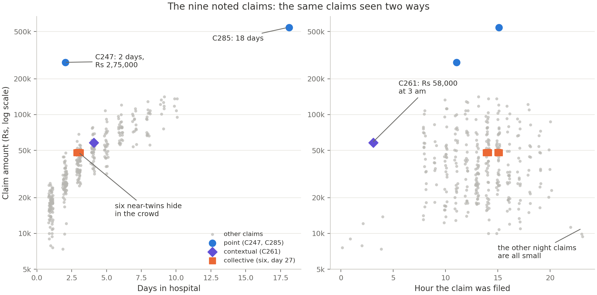
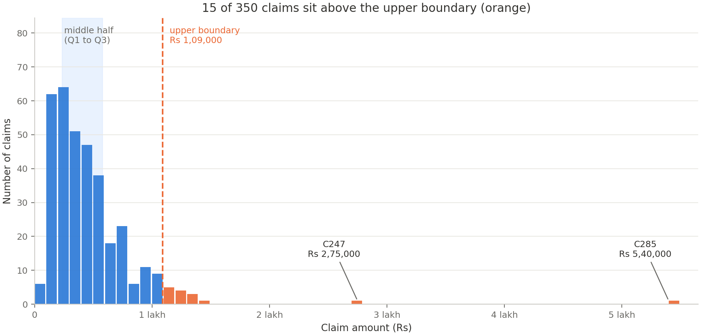
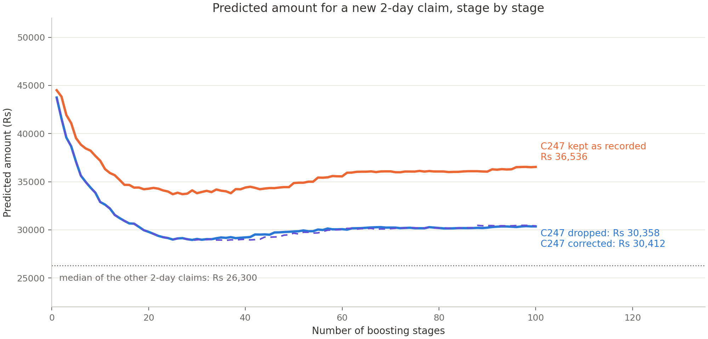
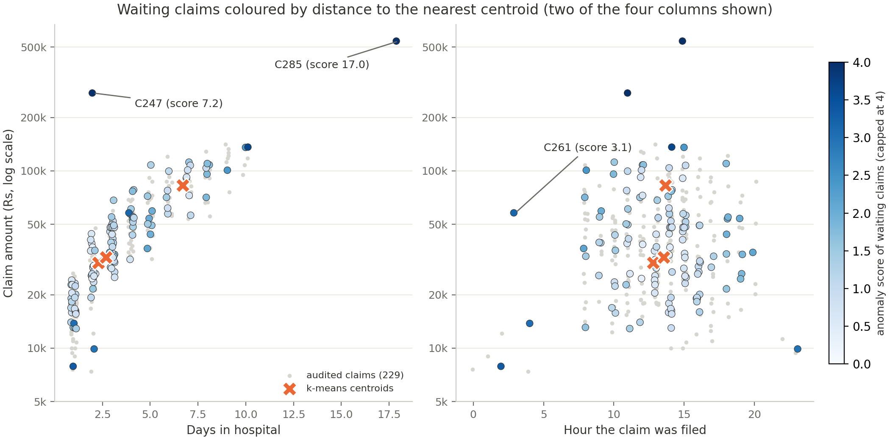
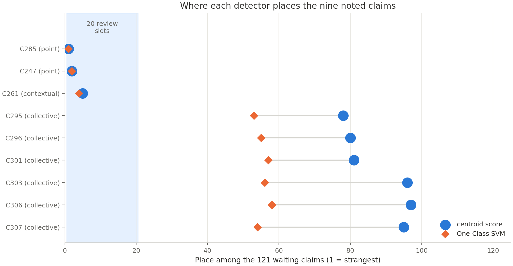
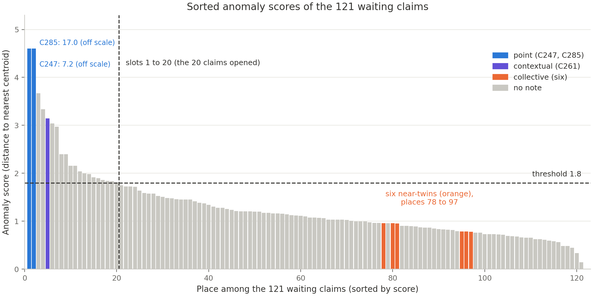

# <font color='#1d4ed8'>Lecture Script: Anomaly Detection: Kinds of Anomaly, Outliers & One-Class SVM</font>

---

## <font color='blue'>Agenda</font>

The lecture runs as four topics. Each topic ends with a quiz.

| Topic | What we do | Learning objectives covered | Minutes |
|:-:|:--|:--|:-:|
| 1 | Name the kind of anomaly and draw the outlier boundaries | Classify an anomaly as a point, contextual or collective anomaly<br>Compute outlier boundaries for a numeric column using the interquartile-range rule | 25 |
| 2 | Measure what the outliers do to an average and to a boosted model | Analyze the change in a summary statistic caused by removing flagged outliers<br>Explain why boosted trees are sensitive to mislabelled rows and outliers | 20 |
| 3 | Treat each flagged claim by its cause, then score every claim by its distance from normal | Select an outlier treatment — remove, cap or retain — justifying by the value's cause and downstream use<br>Compute an anomaly score from a record's distance to its nearest cluster centroid | 30 |
| 4 | Fit the threshold to 20 review slots, add a One-Class SVM and judge both without labels | Select an anomaly threshold that fits a stated review capacity, justifying the anomalies missed | 30 |
| — | Closing: Outcome & Summary | | 15 |
| | **Total** | | **120** |

> <font color="red">**🎯 Instructor Note**</font> Pace: the centroid score in Topic 3 and the threshold in Topic 4 are what learners will use at work, so give them the most time. In Topic 2 keep the change in the mean quick and the boosted-tree part to one idea: the biggest error pulls the next tree.
> Topic 1 is quick naming and one formula; the three-lens check on the auditor's nine claims is the heart of it.

---

## <font color='blue'>Scenario</font>

A Star Health-style health insurer pays hospital claims, and its claims team can read and verify only **20 claims a day**. Today's file holds the last 30 days of claims. The 229 claims from days 1 to 20 have already been audited and paid. The 121 claims from days 21 to 30 are still waiting. Each row has the claim amount, the days in hospital, the day and hour the claim was filed, and the number of claims the policyholder has made this month.

**The risk:** the team must pick 20 of the 121 waiting claims. If the 20 are chosen badly, a wrong amount is paid, a genuine large claim is delayed while a family waits, and the claims nobody opens go through unchecked.

> <font color="red">**🎯 Instructor Note**</font> Star Health is only the setting. Do not claim it uses this data or these methods; the 350 claims in `data/claims.csv` are invented for teaching.
> Outputs come from Python 3, pandas 3.0.1, numpy 2.4.4 and scikit-learn 1.8.0; other versions may differ in the last digit. Every model uses `random_state=42`.

---

## <font color='blue'>Problem Statement</font>

Meera, a claims analyst, had 20 slots and 121 waiting claims. She sorted the waiting claims by amount and opened the 20 largest. The largest was a genuine 18-day stay of Rs 5,40,000, which she held for a week while the family waited. The second was a hospital bill of Rs 27,500 that had been typed as Rs 2,75,000, with one zero too many. The other 18 slots went to the next-largest amounts.

A claim of Rs 58,000 filed at 3 am and a run of six near-identical claims on one day were not among the 20 largest. Nobody opened them.

> <font color='purple'>**How do we find the claims worth a person's time, decide what to do with extreme values, and fit the check to 20 slots a day?**</font>

> <font color="red">**🎯 Instructor Note**</font> Poll: "You can open only 20 of the 121 waiting claims. Would you open the 20 largest amounts, or choose another way?" Give learners 30 seconds to respond in chat.
> Reveal the answer in the Closing.

---

## <font color='blue'>What We Will Use</font>

Four groups of tools, one per topic. Each topic explains its tools where they are first used.

| Topic | Tools | In one line |
|:-:|:--|:--|
| 1 | `quantile`, the IQR rule | Name the kind of anomaly, then draw the lower and upper boundary of a column |
| 2 | `mean`, `median`, `GradientBoostingRegressor` | See what removing outliers does to a summary number, and what a wrong amount does to a boosted model |
| 3 | `clip`, `StandardScaler`, `KMeans`, `transform` | Choose remove, cap or retain by cause and use, then score each claim by its distance to the nearest centroid |
| 4 | `OneClassSVM`, ranking, top-20 lists | Choose a threshold for 20 slots, add a second detector and judge both without labels |

---

## <font color='blue'>How: Walking Through the Claims Queue</font>



---

## <font color='blue'>Topic 1: Name the Kind of Anomaly and Draw the Outlier Boundaries</font> `25 min`

Last session you used an isolation forest to flag anomalous records. It gave you a list, but a list does not say how each record is odd, and the kind of oddness decides what to do about it.

> <font color='purple'>**An auditor has put a note on nine of the waiting claims, saying only "odd". Is every odd claim odd in the same way?**</font>

### <font color='green'>Example: look at the file</font>

> <font color='purple'>**What does one row of the file hold, and how many rows are there?**</font>

**Predict before running: What will happen?**

> <font color="red">**🎯 Instructor Note**</font> Expected: 350 rows and 6 columns, with `claim_id` counted as a column. Common guess: 5 columns, forgetting the id.

```python
import numpy as np
import pandas as pd

claims = pd.read_csv("data/claims.csv")
print(claims.shape)
print(claims.head(5).to_string(index=False))
```

**Output**

```
(350, 6)
claim_id  claim_day  amount_inr  hospital_days  filed_hour  claims_this_month
    C001          1       25000              2          13                  1
    C002          1       57600              6           8                  1
    C003          1       41300              3          12                  1
    C004          1       12300              1          10                  1
    C005          2       40700              3          13                  2
```

#### <font color='#c2410c'>Code Explanation</font>

- **Lines 1 and 2** Load numpy and pandas.
- **Line 4** Reads the claims file into a table called `claims`.
- **Line 5** Prints the size as (rows, columns).
- **Line 6** Shows the first 5 claims without the row numbers.

> <font color='green'>**Result**</font> Each row is one claim. The first 229 rows are the claims filed on days 1 to 20 and the rest are the waiting claims, because the ids follow the filing day.


### <font color='green'>Example: three kinds of anomaly, three lenses</font>

> <font color='purple'>**What are the kinds of anomaly, and how do we tell which one a claim is?**</font>

An **anomaly** is a record that does not fit the pattern of the rest. It can fail to fit in three different ways.

| Kind | Meaning | The question to ask |
|:--|:--|:--|
| **Point** | One record is unusual by itself, far from all the others | Does its value stand out on its own? |
| **Contextual** | The record looks ordinary by itself, but is unusual for its context, such as the time it arrived | Does it stand out among records in the same context? |
| **Collective** | Each record looks ordinary, but the group of records together is unusual | Does it belong to a group of near-identical records? |

The auditor noted three single claims, C247, C285 and C261, and six claims from day 27, C295, C296, C301, C303, C306 and C307. We test each with the three questions, one lens at a time. **Lens 1: does the amount stand out on its own?** We rank every amount from 0 to 1, where 1 is the largest.

**Predict before running: What will happen?**

> <font color="red">**🎯 Instructor Note**</font> Expected: C247 and C285 near 1.0 (the two largest amounts). C261 and the six are in the middle of the pack. Ask: "Which of the nine look odd on this lens?"

```python
run = ["C295", "C296", "C301", "C303", "C306", "C307"]
noted = ["C247", "C285", "C261"] + run
pct = claims.set_index("claim_id").amount_inr.rank(pct=True)
print(pct[noted].round(3).to_string())
```

**Output**

```
claim_id
C247    0.997
C285    1.000
C261    0.757
C295    0.634
C296    0.626
C301    0.619
C303    0.626
C306    0.619
C307    0.634
```

#### <font color='#c2410c'>Code Explanation</font>

- **Lines 1 and 2** The auditor's nine claim ids: the six from day 27, then all nine.
- **Line 3** Turns each amount into its position between 0 and 1 among all 350 amounts.
- **Line 4** Prints that position for the nine noted claims.

> <font color='green'>**Result**</font> C285 and C247 hold the top two places (1.0 and 0.997), so they stand out on their own. The other seven sit between 0.619 and 0.757, which is ordinary on this lens.


### <font color='green'>Extending it: does the claim stand out among claims filed at the same hour?</font>

> <font color='purple'>**C261 has an ordinary amount. What if we compare it only with claims filed from 10 pm to 5:59 am?**</font>

> <font color="red">**🎯 Instructor Note**</font> Ask for a prediction first: "How big is the largest other night claim?" Give learners 30 seconds to respond in chat. Expected: far below Rs 58,000.

```python
night = claims[(claims.filed_hour >= 22) | (claims.filed_hour <= 5)]
ranked = night.sort_values("amount_inr", ascending=False)
print(len(night), "claims filed from 10 pm to 5:59 am")
print(ranked[["claim_id", "amount_inr", "filed_hour"]].head(4).to_string(index=False))
```

**Output**

```
10 claims filed from 10 pm to 5:59 am
claim_id  amount_inr  filed_hour
    C261       58000           3
    C256       13800           4
    C038       12100           2
    C055       11300          22
```

#### <font color='#c2410c'>Code Explanation</font>

- **Line 1** Keeps the claims filed at hour 22 or later, or at hour 5 or earlier.
- **Line 2** Sorts them from the largest amount down.
- **Line 3** Prints how many night claims there are.
- **Line 4** Shows the four largest night claims.

> <font color='green'>**Result**</font> Among the 10 night claims, C261 asks for Rs 58,000 while the next largest asks for Rs 13,800. The amount is ordinary overall, but it is unusual for a claim filed at 3 am.


### <font color='green'>Extending it: does the claim belong to a group of near-twins?</font>

> <font color='purple'>**What if we count, for every claim, how many other claims have the same filing day, the same days in hospital and an amount within Rs 200?**</font>

> <font color="red">**🎯 Instructor Note**</font> Expected: six claims with the same large count and every other claim with 0 or 1. Ask: "How many twins will each of the six have?"

```python
pairs = claims.merge(claims, on=["claim_day", "hospital_days"])
close = (pairs.amount_inr_x - pairs.amount_inr_y).abs() <= 200
pairs = pairs[close & (pairs.claim_id_x != pairs.claim_id_y)]
twins = pairs.groupby("claim_id_x").size()
print(twins.sort_values(ascending=False, kind="stable").head(8).to_string())
```

**Output**

```
claim_id_x
C295    5
C296    5
C301    5
C303    5
C306    5
C307    5
C014    1
C018    1
```

#### <font color='#c2410c'>Code Explanation</font>

- **Line 1** Pairs every claim with every claim that has the same filing day and the same days in hospital.
- **Line 2** Marks the pairs whose amounts differ by at most Rs 200.
- **Line 3** Keeps those pairs, dropping a claim paired with itself.
- **Line 4** Counts the twins of each claim.
- **Line 5** Prints the eight claims with the most twins.

> <font color='green'>**Result**</font> Each of the six day-27 claims has 5 twins, and no other claim has more than 1. No single one of the six is unusual, but together they are.


### <font color='green'>Extending it: put the three lenses together</font>

> <font color='purple'>**Which kind is each of the nine noted claims?**</font>

#### <font color='#c2410c'>Logic Explanation</font>

| Claim | Lens 1: amount alone | Lens 2: same hour | Lens 3: near-twins | Kind |
|:--|:--|:--|:--|:--|
| C285 | the largest amount | not needed | none | **Point** |
| C247 | the second largest amount | not needed | none | **Point** |
| C261 | ordinary (0.757) | far above the other night claims | none | **Contextual** |
| The six on day 27 | ordinary (0.619 to 0.634) | not unusual | 5 twins each | **Collective** |

> <font color='green'>**Result**</font> C285 and C247 are point anomalies, C261 is a contextual anomaly and the six claims on day 27 are one collective anomaly. A kind says how a record stands out. It does not say whether the record is wrong.

> <font color='#b45309'>**Common mistake**</font> Treating "anomaly" as "error". C285 and C247 are both point anomalies, yet one is a genuine stay and the other is a typing slip. The kind tells you where to look; the cause tells you what to do.


<p align="center"></p>

### <font color='green'>Example: where does the ordinary range of amounts end?</font>

> <font color='purple'>**Can one rule, written as a formula, mark the amounts that sit far outside the middle of the column?**</font>

The **interquartile-range (IQR) rule** looks at the middle half of the column. $Q_1$ is the amount that 25% of the claims fall below, and $Q_3$ is the amount that 75% fall below. pandas finds them by interpolating between the two nearest amounts. The **IQR** is the distance between them. The rule draws a boundary 1.5 IQRs beyond each end:

$$\boxed{\text{lower} = Q_1 - 1.5 \times \text{IQR}, \qquad \text{upper} = Q_3 + 1.5 \times \text{IQR}, \qquad \text{IQR} = Q_3 - Q_1}$$

The 1.5 is a common convention, not a law of nature. A value outside the boundaries is flagged. A flag is a reason to look, not a verdict.

**Predict before running: What will happen?**

> <font color="red">**🎯 Instructor Note**</font> Expected: an upper boundary near Rs 1.09 lakh and a negative lower boundary, so only large amounts are flagged. Common guess: learners expect flags on both sides.

```python
q1, q3 = claims.amount_inr.quantile([0.25, 0.75])
iqr = q3 - q1
lower, upper = q1 - 1.5 * iqr, q3 + 1.5 * iqr
print(q1, q3, iqr)
print(lower, upper)
flag = claims[(claims.amount_inr < lower) | (claims.amount_inr > upper)]
print(len(flag), "claims outside the boundaries")
```

**Output**

```
23250.0 57550.0 34300.0
-28200.0 109000.0
15 claims outside the boundaries
```

#### <font color='#c2410c'>Code Explanation</font>

- **Line 1** Finds $Q_1$ and $Q_3$ of the amount column.
- **Line 2** The IQR is $Q_3 - Q_1$.
- **Line 3** Moves 1.5 IQRs below $Q_1$ and above $Q_3$.
- **Lines 4 and 5** Print the quartiles, the IQR and the two boundaries.
- **Lines 6 and 7** Keep the claims outside the boundaries and count them.

> <font color='green'>**Result**</font> By hand: $Q_1 = 23250$, $Q_3 = 57550$, so $\text{IQR} = 57550 - 23250 = 34300$. The upper boundary is $57550 + 1.5 \times 34300 = 109000$ and the lower boundary is $23250 - 1.5 \times 34300 = -28200$. The lower boundary is below zero, and no claim can be, so nothing is flagged low. The rule flags 15 of 350 claims, all above Rs 1,09,000.


<p align="center"></p>

### <font color='green'>Extending it: which claims are flagged?</font>

> <font color='purple'>**Are all 15 flagged claims the typing slip and the genuine stay?**</font>

```python
cols = ["claim_id", "claim_day", "amount_inr", "hospital_days"]
print(flag.sort_values("amount_inr", ascending=False)[cols].to_string(index=False))
```

**Output**

```
claim_id  claim_day  amount_inr  hospital_days
    C285         26      540000             18
    C247         22      275000              2
    C199         18      141400              9
    C288         26      136200             10
    C268         24      135700             10
    C126         12      133100              9
    C152         14      128800              8
    C148         14      126500              9
    C054          5      121600              9
    C220         20      120200              6
    C208         19      117900             10
    C079          7      117800              9
    C068          6      112100              9
    C304         27      112000              7
    C349         30      110000              8
```

> <font color='green'>**Result**</font> Two flagged claims, C285 and C247, are far above the rest. The other 13 are between Rs 1,10,000 and Rs 1,41,400, and all of them have stays of 6 to 10 days. A flag only says "far from the middle".


### <font color='green'>Extending it: how many of the auditor's nine does the rule catch?</font>

> <font color='purple'>**Does a rule on the amount column see the contextual claim and the collective run?**</font>

> <font color="red">**🎯 Instructor Note**</font> Ask: "How many of the nine will the amount rule flag?" Give learners 30 seconds to respond in chat. Expected: 2 of 9.

```python
hit = flag.claim_id[flag.claim_id.isin(noted)].tolist()
print(hit)
print(sorted(set(noted) - set(hit)))
```

**Output**

```
['C247', 'C285']
['C261', 'C295', 'C296', 'C301', 'C303', 'C306', 'C307']
```

> <font color='green'>**Result**</font> The rule on one column flags 2 of the 9 noted claims, the two point anomalies. It cannot see C261, whose amount is ordinary, or the six near-twins, whose amounts are each ordinary. Context and groups need other tools.

### <font color='green'>Extending it: the same rule on days in hospital</font>

> <font color='purple'>**Does the rule work the same way on a second column?**</font>

```python
d1, d3 = claims.hospital_days.quantile([0.25, 0.75])
d_up = d3 + 1.5 * (d3 - d1)
print(d1, d3, d_up)
print((claims.hospital_days > d_up).sum(), "claims above the upper boundary")
```

**Output**

```
2.0 5.0 9.5
6 claims above the upper boundary
```

> <font color='green'>**Result**</font> For days in hospital $Q_1 = 2$ and $Q_3 = 5$, so the upper boundary is $5 + 1.5 \times 3 = 9.5$ days. Any stay of 10 days or more is flagged, 6 claims in all. The rule is the same; each column gets its own boundaries.


### <font color='purple'>Quiz 1</font>

**Question:** Another hospital group's claim amounts have $Q_1$ = Rs 20,000 and $Q_3$ = Rs 44,000. What is the upper boundary of the IQR rule?

**Options:**
- A) Rs 68,000
- B) Rs 80,000
- C) Rs 66,000
- D) Rs 1,16,000

**Correct Answer:** B

**Explanation:**
- **A)** Wrong. This adds one IQR (24,000) to $Q_3$ instead of 1.5 IQRs.
- **B)** Correct. $\text{IQR} = 44{,}000 - 20{,}000 = 24{,}000$, so the upper boundary is $44{,}000 + 1.5 \times 24{,}000 = 80{,}000$.
- **C)** Wrong. This multiplies $Q_3$ by 1.5 (44,000 × 1.5) instead of adding 1.5 IQRs to it.
- **D)** Wrong. This adds 3 IQRs to $Q_3$ (44,000 + 72,000), not the 1.5 of the standard rule.


---


## <font color='blue'>Topic 2: Measure What the Outliers Do</font> `20 min`

In the boosting sessions you saw that each new tree is fitted to the errors the earlier trees left, and that AdaBoost raises the weight of the examples it gets wrong. Both ideas matter once a few extreme rows are in the data.

> <font color='purple'>**The rule flagged 15 claims. If the team deletes them before reporting the average claim, what moves, and what happens to a boosted model that trains on them?**</font>

### <font color='green'>Example: remove the flagged claims and watch the average</font>

> <font color='purple'>**How much do the mean and the median amount change when the 15 flagged claims are taken out?**</font>

**Predict before running: What will happen?**

> <font color="red">**🎯 Instructor Note**</font> Ask: "Which falls by the larger percentage, the mean or the median?" Give learners 30 seconds to respond in chat. Expected: the mean, by about twice as much.

```python
clean = claims[~claims.claim_id.isin(flag.claim_id)]
rows = []
for stat in ["mean", "median"]:
    b = getattr(claims.amount_inr, stat)()
    a = getattr(clean.amount_inr, stat)()
    rows.append([stat, round(b), round(a), round(a - b), round((a - b) / b * 100, 1)])
cols = ["statistic", "all 350", "flagged out", "change", "change %"]
print(pd.DataFrame(rows, columns=cols).to_string(index=False))
```

**Output**

```
statistic  all 350  flagged out  change  change %
     mean    46821        41668   -5152     -11.0
   median    37550        35600   -1950      -5.2
```

#### <font color='#c2410c'>Code Explanation</font>

- **Line 1** Keeps the claims that are not in the flagged list.
- **Lines 3 to 6** For the mean and then the median, compute the value on all claims (`b`, before) and on the kept claims (`a`, after), and store the change in rupees and in percent.
- **Lines 7 and 8** Label the columns and print the small table.

#### <font color='#c2410c'>Logic Explanation</font>

- The mean is $\bar{x} = \frac{1}{n}\sum x_i$, so every rupee of every claim is in it. A very large claim adds its full size.
- The median is only the middle position of the sorted amounts. Taking 15 claims off the top moves that middle down by about half as many places, so it changes less.

> <font color='green'>**Result**</font> The 15 flagged claims are 4.3% of the rows, yet removing them lowers the mean by Rs 5,152 (11.0%) and the median by Rs 1,950 (5.2%). The mean is the statistic that outliers pull hardest.


### <font color='green'>Extending it: which flagged claims do the pulling?</font>

> <font color='purple'>**What does the mean do if we remove only C247, only C285, both, or every flagged claim?**</font>

The mean after dropping one value $x$ from $n$ values is $\bar{x}_{\text{new}} = \dfrac{n\bar{x} - x}{n - 1}$. Subtracting $\bar{x}$ gives the change:

$$\boxed{\bar{x}_{\text{new}} - \bar{x} = \frac{\bar{x} - x}{n - 1}}$$

The further $x$ is above the mean, the more the mean falls.

```python
m = claims.amount_inr.mean()
cases = [("C247 only", ["C247"]), ("C285 only", ["C285"]),
         ("both", ["C247", "C285"]), ("all flagged", flag.claim_id)]
for label, ids in cases:
    kept = claims[~claims.claim_id.isin(ids)]
    print(f"{label:12} {kept.amount_inr.mean() - m:8.0f}")
```

**Output**

```
C247 only        -654
C285 only       -1413
both            -2073
all flagged     -5152
```

#### <font color='#c2410c'>Code Explanation</font>

- **Line 1** The mean of all 350 amounts.
- **Lines 2 and 3** Four removal cases, each with a label and the ids to drop.
- **Lines 4 to 6** For each case, keep the other claims and print how far the mean moves.

> <font color='green'>**Result**</font> By the formula, C247 alone moves the mean by $\frac{46821 - 275000}{349} = -654$ and C285 alone by $\frac{46821 - 540000}{349} = -1413$. Both together move it by Rs 2,073, and all 15 flagged claims by Rs 5,152. About 40% of that fall comes from the two extreme claims, and the rest from the other 13 flagged claims.


> <font color='#b45309'>**Common mistake**</font> Reading a lower mean as a cleaner mean. If the removed claims are genuine, taking them out makes the average claim look cheaper than the claims the insurer really pays.

### <font color='green'>Example: why does a boosted tree chase a wrong amount?</font>

> <font color='purple'>**How much of the starting error of an amount model sits in just two rows?**</font>

A gradient boosting regressor starts from the mean amount and measures its error with squared error. Each new tree is fitted to the residuals $r_i = y_i - \hat{y}_i$, the error each row still has.

$$\boxed{L = \sum_{i=1}^{n} (y_i - \hat{y}_i)^2, \qquad \text{share of row } i = \frac{r_i^2}{\sum_j r_j^2}}$$

Squaring makes a large residual count far more than a small one.

**Predict before running: What will happen?**

> <font color="red">**🎯 Instructor Note**</font> Ask: "What share of the starting squared error do C247 and C285 hold out of 350 rows?" Give learners 30 seconds to respond in chat. Expected: about half.

```python
y = claims.amount_inr
sq = (y - y.mean()) ** 2
share = sq / sq.sum() * 100
two = claims.claim_id.isin(["C247", "C285"])
print("C247 and C285:", share[two].round(1).tolist())
print("largest of the other 348:", round(share[~two].max(), 1))
print("the two together:", round(share[two].sum(), 1))
```

**Output**

```
C247 and C285: [9.1, 42.5]
largest of the other 348: 1.6
the two together: 51.6
```

#### <font color='#c2410c'>Code Explanation</font>

- **Lines 1 and 2** The squared residual of each row when the prediction is the mean amount.
- **Line 3** Each row's percent share of the total squared error.
- **Line 4** Marks the two rows C247 and C285.
- **Lines 5 to 7** Print their shares, the largest share among all other rows, and the two shares added together.

> <font color='green'>**Result**</font> Two rows of 350 hold 51.6% of the starting error, and no other row holds more than 1.6%. Under squared error, the first trees are pulled mostly towards those two rows.


### <font color='green'>Extending it: does one wrong amount move the prediction?</font>

> <font color='purple'>**What does the model predict for a new 2-day claim filed at noon by someone with one claim this month, with and without C247 in the training rows?**</font>

> <font color="red">**🎯 Instructor Note**</font> Expected: higher with C247 in. Ask: "Higher or lower, and by about how much?" Give learners 30 seconds to respond in chat.

```python
from sklearn.ensemble import GradientBoostingRegressor

X = claims[["hospital_days", "filed_hour", "claims_this_month"]]
new2 = pd.DataFrame({"hospital_days": [2], "filed_hour": [12], "claims_this_month": [1]})
def fit(X, y):
    return GradientBoostingRegressor(n_estimators=100, learning_rate=0.1, max_depth=3, random_state=42).fit(X, y)
keep = claims.claim_id != "C247"
print(round(fit(X, claims.amount_inr).predict(new2)[0]))
print(round(fit(X[keep], claims.amount_inr[keep]).predict(new2)[0]))
```

**Output**

```
36536
30358
```

#### <font color='#c2410c'>Code Explanation</font>

- **Line 3** The three input columns: days in hospital, hour filed and claims this month.
- **Line 4** One new claim to predict.
- **Lines 5 and 6** A helper that fits 100 shallow trees, each adding 10% of its correction.
- **Line 7** Marks every row except C247.
- **Line 8** Fits on all 350 rows, with the amount as recorded, and predicts the new claim.
- **Line 9** Fits on 349 rows, without C247.

> <font color='green'>**Result**</font> With the typing slip in, the model predicts Rs 36,536 for the new 2-day claim. Without it, Rs 30,358. One wrong row out of 350 lifts the prediction by Rs 6,178, about 20%.


### <font color='green'>Extending it: what if we fix the label instead?</font>

> <font color='purple'>**The bill says C247 is Rs 27,500. What does the model predict once the label is corrected?**</font>

```python
fixed = claims.amount_inr.where(claims.claim_id != "C247", 27500)
print(round(fit(X, fixed).predict(new2)[0]))
other2 = claims[(claims.hospital_days == 2) & keep]
print(other2.amount_inr.median(), len(other2))
```

**Output**

```
30412
26300.0 65
```

#### <font color='#c2410c'>Code Explanation</font>

- **Line 1** Copies the amounts and replaces C247's amount by Rs 27,500 from the bill.
- **Line 2** Fits on all 350 rows with the corrected label and predicts the same new claim.
- **Line 3** The other 2-day claims, without C247.
- **Line 4** Prints their median amount and how many there are.

> <font color='green'>**Result**</font> With the label corrected, the prediction is Rs 30,412, within Rs 54 of the prediction without the row. The 65 other 2-day claims have a median of Rs 26,300. The damage came from the wrong label, not from the claim itself.


<p align="center"></p>

#### <font color='#c2410c'>Logic Explanation</font>

- **Squared error.** A row's pull on the next tree grows with its residual. C247 has a residual of about Rs 2,28,179 while a typical row is off by tens of thousands, so it sets the direction of the early trees.
- **Stage by stage.** Each stage fits what is left. While a wrong row keeps the largest residual, every new tree adds more of it to the prediction. The chart shows the gap between the orange line and the others holding to the last stage.
- **Mislabelled rows in classification.** AdaBoost raises the weight of every example it classifies wrongly. A row with a wrong label is classified wrongly round after round, so its weight keeps rising.
- **Where the harm enters.** A tree splits on thresholds, so an extreme value in a feature column is just the last value in the order. The harm comes through the target or label: a wrong or extreme target produces a large error.
- **What helps.** A smaller learning rate, early stopping and regularisation slow the chase. They do not remove its cause, so check and fix the labels first.

> <font color='green'>**Result**</font> Boosted trees are sensitive to mislabelled rows and outliers in the target because each stage is built to shrink the biggest errors, and a wrong or extreme target is the biggest error in the file.

### <font color='purple'>Quiz 2</font>

**Question:** A gradient boosting regressor with squared error is trained on claim amounts. One claim of Rs 30,000 was typed as Rs 3,00,000. Why do the predictions for ordinary claims like it end up too high?

**Options:**
- A) The wrong amount is an extreme value, so every tree splits on it first and the split points move
- B) Each tree is trained on a bootstrap sample, and the wrong row lands in most of the samples
- C) The learning rate is too small, so the model cannot learn that the row is wrong
- D) Each stage is fitted to the errors left so far, and the wrong row keeps the largest error, so stage after stage adds part of it to similar claims

**Correct Answer:** D

**Explanation:**
- **A)** Wrong. The wrong value is in the target, not in a feature column; trees split on feature thresholds, where an extreme value is just the last in the order.
- **B)** Wrong. Bootstrap samples belong to bagging and random forests; each boosting stage is fitted to the errors of the stages before it.
- **C)** Wrong. A smaller learning rate slows the chase; it does not cause it, and no setting tells the model which label is wrong.
- **D)** Correct. Under squared error the wrong row's residual dominates, so each new tree corrects towards it and lifts the predictions for claims that share its inputs.

---


## <font color='blue'>Topic 3: Treat Each Flagged Claim by Its Cause, Then Score Every Claim by Distance</font> `30 min`

> <font color='purple'>**Topic 2 showed how hard the flagged claims pull the mean and a boosted model. Which treatment fits each flagged claim, and how do we find odd claims that no single column flags?**</font>


### <font color='green'>Example: is each flagged claim an error or a real claim?</font>

> <font color='purple'>**Before choosing remove, cap or retain, what is the cause of each flagged value?**</font>

A large amount can come from a long stay, which is real, or from a mistake. We compare each claim's amount per hospital day with the median amount per day. A ratio near 1 means the claim costs what its length of stay suggests.

**Predict before running: What will happen?**

> <font color="red">**🎯 Instructor Note**</font> The bill checks on C247 (Rs 27,500) and C285 (genuine ICU stay) are part of the invented story. Expected: C247 far above 1, C285 about 2, the rest near 1.

```python
perday = claims.amount_inr / claims.hospital_days
ratio = (perday / perday.median()).round(1)
cols = ["claim_id", "amount_inr", "hospital_days", "ratio"]
f = claims.assign(ratio=ratio)[claims.claim_id.isin(flag.claim_id)]
f = f.sort_values("amount_inr", ascending=False)
print(f[cols].head(4).to_string(index=False))
print(f.ratio.iloc[2:].max(), "= largest ratio among the other 13")
```

**Output**

```
claim_id  amount_inr  hospital_days  ratio
    C285      540000             18    2.3
    C247      275000              2   10.4
    C199      141400              9    1.2
    C288      136200             10    1.0
1.5 = largest ratio among the other 13
```

#### <font color='#c2410c'>Code Explanation</font>

- **Lines 1 and 2** The amount per day of stay, divided by the median amount per day, rounded to 1 decimal.
- **Line 3** The columns to show.
- **Lines 4 and 5** Keep the flagged claims only and sort them from the largest amount down.
- **Line 6** Prints the top four.
- **Line 7** Prints the largest ratio among the flagged claims after the first two.

> <font color='green'>**Result**</font> C247 costs 10.4 times the usual amount per day: a 2-day stay at Rs 1,37,500 a day, and the bill says Rs 27,500, so it is a recording error. C285 costs 2.3 times the usual per day, but it is an 18-day stay and its bill matches, so it is real. The other 13 flagged claims have ratios of 1.5 or less, so their amounts follow their stays.


### <font color='green'>Example: remove, cap or retain, by cause and by use</font>

> <font color='purple'>**What do the three treatments do to the numbers, and which one fits each flagged claim?**</font>

- **Remove** drops the value from the calculation.
- **Cap** clips the value at the upper boundary, so the claim stays but its size is limited.
- **Retain** keeps the value as it is.

**Predict before running: What will happen?**

> <font color="red">**🎯 Instructor Note**</font> Expected: "retain" has the largest total and mean, "remove" the smallest. Ask: "Which total is closest to what the insurer truly owes?" Expected: none exactly; the answer needs the cause of each claim.

```python
amt = claims.amount_inr
is_flag = claims.claim_id.isin(flag.claim_id)
views = {"retain": amt, "cap": amt.clip(upper=upper), "remove": amt[~is_flag]}
for name, s in views.items():
    print(f"{name:7} total {s.sum():>10,.0f}  mean {s.mean():>7,.0f}  median {s.median():>7,.0f}")
```

**Output**

```
retain  total 16,387,200  mean  46,821  median  37,550
cap     total 15,593,900  mean  44,554  median  37,550
remove  total 13,958,900  mean  41,668  median  35,600
```

#### <font color='#c2410c'>Code Explanation</font>

- **Line 1** The amount column.
- **Line 2** Marks the flagged claims.
- **Line 3** Three versions of the column: as it is, clipped at the upper boundary, and without the flagged claims.
- **Lines 4 and 5** Print each version's total, mean and median.

Now we choose by cause and by use. Two uses of the amount column differ: the **reserve**, the total the insurer sets aside to pay these claims, and a **boosted model** of the claim amount.

| Flagged claim | Cause | Use 1: reserve | Use 2: boosted model of amount |
|:--|:--|:--|:--|
| C247 | Recording error; the bill says Rs 27,500 | Correct it to Rs 27,500 from the bill; if the bill is not available, remove it | Remove the row, or correct the label |
| C285 | Real 18-day stay, bill matches | Retain: the money is owed | Cap: one real row with no peers, so limit its pull. This is a judgement call |
| The other 13 long stays | Real; amounts follow the stay length | Retain | Retain: they follow the pattern |

> <font color='green'>**Result**</font> Retaining everything counts C247 at Rs 2,75,000 when the bill says Rs 27,500. For the reserve, the right total is $16387200 - 275000 + 27500 = 16139700$. Capping every flagged claim leaves the total Rs 5,45,800 short, and removing every flagged claim leaves it Rs 21,80,800 short. The cause of each value, and what the number is used for, decide the treatment; the IQR rule does not.


> <font color='#b45309'>**Common mistake**</font> Capping a typing slip. The capped value, Rs 1,09,000, is still a wrong number. Correct a value from its source when you can, and remove it when you cannot.

In the clustering session you fitted k-means and read its centroids. In the kNN and SVM session you saw that distance-based methods need columns on a common scale, and earlier you fitted a scaler on the training rows only. We use all three ideas now.

### <font color='green'>Example: learn where normal claims live</font>

> <font color='purple'>**The IQR rule looks at one column at a time. Where are the centres of the audited claims, once amount, days, hour and claim count are on one scale?**</font>

The 229 audited claims from days 1 to 20 are our picture of normal. We fit the scaler and k-means on them only, and score the 121 waiting claims against that picture. This assumes the audited claims are mostly ordinary. If odd claims hide among them, normal looks wider than it is.

**Predict before running: What will happen?**

> <font color="red">**🎯 Instructor Note**</font> Expected: 229 audited and 121 waiting claims; three cluster sizes that add up to 229. Ask: "What would one centroid look like?" Expected: a typical claim, such as a short, cheap stay.

```python
from sklearn.preprocessing import StandardScaler
from sklearn.cluster import KMeans

feat = ["amount_inr", "hospital_days", "filed_hour", "claims_this_month"]
ref, new = claims[claims.claim_day <= 20], claims[claims.claim_day > 20]
scaler = StandardScaler().fit(ref[feat])
km = KMeans(n_clusters=3, n_init=10, random_state=42).fit(scaler.transform(ref[feat]))
print(len(ref), len(new), np.bincount(km.labels_))
print(pd.DataFrame(scaler.inverse_transform(km.cluster_centers_), columns=feat).round(1).to_string())
```

**Output**

```
229 121 [113  60  56]
   amount_inr  hospital_days  filed_hour  claims_this_month
0     30278.8            2.3        12.8                1.0
1     82906.7            6.7        13.6                1.2
2     32560.7            2.7        13.6                2.4
```

#### <font color='#c2410c'>Code Explanation</font>

- **Line 4** The four columns used to describe a claim.
- **Line 5** Splits the claims: audited (days 1 to 20) and waiting (days 21 to 30).
- **Line 6** Learns each column's mean and spread from the audited claims only.
- **Line 7** Fits k-means with 3 clusters on the scaled audited claims.
- **Line 8** Prints the sizes of the 3 clusters.
- **Line 9** Converts the centroids back to rupees, days, hours and counts so we can read them.

> <font color='green'>**Result**</font> The three centroids are three typical claims. One is about Rs 30,279 for 2.3 days, one is about Rs 82,907 for 6.7 days and one is about Rs 32,561 for 2.7 days from a policyholder with about 2.4 claims this month. Every filing hour is near 13, in the working day.


### <font color='green'>Example: the score of one claim, by hand</font>

> <font color='purple'>**How far is claim C261 from its nearest centroid?**</font>

Each column is scaled as $x_j = (v_j - \mu_j)/\sigma_j$, with $\mu_j$ and $\sigma_j$ from the audited claims. The **anomaly score** of a claim is its straight-line distance to the nearest centroid $c_k$:

$$\boxed{\text{score}(x) = \min_{k}\ \lVert x - c_k \rVert = \min_{k}\sqrt{\sum_{j=1}^{4}\left(x_j - c_{kj}\right)^2}}$$

A larger score means the claim is further from every typical claim.

**Predict before running: What will happen?**

> <font color="red">**🎯 Instructor Note**</font> Ask: "Which of the three centroids is nearest to C261, and is the score above or below 1?" Give learners 30 seconds to respond in chat. Expected: the first (cheap, short stay) centroid; above 1, because 3 am is far from every centroid.

```python
x = scaler.transform(claims.loc[claims.claim_id == "C261", feat])
print(x.round(2))
d = np.sqrt(((x - km.cluster_centers_) ** 2).sum(axis=1))
print(d.round(2), d.argmin())
print(round(d.min(), 3))
```

**Output**

```
[[ 0.48  0.19 -3.02 -0.59]]
[3.14 3.48 3.91] 0
3.144
```

#### <font color='#c2410c'>Code Explanation</font>

- **Line 1** Takes C261's four values and scales them with the audited claims' mean and spread.
- **Line 2** Prints the four scaled values.
- **Line 3** Subtracts each centroid from the claim, squares, adds the four squares and takes the square root, once per centroid. That is the formula above.
- **Line 4** Prints the three distances and the number of the nearest centroid.
- **Line 5** The smallest distance is the score.

| Column | Scaled value $x_j$ | Nearest centroid $c_{kj}$ | $(x_j - c_{kj})^2$ |
|:--|:-:|:-:|:-:|
| amount | 0.48 | -0.51 | 0.97 |
| days in hospital | 0.19 | -0.53 | 0.53 |
| hour filed | -3.02 | -0.12 | 8.38 |
| claims this month | -0.59 | -0.59 | 0.0 |

> <font color='green'>**Result**</font> The squares add to $9.88$, and $\sqrt{9.88} = 3.14$. The hour column supplies almost all of it: 3 am is $3.02$ standard deviations from the typical filing hour. C261's score is 3.14.


### <font color='green'>Example: score every waiting claim</font>

> <font color='purple'>**What are the scores of all 121 waiting claims, and which claims score highest?**</font>

`km.transform` gives each claim's distance to every centroid. The smallest of the three is the score.

```python
Xn = scaler.transform(new[feat])
new = new.assign(score=km.transform(Xn).min(axis=1))
new = new.assign(place=new.score.rank(ascending=False, method="first").astype(int))
cols = ["place", "claim_id", "amount_inr", "hospital_days", "filed_hour", "score"]
print(new.sort_values("place")[cols].head(8).round(2).to_string(index=False))
```

**Output**

```
 place claim_id  amount_inr  hospital_days  filed_hour  score
     1     C285      540000             18          15  16.97
     2     C247      275000              2          11   7.17
     3     C288      136200             10          14   3.67
     4     C322        7900              1           2   3.33
     5     C261       58000              4           3   3.14
     6     C256       13800              1           4   3.04
     7     C255        9900              2          23   2.97
     8     C262      100900              9           8   2.40
```

#### <font color='#c2410c'>Code Explanation</font>

- **Line 1** Scales the waiting claims with the audited claims' mean and spread.
- **Line 2** For each claim, takes the smallest of its three distances as the score.
- **Line 3** Gives place 1 to the highest score, place 2 to the next, and so on; two equal scores get consecutive places.
- **Lines 4 and 5** Print the eight highest-scoring claims.

> <font color='green'>**Result**</font> C285 scores 16.97 and C247 scores 7.17, far above the rest. C261 is in place 5 with 3.14, matching the hand calculation. The list also holds claims nobody has noted, such as place 4, a Rs 7,900 claim filed at hour 2.


### <font color='green'>Extending it: where do the auditor's nine claims land?</font>

> <font color='purple'>**Does a score from four columns see the kinds of anomaly that the amount rule missed?**</font>

> <font color="red">**🎯 Instructor Note**</font> Ask: "Which of the nine will still rank low?" Give learners 30 seconds to respond in chat. Expected: the six near-twins.

```python
print(new.set_index("claim_id").loc[noted, ["place", "score"]].round(2).to_string())
```

**Output**

```
          place  score
claim_id              
C247          2   7.17
C285          1  16.97
C261          5   3.14
C295         78   0.96
C296         80   0.96
C301         81   0.95
C303         96   0.78
C306         97   0.78
C307         95   0.79
```

> <font color='green'>**Result**</font> The two point anomalies take places 1 and 2. C261, the contextual claim, takes place 5 because hour 3 is one of the four columns. The six day-27 claims take places 78 to 97 of 121. Each one sits among ordinary claims, so a distance to a centroid cannot see that they are a group.


### <font color='green'>Extending it: why three clusters?</font>

> <font color='purple'>**Which number of clusters does the silhouette score prefer on the audited claims?**</font>

```python
from sklearn.metrics import silhouette_score

Xr = scaler.transform(ref[feat])
for k in range(2, 7):
    labels = KMeans(n_clusters=k, n_init=10, random_state=42).fit_predict(Xr)
    print(k, round(silhouette_score(Xr, labels), 3))
```

**Output**

```
2 0.346
3 0.349
4 0.309
5 0.267
6 0.287
```

> <font color='green'>**Result**</font> The silhouette scores for k = 2 and k = 3 are almost equal (0.346 and 0.349), and every larger k scores lower. A gap of 0.003 is too small to prove k = 3 is better, so we use 3 as a working choice.


<p align="center"></p>

> <font color='#b45309'>**Common mistake**</font> Skipping the scaler. Amounts run in tens of thousands and days in single digits, so the amount column would decide almost every distance. Fit the scaler on the audited claims only, so an odd waiting claim cannot stretch the scale.

### <font color='purple'>Quiz 3</font>

**Question:** After scaling, a claim sits at $(2.0, 1.0)$. There are two centroids, at $(0, 0)$ and $(1.5, 0.5)$. What is the anomaly score of the claim under the distance-to-nearest-centroid method?

**Options:**
- A) 0.71
- B) 2.24
- C) 0.50
- D) 1.00

**Correct Answer:** A

**Explanation:**
- **A)** Correct. The nearer centroid is $(1.5, 0.5)$: $\sqrt{(2.0-1.5)^2 + (1.0-0.5)^2} = \sqrt{0.5} \approx 0.71$.
- **B)** Wrong. This is the distance to the centroid at $(0, 0)$, $\sqrt{4+1} \approx 2.24$. The score uses the nearest centroid, not the first.
- **C)** Wrong. 0.50 is the squared distance. The score is its square root.
- **D)** Wrong. This adds the two differences, $0.5 + 0.5$, instead of squaring them, adding and taking the square root.


---


## <font color='blue'>Topic 4: Fit the Threshold to 20 Review Slots, Add a One-Class SVM and Judge Both Without Labels</font> `30 min`

In the SVM session you trained a linear support vector machine that finds a maximum-margin boundary between two classes. Earlier you also chose a decision threshold for a classifier by weighing the cost of each kind of error. Both come back here.

> <font color='purple'>**The scores rank 121 waiting claims, but the team can open only 20. Where do we cut, and how will we know the cut is any good?**</font>

### <font color='green'>Example: cut the list where the review capacity ends</font>

> <font color='purple'>**What score threshold flags exactly 20 claims, and how many claims does a threshold chosen by feel flag?**</font>

The capacity is fixed, so the capacity chooses the threshold, not the other way round. Sort the scores from highest to lowest and let $s_{(20)}$ be the 20th score. Any threshold that is at most $s_{(20)}$ and above the 21st score flags exactly 20 claims:

$$\boxed{\text{flag claim } x \iff \text{score}(x) \ge \text{threshold}, \qquad s_{(21)} < \text{threshold} \le s_{(20)}}$$

**Predict before running: What will happen?**

> <font color="red">**🎯 Instructor Note**</font> Ask: "A cut-off of 1.0 looks reasonable. How many claims will it flag?" Give learners 30 seconds to respond in chat. Expected: far more than 20.

```python
ordered = new.score.sort_values(ascending=False).round(3).tolist()
print("20th:", ordered[19], "21st:", ordered[20])
for cut in [1.0, 1.5, 1.8, 2.0, 2.5]:
    print(cut, (new.score >= cut).sum())
```

**Output**

```
20th: 1.81 21st: 1.75
1.0 71
1.5 30
1.8 20
2.0 12
2.5 7
```

#### <font color='#c2410c'>Code Explanation</font>

- **Line 1** The 121 scores from highest to lowest, as a list.
- **Line 2** Prints the 20th and the 21st score; list positions start at 0, so these are positions 19 and 20.
- **Lines 3 and 4** For five trial thresholds, count the claims scoring at least that much.

> <font color='green'>**Result**</font> The 20th score is 1.81 and the 21st is 1.75, so any threshold from just above 1.75 up to 1.81 flags exactly 20 claims. We take **1.8**. A cut-off of 1.0 would flag 71 claims and 1.5 would flag 30, far more than the team can open.


### <font color='green'>Extending it: who is inside the 20, and who is missed?</font>

> <font color='purple'>**With the threshold at 1.8, which of the auditor's nine claims are flagged, and which are missed?**</font>

```python
flagged = new[new.score >= 1.8]
got = sorted(set(noted) & set(flagged.claim_id))
print(len(flagged), got)
print(sorted(set(noted) - set(got)))
print(len(flagged) - len(got), "flagged claims have no auditor note")
```

**Output**

```
20 ['C247', 'C261', 'C285']
['C295', 'C296', 'C301', 'C303', 'C306', 'C307']
17 flagged claims have no auditor note
```

#### <font color='#c2410c'>Code Explanation</font>

- **Line 1** Keeps the waiting claims scoring at least 1.8.
- **Line 2** The noted claims that are in that list.
- **Lines 3 and 4** Print how many claims are flagged with the noted ones among them, and the noted ones that are not.
- **Line 5** Counts the flagged claims about which the auditor has written nothing.

#### <font color='#c2410c'>Logic Explanation</font>

- **What the 20 slots hold.** Three of the nine noted claims, and 17 flagged claims with no note. We do not know whether those 17 are anomalies. Opening them is what the slots are for.
- **What is missed.** Claims below 1.8 are not opened today: 101 claims, including the six day-27 claims in places 78 to 97. Without clean labels we cannot count how many other anomalies are among the 101.
- **Why we can accept the six misses.** A distance to a centroid cannot see a group, so this score was never going to flag them. The twin count from Topic 1 finds them with one cheap check, so the run can be sent for its own check instead of taking 6 of the 20 slots.

> <font color='green'>**Result**</font> A threshold of 1.8 fits the capacity: 20 flagged claims, three of the nine noted claims among them. The misses are named and have a reason: the six near-twins are invisible to this score. Every claim below the threshold also goes unopened today.


### <font color='green'>Extending it: what would ten more slots buy?</font>

> <font color='purple'>**If the team could open 30 claims instead of 20, which claims would the extra 10 slots add?**</font>

```python
extra = new.sort_values("score", ascending=False).iloc[20:30]
print(extra[["claim_id", "amount_inr", "hospital_days", "score"]].round(2).to_string(index=False))
print(sorted(set(noted) & set(extra.claim_id)))
```

**Output**

```
claim_id  amount_inr  hospital_days  score
    C267       24600              2   1.75
    C349      110000              8   1.72
    C312       76800              4   1.72
    C298      108200              8   1.72
    C235       13100              1   1.64
    C263       49300              5   1.59
    C260       21600              2   1.57
    C230       34000              3   1.57
    C304      112000              7   1.53
    C266       72000              5   1.51
[]
```

> <font color='green'>**Result**</font> Places 21 to 30 have scores from 1.75 down to 1.51, and none of the nine noted claims is among them. We cannot tell how many of these ten are anomalies, since only nine claims have been checked. What we can say is that the scores in this stretch fall slowly, so there is no natural cut after place 20.


### <font color='green'>Example: a second detector, the One-Class SVM</font>

> <font color='purple'>**Can we learn a boundary around normal claims and score the waiting claims by how far outside it they fall?**</font>

A support vector machine with two classes finds a boundary between them. A **One-Class SVM** has one class only: it learns a boundary around where normal claims live. This is **novelty detection**: train on records believed to be ordinary, then ask of each new record whether it falls outside. Here the 229 audited claims are the training set and the 121 waiting claims are the new records.

- `decision_function` is positive inside the boundary and negative outside. We flip the sign so that a larger number means a stranger claim, as with the centroid score.
- `kernel="rbf"` lets the boundary curve around the claims, and `gamma="scale"` sets how local the curve is from the spread of the data.
- `nu`, between 0 and 1, sets how tightly the boundary hugs the training claims: a larger `nu` leaves more training claims outside.
- The columns must be scaled, as for any distance-based method.

**Predict before running: What will happen?**

> <font color="red">**🎯 Instructor Note**</font> Ask: "Will the One-Class SVM also rank C285, C247 and C261 near the top?" Give learners 30 seconds to respond in chat. Expected: yes for all three; the near-twins stay low.

```python
from sklearn.svm import OneClassSVM

oc = OneClassSVM(kernel="rbf", gamma="scale", nu=0.05).fit(scaler.transform(ref[feat]))
new = new.assign(oc=-oc.decision_function(Xn))
new = new.assign(oc_place=new.oc.rank(ascending=False, method="first").astype(int))
print((new.oc > 0).sum(), "of", len(new), "waiting claims fall outside the boundary")
print(new.sort_values("oc_place")[["oc_place", "claim_id", "amount_inr", "oc"]].head(5).round(2).to_string(index=False))
```

**Output**

```
15 of 121 waiting claims fall outside the boundary
 oc_place claim_id  amount_inr   oc
        1     C285      540000 1.33
        2     C247      275000 1.33
        3     C288      136200 0.59
        4     C261       58000 0.49
        5     C255        9900 0.21
```

#### <font color='#c2410c'>Code Explanation</font>

- **Line 3** Fits the boundary on the scaled audited claims.
- **Line 4** Scores each waiting claim as the negative of its decision value, so bigger means further outside.
- **Line 5** Ranks the scores, place 1 for the strangest claim.
- **Line 6** Counts the waiting claims with a positive score, which are the ones outside the boundary.
- **Line 7** Shows the five strangest claims.

> <font color='green'>**Result**</font> The boundary puts 15 of the 121 waiting claims outside. C285 and C247 take places 1 and 2 with almost the same score (1.33), because both are far from every audited claim, and C261 takes place 4; the centroid score put C261 in place 5. Unlike the centroid score, the One-Class SVM gives a natural in-or-out line at 0, but that line is set by `nu` and not by the team's 20 slots, so we still cut by place.


### <font color='green'>Extending it: what does `nu` change?</font>

> <font color='purple'>**How many waiting claims fall outside if `nu` is 0.05 and if it is 0.2?**</font>

```python
for nu in [0.05, 0.2]:
    m = OneClassSVM(nu=nu, gamma="scale").fit(scaler.transform(ref[feat]))
    print(nu, (m.decision_function(Xn) < 0).sum())
```

**Output**

```
0.05 15
0.2 25
```

> <font color='green'>**Result**</font> A larger `nu` pulls the boundary tighter, so 25 waiting claims fall outside instead of 15. The in-or-out line moves with `nu`, not with the team's capacity, which is why we rank by place and cut at 20 rather than use that line.


### <font color='green'>Example: judging two detectors when no claim has a clean label</font>

> <font color='purple'>**Nobody has labelled every waiting claim as anomaly or not. How can we judge the two lists at all?**</font>

Without clean labels we cannot compute precision or recall for the whole list. We can still run checks that expose weakness. **No check proves a detector is right.** **Check 1: do the two detectors agree, and what do they do with the nine claims we know something about?**

**Predict before running: What will happen?**

> <font color="red">**🎯 Instructor Note**</font> Ask: "How many of the 20 will the two lists share: all 20, about half, or almost none?" Give learners 30 seconds to respond in chat. Expected: about half.

```python
top_c = set(new.nlargest(20, "score").claim_id)
top_o = set(new.nlargest(20, "oc").claim_id)
print(len(top_c & top_o), "of 20 are in both top-20 lists")
for name, top in [("centroid", top_c), ("one-class", top_o)]:
    print(name, sorted(set(noted) & top))
```

**Output**

```
10 of 20 are in both top-20 lists
centroid ['C247', 'C261', 'C285']
one-class ['C247', 'C261', 'C285']
```

#### <font color='#c2410c'>Code Explanation</font>

- **Lines 1 and 2** The 20 highest-scoring claim ids under each detector.
- **Line 3** Counts the claims that are in both lists.
- **Lines 4 and 5** For each detector, print which of the nine noted claims are in its top 20.

> <font color='green'>**Result**</font> The lists share 10 of 20 claims. Both contain C285, C247 and C261, and neither contains any of the six near-twins. The two detectors disagree on 10 slots, and they agree about the near-twins only because both are blind to them.


### <font color='green'>Extending it: Check 2, does the list survive a change of k?</font>

> <font color='purple'>**If we refit the centroid detector with 2, 4, 5 or 6 clusters, how many of its top 20 stay?**</font>

```python
for k in [2, 3, 4, 5, 6]:
    km_k = KMeans(n_clusters=k, n_init=10, random_state=42).fit(Xr)
    s_k = km_k.transform(Xn).min(axis=1)
    top_k = set(new.claim_id.iloc[np.argsort(-s_k)[:20]])
    print(k, len(top_k & top_c))
```

**Output**

```
2 13
3 20
4 16
5 15
6 13
```

#### <font color='#c2410c'>Code Explanation</font>

- **Line 2** Refits k-means on the scaled audited claims with a different number of clusters.
- **Line 3** Scores the waiting claims with that model.
- **Line 4** Takes the 20 highest scores, as claim ids.
- **Line 5** Prints k and how many of those 20 are also in the k = 3 list.

> <font color='green'>**Result**</font> The k = 3 row is 20 because it is compared with itself. For the other values of k, between 13 and 16 of the 20 claims stay. So 4 to 7 of the 20 slots depend on a setting we chose, not on the data.


<p align="center"></p>

#### <font color='#c2410c'>Logic Explanation</font>

- **Check 3: a small spot check.** Nine claims are the only ones with any outside information. Both detectors place three of them in the top 20 and none of the six near-twins. Nine claims is too few to compare the detectors.
- **Agreement is not correctness.** Two detectors can share the same blind spot. Here both miss the near-twins.
- **Stability.** If a list moves a lot when a setting moves a little, trust the setting less.
- **The first real labels.** After the team opens the 20 claims and records which were anomalies, the share confirmed in the 20 is the first real evidence about a detector. Keep those outcomes as labels for next time.

> <font color='green'>**Result**</font> Neither detector is shown to be correct. Agreement, stability and a spot check each expose a weakness, and the real test is the review outcomes of the 20 claims.

> <font color='#b45309'>**Common mistake**</font> Reporting "the detector found 3 of 3" as if it were an accuracy. The three claims were chosen after we knew them, and nothing is known about the other claims in the lists.

### <font color='purple'>Quiz 4</font>

**Question:** The team can review 20 claims. On a new queue, the 20th highest anomaly score is 2.4 and the 21st is 2.3. Which choice fits the review capacity and is honest about the claims it leaves out?

**Options:**
- A) Flag every claim scoring above 1.0, because a lower cut-off catches more anomalies
- B) Choose the threshold after the review, so that no anomaly is missed
- C) Flag claims scoring at least 2.4 and state that anomalies below that score go unopened today
- D) Flag every claim scoring above the average score

**Correct Answer:** C

**Explanation:**
- **A)** Wrong. A low cut-off flags far more than 20 claims, and the team cannot open them all, so the flag stops meaning anything.
- **B)** Wrong. Without clean labels we cannot know where every anomaly is, and the review must be planned before it happens.
- **C)** Correct. A threshold in the range above 2.3 up to 2.4 flags exactly 20 claims, and the claims below it are named as unopened.
- **D)** Wrong. The average score has no link to the capacity, so it can flag any number of claims, more or fewer than 20.

---


## <font color='blue'>Closing: Outcome & Summary</font> `15 min`

Back to the problem: Meera must choose 20 of 121 waiting claims. We answer it using each topic once.

> <font color='purple'>**1. Is the list of the 20 largest amounts a good list? (Topic 1)**</font>

Not on its own. The amount rule sees only point anomalies. The 20 largest amounts hold C285 and C247, two of the three single noted claims, and none of the six near-twins. C261 is filed at 3 am with an ordinary amount, so it is a contextual anomaly that no amount list can find, and a run of near-twins is a collective anomaly that needs its own check.

> <font color='purple'>**2. What do the extreme claims do to the numbers? (Topic 2)**</font>

Deleting all 15 flagged claims lowers the mean by 11.0% but the median by only 5.2%. Kept as recorded, the typing slip C247 lifts a boosted model's prediction for a new 2-day claim by about 20%, because every stage chases its large error.

> <font color='purple'>**3. What should we do with the two extreme claims, and how do we rank the rest? (Topic 3)**</font>

Look at the cause before the treatment. C247 is a recording error: correct it to Rs 27,500 from the bill. C285 is a real stay: retain it in the reserve. Removing all 15 flagged claims would leave the reserve Rs 21,80,800 short. To rank the queue, score every waiting claim by its distance to the nearest centroid on all four columns; that score lifts C261, the 3 am claim, to place 5.

> <font color='purple'>**4. Which 20 claims go to the team, and how good is the list? (Topic 4)**</font>

```python
single = ["C247", "C285", "C261"]
tops = {"20 largest amounts": set(new.nlargest(20, "amount_inr").claim_id),
        "centroid score": top_c, "One-Class SVM": top_o}
for name, top in tops.items():
    print(f"{name:18} single {len(set(single) & top)} of 3 | near-twins {len(set(run) & top)} of 6 | no note {len(top - set(noted))}")
```

**Output**

```
20 largest amounts single 2 of 3 | near-twins 0 of 6 | no note 18
centroid score     single 3 of 3 | near-twins 0 of 6 | no note 17
One-Class SVM      single 3 of 3 | near-twins 0 of 6 | no note 17
```

#### <font color='#c2410c'>Code Explanation</font>

- **Line 1** The three single claims the auditor noted.
- **Lines 2 and 3** Three lists of 20: the largest amounts, the 20 highest centroid scores, which is the threshold of 1.8, and the 20 highest One-Class SVM scores.
- **Lines 4 and 5** For each list, count the noted single claims, the near-twins, and the claims with no note.

<p align="center"></p>

The threshold of 1.8 fills the 20 slots exactly. How good the list is, we cannot say, because no claim has a clean label. The two score lists share 10 of 20 claims, and between 13 and 16 of the centroid list's 20 stay when k changes. Both lists miss the six near-twins, which one cheap twin count can catch. The review outcomes of these 20 claims will be the first real labels.

### <font color='green'>Outcome</font>

| Waiting claims, 20 slots | 20 largest amounts | Centroid score, threshold 1.8 | One-Class SVM, top 20 |
|:--|:-:|:-:|:-:|
| Noted single claims in the 20 (of 3) | 2 | 3 | 3 |
| Near-twins in the 20 (of 6) | 0 | 0 | 0 |
| Claims in the 20 with no auditor note | 18 | 17 | 17 |
| Claims shared with the centroid list | 6 | 20 | 10 |

> <font color='green'>**Therefore,**</font> Meera should not open the 20 largest amounts alone. She should score every claim on all four columns and let the 20 slots set the threshold (1.8 for the centroid score). Correct C247, retain C285 in the reserve, and add a same-day twin count for runs of near-identical claims. The score lists place all 3 noted single claims in the 20 where the amount list places 2, but with nine noted claims that gap is small evidence, and it does not show one score list is better than the other. No claim has been confirmed by review yet, so every list of 20 is a place to start looking, not a result.

> <font color="red">**🎯 Instructor Note**</font> Reveal the opening poll next to the table: the 20 largest amounts reach 2 of the 3 noted single claims and none of the six near-twins. Ask learners to say what they would add to the list.

### <font color='green'>Summary</font>

| Learning objective | Takeaway |
|:--|:--|
| Classify an anomaly | Point: unusual by itself. Contextual: ordinary alone, unusual for its context (C261 at 3 am). Collective: each ordinary, the group unusual (six near-twins) |
| Compute outlier boundaries with the IQR rule | $Q_1 - 1.5\,\text{IQR}$ and $Q_3 + 1.5\,\text{IQR}$; here the upper boundary is Rs 1,09,000 and 15 claims are flagged. A flag is a reason to look, not a verdict |
| Analyze the change from removing flagged outliers | The mean fell 11.0% and the median 5.2%; the mean is pulled hardest, and the change from one value is $(\bar{x} - x)/(n-1)$ |
| Explain why boosted trees are sensitive to mislabelled rows and outliers | Each stage is fitted to the largest errors, and a wrong or extreme target is the largest error; two rows held 51.6% of the starting error |
| Select an outlier treatment | Choose by cause and by use: correct or remove a recording error, retain a real value in a total, cap a real value that would distort a model |
| Compute an anomaly score from centroid distance | $\text{score}(x) = \min_k \lVert x - c_k \rVert$ on scaled columns, with the scaler and k-means fitted on the audited claims |
| Select a threshold that fits a review capacity | Flag the top 20 scores, here a threshold of 1.8, and name what is missed: the six near-twins and every claim below it |
| **Practical value** | Whenever people can check only a few records, name the kind of oddness, treat extreme values by cause and use, rank by a score, let capacity set the threshold, state what is missed, and keep the review outcomes as the labels you do not yet have |

---

# <font color='red'>Launch the Feedback Poll</font>

> <font color="red">**🎯 Instructor Note**</font> Reminder: launch the feedback poll now to collect learner feedback.

