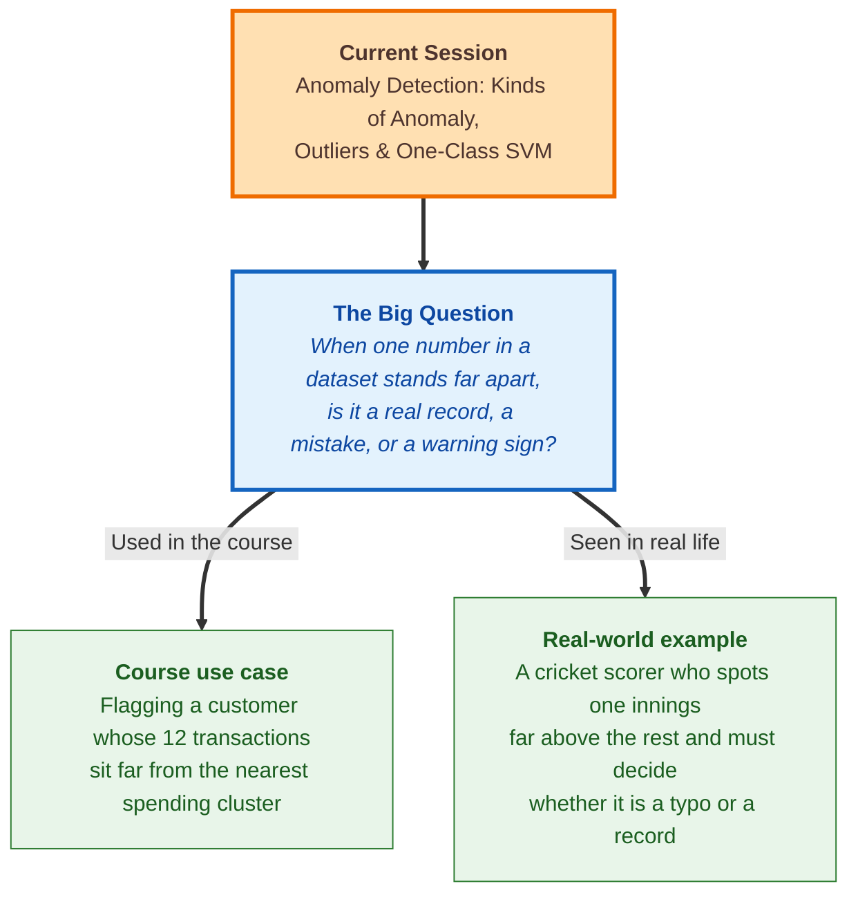

## <span style="color:#2F7DDE">Anomaly Detection: Kinds of Anomaly, Outliers & One-Class SVM</span>

### <span style="color:#2F7DDE">Mental Map</span>



---

### <span style="color:#2F7DDE">What You'll Learn</span>

Have you ever wondered if a suspicious score is a genuine record or a stray keystroke?

By the end of this session, you will be able to:

- <span style="color:#D9660B">**Describe**</span> why a model that trains on its own errors is thrown off by wrongly recorded rows.
- <span style="color:#D9660B">**Determine**</span> the upper and lower boundaries for a numeric column using a quartile-based formula.
- <span style="color:#D9660B">**Calculate**</span> how far one innings sits from the nearest group of innings.
- <span style="color:#D9660B">**Classify**</span> a suspicious innings as isolated, out of place for T20, or part of a wider group.
- <span style="color:#D9660B">**Trace**</span> the shift in batting average when extreme entries leave the column.
- <span style="color:#D9660B">**Justify**</span> whether to remove, cap or keep an entry, given its cause and your review capacity.

> <span style="color:#2F7DDE">**Topics you will meet:**</span>
> Point, contextual and collective anomalies; outlier boundaries with the IQR rule;
> remove, cap or retain; anomaly score from centroid distance; One-Class SVM for novelty detection;
> choosing a threshold that fits review capacity; judging a detector without clean labels.
>
> Join the session to learn each one.

---

### <span style="color:#2F7DDE">Why You Are Learning This Topic</span>

You are keeping a T20 scorebook. One batsman shows 334 runs. The T20 record is 175, so 334 is impossible. You face a choice: delete it, cap it, or flag it for review.

An <span style="color:#D9660B">**anomaly**</span> means a data point that does not fit the rest.

In this course, you build models from real data where extreme values can shift the result.

> <span style="color:#2F7DDE">**Think about it:**</span>
>
> If you delete 334 and the true score was 134, have you fixed the data or only changed it?

---

### <span style="color:#2F7DDE">The Cricket Scorebook Puzzle</span>

Here are six innings from a T20 match.

| Batsman | Runs | Balls |
|:---|:---:|:---:|
| Rohit Sharma | 82 | 59 |
| Shubman Gill | 14 | 12 |
| Virat Kohli | 76 | 61 |
| K.L. Rahul | 334 | 190 |
| Hardik Pandya | 9 | 8 |
| Rishabh Pant | 18 | 13 |

<span style="color:#D9660B">**What you want to happen:**</span>

- Flag innings outside the expected range.
- Choose to remove, cap or keep it.
- See how removing it shifts the batting average.

Here is how it might start. You do not need to understand it yet.

```python
from sklearn.cluster import KMeans
runs = [[82],[14],[76],[334],[9],[18]]
print(KMeans(n_clusters=2, random_state=0, n_init="auto").fit(runs).cluster_centers_)
```

> <span style="color:#D9660B">**Wonder about this:**</span>
>
> - Is K.L. Rahul's 334 a typo, out of place for T20, or part of a wider pattern?
> - Does capping 334 at 100 give a fairer average than removing it entirely?

---

### <span style="color:#2F7DDE">Think It Through</span>

There is no wrong first try. Keep your guesses for the session.

**1. These six innings: 82, 14, 76, 334, 9, 18. How much does the mean change when you remove 334?**
Hint: Find the mean with 334 and without it.

**2. A scorer types 334 instead of 134 by accident. Is it isolated, out of place for T20, or part of a suspicious pattern?**
Hint: Ask whether the problem is the value alone, its context, or a group.

**3. You review five entries per hour. Twenty are flagged in a 50-row scorebook. What stays unchecked?**
Hint: Think about how your threshold controls the size of the queue.

---

### <span style="color:#2F7DDE">One Question to Carry Into the Session</span>

> <span style="color:#2F7DDE">**If you have no confirmed mistakes, how can a detector learn what normal looks like?**</span>
>
> Once it flags a row, where do you draw the line?
