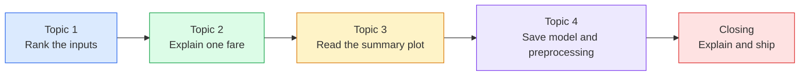
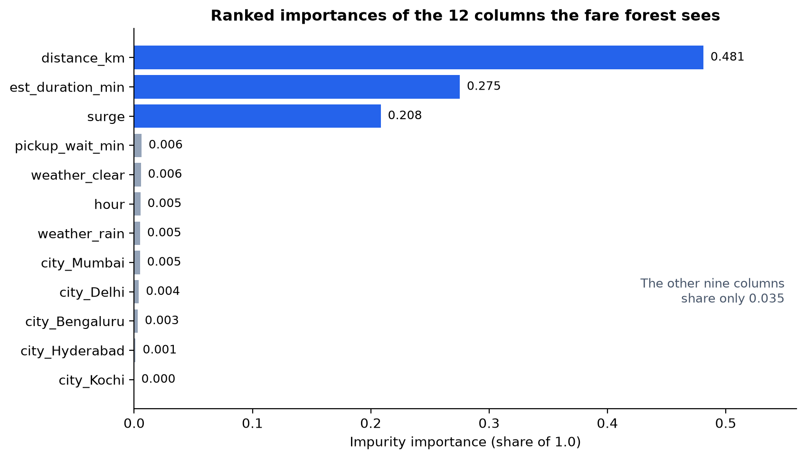
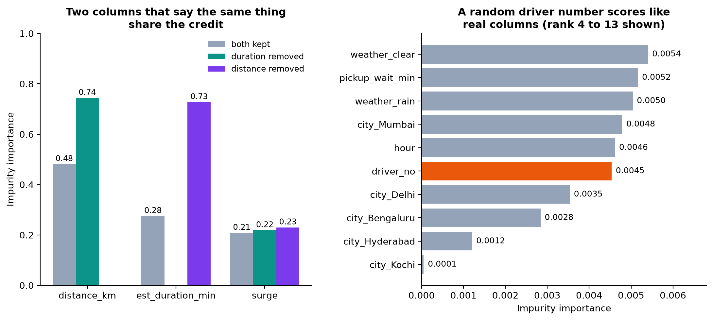
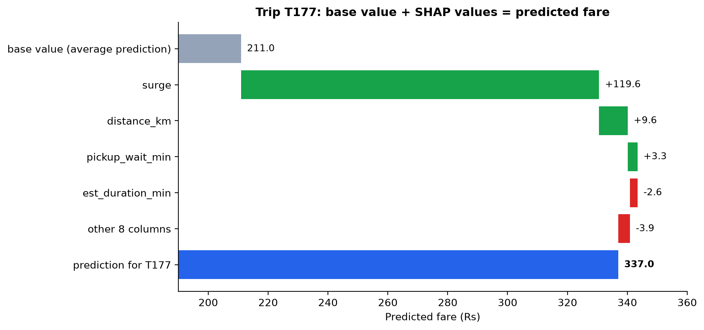
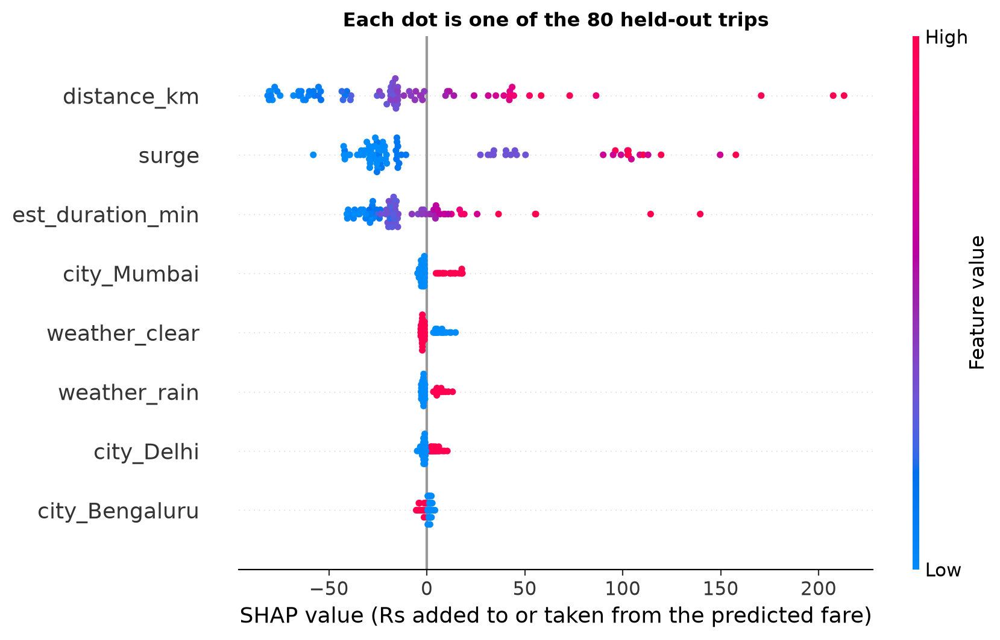
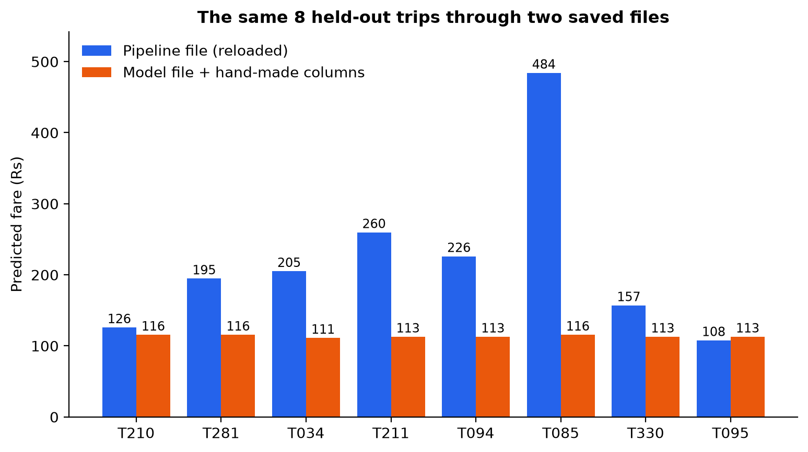
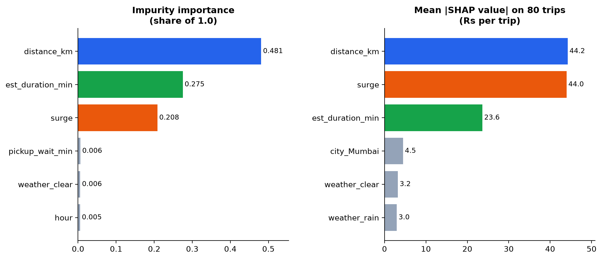

# <font color='#1d4ed8'>Lecture Script: Feature Importance, SHAP and Saving Models</font>

---

## <font color='blue'>Agenda</font>

The lecture runs as four topics. Each topic ends with a quiz.

| Topic | What we do | Learning objectives covered | Minutes |
|:-:|:--|:--|:-:|
| 1 | Rank the inputs of the fare forest | Extract ranked feature importances from a fitted tree ensemble | 30 |
| 2 | Explain one fare with SHAP | Explain what a SHAP value represents for a single prediction | 25 |
| 3 | Read the SHAP summary plot | Interpret a SHAP summary plot to name the strongest drivers of the model's output | 25 |
| 4 | Save the model and its preprocessing | Write a fitted model to disk as a serialised artifact<br>Explain why the preprocessing pipeline must be serialised together with the model | 25 |
| — | Closing: Outcome & Summary | | 15 |
| | **Total** | | **120** |

> <font color="red">**🎯 Instructor Note**</font> Pace: in Topic 1 spend about 10 minutes on the fit and the ranking, and the rest on the three warning examples. In Topic 2 slow down at "base value plus SHAP values equals the prediction".
> Topic 4 holds two objectives: keep the first save short (about 8 minutes) and spend the time on what goes wrong when only the model is saved.

---

## <font color='blue'>Scenario</font>

An Ola-style cab app shows a fare before every ride, and a random forest sets that fare. Two people depend on the same model, in two very different places.

**On the data scientist's laptop**, the model is a live Python object sitting next to the notebook that built it. Every column is still the word or number she typed: city names, surge, distance. When a rider disputes a fare, she can open the model and ask what moved the price.

**Inside the app team's service**, the same model is only a file. There is no notebook, no memory of how city names were turned into numbers, and nobody to ask. The service receives one raw trip, must return a fare in a fraction of a second, and must give the same fare she sees on her laptop.

> <font color="red">**🎯 Instructor Note**</font> The cab app is only the setting. Do not claim Ola uses this data; the 400 trips in `data/trips.csv`, including the random `driver_no` column, are invented for teaching.
> Outputs come from Python 3.14, pandas 3.0.1, numpy 2.4.4, scikit-learn 1.8.0, shap 0.54.1 and joblib 1.6.0; other versions may differ in the last digit.

---

## <font color='blue'>Problem Statement</font>

Meera, a data scientist at the cab app, trained a random forest on 400 past trips. The operations lead asked which inputs drive the fare. Meera sent a table of importance scores. The lead read it as a fact and ranked every input from first to last, even the ones separated by a hair.

A week later a rider called: why did the app quote Rs 337 for a 9.5 km trip? The table could not say, because it describes all trips together and not this one. Meera then emailed the model file to the app team. They sent it a raw trip and got an error. They rebuilt the city columns by hand, in their own order, and the app showed wrong fares for a day.

Three things were wrong: a ranking taken as a fact, no explanation for one trip, and a model file sent without its preprocessing.

> <font color='purple'>**How do we name what drives the model's fares, explain one rider's fare, and hand the model over so the app team gets the same fares we do?**</font>

> <font color="red">**🎯 Instructor Note**</font> Poll: "The rider's 9.5 km trip was quoted Rs 337, while an average training trip costs about Rs 211. Which input pushed it up the most: distance, surge, city or pickup wait?" Give learners 30 seconds to respond in chat.
> Reveal the answer in the Closing. Common guess: distance, because it leads the ranking.

---

## <font color='blue'>What We Will Use</font>

Four groups of tools, one per topic. Each topic explains its tools where they are first used. In Colab, run `!pip install shap` once before Topic 2.

| Topic | Tools | In one line |
|:-:|:--|:--|
| 1 | `RandomForestRegressor`, `feature_importances_`, `ColumnTransformer`, `OneHotEncoder`, `Pipeline` | Fit a fare forest and read each input's score |
| 2 | `shap.TreeExplainer`, `shap_values`, `expected_value` | Split one prediction into a base value plus one push per input |
| 3 | `shap.summary_plot` | Show every trip's pushes at once and name the strongest drivers |
| 4 | `joblib.dump`, `joblib.load` | Write a fitted model or pipeline to a file and read it back |

---

## <font color='blue'>How: Walking Through the Fare Model</font>



---

## <font color='blue'>Topic 1: Rank the Inputs of the Fare Forest</font> `30 min`

Earlier you read a slope for each input in linear regression, trained a random forest, scored a model with MAE, and chained preprocessing and a model in a scikit-learn Pipeline. A linear model gives one coefficient per input. A forest has none, so we need another way to ask which inputs it relies on.

> <font color='purple'>**A forest has no coefficients to read. How do we ask which inputs it relies on?**</font>

### <font color='green'>Example: fit the fare forest and rank its inputs</font>

> <font color='purple'>**What is in the trip table?**</font>

**Predict before running: What will happen?**

> <font color="red">**🎯 Instructor Note**</font> Expected: 400 rows and 9 columns (the trip id is the row label, so it is not counted). City and weather are text.
> Ask learners which two columns look as if they say the same thing.

```python
import pandas as pd
df = pd.read_csv("data/trips.csv", index_col="trip_id")
print(df.shape)
print(df.head(4).to_string())
print(df["city"].value_counts().to_dict())
print(df["distance_km"].corr(df["est_duration_min"]).round(3))
```

**Output**

```
(400, 9)
              city  distance_km  est_duration_min  hour  surge  pickup_wait_min weather  driver_no  fare_inr
trip_id                                                                                                     
T001        Mumbai          9.5                29     7    1.0                6   clear        190       207
T002        Mumbai          6.6                20     8    1.0                9   clear          8       183
T003     Bengaluru          7.8                26    19    1.0                8   clear         77       150
T004     Bengaluru         14.3                43    14    1.0                5   clear        139       209
{'Bengaluru': 130, 'Delhi': 120, 'Mumbai': 84, 'Hyderabad': 49, 'Kochi': 17}
0.984
```

#### <font color='#c2410c'>Code Explanation</font>

- **Line 1** Loads pandas, which reads tables.
- **Line 2** Reads the trip file and uses `trip_id` as the row label.
- **Line 3** Prints the size as (rows, columns).
- **Line 4** Shows the first four trips.
- **Line 5** Counts the trips in each city.
- **Line 6** Prints the correlation of distance and estimated trip time; a value near 1 means they rise together.

> <font color='green'>**Result**</font> We have 400 trips and 9 columns. `fare_inr` is what we predict. City and weather are text. Distance and estimated trip time move together (correlation 0.984), and `driver_no` is only an identifier.

> <font color='purple'>**Before we can rank anything, how do we fit a forest on a table that contains text?**</font>

First hold out 20% of the trips, so every score we report is on trips the forest has not seen.

**Predict before running: What will happen?**

> <font color="red">**🎯 Instructor Note**</font> Expected: 320 training trips and 80 test trips, each with 7 input columns (`driver_no` and the fare are left out).

```python
from sklearn.model_selection import train_test_split
from sklearn.compose import ColumnTransformer
from sklearn.preprocessing import OneHotEncoder
from sklearn.pipeline import Pipeline
from sklearn.ensemble import RandomForestRegressor
num = ["distance_km", "est_duration_min", "hour", "surge", "pickup_wait_min"]
cat = ["city", "weather"]
Xa, Xb, ya, yb = train_test_split(df[num + cat], df["fare_inr"], test_size=0.2, random_state=42)
print(Xa.shape, Xb.shape)
```

**Output**

```
(320, 7) (80, 7)
```

#### <font color='#c2410c'>Code Explanation</font>

- **Lines 1 to 5** Import the splitter, the column handler, the encoder, `Pipeline` and the forest.
- **Line 6** Names the five numeric input columns.
- **Line 7** Names the two text columns.
- **Line 8** Holds out 80 trips (20%) as a test set; `random_state=42` fixes which ones.
- **Line 9** Prints the training and test sizes.

**Predict before running: What will happen?**

> <font color="red">**🎯 Instructor Note**</font> Expected: 12 columns after encoding (5 cities + 2 weather values + 5 numeric), and an MAE of about Rs 23. Common wrong guess: 7, the number of columns before encoding.

```python
from sklearn.metrics import mean_absolute_error
prep = ColumnTransformer([("cat", OneHotEncoder(), cat)], remainder="passthrough", verbose_feature_names_out=False)
forest = RandomForestRegressor(n_estimators=100, min_samples_leaf=3, random_state=42)
pipe = Pipeline([("prep", prep), ("rf", forest)]).fit(Xa, ya)
names = pipe["prep"].get_feature_names_out()
print(len(names), list(names))
print(round(mean_absolute_error(yb, pipe.predict(Xb)), 2))
```

**Output**

```
12 ['city_Bengaluru', 'city_Delhi', 'city_Hyderabad', 'city_Kochi', 'city_Mumbai', 'weather_clear', 'weather_rain', 'distance_km', 'est_duration_min', 'hour', 'surge', 'pickup_wait_min']
23.31
```

#### <font color='#c2410c'>Code Explanation</font>

- **Line 1** Imports the MAE scorer.
- **Line 2** Builds the preprocessing: `OneHotEncoder` turns each text column into one 0/1 column per value, `remainder="passthrough"` keeps the numeric columns as they are, and `verbose_feature_names_out=False` keeps plain column names.
- **Line 3** Builds a forest of 100 trees; `min_samples_leaf=3` means every leaf holds at least 3 trips.
- **Line 4** Chains the preprocessing and the forest into one `Pipeline` and fits it on the 320 training trips.
- **Lines 5 and 6** Read back the 12 column names the forest sees and print them.
- **Line 7** Scores the forest on the 80 held-out trips with MAE.

> <font color='green'>**Result**</font> The forest sees 12 columns: five numbers, and one 0/1 column for each of the five cities and two weather values. On trips it has not seen, its fares are off by about Rs 23.31 on average.

> <font color='purple'>**Which of the 12 columns does the forest rely on most?**</font>

For each tree, add up how much the splits on column $k$ reduce the squared error, scale the tree's scores so they add to 1, then average over the $T = 100$ trees.

$$\boxed{\text{importance}_k = \frac{1}{T}\sum_{t=1}^{T} \text{share}_{t,k}, \qquad \text{share}_{t,k} = \frac{\text{error reduction from splits on } k \text{ in tree } t}{\text{error reduction from all splits in tree } t}}$$

**Predict before running: What will happen?**

> <font color="red">**🎯 Instructor Note**</font> Expected: distance, trip time and surge lead, and the other nine columns are tiny. Ask learners to guess the size of the tiny ones before revealing.

```python
imp = pd.Series(pipe["rf"].feature_importances_, index=names).sort_values(ascending=False)
print(imp.round(3).to_string())
print(imp.sum().round(3), imp.filter(like="city_").sum().round(3))
```

**Output**

```
distance_km         0.481
est_duration_min    0.275
surge               0.208
pickup_wait_min     0.006
weather_clear       0.006
hour                0.005
weather_rain        0.005
city_Mumbai         0.005
city_Delhi          0.004
city_Bengaluru      0.003
city_Hyderabad      0.001
city_Kochi          0.000
1.0 0.013
```

#### <font color='#c2410c'>Code Explanation</font>

- **Line 1** `feature_importances_` holds one score per column; we label each score with its column name and sort from largest to smallest.
- **Line 2** Prints the ranking to 3 decimals.
- **Line 3** Prints the total (it is always 1) and the total of the five `city_` columns, which are really one input. The same attribute exists on scikit-learn's gradient boosting models.

> <font color='green'>**Result**</font> `distance_km` (0.481), `est_duration_min` (0.275) and `surge` (0.208) carry more than 96% of the credit. The other nine columns share about 0.035. The five city columns add to only 0.013.

<p align="center"></p>

### <font color='green'>Extending it: two columns that say the same thing</font>

> <font color='purple'>**Distance and trip time move together. What does the forest do with two columns that carry the same information?**</font>

**Predict before running: What will happen?**

> <font color="red">**🎯 Instructor Note**</font> Ask: "If we remove trip time, will distance stay at 0.48?" Give learners 30 seconds to respond in chat. Expected: it jumps to about 0.74.

```python
from sklearn.base import clone
def ranked(cols):
    p = clone(pipe).fit(df.loc[Xa.index, cols], ya)
    r = pd.Series(p["rf"].feature_importances_, index=p["prep"].get_feature_names_out())
    return r.sort_values(ascending=False), round(mean_absolute_error(yb, p.predict(df.loc[Xb.index, cols])), 2)
base = num + cat
for drop in [None, "est_duration_min", "distance_km"]:
    r, mae = ranked([c for c in base if c != drop])
    print(f"drop {drop}: MAE {mae}", r.head(3).round(3).to_dict())
```

**Output**

```
drop None: MAE 23.31 {'distance_km': 0.481, 'est_duration_min': 0.275, 'surge': 0.208}
drop est_duration_min: MAE 23.93 {'distance_km': 0.744, 'surge': 0.219, 'city_Mumbai': 0.006}
drop distance_km: MAE 23.13 {'est_duration_min': 0.727, 'surge': 0.23, 'hour': 0.007}
```

#### <font color='#c2410c'>Code Explanation</font>

- **Line 1** Imports `clone`, which makes an unfitted copy of the pipeline with the same settings.
- **Lines 2 to 5** `ranked` refits a copy on the chosen columns and returns the sorted importances and the MAE on the held-out trips.
- **Line 6** Lists all the input columns.
- **Lines 7 to 9** Fit three times: all columns, without trip time, without distance. Each pass prints the MAE and the three largest scores.

> <font color='green'>**Result**</font> Together the pair holds $0.481 + 0.275 = 0.756$. Remove one and the other takes almost all of it (0.744 or 0.727), and the MAE hardly moves (23.31, 23.93, 23.13). Each column alone does the job, so when both are present the forest splits the credit. Neither 0.481 nor 0.275 is "the" effect of distance or of time; read the pair together.

### <font color='green'>Extending it: a column that means nothing</font>

> <font color='purple'>**What if a column with no link to the fare slips into the model?**</font>

`driver_no` is a random driver number with 191 different values in 400 trips; it was invented with no link to the fare.

> <font color="red">**🎯 Instructor Note**</font> Poll: "Where will `driver_no` rank among 13 columns?" Give learners 30 seconds to respond in chat. Expected: not last; it lands among the real columns.

```python
r, mae = ranked(base + ["driver_no"])
print("with driver_no: MAE", mae)
print(r.iloc[3:].round(4).to_string())
print(df["driver_no"].nunique(), "different driver numbers in", len(df), "trips")
```

**Output**

```
with driver_no: MAE 23.22
weather_clear      0.0054
pickup_wait_min    0.0052
weather_rain       0.0050
city_Mumbai        0.0048
hour               0.0046
driver_no          0.0045
city_Delhi         0.0035
city_Bengaluru     0.0028
city_Hyderabad     0.0012
city_Kochi         0.0001
191 different driver numbers in 400 trips
```

#### <font color='#c2410c'>Code Explanation</font>

- **Line 1** Refits with `driver_no` added to the inputs.
- **Line 2** Prints the new MAE.
- **Line 3** Prints the ranking from the fourth column down.
- **Line 4** Counts the different driver numbers.

> <font color='green'>**Result**</font> A random number scores 0.0045 and ranks 9th of 13. That is level with `hour` (0.0046) and ahead of the real `city_Delhi` column (0.0035), while the MAE barely moves (23.22 against 23.31). A column with many different values gives the trees many places to split, so some split fits chance patterns and earns credit. Impurity importance can flatter such columns.

### <font color='green'>Extending it: is the order stable?</font>

> <font color='purple'>**If only the forest's random seed changes, does the ranking stay the same?**</font>

> <font color="red">**🎯 Instructor Note**</font> Ask learners to predict which ranks will change. Expected: the top three stay put, and the order below them shuffles.

```python
for seed in range(5):
    p = clone(pipe).set_params(rf__random_state=seed).fit(Xa, ya)
    r = pd.Series(p["rf"].feature_importances_, index=names).sort_values(ascending=False)
    print(seed, list(r.index[:6]))
```

**Output**

```
0 ['distance_km', 'est_duration_min', 'surge', 'weather_clear', 'hour', 'weather_rain']
1 ['distance_km', 'est_duration_min', 'surge', 'pickup_wait_min', 'weather_clear', 'hour']
2 ['distance_km', 'est_duration_min', 'surge', 'weather_rain', 'pickup_wait_min', 'hour']
3 ['distance_km', 'est_duration_min', 'surge', 'weather_rain', 'pickup_wait_min', 'weather_clear']
4 ['distance_km', 'est_duration_min', 'surge', 'hour', 'weather_clear', 'pickup_wait_min']
```

#### <font color='#c2410c'>Code Explanation</font>

- **Line 1** Repeats five times with seeds 0 to 4.
- **Line 2** Refits a copy of the pipeline, changing only the forest's `random_state`.
- **Line 3** Ranks the 12 columns.
- **Line 4** Prints the seed and the six leading columns in order.

<p align="center"></p>

> <font color='green'>**Result**</font> In all five runs the top three stay `distance_km`, `est_duration_min`, `surge`. The order of ranks 4 to 6 changes from run to run, because those scores differ by only about 0.001. Report the leading group and do not rank columns whose scores differ in the third decimal.

> <font color='#b45309'>**Common mistake**</font> Reading a rank as a fact. The five `city_` columns are one input, so add them (0.013) before comparing city with other inputs. Treat scores below about 0.01 here as noise.

### <font color='purple'>Quiz 1</font>

**Question:** In our forest `distance_km` scores 0.481 and `est_duration_min` scores 0.275. When `est_duration_min` is removed and the forest is refitted, `distance_km` scores 0.744. What does this show?

**Options:**
- A) `est_duration_min` has no effect on fares, so removing it changed nothing
- B) Importance scores are exact measures of how many rupees each input adds to a fare
- C) The two columns carry nearly the same information, so the forest shared the credit between them
- D) The forest was broken and must be retrained with more trees

**Correct Answer:** C

**Explanation:**
- **A)** Wrong: the score of the remaining column changed a lot, and the MAE moved too (23.31 to 23.93).
- **B)** Wrong: the scores are shares of error reduction that add to 1; they are not rupees.
- **C)** Correct: distance and trip time are correlated at 0.984, so each alone can do the work, and with both present they split the credit.
- **D)** Wrong: nothing is broken; the forest behaves this way whenever two columns overlap.

---

## <font color='blue'>Topic 2: Explain One Fare with SHAP</font> `25 min`

The ranking describes all 400 trips together. The rider on the phone is asking about one trip: Rs 337 for 9.5 km at 6 pm in Delhi, with surge 2.5, clear weather and a 10 minute pickup wait. Importance scores cannot answer that.

> <font color='purple'>**The ranking covers every trip. How do we explain the fare of this one trip?**</font>

A SHAP value gives each input a share of the gap between the base value (the model's starting point, close to the average fare of the training trips) and the prediction for one trip. A positive value pushed the fare up for this trip, a negative value pushed it down. For a trip with 12 input columns:

$$\boxed{\hat{y}_{\text{trip}} = \phi_0 + \sum_{k=1}^{12} \phi_k}$$

Here $\phi_0$ is the base value and $\phi_k$ is the SHAP value of column $k$ for this trip.

### <font color='green'>Example: explain trip T177</font>

> <font color='purple'>**What do we get back when we ask SHAP to explain the 80 held-out trips?**</font>

**Predict before running: What will happen?**

> <font color="red">**🎯 Instructor Note**</font> Expected: 80 rows by 12 columns, one number per trip and column. The base value should be close to the average fare of the training trips.

```python
import numpy as np
import shap
explainer = shap.TreeExplainer(pipe["rf"])
Zb = pipe["prep"].transform(Xb)
sv = explainer.shap_values(Zb)
base_value = float(np.ravel(explainer.expected_value)[0])
print(sv.shape)
print(round(base_value, 1), round(ya.mean(), 1))
```

**Output**

```
(80, 12)
211.0 211.3
```

#### <font color='#c2410c'>Code Explanation</font>

- **Lines 1 and 2** Load numpy and the `shap` library.
- **Line 3** Builds an explainer from the fitted forest; for tree ensembles it reads the trees and computes exact SHAP values.
- **Line 4** Encodes the 80 test trips with the pipeline's preprocessing, because the forest only understands the 12 encoded columns.
- **Line 5** Computes one SHAP value for every trip and column.
- **Line 6** Reads the base value from the explainer as a plain number.
- **Lines 7 and 8** Print the shape, the base value and the average training fare.

> <font color='green'>**Result**</font> There are $80 \times 12 = 960$ SHAP values. The base value is Rs 211.0, close to the average training fare of Rs 211.3.

> <font color='purple'>**Why did the app quote Rs 337 for the 9.5 km trip?**</font>

**Predict before running: What will happen?**

> <font color="red">**🎯 Instructor Note**</font> Ask: "Which input will have the largest push: distance or surge?" Give learners 30 seconds to respond in chat. Expected: surge. Common wrong guess: distance, because it leads the ranking.

```python
i = list(Xb.index).index("T177")
s = pd.Series(sv[i], index=names).sort_values(key=abs, ascending=False)
print(Xb.loc["T177"].to_dict())
print(s.head(4).round(1).to_dict())
print("other 8 columns:", round(s.iloc[4:].sum(), 1))
print(round(base_value, 1), round(s.sum(), 1), round(base_value + s.sum(), 1))
print(pipe.predict(Xb.loc[["T177"]]).round(1))
```

**Output**

```
{'distance_km': 9.5, 'est_duration_min': 27, 'hour': 18, 'surge': 2.5, 'pickup_wait_min': 10, 'city': 'Delhi', 'weather': 'clear'}
{'surge': 119.6, 'distance_km': 9.6, 'pickup_wait_min': 3.3, 'est_duration_min': -2.6}
other 8 columns: -3.9
211.0 126.0 337.0
[337.]
```

#### <font color='#c2410c'>Code Explanation</font>

- **Line 1** Finds the position of trip T177 among the 80 test trips.
- **Line 2** Takes its 12 SHAP values and sorts them by size, ignoring the sign.
- **Line 3** Prints the trip's inputs.
- **Line 4** Prints the four largest pushes in rupees.
- **Line 5** Adds up the other eight columns.
- **Line 6** Prints the base value, the sum of all 12 pushes, and base plus sum.
- **Line 7** Prints the pipeline's own prediction for the same trip.

$$211.0 + 119.6 + 9.6 + 3.3 - 2.6 - 3.9 = 337.0$$

<p align="center"></p>

> <font color='green'>**Result**</font> Base value 211.0 plus pushes of +126.0 gives 337.0, exactly the model's prediction. Surge added Rs 119.6. The 9.5 km distance added only Rs 9.6. The answer for the rider: the fare is high because of surge 2.5, not because of distance.

### <font color='green'>Extending it: does the identity hold for every trip?</font>

> <font color='purple'>**Is base value plus the 12 pushes equal to the prediction for all 80 trips, or only for T177?**</font>

> <font color="red">**🎯 Instructor Note**</font> Ask for a quick show of hands: every trip, or only T177? Expected: every trip, with a gap of zero up to rounding.

```python
pred = pipe["rf"].predict(Zb)
total = base_value + sv.sum(axis=1)
print(np.allclose(total, pred), f"{np.abs(total - pred).max():.6f}")
print(len(pred), "trips checked")
```

**Output**

```
True 0.000000
80 trips checked
```

#### <font color='#c2410c'>Code Explanation</font>

- **Line 1** Predicts all 80 test trips with the forest.
- **Line 2** Computes base value plus the 12 pushes for every trip.
- **Line 3** Checks that the two agree, and prints the largest gap to 6 decimals.
- **Line 4** Prints how many trips were checked.

> <font color='green'>**Result**</font> The two agree for all 80 trips, with a largest gap below a millionth of a rupee. Each prediction is a base value plus 12 pushes; nothing is left over.

### <font color='green'>Extending it: is a surge of 2.5 worth the same on every trip?</font>

> <font color='purple'>**Does the same surge value push every trip's fare up by the same number of rupees?**</font>

**Predict before running: What will happen?**

> <font color="red">**🎯 Instructor Note**</font> Expected: no. The push depends on the rest of the trip. Also ask what sign surge 1.0 will get.

```python
j = list(names).index("surge")
top = Xb["surge"] == 2.5
print(pd.DataFrame({"distance_km": Xb.loc[top, "distance_km"], "surge_shap": sv[top.to_numpy(), j].round(1)}).to_string())
print(pd.Series(sv[:, j], index=Xb.index).groupby(Xb["surge"]).mean().round(1).to_dict())
```

**Output**

```
         distance_km  surge_shap
trip_id                         
T281             2.1       102.6
T263            20.9       157.8
T182             2.5       102.9
T047             4.7       102.9
T339             1.9        96.2
T071             3.1       110.5
T177             9.5       119.6
{1.0: -29.7, 1.2: -19.3, 1.5: 38.6, 2.0: 107.8, 2.5: 113.2}
```

#### <font color='#c2410c'>Code Explanation</font>

- **Line 1** Finds the position of `surge` among the 12 columns.
- **Line 2** Marks the test trips with surge 2.5.
- **Line 3** Prints their distance next to the SHAP value of `surge`.
- **Line 4** Averages the SHAP value of `surge` for each surge level present in the test trips.

> <font color='green'>**Result**</font> The same surge of 2.5 pushed fares by between +96.2 and +157.8. The 20.9 km trip T263 got the largest push (+157.8) and trips under 5 km got +96.2 to +110.5, which fits a surge that multiplies a bigger base fare. At surge 1.0 the average push is -29.7: a SHAP value is measured from the base value, and ordinary trips sit below the average fare.

> <font color='#b45309'>**Common mistake**</font> Reading a SHAP value as "the fare would fall by this much if the input changed in real life". It describes how the model built this trip's prediction from its base value.

### <font color='purple'>Quiz 2</font>

**Question:** For one trip the base value is Rs 211.0, the SHAP value of `surge` is +119.6, and all 12 SHAP values add up to +126.0. What does the model predict for this trip?

**Options:**
- A) Rs 337.0
- B) Rs 126.0
- C) Rs 91.4
- D) Rs 330.6

**Correct Answer:** A

**Explanation:**
- **A)** Correct: prediction = base value + sum of all SHAP values = $211.0 + 126.0 = 337.0$.
- **B)** Wrong: this is only the sum of the pushes; it leaves out the base value.
- **C)** Wrong: this is $211.0 - 119.6$; the pushes are added to the base value, not subtracted.
- **D)** Wrong: this is $211.0 + 119.6$, which uses the `surge` push alone and ignores the other 11 columns.

---

## <font color='blue'>Topic 3: Read the SHAP Summary Plot</font> `25 min`

T177 is explained, and the explanation took one trip and one chart. Operations also want the big picture: across many trips, which inputs push fares the most, and in which direction? One summary plot shows the pushes of all 80 held-out trips together.

> <font color='purple'>**One trip is explained. How do we see the pushes of all 80 trips at once and name the strongest drivers?**</font>

How to read the plot:

| Part of the plot | What it means |
|:--|:--|
| Row | One input column; rows are sorted so the largest mean absolute SHAP value is on top |
| Dot | One held-out trip |
| Left or right | The SHAP value in rupees: right pushes the predicted fare up, left pushes it down |
| Colour | The column's value for that trip: red is high, blue is low (for a 0/1 column, red is 1) |

The sort order is the mean absolute SHAP value over the $n$ trips:

$$\boxed{\text{mean}\,|\phi_k| = \frac{1}{n}\sum_{i=1}^{n} |\phi_{ik}|}$$

### <font color='green'>Example: draw the summary plot</font>

> <font color='purple'>**Which columns head the plot, and how big are their pushes?**</font>

**Predict before running: What will happen?**

> <font color="red">**🎯 Instructor Note**</font> Expected: distance and surge at the top with almost the same size, trip time third, and everything else under Rs 5. Common wrong guess: distance far ahead of surge, as in the impurity ranking.

```python
mean_abs = pd.Series(np.abs(sv).mean(axis=0), index=names).sort_values(ascending=False)
print(mean_abs.head(6).round(2).to_string())
shap.summary_plot(sv, Zb, feature_names=names, max_display=8)
```

**Output**

```
distance_km         44.23
surge               43.96
est_duration_min    23.64
city_Mumbai          4.49
weather_clear        3.23
weather_rain         2.96
```

#### <font color='#c2410c'>Code Explanation</font>

- **Line 1** Averages the size of each column's SHAP values over the 80 trips, ignoring the sign, and sorts from largest to smallest.
- **Line 2** Prints the six largest, in rupees per trip.
- **Line 3** Draws the summary plot for the eight leading columns.

<p align="center"></p>

> <font color='green'>**Result**</font> `distance_km` (44.23) and `surge` (43.96) lead and are almost tied, `est_duration_min` (23.64) is third, and the fourth column, `city_Mumbai`, is only 4.49. On the plot the three leaders spread far from zero and the rest hug it. The strongest drivers of the model's fares are the group of distance, surge and trip time.

### <font color='green'>Extending it: what do the colours say?</font>

> <font color='purple'>**Do high values of a column push the fare up or down?**</font>

Correlate each column's value with its SHAP value across the 80 trips. A positive number means the red dots sit on the right.

> <font color="red">**🎯 Instructor Note**</font> Ask learners to read the direction off the plot first. Expected: all four positive, with pickup wait the weakest push.

```python
for c in ["surge", "distance_km", "est_duration_min", "pickup_wait_min"]:
    j = list(names).index(c)
    print(c, np.corrcoef(Xb[c], sv[:, j])[0, 1].round(2), mean_abs[c].round(1))
```

**Output**

```
surge 0.95 44.0
distance_km 0.98 44.2
est_duration_min 0.97 23.6
pickup_wait_min 0.86 1.6
```

#### <font color='#c2410c'>Code Explanation</font>

- **Line 1** Loops over four columns.
- **Line 2** Finds the column's position.
- **Line 3** Prints the column, the correlation between its value and its SHAP value, and its mean absolute SHAP value in rupees.

> <font color='green'>**Result**</font> All four correlations are positive (0.95, 0.98, 0.97, 0.86), so for these columns high values push the fare up and low values push it down. `pickup_wait_min` points the same way but its mean push is only Rs 1.6, so it is a weak driver.

### <font color='green'>Extending it: do the two rankings agree?</font>

> <font color='purple'>**Does SHAP name the same leaders as the impurity ranking, in the same order, on any set of trips?**</font>

**Predict before running: What will happen?**

> <font color="red">**🎯 Instructor Note**</font> Expected: the leaders match, but the order of the top two changes with the trips explained. Impurity put distance far ahead of surge.

```python
Za = pipe["prep"].transform(Xa)
mean_a = pd.Series(np.abs(explainer.shap_values(Za)).mean(axis=0), index=names).sort_values(ascending=False)
print(mean_a.head(3).round(2).to_dict())
print(mean_abs.head(3).round(2).to_dict())
print(round(mean_abs[["distance_km", "est_duration_min"]].sum(), 2))
```

**Output**

```
{'distance_km': 48.2, 'surge': 39.5, 'est_duration_min': 24.56}
{'distance_km': 44.23, 'surge': 43.96, 'est_duration_min': 23.64}
67.87
```

#### <font color='#c2410c'>Code Explanation</font>

- **Line 1** Encodes the 320 training trips.
- **Line 2** Computes the mean absolute SHAP value on them and sorts.
- **Lines 3 and 4** Print the top three on the training trips, then on the 80 held-out trips.
- **Line 5** Adds the two correlated columns, distance and trip time, on the held-out trips.

> <font color='green'>**Result**</font> On the 320 training trips distance leads surge by 8.7 rupees (48.2 against 39.5). On the 80 held-out trips they tie (44.23 against 43.96). Name them as one leading pair; the order of the two depends on which trips we explain. Trip time shares credit with distance, and together they average 67.87. The impurity ranking put surge third (0.208), well behind distance (0.481), while SHAP puts it level with distance, because the two measures ask different questions: error reduction inside the trees against rupees moved per trip. What both agree on is the group: distance, surge and trip time, with every other column small.

> <font color='#b45309'>**Common mistake**</font> Treating the plot as a statement about the real world. It shows how the model uses its inputs; it does not show that surge causes anything, and a column the model does not use cannot appear as a driver.

### <font color='purple'>Quiz 3</font>

**Question:** In a SHAP summary plot the `surge` row has red dots to the right of zero and blue dots to the left. What does this say?

**Options:**
- A) The model ignores `surge`, because its dots are spread out
- B) Red dots are expensive trips and blue dots are cheap trips, whatever the surge value
- C) The plot proves that raising surge in the real world causes higher fares
- D) High surge values push the predicted fare up, and low surge values push it down

**Correct Answer:** D

**Explanation:**
- **A)** Wrong: a wide spread means large pushes, so the model uses `surge` heavily.
- **B)** Wrong: colour is the value of the column (surge), not the fare of the trip.
- **C)** Wrong: the plot shows how the model builds its predictions; it does not prove cause and effect in the real world.
- **D)** Correct: right of zero raises the predicted fare, red marks high surge, so high surge raises it and low surge lowers it.

---

## <font color='blue'>Topic 4: Save the Model and Its Preprocessing</font> `25 min`

Meera now has the ranking, the explanation of T177 and the summary plot. The app team needs the model itself. A fitted model lives in memory and disappears when the notebook closes, so it has to be written to a file. Turning a fitted object into bytes in a file is called serialising it, and reading it back is loading it.

> <font color='purple'>**The model lives in Meera's notebook. How do we write it to a file the app team can load?**</font>

### <font color='green'>Example: write the forest to a file and read it back</font>

> <font color='purple'>**If we save only the fitted forest, does the reloaded copy predict the same fares?**</font>

**Predict before running: What will happen?**

> <font color="red">**🎯 Instructor Note**</font> Expected: all 80 predictions identical, on a file of a few hundred KB. The file size and the version printed here depend on the library version.

```python
import joblib, os, sklearn
joblib.dump(pipe["rf"], "data/fare_model_only.joblib", compress=3)
model_only = joblib.load("data/fare_model_only.joblib")
print(sklearn.__version__, round(os.path.getsize("data/fare_model_only.joblib") / 1024), "KB")
same = model_only.predict(Zb) == pipe["rf"].predict(Zb)
print(same.sum(), "of", len(same), "predictions identical")
```

**Output**

```
1.8.0 197 KB
80 of 80 predictions identical
```

#### <font color='#c2410c'>Code Explanation</font>

- **Line 1** Loads `joblib` (it writes Python objects to files, and handles large NumPy arrays well), `os` for the file size and `sklearn` for its version.
- **Line 2** Writes the fitted forest, `pipe["rf"]`, to a compressed file. The standard-library `pickle` can do the same job.
- **Line 3** Reads the file back into a new object.
- **Line 4** Prints the scikit-learn version that wrote the file and the file size in KB.
- **Lines 5 and 6** Compare the reloaded forest with the original on the 80 encoded test trips and count identical predictions.

> <font color='green'>**Result**</font> The reloaded forest gives the same fare on all 80 trips. The file is about 197 KB and was written with scikit-learn 1.8.0.

> <font color='#b45309'>**Common mistake**</font> Loading a file you do not trust. A joblib or pickle file can run code when it is loaded, so load only files from sources you trust. Also load with the same scikit-learn version that saved it.

### <font color='green'>Extending it: the app team sends a raw trip</font>

> <font color='purple'>**What happens when the app team sends this model file a raw trip, with the city as text?**</font>

**Predict before running: What will happen?**

> <font color="red">**🎯 Instructor Note**</font> Expected: an error, because the forest expects 12 numbers and receives the word Delhi. Common guess: it works, because the model "knows" the city names.

```python
trip = pd.DataFrame([{"distance_km": 9.5, "est_duration_min": 27, "hour": 18, "surge": 2.5,
                      "pickup_wait_min": 10, "city": "Delhi", "weather": "clear"}])
try:
    model_only.predict(trip)
except ValueError as e:
    print("ValueError:", e)
```

**Output**

```
ValueError: could not convert string to float: 'Delhi'
```

#### <font color='#c2410c'>Code Explanation</font>

- **Lines 1 and 2** Build one raw trip, the same inputs as T177, with the city and weather as text.
- **Lines 3 to 6** Ask the model file to predict it, and print the error instead of stopping. scikit-learn also shows a warning that the forest was fitted without column names.

> <font color='green'>**Result**</font> The model file fails with `could not convert string to float: 'Delhi'`. The file holds only the forest, which expects 12 numbers. It does not know how to turn a city name into columns.

### <font color='green'>Extending it: the app team rebuilds the columns by hand</font>

> <font color='purple'>**What if the app team turns the text into 0/1 columns themselves, with their own tool?**</font>

`pd.get_dummies` does the same job as `OneHotEncoder`, but it puts the new 0/1 columns after the numeric ones. In training the pipeline put them first.

**Predict before running: What will happen?**

> <font color="red">**🎯 Instructor Note**</font> Ask: "The table has the same 12 columns. Will it work?" Give learners 30 seconds to respond in chat. Expected: no error, but wrong fares.

```python
hand = pd.get_dummies(Xb).astype(float)
print(list(hand.columns[:3]), list(names[:3]))
wrong = model_only.predict(hand.to_numpy())
right = pipe.predict(Xb)
print(hand.shape == Zb.shape, int((wrong == right).sum()), "of", len(right), "match")
print(wrong[:3].round(0), right[:3].round(0), np.abs(wrong - right).mean().round(1))
```

**Output**

```
['distance_km', 'est_duration_min', 'hour'] ['city_Bengaluru', 'city_Delhi', 'city_Hyderabad']
True 0 of 80 match
[116. 116. 111.] [126. 195. 205.] 87.0
```

#### <font color='#c2410c'>Code Explanation</font>

- **Line 1** Builds the hand-made 0/1 table for the 80 test trips, as numbers.
- **Line 2** Prints the first three column names of the hand-made table and of the training columns.
- **Lines 3 and 4** Predict with the model file on the hand-made table, and with the pipeline on the raw trips.
- **Line 5** Prints whether the shapes match and how many of the 80 predictions are identical.
- **Line 6** Prints the first three fares of each, and the average gap in rupees.

<p align="center"></p>

> <font color='green'>**Result**</font> There is no error: 12 columns go in and a fare comes out. But none of the 80 fares matches, and they are off by Rs 87.0 on average. The forest was fitted on a plain array with no column names, so it knows only positions: position 1 was `city_Bengaluru`, and now it receives distance. A wrong fare with no warning is worse than an error.

### <font color='green'>Extending it: save the whole pipeline</font>

> <font color='purple'>**What if the preprocessing travels in the same file as the forest?**</font>

**Predict before running: What will happen?**

> <font color="red">**🎯 Instructor Note**</font> Expected: all 80 predictions identical, and the raw trip works and gives Rs 337.0, the same as T177 before.

```python
joblib.dump(pipe, "data/fare_pipeline.joblib", compress=3)
loaded = joblib.load("data/fare_pipeline.joblib")
print(round(os.path.getsize("data/fare_pipeline.joblib") / 1024), "KB")
print(list(loaded["prep"].named_transformers_["cat"].categories_[0]))
same = loaded.predict(Xb) == pipe.predict(Xb)
print(same.sum(), "of", len(same), "predictions identical")
print(loaded.predict(trip).round(1))
```

**Output**

```
198 KB
['Bengaluru', 'Delhi', 'Hyderabad', 'Kochi', 'Mumbai']
80 of 80 predictions identical
[337.]
```

#### <font color='#c2410c'>Code Explanation</font>

- **Line 1** Writes the whole pipeline (the fitted encoder and the fitted forest) to one file.
- **Line 2** Reads it back.
- **Line 3** Prints the file size in KB.
- **Line 4** Prints the cities the encoder remembered, in the order it uses.
- **Lines 5 and 6** Compare the reloaded pipeline with the original on the raw test trips.
- **Line 7** Sends the raw trip from before, with the city as text.

> <font color='green'>**Result**</font> The file holds the encoder as well as the forest, so the encoder remembers the five cities and their column order. All 80 predictions are identical, and the raw trip now works and gives Rs 337.0, the fare we explained for T177. The file is about 198 KB, almost the same size as the forest alone.

> <font color='#b45309'>**Common mistake**</font> Saving `pipe["rf"]` and keeping the preprocessing "in the notebook". Save the whole `Pipeline`, so the model and the exact steps that prepared its inputs always travel together. The saved encoder knows only the five training cities: a trip from a new city such as Pune raises `Found unknown categories`, so refit and save again before the app adds a city.

### <font color='purple'>Quiz 4</font>

**Question:** The app team loads only the saved forest and passes it a 0/1 table they built themselves. It has the same 12 columns as the training data, in a different order. What happens?

**Options:**
- A) scikit-learn raises an error, because the column order differs
- B) It returns fares with no error, but they are wrong, because the forest knows only column positions
- C) It returns the same fares as the pipeline, because the forest learned the column names
- D) It returns the same fares, only more slowly

**Correct Answer:** B

**Explanation:**
- **A)** Wrong: this forest was fitted on a plain array, so it has no names to check; our run raised no error.
- **B)** Correct: our run matched 0 of 80 fares, with an average gap of Rs 87.0, and printed no error.
- **C)** Wrong: the forest never saw column names; it saw positions.
- **D)** Wrong: speed is not the issue; the numbers in each position mean something different from training.

---

## <font color='blue'>Closing: Outcome & Summary</font> `15 min`

Back to the problem: Meera must name what drives the fares, explain the Rs 337 quote, and hand the model over safely. We answer it with each topic used once.

> <font color='purple'>**1. What drives the model's fares? (Topics 1 and 3)**</font>

Two measures agree on the group. By impurity importance, distance, trip time and surge carry more than 96% of the credit. By mean absolute SHAP value, distance (44.23), surge (43.96) and trip time (23.64) are each far above every other column (4.49 or less). The order inside the group is not firm: distance and surge tie on the held-out trips, and trip time shares credit with distance.

<p align="center"></p>

> <font color='purple'>**2. Why did the app quote Rs 337 for trip T177? (Topic 2, using the saved pipeline from Topic 4)**</font>

```python
ex2 = shap.TreeExplainer(loaded["rf"])
trip1 = Xb.loc[["T177"]]
s1 = pd.Series(ex2.shap_values(loaded["prep"].transform(trip1))[0], index=names)
print(loaded.predict(trip1).round(1), round(float(np.ravel(ex2.expected_value)[0]), 1))
print(s1.sort_values(key=abs, ascending=False).head(3).round(1).to_dict())
```

**Output**

```
[337.] 211.0
{'surge': 119.6, 'distance_km': 9.6, 'pickup_wait_min': 3.3}
```

#### <font color='#c2410c'>Code Explanation</font>

- **Line 1** Builds a SHAP explainer from the forest inside the reloaded pipeline (Topic 2).
- **Line 2** Takes trip T177 as a raw row.
- **Line 3** Encodes it with the reloaded pipeline's own encoder and computes its 12 SHAP values (Topic 4).
- **Line 4** Prints the fare from the reloaded pipeline and the base value.
- **Line 5** Prints the three largest pushes, in rupees.

> <font color='green'>**Result**</font> From the file alone we get Rs 337.0 from a base value of Rs 211.0. Surge added Rs 119.6, distance Rs 9.6 and pickup wait Rs 3.3.

> <font color='purple'>**3. Will the app team get the same fares as ours? (Topic 4)**</font>

```python
ok_pipe = int((loaded.predict(Xb) == right).sum())
ok_hand = int((wrong == right).sum())
gap_pipe = np.abs(loaded.predict(Xb) - right).mean().round(1)
gap_hand = np.abs(wrong - right).mean().round(1)
print(ok_pipe, ok_hand)
print(gap_pipe, gap_hand)
```

**Output**

```
80 0
0.0 87.0
```

#### <font color='#c2410c'>Code Explanation</font>

- **Lines 1 and 2** Count the test trips where the reloaded pipeline, and the model file with hand-made columns, match our fares exactly.
- **Lines 3 and 4** Compute the average gap in rupees for each.
- **Lines 5 and 6** Print the two counts, then the two gaps.

### <font color='green'>Outcome</font>

| | Model file + hand-made columns | Pipeline file |
|:--|:-:|:-:|
| Test trips with our exact fare (of 80) | 0 | 80 |
| Average gap from our fare | Rs 87.0 | Rs 0.0 |
| Accepts a raw trip with the city as text | No (`ValueError`) | Yes (Rs 337.0 for T177) |

> <font color='green'>**Therefore,**</font> Meera can tell operations that distance, surge and trip time drive the model's fares, and that the order inside that group is not firm. She can tell the rider that surge 2.5 added Rs 119.6 to the model's base value of Rs 211.0. She should hand over the whole pipeline, because the app team then gets exactly her fares (80 of 80), while a model file alone gave 0 of 80 and was Rs 87.0 off on average. Limits to keep in mind: scores that differ in the third decimal are not a ranking, SHAP describes the model and not the real world, and a joblib file should be loaded only from a source you trust.

> <font color="red">**🎯 Instructor Note**</font> Reveal the opening poll next to the table: surge was the largest push on the Rs 337 quote (+119.6), distance only +9.6. Compare with learners' guesses.

### <font color='green'>Summary</font>

| Learning objective | Takeaway |
|:--|:--|
| Ranked feature importances | `feature_importances_` ranks columns by shares that add to 1; it splits credit between correlated columns and can flatter columns with many values, so report the leading group |
| SHAP value for one prediction | A SHAP value is one input's push, in rupees, on one trip: base value + all pushes = prediction (211.0 + 126.0 = 337.0) |
| SHAP summary plot | Rows are sorted by mean absolute SHAP; position is the push, colour is the column's value; distance, surge and trip time are the strongest drivers as a group |
| Saving a fitted model | `joblib.dump` writes the fitted object to a file and `joblib.load` reads it back with identical predictions; load only trusted files, with the same library version |
| Saving preprocessing with the model | The forest knows only column positions, so the encoder must travel with it: the pipeline file gave 80 of 80 identical fares, the model file alone 0 of 80 |
| **Practical value** | You can defend a model's drivers with honest limits, explain any single prediction to a customer, and ship a model that behaves the same in someone else's service |

---

# <font color='red'>Launch the Feedback Poll</font>

> <font color="red">**🎯 Instructor Note**</font> Reminder: launch the feedback poll now to collect learner feedback.
