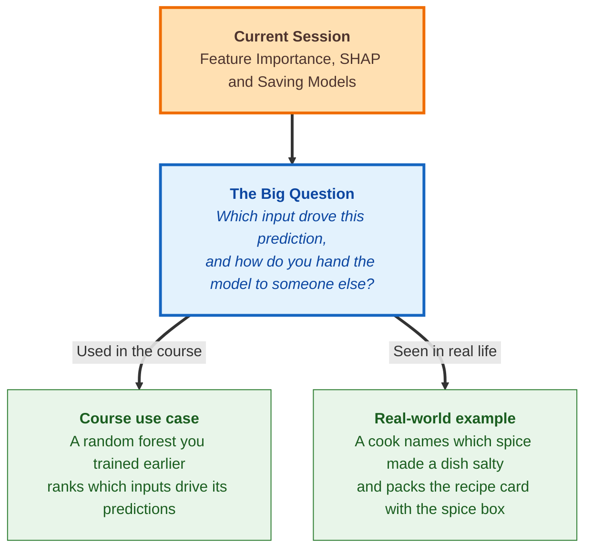

## <span style="color:#2F7DDE">Feature Importance, SHAP and Saving Models</span>

### <span style="color:#2F7DDE">Mental Map</span>



---

### <span style="color:#2F7DDE">What You'll Learn</span>

Have you ever wondered which spice makes a whole dish too salty?

By the end of this session, you will be able to:

- <span style="color:#D9660B">**List**</span> a model's top ingredients by their scores.
- <span style="color:#D9660B">**Describe**</span> a contribution score for one prediction.
- <span style="color:#D9660B">**Interpret**</span> a contribution chart to name the top drivers.
- <span style="color:#D9660B">**Explain**</span> why the recipe card must go with the spice box.
- <span style="color:#D9660B">**Write**</span> a fitted model to a file for another cook.

> <span style="color:#2F7DDE">**Topics you will meet:**</span>
> Ranked feature importances; SHAP values; SHAP summary plot;
> Saving a fitted model; Saving preprocessing with the model.
>
> Join the session to learn each of these in detail.

---

### <span style="color:#2F7DDE">Why You Are Learning This Topic</span>

A cook trains on 20 dishes to learn when a dish is too salty. She saves the trained model to a file and packs the recipe card with it. The card records every step she took before tasting, such as dividing grams by ten. Without the card, the second cook's numbers will not match.

A <span style="color:#D9660B">**feature importance score**</span> means how much each input shaped a prediction.

In this course, you will rank the inputs that drive a random forest you trained earlier.

> <span style="color:#2F7DDE">**Think about it:**</span> If the recipe card and spice box are separated, what does the second cook get wrong?

---

### <span style="color:#2F7DDE">The Cook's Puzzle</span>

Here are the cook's tasting notes.

| Dish | Salt added (g) | Broth used (ml) | Too salty? |
|:-----|:---:|:---:|:---:|
| Lamb curry | 8 | 200 | Yes |
| Lentil soup | 3 | 100 | No |
| Rice pilaf | 5 | 150 | Yes |
| Chicken stew | 2 | 80 | No |

<span style="color:#D9660B">**What you want to happen:**</span>

- Rank salt and broth by how much each shaped the verdict.
- Find the push each column gave the lamb curry prediction.
- Pack the trained model and scaling step into one file.

Here is how it might start. You do not need to understand it yet.

```python
from sklearn.ensemble import RandomForestClassifier
rf = RandomForestClassifier(n_estimators=10, random_state=0).fit([[8,200],[3,100],[5,150],[2,80]], [1,0,1,0])
print(sorted(zip(["salt_g","broth_ml"], rf.feature_importances_), reverse=True))
```

> <span style="color:#D9660B">**Wonder about this:**</span>
>
> - Salt and broth both affect saltiness. How do you tell which drove the lamb curry's verdict?
> - If you save the model but forget the scaling step, what number does the second cook see?

---

### <span style="color:#2F7DDE">Think It Through</span>

There is no wrong first try. Keep your guesses for the session.

**1. The model names salt as the top ingredient. What does that say about broth?**
Hint: Think about how importance is shared between the two columns.

**2. The lamb curry was flagged "too salty." Can the cook find the push each column gave?**
Hint: One score breaks a prediction into each input's push.

**3. A second cook opens the saved model but loses the scaling step, which divides grams by ten. What number does the model see for 8 g of salt?**
Hint: The model learned from scaled numbers, not raw grams.

---

### <span style="color:#2F7DDE">One Question to Carry Into the Session</span>

> <span style="color:#2F7DDE">**If two ingredients both affect saltiness, how do you decide which one drove the prediction for one dish?**</span>
>
> And if another cook opens your saved file, how do you make sure it works the same way?
