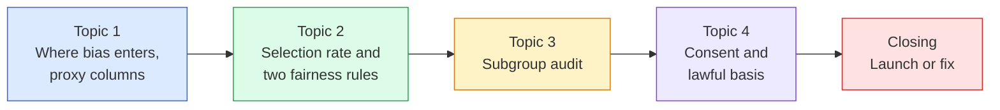
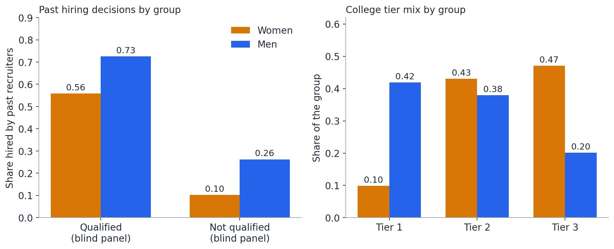
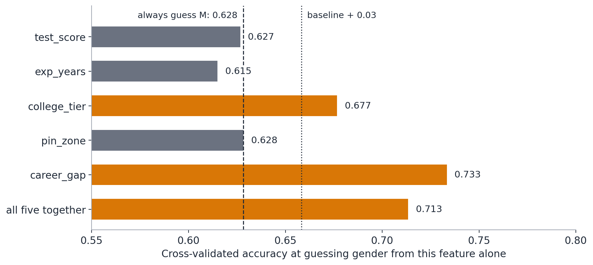
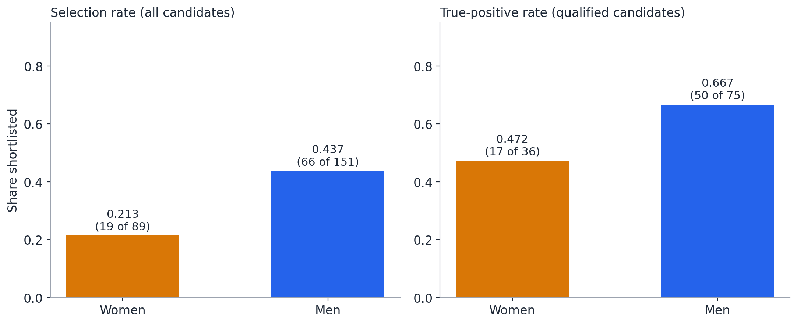
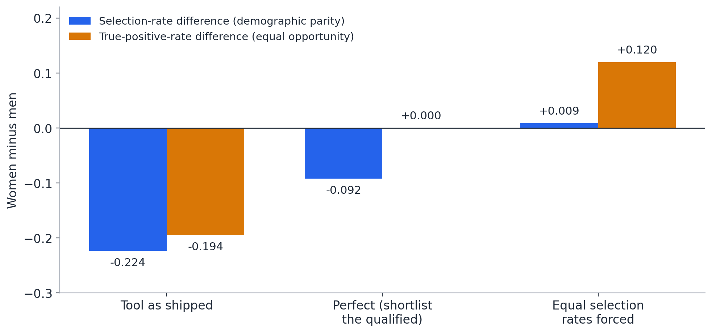
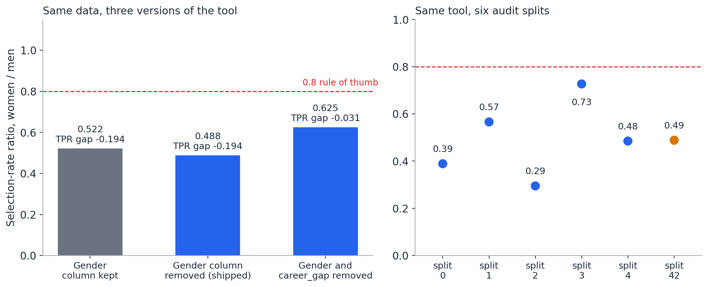
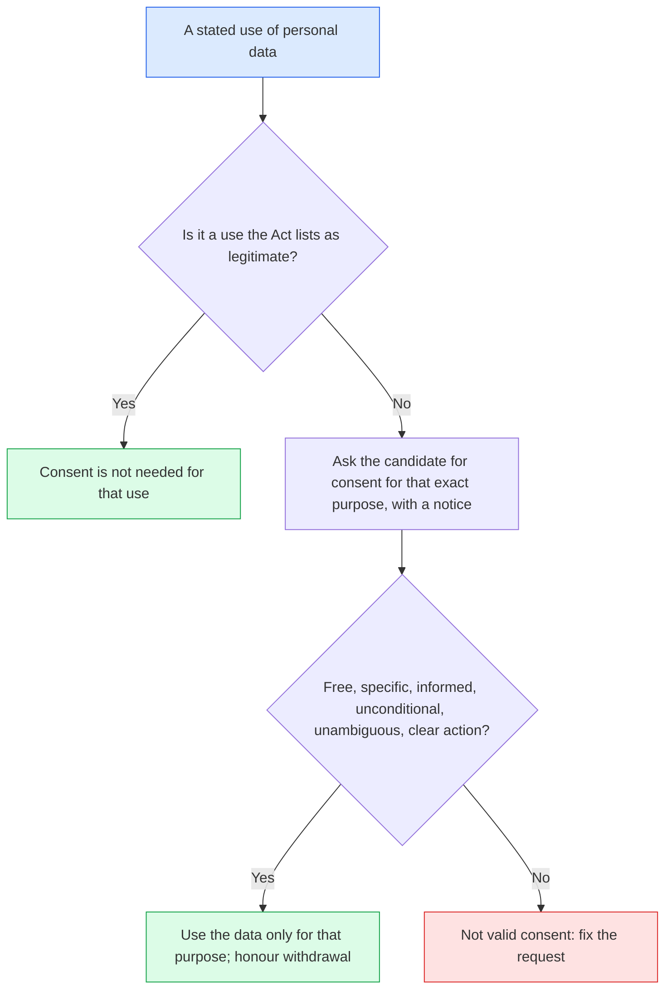
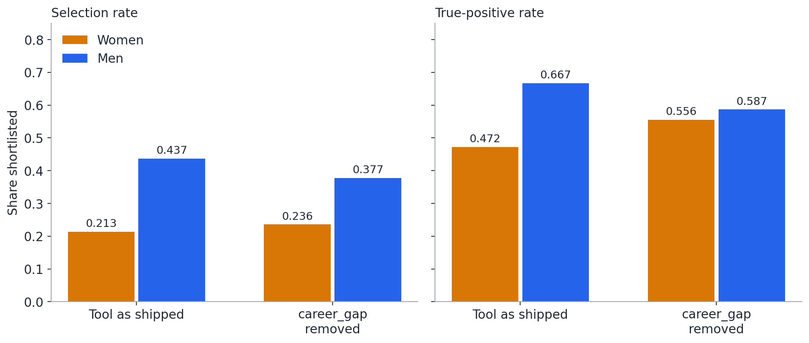

# <font color='#1d4ed8'>Lecture Script: Ethics, Fairness & Privacy in ML</font>

---

## <font color='blue'>Agenda</font>

The lecture runs as four topics. Each topic ends with a quiz.

| Topic | What we do | Learning objectives covered | Minutes |
|:-:|:--|:--|:-:|
| 1 | Find where bias enters and which columns stand in for gender | Classify a stated bias as historical, sampling, labelling or deployment bias<br>Classify features by whether they act as proxies for a protected attribute | 30 |
| 2 | Measure the gap and compare two fairness rules | Compute a fairness metric comparing model outcomes across two groups<br>Compare demographic parity with equal opportunity as definitions of fairness | 30 |
| 3 | Audit the shortlist by candidate subgroup | Analyze an AI hiring tool's shortlist by candidate subgroup to check for a fairness gap | 25 |
| 4 | Check consent and the lawful basis for candidate data | State the lawful basis and consent required for a stated use of personal data | 20 |
| — | Closing: Outcome & Summary | | 15 |
| | **Total** | | **120** |

> <font color="red">**🎯 Instructor Note**</font> Pace: in Topic 1 spend about 12 minutes on the four kinds of bias and the rest on proxies. In Topic 2 slow down at the hand calculation and at the table where the two rules disagree.
> Topic 3 is the audit learners will repeat at work. Topic 4 has no code: keep it a discussion, and say clearly that it is teaching material, not legal advice.

---

## <font color='blue'>Scenario</font>

A Naukri-style campus-hiring platform has built an AI tool that shortlists final-year students for employers. Meera, a data scientist on the platform, has been asked to check the shortlist by subgroup before the tool goes live. Here are two students who applied for the same role.

**Ananya** scored 78 in the platform's online test, finished two internships and studies at a tier-2 college. In her second year she took a six-month break to care for a family member, and her profile carries a career-gap flag.

**Rahul** scored 78 in the same test, finished two internships and also studies at a tier-2 college. He has no break, so his profile carries no flag.

The vendor's slide says, "The tool never sees gender, so it treats everyone the same." Meera must find out whether that holds for students like Ananya and Rahul, and for the groups they stand for.

> <font color="red">**🎯 Instructor Note**</font> The company is only the setting; do not claim any real platform uses this data or tool. The 600 candidates in `data/hiring_candidates.csv`, Ananya, Rahul and Meera are invented for teaching, and no real group of people is being described.
> Outputs come from Python 3, pandas 3.0.1, numpy 2.4.4 and scikit-learn 1.8.0; every split and model uses `random_state=42`. Learners upload the CSV into a `data` folder in Colab first.

---

## <font color='blue'>Problem Statement</font>

A campus-hiring platform launched its shortlisting tool after one check. The tool agreed with past recruiters' decisions about 3 times in 4, and the gender column had been removed from the data. A month later a placement officer at a women's college noticed that few of her students were being shortlisted, although many of them had test scores above the employers' cut-off. Employers lost a hiring season, students missed interviews, and the platform paused the tool and had to explain itself to every college.

Nobody had compared the shortlist across groups. Nobody had asked whether a column other than gender could do gender's work. And nobody had written down what the platform was allowed to do with the candidates' data.

> <font color='purple'>**How do we check, before launch, whether a hiring tool treats groups differently, which fairness rule do we judge it by, and what must we do about the candidates' personal data?**</font>

> <font color="red">**🎯 Instructor Note**</font> Poll: "The tool never sees the gender column. Can it still shortlist women at a lower rate than men? A) No, it cannot see gender. B) Yes, other columns can stand in for gender. C) Only if the data set is very large." Give learners 30 seconds to respond in chat. Reveal the answer in the Closing.

---

## <font color='blue'>What We Will Use</font>

Four groups of tools, one per topic. A **protected attribute** is a personal characteristic, such as gender, that a decision must not unfairly depend on. In our file it sits in one column, `gender`, kept only for auditing and never given to the tool.

| Topic | Tools | In one line |
|:-:|:--|:--|
| 1 | pandas `groupby` and `crosstab`, `DecisionTreeClassifier`, `cross_val_score` | Count where bias sits in the table, and test whether a column can guess gender |
| 2 | `LogisticRegression` in a `Pipeline`, `groupby`, `recall_score` | Make the shortlist, then compute selection rate and true-positive rate for each group |
| 3 | `groupby` on two columns, a retrained tool, repeated splits | Slice the shortlist by subgroup, remove a column, and repeat the audit on other splits |
| 4 | Reading and reasoning, no code: the Digital Personal Data Protection Act, 2023 (India) | Say which basis and which consent a stated use of personal data needs |

---

## <font color='blue'>How: Walking Through the Campus-Hiring Audit</font>



---

## <font color='blue'>Topic 1: Find Where Bias Enters and Which Columns Stand In for Gender</font> `30 min`

Last session you ranked feature importances and read SHAP values to see what drives a model's output, and you saved a model together with its preprocessing. Earlier you trained a logistic regression, read recall from a confusion matrix, and used k-fold cross-validation and a decision tree. Today those same tools audit a model instead of tuning it. A shortlisted candidate is the positive class, coded 1.

> <font color='purple'>**The tool will learn from past hiring decisions. Can the table itself already be unfair before any model is fitted?**</font>

### <font color='green'>Example: look at the candidate file</font>

> <font color='purple'>**What does one row hold, and how many women and men are in the file?**</font>

Each row is one past candidate. `test_score` is the platform's online test. `exp_years` is internship and work experience. `career_gap` is 1 when the candidate had a break of six months or more. `qualified` is 1 when a blind work-sample panel, which never saw names or gender, judged the candidate fit for the role. `hired_past` is 1 when past recruiters hired the candidate. `gender` is used only for auditing.

**Predict before running: What will happen?**

> <font color="red">**🎯 Instructor Note**</font> Expected: 600 rows and 9 columns, with about 4 women in every 10 candidates (223 women, 377 men). Common wrong guess: an even split.

```python
import pandas as pd

pd.set_option("display.width", 120)
pd.set_option("display.max_columns", 20)
df = pd.read_csv("data/hiring_candidates.csv")
print(df.shape)
print(df.head(4))
print(df["gender"].value_counts())
```

**Output**

```
(600, 9)
  candidate_id  test_score  exp_years  college_tier pin_zone  career_gap gender  qualified  hired_past
0         C001          87        1.8             1       Z1           0      F          1           1
1         C002          54        0.2             3       Z2           1      F          0           0
2         C003          46        0.2             2       Z2           1      F          0           0
3         C004          56        2.7             3       Z1           0      M          1           0
gender
M    377
F    223
Name: count, dtype: int64
```

#### <font color='#c2410c'>Code Explanation</font>

- **Line 1** Loads pandas.
- **Lines 3 and 4** Print wider tables, so all nine columns show on one line.
- **Line 5** Reads the candidate file into a table called `df`.
- **Line 6** Prints the size as (rows, columns).
- **Line 7** Shows the first four candidates.
- **Line 8** Counts how many candidates are women (F) and men (M).

> <font color='green'>**Result**</font> 600 candidates: 223 women (37.2%) and 377 men.

### <font color='green'>Extending it: what happened to each group?</font>

> <font color='purple'>**How many in each group did the blind panel call qualified, and how many did past recruiters hire?**</font>

> <font color="red">**🎯 Instructor Note**</font> Ask for a prediction first: "Is the hired gap bigger or smaller than the qualified gap?" Expected: the hired gap is bigger, about 19 points against 7.

```python
by = df.groupby("gender").agg(candidates=("qualified", "size"),
                              qualified=("qualified", "mean"),
                              hired_before=("hired_past", "mean"))
print(by.round(3))
```

**Output**

```
        candidates  qualified  hired_before
gender                                     
F              223      0.386         0.278
M              377      0.454         0.472
```

#### <font color='#c2410c'>Code Explanation</font>

- **Lines 1 to 3** Group the candidates by gender and compute three numbers per group: the count, the share qualified and the share hired in the past.
- **Line 4** Prints the table rounded to three places.

> <font color='green'>**Result**</font> The panel called 38.6% of women and 45.4% of men qualified, a gap of 6.8 points. Past recruiters hired 27.8% of women and 47.2% of men, a gap of 19.4 points. The hiring gap is much bigger than the qualified gap.

### <font color='green'>Extending it: did equally qualified candidates get equal treatment?</font>

> <font color='purple'>**Among candidates the panel judged qualified, did recruiters hire women and men at the same rate?**</font>

```python
print(df.groupby(["qualified", "gender"])["hired_past"].agg(["size", "mean"]).round(3))
```

**Output**

```
                  size   mean
qualified gender             
0         F        137  0.102
          M        206  0.262
1         F         86  0.558
          M        171  0.725
```

#### <font color='#c2410c'>Code Explanation</font>

- **Line 1** Splits candidates by the panel's verdict and by gender, then prints the count and the share hired in each cell.

<p align="center"></p>

> <font color='green'>**Result**</font> Among qualified candidates, recruiters hired 55.8% of women and 72.5% of men. The `hired_past` column is a recruiter's judgement, and that judgement was not the same for the same qualification. A tool trained on it learns that judgement. This is a **labelling** problem: the target column does not measure "qualified" the same way for every group.

### <font color='green'>Extending it: who sits in each college tier?</font>

> <font color='purple'>**The panel's qualified rate also differs by gender. Where could that come from?**</font>

```python
print(pd.crosstab(df["gender"], df["college_tier"], normalize="index").round(2))
```

**Output**

```
college_tier     1     2     3
gender                        
F             0.10  0.43  0.47
M             0.42  0.38  0.20
```

#### <font color='#c2410c'>Code Explanation</font>

- **Line 1** Builds a table of gender against college tier. `normalize="index"` turns each row into shares that add up to 1.

> <font color='green'>**Result**</font> Only 10% of the women come from tier-1 colleges, against 42% of the men. The records are accurate. They describe a pool shaped by earlier differences in who reached the top colleges, which is **historical** bias.

### <font color='green'>Extending it: who is thin in the file?</font>

> <font color='purple'>**Suppose placement cells say each of the four zones sends about a quarter of the students. Does the file match that?**</font>

> <font color="red">**🎯 Instructor Note**</font> The "about a quarter" is an invented figure for teaching, to give the file something to be compared with. Zone Z4 has 80 of 600 rows.

```python
print(pd.crosstab(df["pin_zone"], df["gender"], margins=True))
```

**Output**

```
gender      F    M  All
pin_zone               
Z1         68  118  186
Z2         72  116  188
Z3         52   94  146
Z4         31   49   80
All       223  377  600
```

#### <font color='#c2410c'>Code Explanation</font>

- **Line 1** Counts candidates by zone and gender. `margins=True` adds the totals.

> <font color='green'>**Result**</font> Zone Z4 has 80 rows, 13.3% of the file, against the quarter we expect, and only 31 of them are women. A model learns less about groups with few rows, and an audit of them rests on few people. This is **sampling** bias: the file does not match the people the tool will serve.

#### <font color='#c2410c'>Logic Explanation</font>

Four places where a distortion can enter. Ask one question to decide which one a statement is about.

| Kind | Where the problem sits | Question to ask |
|:--|:--|:--|
| Historical | In the world the data describes. The records are accurate, but the world was unequal | Would the pattern remain even if every record were perfect? |
| Sampling | In who is in the file. Some groups are missing or thin compared with the people the tool will serve | Does the file match the people the tool will be used on? |
| Labelling | In the target column. The label is a flawed stand-in for what we want, or is applied unevenly | Does the label measure the same thing, the same way, for every group? |
| Deployment | In use after training. The tool is used on other people, for another purpose, or its output is not reviewed | Is the tool used the way, and on the people, it was built for? |

Real cases can mix several kinds. Name the one the statement points to.

> <font color="red">**🎯 Instructor Note**</font> Read each statement aloud and ask learners to classify it. Give learners 30 seconds to respond in chat. Answers: a) historical, b) sampling, c) labelling, d) deployment.

| | Stated bias | Kind |
|:-:|:--|:--|
| a | Women in the pool reached tier-1 colleges less often because of earlier differences in access. The table records this correctly | Historical |
| b | Zone Z4 sends about a quarter of the students but supplies 13% of the rows | Sampling |
| c | The target is what a recruiter decided, and recruiters hired qualified women less often than qualified men | Labelling |
| d | A tool built on freshers is switched on to rank lateral hires with six years of experience, and everyone under the cut-off is rejected without a human reading the profile | Deployment |

### <font color='green'>Extending it: can a column that is not gender still tell us gender?</font>

> <font color='purple'>**We can remove the gender column. Can the other columns still tell us who is a woman?**</font>

A **proxy** is a column that is not the protected attribute but lets you guess it. A tool that never sees `gender` can still lean on a proxy. First look at the share of women inside each value of a column. If the share is the same in every value, the column says nothing about gender.

**Predict before running: What will happen?**

> <font color="red">**🎯 Instructor Note**</font> Overall 37% of candidates are women. Expected: the career-gap and tier shares move far from 37%; the zone shares stay near it. Common wrong guess: that a location column must be a proxy.

```python
woman = (df["gender"] == "F").astype(int)
print("share of women overall:", round(woman.mean(), 3))
for col in ["career_gap", "college_tier", "pin_zone"]:
    print(col, woman.groupby(df[col]).mean().round(2).to_dict())
print(df.groupby("gender")[["test_score", "exp_years"]].mean().round(1))
```

**Output**

```
share of women overall: 0.372
career_gap {0: 0.28, 1: 0.79}
college_tier {1: 0.12, 2: 0.4, 3: 0.58}
pin_zone {'Z1': 0.37, 'Z2': 0.38, 'Z3': 0.36, 'Z4': 0.39}
        test_score  exp_years
gender                       
F             54.8        1.2
M             61.0        1.2
```

#### <font color='#c2410c'>Code Explanation</font>

- **Line 1** Makes a 0/1 column that is 1 for a woman.
- **Line 2** Prints the share of women overall, the baseline for the comparison.
- **Lines 3 and 4** For each column, group the 0/1 column by the column's values and print the mean, which is the share of women within each value.
- **Line 5** Prints the average test score and experience for each gender.

> <font color='green'>**Result**</font> Among candidates with a career gap, 79% are women; among those without, 28%. In tier 1 only 12% are women; in tier 3, 58%. In each of the four zones the share stays between 36% and 39%. The average scores differ by 6 points on the test and not at all on experience.

### <font color='green'>Extending it: can a model guess gender from one column?</font>

> <font color='purple'>**How much better than guessing can a small model recover gender from a single column?**</font>

Set a baseline first. If we always guess "man", we are right for 377 of 600 candidates, 62.8%. We use cross-validated accuracy of a small decision tree. The 3-point cut-off below is a teaching choice for this room; no standard fixes it.

$$\boxed{\text{a column acts as a proxy when its accuracy} \ge \text{baseline} + 0.03}$$

```python
from sklearn.tree import DecisionTreeClassifier
from sklearn.model_selection import StratifiedKFold, cross_val_score

X = pd.get_dummies(df.drop(columns=["candidate_id", "gender", "qualified", "hired_past"]), columns=["pin_zone"], dtype=int)
y = woman
skf = StratifiedKFold(5, shuffle=True, random_state=42)
tree = DecisionTreeClassifier(max_depth=3, random_state=42)
print(list(X.columns))
print("always guess M:", round(1 - y.mean(), 3))
```

**Output**

```
['test_score', 'exp_years', 'college_tier', 'career_gap', 'pin_zone_Z1', 'pin_zone_Z2', 'pin_zone_Z3', 'pin_zone_Z4']
always guess M: 0.628
```

#### <font color='#c2410c'>Code Explanation</font>

- **Lines 1 and 2** Import the small decision tree and the cross-validation tools you used before.
- **Line 4** Builds the feature table without `gender`, `qualified`, `hired_past` and the id. The zone becomes four 0/1 columns.
- **Line 5** The thing to guess is the 0/1 "woman" column.
- **Lines 6 and 7** Set up five stratified folds and a small tree.
- **Lines 8 and 9** Print the feature names and the baseline.

**Predict before running: What will happen?**

> <font color="red">**🎯 Instructor Note**</font> Expected: only `career_gap` and `college_tier` rise clearly above 0.628. Common wrong guess: that test score will, because the average scores differ.

```python
groups = {"test_score": ["test_score"], "exp_years": ["exp_years"], "college_tier": ["college_tier"],
          "pin_zone": [c for c in X if c.startswith("pin_zone")], "career_gap": ["career_gap"],
          "all five together": list(X.columns)}
for name, cols in groups.items():
    acc = cross_val_score(tree, X[cols], y, cv=skf).mean()
    print(f"{name:18s}{acc:.3f}")
```

**Output**

```
test_score        0.627
exp_years         0.615
college_tier      0.677
pin_zone          0.628
career_gap        0.733
all five together 0.713
```

#### <font color='#c2410c'>Code Explanation</font>

- **Lines 1 to 3** Name the feature groups to test. The zone uses its four 0/1 columns together; the last entry uses every feature.
- **Lines 4 to 6** For each group, cross-validate the tree at guessing gender and print the mean accuracy.

<p align="center"></p>

> <font color='green'>**Result**</font> `career_gap` reaches 0.733 and `college_tier` 0.677, both above the 0.658 cut-off, so both act as proxies. `test_score` (0.627), `exp_years` (0.615) and `pin_zone` (0.628) stay at the baseline, so they do not. All five together reach 0.713 even with the gender column gone.

> <font color='#b45309'>**Common mistake**</font> Deciding by intuition. A pin-code zone looks like a stand-in for who a person is, and here it is not. Test each column on each new file. A proxy is a flag for review, not an automatic ban: `college_tier` may be job-related, and a human must decide.

### <font color='purple'>Quiz 1</font>

**Question:** A hiring file has 200 candidates, 80 of them women (40%). After the gender column is removed, a team checks how many women fall into each group of four remaining columns. Which column acts most clearly as a proxy for gender?

**Options:**
- A) Home zone is Z4: 17 women among 40 candidates, against 63 among the other 160
- B) Career break of six months or more: 48 women among 60 candidates, against 32 among the other 140
- C) Test score above 70: 33 women among 80 candidates, against 47 among the other 120
- D) Two or more years of experience: 19 women among 50 candidates, against 61 among the other 150

**Correct Answer:** B

**Explanation:**
- **A)** Wrong: 17 of 40 is 42.5% and 63 of 160 is 39.4%, so the share of women barely changes.
- **B)** Correct: 48 of 60 is 80% women with a break, and 32 of 140 is 22.9% without; the column separates women from men sharply.
- **C)** Wrong: 33 of 80 is 41.3% and 47 of 120 is 39.2%, close to the overall 40%.
- **D)** Wrong: 19 of 50 is 38% and 61 of 150 is 40.7%, also close to 40%.

---

## <font color='blue'>Topic 2: Measure the Gap and Compare Two Fairness Rules</font> `30 min`

> <font color='purple'>**Two columns can stand in for gender. How differently does the shortlist treat women and men, and in which number do we see it?**</font>

### <font color='green'>Example: build the tool and make its shortlist</font>

> <font color='purple'>**What does the tool shortlist from candidates it has never seen?**</font>

The platform trained its tool on past recruiters' `hired_past` decisions, using the blind feature table from Topic 1 with no `gender` column. We keep 60% of the candidates (360) to train it and 40% (240) as an audit batch, split so both groups appear in the same proportion in each part. The tool is a standardised logistic regression in a Pipeline.

**Predict before running: What will happen?**

> <font color="red">**🎯 Instructor Note**</font> Expected: 360 and 240 rows, and the tool agreeing with recruiters' decisions on about 72.5% of the audit batch. Common wrong guess: that a high agreement means the tool is fair.

```python
from sklearn.linear_model import LogisticRegression
from sklearn.model_selection import train_test_split
from sklearn.pipeline import make_pipeline
from sklearn.preprocessing import StandardScaler

tr, te = train_test_split(df.index, test_size=0.4, stratify=df["gender"], random_state=42)
tool = make_pipeline(StandardScaler(), LogisticRegression(max_iter=1000))
tool.fit(X.loc[tr], df.loc[tr, "hired_past"])
print(len(tr), len(te), round(tool.score(X.loc[te], df.loc[te, "hired_past"]), 3))
```

**Output**

```
360 240 0.725
```

#### <font color='#c2410c'>Code Explanation</font>

- **Lines 1 to 4** Import the model, the splitter, the Pipeline and the scaler.
- **Line 6** Splits the row numbers 60/40, stratified on gender, with a fixed `random_state`. `tr` is for training, `te` is the audit batch.
- **Line 7** Builds the Pipeline: standardise the columns, then fit a logistic regression.
- **Line 8** Trains it on the training rows with the recruiters' decision as the label.
- **Line 9** Prints the two sizes and the accuracy against recruiters' decisions on the audit batch.

```python
audit = df.loc[te].copy()
audit["shortlist"] = tool.predict(X.loc[te])
print(audit["shortlist"].sum(), "of", len(audit), "shortlisted")
sel = audit.groupby("gender")["shortlist"].agg(["size", "sum", "mean"])
print(sel.round(3))
```

**Output**

```
85 of 240 shortlisted
        size  sum   mean
gender                  
F         89   19  0.213
M        151   66  0.437
```

#### <font color='#c2410c'>Code Explanation</font>

- **Line 1** Copies the audit batch into a table called `audit`.
- **Line 2** Adds the tool's decision, 1 for shortlisted.
- **Line 3** Prints how many of the 240 were shortlisted.
- **Lines 4 and 5** For each gender, print the group size, the number shortlisted and the share shortlisted.

> <font color='green'>**Result**</font> The tool shortlisted 85 of 240 candidates: 19 of 89 women and 66 of 151 men.

### <font color='green'>Extending it: selection rate, difference and ratio</font>

> <font color='purple'>**How much lower is the women's shortlist rate than the men's?**</font>

The **selection rate** of a group is the share of its candidates the tool shortlists. Demographic parity asks for equal selection rates.

$$\boxed{\text{rate}_g = \frac{\text{shortlisted in group } g}{\text{candidates in group } g}}$$

$$\text{DP difference} = \text{rate}_F - \text{rate}_M, \qquad \text{DP ratio} = \frac{\text{rate}_F}{\text{rate}_M}$$

By hand: $\text{rate}_F = 19 \div 89 = 0.213$ and $\text{rate}_M = 66 \div 151 = 0.437$. The difference is $0.2135 - 0.4371 = -0.224$ and the ratio is $0.2135 \div 0.4371 = 0.488$.

```python
rate = sel["mean"]
print("difference F - M:", round(rate["F"] - rate["M"], 3))
print("ratio F / M:", round(rate["F"] / rate["M"], 3))
```

**Output**

```
difference F - M: -0.224
ratio F / M: 0.488
```

#### <font color='#c2410c'>Code Explanation</font>

- **Line 1** Takes the selection-rate column of the table from the last block.
- **Line 2** Prints women's rate minus men's rate.
- **Line 3** Prints women's rate divided by men's rate.

> <font color='green'>**Result**</font> The women's selection rate is 0.224 lower than the men's, and about half of it (ratio 0.488). A **four-fifths rule** is a rule of thumb from US employment practice that asks for a ratio of at least 0.8. It is not Indian law, and it does not prove fairness or unfairness. Here 0.488 is far below 0.8, so it flags the shortlist for a closer look.

### <font color='green'>Extending it: equal opportunity, the true-positive rate</font>

> <font color='purple'>**Among candidates who really are qualified, does the tool shortlist women and men at the same rate?**</font>

The **true-positive rate** (TPR) of a group is the share of its qualified candidates that the tool shortlists. It is the recall you used before, computed for each group. Equal opportunity asks for equal TPRs. Here "qualified" means the blind panel's verdict.

$$\boxed{\text{TPR}_g = \frac{\text{qualified and shortlisted in group } g}{\text{qualified in group } g}}$$

By hand: $\text{TPR}_F = 17 \div 36 = 0.472$ and $\text{TPR}_M = 50 \div 75 = 0.667$, so the difference is $0.4722 - 0.6667 = -0.194$.

```python
q = audit[audit["qualified"] == 1]
tpr = q.groupby("gender")["shortlist"].agg(["size", "sum", "mean"])
print(tpr.round(3))
print("TPR difference F - M:", round(tpr.loc["F", "mean"] - tpr.loc["M", "mean"], 3))
```

**Output**

```
        size  sum   mean
gender                  
F         36   17  0.472
M         75   50  0.667
TPR difference F - M: -0.194
```

#### <font color='#c2410c'>Code Explanation</font>

- **Line 1** Keeps only the candidates the panel judged qualified.
- **Line 2** For each gender, counts them, counts how many were shortlisted, and gives the share.
- **Lines 3 and 4** Print the table and the women's TPR minus the men's.

```python
from sklearn.metrics import recall_score

for g in ["F", "M"]:
    a = audit[audit["gender"] == g]
    print(g, round(recall_score(a["qualified"], a["shortlist"]), 3))
```

**Output**

```
F 0.472
M 0.667
```

#### <font color='#c2410c'>Code Explanation</font>

- **Line 1** Loads scikit-learn's recall function, a second method to check the TPR.
- **Lines 3 to 5** For each gender, compute recall of the tool's decision against the panel's verdict, and print it. It matches the table.

<p align="center"></p>

> <font color='green'>**Result**</font> Qualified women are shortlisted at 0.472 and qualified men at 0.667. The check uses 36 qualified women, so one candidate moves the women's TPR by about 3 points.

### <font color='green'>Extending it: can the two rules disagree?</font>

> <font color='purple'>**If a shortlist were perfect, would both rules be satisfied?**</font>

First by hand. Group A has 100 applicants, 50 qualified. Group B has 100 applicants, 20 qualified. A perfect tool shortlists exactly the qualified.

| | Group A | Group B |
|:--|:-:|:-:|
| Selection rate | $50 \div 100 = 0.50$ | $20 \div 100 = 0.20$ |
| TPR | $50 \div 50 = 1.0$ | $20 \div 20 = 1.0$ |

The TPRs are equal, so equal opportunity holds. The selection rates are 0.50 and 0.20, a ratio of 0.4, so demographic parity fails. When the groups' qualified shares differ, a perfect tool can still break demographic parity. Now the same test on our audit batch, with a perfect "oracle" that shortlists exactly the qualified. The helper `check` also reports the tool.

**Predict before running: What will happen?**

> <font color="red">**🎯 Instructor Note**</font> Expected: the oracle has TPR 1.0 for both groups, yet its selection rates differ (0.404 and 0.497), because 36 of 89 women and 75 of 151 men are qualified.

```python
def check(col):
    s = audit.groupby("gender")[col].mean()
    t = audit[audit["qualified"] == 1].groupby("gender")[col].mean()
    return {"sel F": s["F"], "sel M": s["M"], "DP diff": s["F"] - s["M"], "DP ratio": s["F"] / s["M"],
            "TPR F": t["F"], "TPR M": t["M"], "EO diff": t["F"] - t["M"]}
audit["oracle"] = audit["qualified"]
print(pd.DataFrame({c: check(c) for c in ["shortlist", "oracle"]}).round(3).T)
```

**Output**

```
           sel F  sel M  DP diff  DP ratio  TPR F  TPR M  EO diff
shortlist  0.213  0.437   -0.224     0.488  0.472  0.667   -0.194
oracle     0.404  0.497   -0.092     0.814  1.000  1.000    0.000
```

#### <font color='#c2410c'>Code Explanation</font>

- **Lines 1 to 5** The helper `check` takes a decision column and returns both groups' selection rates, their difference and ratio, and both groups' TPRs and their difference.
- **Line 6** Makes the oracle: shortlist exactly the candidates the panel judged qualified.
- **Line 7** Prints the check for the tool and for the oracle.

> <font color='green'>**Result**</font> The oracle has TPR 1.0 for both groups, so equal opportunity holds exactly. Its selection rates are 0.404 and 0.497, a ratio of 0.814, so demographic parity does not hold. The two rules measure different things.

### <font color='green'>Extending it: close one gap and see the other</font>

> <font color='purple'>**What if we force the two selection rates to match?**</font>

We keep the tool's scores but pick each group's shortlist separately: the top share of women and the top share of men, so that both groups get about the tool's overall rate of 35.4%.

> <font color="red">**🎯 Instructor Note**</font> Ask for a prediction: "If the selection rates match, will the TPRs match too?" Expected: no. The women's TPR rises above the men's.

```python
audit["score"] = tool.predict_proba(X.loc[te])[:, 1]
target = audit["shortlist"].mean()
top = lambda s: (s.rank(ascending=False, method="first") <= round(target * len(s))).astype(int)
audit["equalised"] = audit.groupby("gender")["score"].transform(top)
print(pd.DataFrame({c: check(c) for c in ["shortlist", "oracle", "equalised"]}).round(3).T)
```

**Output**

```
           sel F  sel M  DP diff  DP ratio  TPR F  TPR M  EO diff
shortlist  0.213  0.437   -0.224     0.488  0.472  0.667   -0.194
oracle     0.404  0.497   -0.092     0.814  1.000  1.000    0.000
equalised  0.360  0.351    0.009     1.024  0.667  0.547    0.120
```

#### <font color='#c2410c'>Code Explanation</font>

- **Line 1** Saves the tool's probability of being shortlisted for each candidate.
- **Line 2** Takes the tool's overall selection rate, 85 of 240.
- **Line 3** Defines a function that ranks a group's scores and keeps the top share.
- **Line 4** Applies it separately inside each gender.
- **Line 5** Prints the check for all three shortlists.

<p align="center"></p>

> <font color='green'>**Result**</font> The selection rates now match (0.360 and 0.351, a difference of 0.009), but the TPRs are 0.667 for women and 0.547 for men, a gap of +0.120 the other way. Closing one gap did not close the other.

#### <font color='#c2410c'>Logic Explanation</font>

| | Demographic parity | Equal opportunity |
|:--|:--|:--|
| It asks | Do groups get shortlisted at the same rate? | Do qualified people in each group get shortlisted at the same rate? |
| It needs | Only the tool's decisions and the group | A trustworthy "qualified" label for every candidate |
| Its blind spot | Ignores whether groups differ in how many are qualified | Is only as good as the label; a biased label hides unfairness |

No single number proves a tool fair or unfair. Pick the rule that fits the decision, report more than one, and say what each cannot show.

### <font color='purple'>Quiz 2</font>

**Question:** A tool shortlists 30 of 120 women and 45 of 90 men. Of the candidates who are qualified, it shortlists 24 of 40 women and 36 of 60 men. Which statement is correct?

**Options:**
- A) Both demographic parity and equal opportunity hold
- B) Neither holds
- C) Demographic parity holds but equal opportunity fails
- D) Equal opportunity holds but demographic parity fails

**Correct Answer:** D

**Explanation:**
- **A)** Wrong: the selection rates are $30 \div 120 = 0.25$ and $45 \div 90 = 0.50$, so demographic parity fails.
- **B)** Wrong: the TPRs are $24 \div 40 = 0.60$ and $36 \div 60 = 0.60$, so equal opportunity holds.
- **C)** Wrong: this reverses the two; the selection rates differ (ratio 0.5) and the TPRs match.
- **D)** Correct: TPR is 0.60 for both groups, while the selection rates are 0.25 and 0.50.

---

## <font color='blue'>Topic 3: Audit the Shortlist by Candidate Subgroup</font> `25 min`

> <font color='purple'>**The vendor says the tool never sees gender, so it cannot be unfair. Does our audit support that?**</font>

### <font color='green'>Example: three versions of the tool</font>

> <font color='purple'>**What happens to the gap if the gender column is put back, and what if the career-gap column is taken out as well?**</font>

We compare the tool with the gender column kept, the tool as shipped (gender removed) and a third tool with `career_gap` removed too. All three train on the same 360 rows and shortlist the same 240.

**Predict before running: What will happen?**

> <font color="red">**🎯 Instructor Note**</font> Expected: putting gender back changes the gap very little, and removing `career_gap` shrinks the TPR gap most. Common wrong guess: that removing gender should have closed the gap.

```python
X2 = X.assign(is_female=woman)
cols = list(X.columns)
def run_tool(use):
    m = make_pipeline(StandardScaler(), LogisticRegression(max_iter=1000))
    return m.fit(X2.loc[tr, use], df.loc[tr, "hired_past"]).predict(X2.loc[te, use])
audit["with_gender"] = run_tool(cols + ["is_female"])
audit["no_gap"] = run_tool([c for c in cols if c != "career_gap"])
print(pd.DataFrame({c: check(c) for c in ["with_gender", "shortlist", "no_gap"]}).round(3).T)
```

**Output**

```
             sel F  sel M  DP diff  DP ratio  TPR F  TPR M  EO diff
with_gender  0.225  0.430   -0.206     0.522  0.472  0.667   -0.194
shortlist    0.213  0.437   -0.224     0.488  0.472  0.667   -0.194
no_gap       0.236  0.377   -0.142     0.625  0.556  0.587   -0.031
```

#### <font color='#c2410c'>Code Explanation</font>

- **Line 1** Adds a 0/1 woman column to the feature table.
- **Line 2** Saves the list of blind feature names.
- **Lines 3 to 5** The function `run_tool` fits the same Pipeline on the columns it is given and returns the shortlist for the audit batch.
- **Lines 6 and 7** Make the shortlist with gender kept, and without `career_gap`.
- **Line 8** Prints the check for the three tools.

> <font color='green'>**Result**</font> With gender kept, the selection ratio is 0.522; as shipped, it is 0.488. The ratio did not improve when gender was removed. With `career_gap` also removed, the TPR gap falls from -0.194 to -0.031, but the selection ratio is still only 0.625. A perfect shortlist has ratio 0.814, so part of what remains comes from the pool; the table cannot tell us how much comes from each remaining column.

### <font color='green'>Extending it: which column is the tool leaning on?</font>

> <font color='purple'>**Which columns pull a candidate's score up or down in the tool as shipped?**</font>

```python
coef = pd.Series(tool[-1].coef_[0], index=X.columns)
print(coef.round(2).sort_values())
```

**Output**

```
career_gap     -0.79
college_tier   -0.09
pin_zone_Z3    -0.08
pin_zone_Z1    -0.00
pin_zone_Z4     0.04
pin_zone_Z2     0.05
exp_years       0.59
test_score      1.16
dtype: float64
```

#### <font color='#c2410c'>Code Explanation</font>

- **Line 1** Reads the fitted model's coefficients out of the Pipeline's last step and labels them with the column names. The columns were standardised, so the sizes are comparable.
- **Line 2** Prints them from most negative to most positive.

> <font color='green'>**Result**</font> `career_gap` is the only strongly negative column (-0.79). The tool learned to mark the gap down from the recruiters' decisions it was trained on. Because 37% of women in the audit batch (33 of 89) have a gap, against 5% of men (7 of 151), the penalty falls mostly on women.

### <font color='green'>Extending it: slice the shortlist by subgroup</font>

> <font color='purple'>**Inside each combination of gender and career gap, how many candidates are there, how many are qualified, and how many are shortlisted?**</font>

> <font color="red">**🎯 Instructor Note**</font> Ask first: "Which cell will be the smallest?" Expected: men with a gap, only 7 people. Point at the count column before reading any rate.

```python
sub = audit.groupby(["gender", "career_gap"]).agg(n=("shortlist", "size"),
                                                  qualified=("qualified", "mean"),
                                                  shortlisted=("shortlist", "mean"))
print(sub.round(3))
```

**Output**

```
                     n  qualified  shortlisted
gender career_gap                             
F      0            56      0.375        0.286
       1            33      0.455        0.091
M      0           144      0.493        0.451
       1             7      0.571        0.143
```

#### <font color='#c2410c'>Code Explanation</font>

- **Lines 1 to 3** Group the audit batch by gender and career gap, and compute the count, the qualified share and the shortlisted share in each cell.
- **Line 4** Prints the table rounded to three places.

> <font color='green'>**Result**</font> Candidates with a gap are qualified at a similar rate or higher (0.455 for women, 0.571 for men) than those without (0.375 and 0.493), yet they are shortlisted far less: 9.1% of women with a gap (3 of 33), against 28.6% of women without (16 of 56). Even without a gap, women are shortlisted at 28.6% and men at 45.1%, so the gap is not only the career-gap column. The men-with-a-gap cell has 7 people, one of whom was shortlisted, so its 14.3% is too thin to read.

### <font color='green'>Extending it: is one audit number enough?</font>

> <font color='purple'>**If we draw a different audit batch, how far does the gap move?**</font>

We repeat the whole audit on five other random splits, retraining the same blind tool each time, just as k-fold cross-validation repeats a score on different folds.

```python
def spread(seed):
    a, b = train_test_split(df.index, test_size=0.4, stratify=df["gender"], random_state=seed)
    m = make_pipeline(StandardScaler(), LogisticRegression(max_iter=1000)).fit(X.loc[a], df.loc[a, "hired_past"])
    p, g, ok = pd.Series(m.predict(X.loc[b]), index=b), df.loc[b, "gender"], df.loc[b, "qualified"] == 1
    s, t = p.groupby(g).mean(), p[ok].groupby(g[ok]).mean()
    return [round(s["F"] / s["M"], 3), round(t["F"] - t["M"], 3)]
print(pd.DataFrame({s: spread(s) for s in range(5)}, index=["DP ratio", "EO diff"]).T)
```

**Output**

```
   DP ratio  EO diff
0     0.389   -0.314
1     0.566   -0.161
2     0.295   -0.333
3     0.727   -0.193
4     0.485   -0.241
```

#### <font color='#c2410c'>Code Explanation</font>

- **Lines 1 to 3** A function that, for one split number, splits, trains the blind tool and shortlists the held-out part.
- **Lines 4 and 5** Work out the selection rate by gender and the TPR by gender for that part.
- **Line 6** Returns the selection ratio and the TPR difference.
- **Line 7** Runs the function for splits 0 to 4 and prints a table.

<p align="center"></p>

> <font color='green'>**Result**</font> The selection ratio ranges from 0.295 to 0.727 across the five splits, and the TPR difference from -0.333 to -0.161. Women are shortlisted less in all five, but the size of the gap moves a lot, and the audit group has only 89 women (36 qualified). The chart adds our main audit split in orange (0.488). Report a range, with the group sizes.

#### <font color='#c2410c'>Logic Explanation</font>

| This check can show | This check cannot show |
|:--|:--|
| That outcomes differ between the groups we measured, and by how much | Why they differ: the tool, the pool or the label |
| Which columns the tool leans on, and where the gap shrinks when one is removed | That the tool is fair because the gap is small: small groups, other attributes and a biased label can all hide a problem |
| That the direction repeats on other splits | A reliable size for thin subgroups, such as 7 men with a gap |

> <font color='#b45309'>**Common mistake**</font> Reading a small group's rate as a finding. Show the counts beside every rate, and treat cells of a handful of people as a prompt to collect more data.

### <font color='purple'>Quiz 3</font>

**Question:** Among candidates with a career gap in an audit batch, 3 of 33 women (9.1%) and 1 of 7 men (14.3%) are shortlisted. What is the sound reading?

**Options:**
- A) The two rates cannot be compared with confidence: one more shortlisted man would raise the men's rate by 14 points, to 28.6%, so report the counts and collect more data
- B) Men with a gap are favoured, because 14.3% is higher than 9.1%
- C) The tool is fair to women with a gap, because 9.1% is close to 14.3%
- D) Small groups cannot suffer a fairness gap, so the cell can be dropped

**Correct Answer:** A

**Explanation:**
- **A)** Correct: $2 \div 7 = 0.286$ against $1 \div 7 = 0.143$, a 14-point move from one person.
- **B)** Wrong: the 14.3% rests on 1 person out of 7; it is not evidence of favouring men.
- **C)** Wrong: both rates are low and the men's rate is unreliable, so closeness proves nothing about fairness.
- **D)** Wrong: a small group can be harmed; its gap is just hard to measure and needs more data.

---

## <font color='blue'>Topic 4: Check Consent and the Lawful Basis for Candidate Data</font> `20 min`

> <font color='purple'>**To audit by gender, the platform must hold gender, CVs and test scores. What must it do before it uses that data?**</font>

This topic is teaching material, not legal advice. It refers to the Digital Personal Data Protection Act, 2023 (India), which we call "the Act". For a real decision, read the current text of the Act and its Rules, or ask a lawyer.

> <font color="red">**🎯 Instructor Note**</font> Teach only what is on this page, with no section numbers, penalties, dates or Rules details. Before the session, check the current text of the Act and its Rules on the official government site, including which parts are already in force.
> If asked whether a CV uploaded to apply for a job is itself a listed legitimate use, say it is a legal reading, and teach the safe route: ask for consent for the stated purpose.

### <font color='green'>Example: who is who, and what the Act asks first</font>

> <font color='purple'>**Whose data is it, and what are the two routes by which the platform may use it?**</font>

The Act covers digital personal data: data about a person who can be identified from it, collected in digital form or collected on paper and digitised later, such as a CV, a test score or a gender entry. It uses three roles.

| Role in the Act | Who it is on our platform |
|:--|:--|
| Data Principal | The candidate, the person the data is about |
| Data Fiduciary | The platform, which decides why and how the data is used |
| Data Processor | A vendor that handles the data on the platform's behalf, such as a cloud host |

The platform may process a candidate's personal data for a lawful purpose in one of two ways. Either the candidate has given **consent** for that purpose, or the use is one of the **legitimate uses** the Act lists, which do not need consent. The list includes uses such as complying with a court order and responding to a medical emergency.



#### <font color='#c2410c'>Logic Explanation</font>

- **The flow** is a checking routine for this room, not the Act's own wording.
- **A notice** goes with the request for consent. It tells the candidate what data is asked for, for what purpose, how to exercise her rights and how to complain.
- **Consent** must be free, specific, informed, unconditional and unambiguous, given by a clear affirmative action, for a stated purpose, and limited to the data needed for that purpose. A pre-ticked box or silence is not a clear affirmative action.
- **Withdrawal** is allowed at any time, and withdrawing should be about as easy as giving consent was. Use made before the withdrawal stays lawful.

> <font color='green'>**Result**</font> Every use of candidate data needs a stated purpose, and then either a matching consent or a listed legitimate use.

### <font color='green'>Extending it: state the basis and consent for each use</font>

> <font color='purple'>**For five uses of candidate data, which basis applies and what must the consent look like?**</font>

> <font color="red">**🎯 Instructor Note**</font> Read each use aloud and ask learners for the basis before showing the row. Give learners 30 seconds to respond in chat. The "safe design" column is advice for this room, not a legal ruling.

| Stated use | Lawful basis | What a safe request looks like |
|:--|:--|:--|
| 1. Shortlist an applicant for the role she applied for, using her CV and test score | Consent for that purpose, the safe basis to rely on | A notice naming the purpose, and an affirmative tick at sign-up |
| 2. Collect gender only to audit the shortlist for fairness | Consent for that separate purpose | Its own notice and tick, optional so that applying does not depend on it, and used only for the audit, never fed to the tool |
| 3. Pass candidates' CVs to a partner company for its own marketing | Consent for this new purpose; the shortlisting consent does not cover it | A fresh, specific request that names this purpose |
| 4. Hand a candidate's record to a court that has ordered it | A legitimate use the Act lists: complying with a court order | No consent needed for that disclosure |
| 5. Keep using a candidate's CV after she withdraws her consent | None for that purpose | Stop using it for that purpose within a reasonable time, and erase it unless a law requires keeping it; use before withdrawal stays lawful |

> <font color='green'>**Result**</font> A use is covered only by the purpose its consent names. A new purpose needs a new consent, unless the Act lists it as a legitimate use.

> <font color='#b45309'>**Common mistake**</font> Treating consent given at sign-up as permission for every other use. Consent is for a stated purpose, and a vague "we may use your data for anything" is not specific.

### <font color='purple'>Quiz 4</font>

**Question:** A campus-hiring platform collected CVs with consent for "matching you with jobs". It now wants to use the same CVs to build a model for a paid advertising product. What should it do under the Act?

**Options:**
- A) Nothing: a CV already given can be used for any purpose
- B) Use the CVs: consent never expires, so it covers the new purpose
- C) Ask for fresh consent for the new purpose, with a notice, unless the Act lists the use as a legitimate use
- D) Delete the name column and go ahead, because the Act then no longer matters

**Correct Answer:** C

**Explanation:**
- **A)** Wrong: consent is tied to a stated purpose, and "matching you with jobs" does not name advertising.
- **B)** Wrong: consent covers only the purpose it names, and the candidate can withdraw it at any time.
- **C)** Correct: a new purpose needs its own specific consent with a notice, or a listed legitimate use.
- **D)** Wrong: a CV still identifies a person through other details such as a phone number or email, so removing the name column does not remove the Act.

---

## <font color='blue'>Closing: Outcome & Summary</font> `15 min`

Back to the problem: the platform needs to know whether its tool treats groups differently, which fairness rule to judge it by, and what it must do about candidates' data. We answer it using each topic once.

> <font color='purple'>**1. Where did the unfairness enter, and which columns carried it?**</font>

It entered at the label (qualified women were hired 55.8% of the time and qualified men 72.5%), in the pool's history (10% of women from tier-1 colleges against 42% of men) and in a thin zone (Z4 is 13% of the file). Two columns stand in for gender: `career_gap` (accuracy 0.733) and `college_tier` (0.677). Removing the gender column did not remove the gap.

> <font color='purple'>**2. How big is the gap, and which rule do we judge it by?**</font>

Women are shortlisted at 0.213 and men at 0.437, a ratio of 0.488, far below the 0.8 rule of thumb. Qualified women are shortlisted at 0.472 and qualified men at 0.667. We report both rules, because a perfect shortlist breaks one and forcing equal rates breaks the other.

> <font color='purple'>**3. Does the fix help, and what does it cost?**</font>

We compare the tool as shipped with the tool retrained without `career_gap`, using the check from Topic 2 on the same 240-candidate audit batch.

```python
final = pd.DataFrame({c: check(c) for c in ["shortlist", "no_gap"]}).T
final["agree with panel"] = [(audit[c] == audit["qualified"]).mean() for c in final.index]
print(final.round(3).T)
```

**Output**

```
                  shortlist  no_gap
sel F                 0.213   0.236
sel M                 0.437   0.377
DP diff              -0.224  -0.142
DP ratio              0.488   0.625
TPR F                 0.472   0.556
TPR M                 0.667   0.587
EO diff              -0.194  -0.031
agree with panel      0.742   0.746
```

#### <font color='#c2410c'>Code Explanation</font>

- **Line 1** Runs the Topic 2 `check` on the tool as shipped and on the version without `career_gap` from Topic 3.
- **Line 2** Adds how often each tool's decision agrees with the blind panel's verdict.
- **Line 3** Prints the table, turned so each measure is a row.

<p align="center"></p>

> <font color='purple'>**4. What do we owe the candidates whose data feeds the audit?**</font>

Each use needs a stated purpose and either a matching consent, given freely and specifically with a notice and a clear action, or a use the Act lists as legitimate. Gender collected for the audit gets its own optional consent and is used only for the audit. Consent can be withdrawn. This is teaching material, not legal advice.

### <font color='green'>Outcome</font>

| On the 240-candidate audit batch | Tool as shipped | Retrained without `career_gap` |
|:--|:-:|:-:|
| Women's selection rate | 0.213 | 0.236 |
| Men's selection rate | 0.437 | 0.377 |
| Selection ratio, women / men | 0.488 | 0.625 |
| Women's TPR | 0.472 | 0.556 |
| Men's TPR | 0.667 | 0.587 |
| TPR difference, women minus men | -0.194 | -0.031 |
| Agreement with the blind panel | 0.742 | 0.746 |

> <font color='green'>**Therefore,**</font> the tool should not go live as shipped: it shortlists women at about half the men's rate, and qualified women fare worse than qualified men, partly because the tool leans on the career-gap column. Removing that column narrows the TPR gap to -0.031 without lowering agreement with the blind panel (0.746 against 0.742), but the selection ratio is still 0.625, below the 0.8 rule of thumb. So re-audit after the change, keep a human reviewing the shortlist, and collect the audit gender column with its own consent. These numbers rest on one split with 89 women and 36 qualified women in an invented file; they show a gap and cannot prove the tool fair or unfair.

> <font color="red">**🎯 Instructor Note**</font> Reveal the opening poll next to the table: B, yes. The tool never saw gender, yet `career_gap` carried it, and the selection ratio was 0.488. Remind learners that no single metric proves a tool fair.

### <font color='green'>Summary</font>

| Learning objective | Takeaway |
|:--|:--|
| Classify a stated bias as historical, sampling, labelling or deployment bias | Ask where the distortion sits: the world (historical), who is in the file (sampling), the target column (labelling) or the use after training (deployment) |
| Classify features by whether they act as proxies for a protected attribute | Test each column: does it alone guess the protected attribute better than the baseline? `career_gap` and `college_tier` did, `pin_zone` did not |
| Compute a fairness metric comparing model outcomes across two groups | Selection rate per group, then $\text{rate}_F - \text{rate}_M$ and $\text{rate}_F \div \text{rate}_M$; TPR per group among the qualified |
| Compare demographic parity with equal opportunity as definitions of fairness | Equal selection rates versus equal TPRs; they can disagree, and closing one gap need not close the other |
| Analyze an AI hiring tool's shortlist by candidate subgroup to check for a fairness gap | Slice by subgroup with counts, retrain without a column, repeat on other splits, and hedge small groups |
| State the lawful basis and consent required for a stated use of personal data | Name the purpose, then consent for that purpose (free, specific, informed, unconditional, unambiguous, with a notice) or a listed legitimate use; consent can be withdrawn |
| **Practical value** | Before any model that ranks or approves people goes live, audit it by group with more than one fairness rule, look for proxy columns, show group sizes, and check what consent covers the data |

---

# <font color='red'>Launch the Feedback Poll</font>

> <font color="red">**🎯 Instructor Note**</font> Reminder: launch the feedback poll now to collect learner feedback.
