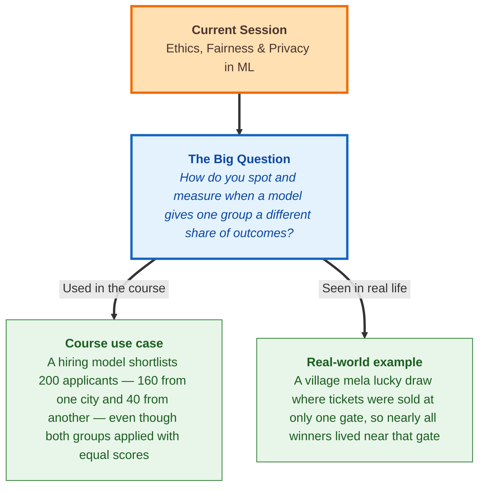

## <span style="color:#2F7DDE">Ethics, Fairness & Privacy in ML</span>

### <span style="color:#2F7DDE">Mental Map</span>



---

### <span style="color:#2F7DDE">What You'll Learn</span>

Have you ever wondered why a village draw kept picking winners from the same area?

By the end of this session, you will be able to:

- <span style="color:#D9660B">**Name**</span> one lawful basis a committee needs before it stores residents' address data.
- <span style="color:#D9660B">**Explain**</span> which of the four stages let unfairness into the mela draw.
- <span style="color:#D9660B">**Classify**</span> a feature like gate number as a stand-in for where a person lives.
- <span style="color:#D9660B">**Calculate**</span> win rates for each quarter and check whether the gap meets a named target.
- <span style="color:#D9660B">**Compare**</span> two fairness rules to decide which one the draw organiser should apply.
- <span style="color:#D9660B">**Examine**</span> a job shortlist for over- or under-represented applicant groups.

> <span style="color:#2F7DDE">**Topics you will meet:**</span> Historical, sampling, labelling and deployment bias; proxy features; fairness metrics; demographic parity; equal opportunity.
> Personal data, consent and the DPDP Act.
>
> Join the session to learn each of these in detail.

---

### <span style="color:#2F7DDE">Why You Are Learning This Topic</span>

A village mela sold tickets at only the north gate. Most residents lived far from that gate. They had no ticket on draw day. The draw was unrigged, yet nearly all winners lived near that gate.

A <span style="color:#D9660B">**fairness gap**</span> means unequal outcomes between groups. The gap comes from how the system was set up, not from real differences between the people.

The same pattern appears in hiring and lending models. They learn from records carrying old patterns of exclusion.

In this course, you will measure gaps in model output and pick a rule for when they are acceptable.

> <span style="color:#2F7DDE">**Think about it:**</span> The draw was unrigged. Where did unfairness enter?

---

### <span style="color:#2F7DDE">The Village Mela Puzzle</span>

The committee recorded the numbers below.

| Village Quarter | Residents | Tickets Bought | Winners |
|:---:|:---:|:---:|:---:|
| Priya's quarter (near gate) | 120 | 48 | 6 |
| Ravi's quarter | 100 | 20 | 2 |
| Meera's quarter | 130 | 10 | 1 |
| Dev's quarter (far gate) | 150 | 2 | 0 |

<span style="color:#D9660B">**What you want to happen:**</span>

- Every resident holds a ticket before the draw.
- Win rates are roughly equal across all four quarters.
- The committee has a number to show the draw was fair.

Here is how it might start. You do not need to understand it yet.

```python
residents = {"near_gate": 120, "far_gate": 150}
winners   = {"near_gate": 6,   "far_gate": 0}
print({g: round(winners[g]/residents[g], 3) for g in residents})
```

> <span style="color:#D9660B">**Wonder about this:**</span>
>
> - One free ticket for all: does that fix the problem?
> - Which resident details should the committee keep private?

---

### <span style="color:#2F7DDE">Think It Through</span>

There is no wrong first try. Keep your guesses for the session.

**1. Only one gate sold tickets. At which stage did unfairness enter the draw?**
Hint: Focus on the step before any ticket was drawn.

**2. Gate number shows where a resident lives. Why is that a problem in a model?**
Hint: What else does "gate number" say about a resident?

**3. The committee wants 25% winners from each quarter. Is that the same as equal chances for everyone?**
Hint: Equal shares and equal starting chances differ.

---

### <span style="color:#2F7DDE">One Question to Carry Into the Session</span>

> <span style="color:#2F7DDE">**If every resident had one ticket, would the results definitely be fair?**</span>
>
> What other steps might leave one group at a disadvantage?
