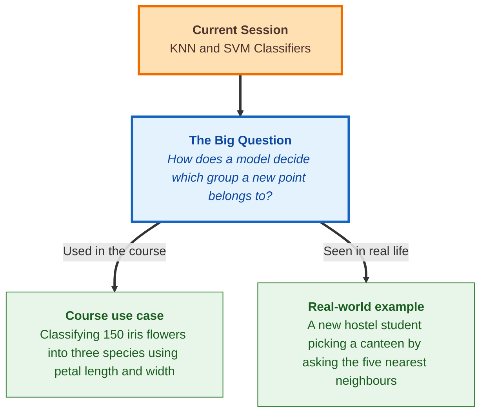

## <span style="color:#2F7DDE">KNN and SVM Classifiers</span>

### <span style="color:#2F7DDE">Mental Map</span>



---

### <span style="color:#2F7DDE">What You'll Learn</span>

Have you ever wondered how a new student picks a canteen before tasting any of the food?

By the end of this session, you will be able to:

- <span style="color:#D9660B"></span> how a new arrival gets a label by counting votes from its closest neighbours.
- <span style="color:#D9660B"></span> why two traits measured in different units can mislead a distance calculation.
- <span style="color:#D9660B"></span> how a machine draws the widest possible line between two groups of students.
- <span style="color:#D9660B"></span> how one number trades a wider boundary against a few wrong labels.
- <span style="color:#D9660B"></span> training a nearest-neighbour classifier on student records with the neighbour count set to 3.
- <span style="color:#D9660B"></span> a straight-line boundary model to separate two canteen-preference groups.

> <span style="color:#2F7DDE"></span>
> kNN idea; Fitting kNN; Why features need scaling; Maximum-margin boundary; Fitting a linear SVM; C and margin.
>
> Join the session to learn each of these in detail.

---

### <span style="color:#2F7DDE">Why You Are Learning This Topic</span>

You arrive at a hostel not knowing which canteen is worth the queue. You ask the five nearest and follow the majority. A <span style="color:#D9660B"></span> means a model that assigns a label to a new data point from patterns in existing labelled data. A second approach draws a boundary that separates the two groups. In this course, you will apply both to structured data.

> <span style="color:#2F7DDE"></span> If closeness is measured only by room number, students two floors up can count as near. Does that feel right?

---

### <span style="color:#2F7DDE">The Hostel Canteen Puzzle</span>

Here are four students surveyed on their canteen habits.

| Student | Walk time (min) | Queue rating (1–5) |                                                                                                                   Canteen                                                                                                                   |
| :-----: | :-------------: | :-----------------: | :-----------------------------------------------------------------------------------------------------------------------------------------------------------------------------------------------------------------------------------------: |
|  Priya  |        8        |          2          |                                                                                                                      A                                                                                                                      |
|  Arjun  |        3        |          4          | <br /><br /><br /><br /><br /><br /><br /><br /><br /><br /><br /><br /><br /><br /><br /><br /><br /><br /><br /><br /><br /><br /><br /><br /><br /><br /><br /><br /><br /><br /><br /><br /><br /><br /><br /><br /><br /><br /><br />B |
|  Meena  |        5        |          3          |                                                                                                                      A                                                                                                                      |
| Sakshi |        2        |          5          |                                                                                                                      B                                                                                                                      |

You have a 4-minute walk and a queue rating of 3.

<span style="color:#D9660B"></span>

- Find the 3 closest students and check their labels.
- Pick the canteen with the most votes.
- Re-check who is nearest after rescaling both measurements.

Here is how it might start. You do not need to understand it yet.

```python
from sklearn.neighbors import KNeighborsClassifier
knn = KNeighborsClassifier(n_neighbors=3)
knn.fit(X_train, y_train)
```

> <span style="color:#D9660B"></span>
>
> - If Arjun's queue rating were 4.5, would he still count as a nearest neighbour?
> - Two students pick Canteen A for different reasons. Does the model track those reasons?

---

### <span style="color:#2F7DDE">Think It Through</span>

There is no wrong first try. Keep your guesses for the session.

**1. Your three nearest neighbours are Meena (A), Arjun (B), and Sakshi (B). What does the model predict?**
Hint: One vote per neighbour; majority wins.

**2. Walk time ranges from 2 to 8. Queue rating ranges from 1 to 5. Which has the larger spread?**
Hint: Look at the range of each measurement.

**3. Imagine a straight line splitting Canteen A students from Canteen B on a plot. What one property makes it the right boundary?**
Hint: Look at how far each nearest student sits from the line.

---

### <span style="color:#2F7DDE">One Question to Carry Into the Session</span>

> <span style="color:#2F7DDE"></span>
>
> What happens when one Canteen A student lands inside the Canteen B group?
