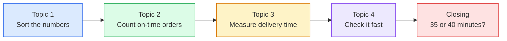
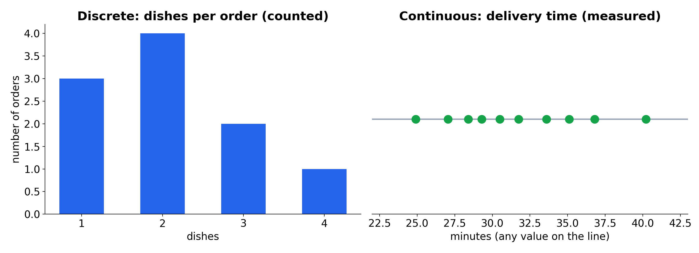
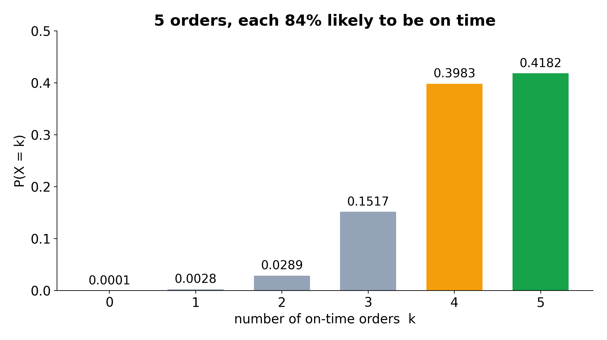
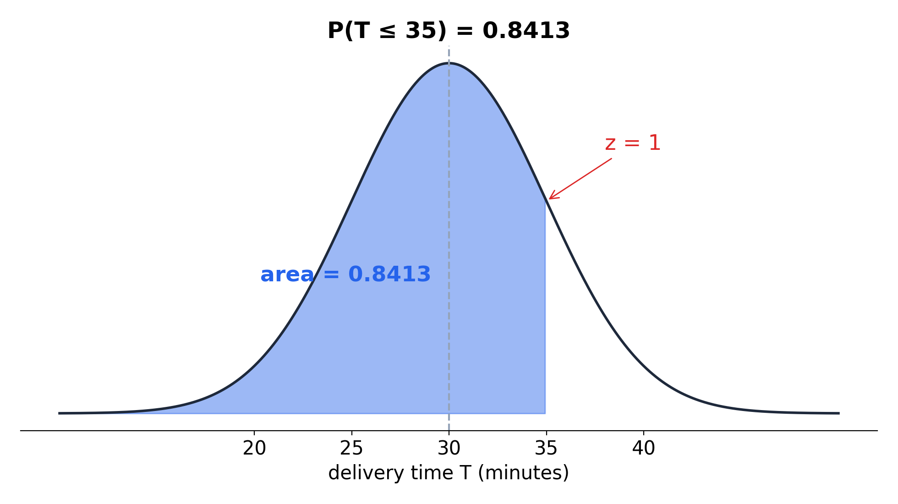
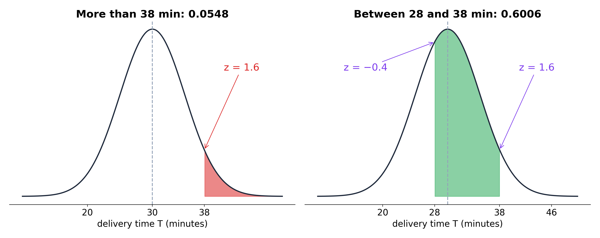
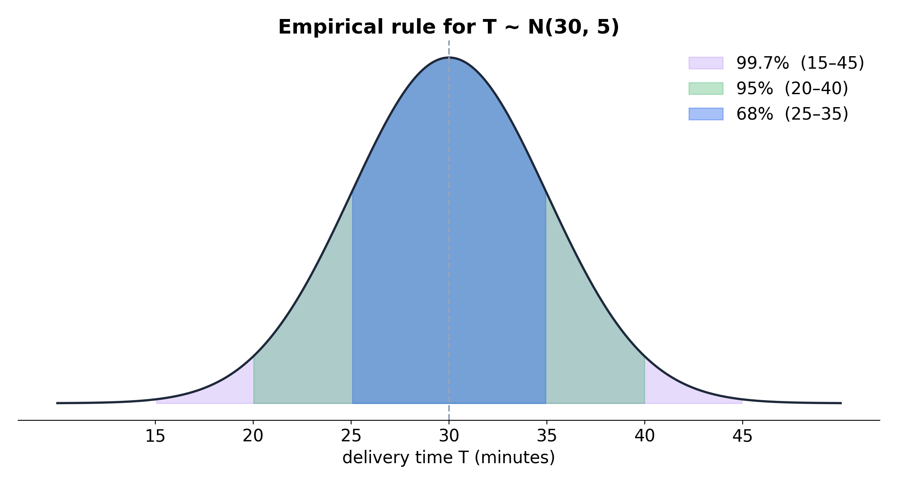
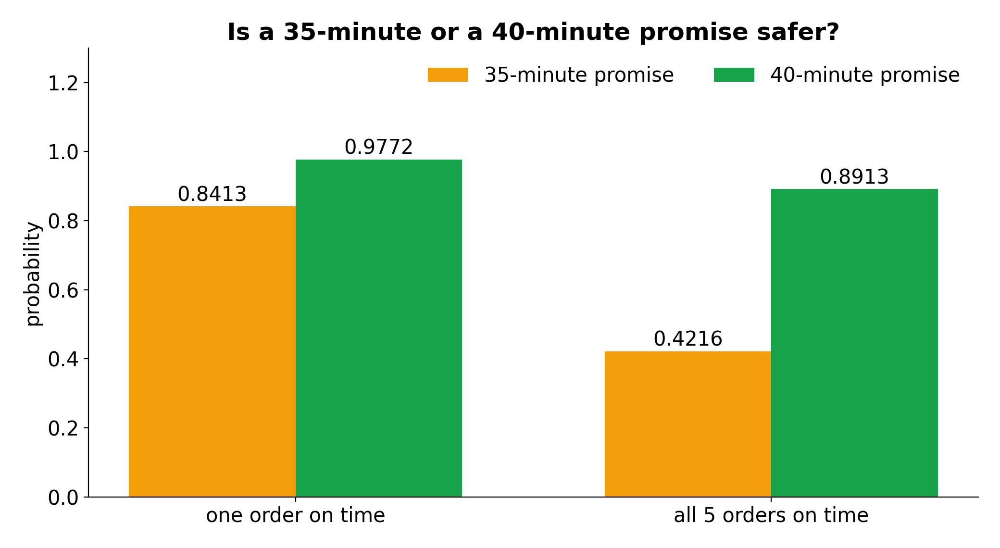

# <font color='#1d4ed8'>Lecture Script: Probability Distributions</font>

---

## <font color='blue'>Agenda</font>

The lecture runs as four topics. Each topic ends with a quiz.

| Topic | What we do | Learning objectives covered | Minutes |
|:-:|:--|:--|:-:|
| 1 | Sort the numbers: counted or measured | Classify a random variable as discrete or continuous | 15 |
| 2 | Count the on-time orders | Compute a binomial probability for a stated number of successes | 30 |
| 3 | Measure the delivery time | Compute a normal probability by standardising to the z-scale | 35 |
| 4 | Check it fast | Apply the empirical rule to estimate the proportion of values within k standard deviations | 20 |
| — | Closing: Outcome & Summary | | 20 |
| | **Total** | | **120** |

> <font color="red">**🎯 Instructor Note**</font> Pace: Topic 1 is a quick sort, so keep it moving. Spend the time in Topics 2 and 3, where learners compute.
> Topic 4 reuses the z-scale from Topic 3, so keep it short.

---

## <font color='blue'>Scenario</font>

A food-delivery app, in the style of Swiggy or Zomato, prints one promise on every order: **"Delivered in 35 minutes."** The operations manager must decide whether to keep it or move to 40.

| Promise | What the customer sees | What can go wrong |
|:--|:--|:--|
| 35 minutes | A fast app | Late orders, cancellations, refunds |
| 40 minutes | A slower app | Customers choose another app |

> <font color="red">**🎯 Instructor Note**</font> Do not say that any real company uses these numbers or methods. Real delivery times are usually skewed, so treating delivery time as normal is a teaching assumption.

---

## <font color='blue'>Problem Statement</font>

You order food. The app says **30 minutes**. Fifty minutes pass and nothing arrives, so you cancel. The app has lost your order and your trust.

Someone at the app chose that number 30. How did they know it was safe? The operations manager of our app has to make the same kind of choice, and asks one question:

> <font color='purple'>**Is a 35-minute promise safe, or should we promise 40 minutes?**</font>

> <font color="red">**🎯 Instructor Note**</font> Zoom poll: "Which promise is safer, 35 or 40 minutes?" Do not reveal the answer; it is revealed in the Closing.

---

## <font color='blue'>What We Will Use</font>

Everything the lecture needs, in one place. Each topic uses these ideas without repeating them.

| Idea | Meaning | In our app |
|:--|:--|:--|
| **Random variable** | A variable whose value is a number decided by chance | dishes in the next order |
| **Discrete** | Countable, separate values such as $0, 1, 2, 3, \dots$; you **count** it | dishes in an order, late orders in a day |
| **Continuous** | Any value in a range, including decimals; you **measure** it | delivery time in minutes |
| **Binomial** | The number of "yes" results in a fixed number of tries $n$, each with the same chance $p$ | on-time orders out of 5, $p = 0.84$ |
| **Normal** $N(\mu, \sigma)$ | A bell-shaped distribution with centre $\mu$ and spread $\sigma$ | $T \sim N(30, 5)$ minutes |
| **z-score** | How many standard deviations a value is from the mean | $z = 1$ for 35 minutes |
| **Empirical rule** | The share of values within 1, 2 and 3 standard deviations of the mean | the bands 25 to 35, 20 to 40, 15 to 45 |

**Counting on-time orders.** Conditions: a fixed number of trials, two outcomes, the same chance each time, and trials independent of each other.

$$\boxed{P(X=k)=\binom{n}{k}\,p^{k}\,(1-p)^{\,n-k}}$$

- $\binom{n}{k}$ is the number of ways to choose which $k$ of the $n$ trials succeed.
- $p^{k}$ is the chance of those $k$ successes, and $(1-p)^{n-k}$ is the chance that the others fail.

**Measuring delivery time.** For a continuous variable, probability is an **area under the curve**. The chance of exactly $35.000\ldots$ minutes is $0$, so we always ask about a range. Standardise first, then read the area to the left with `norm.cdf`:

$$\boxed{z=\frac{x-\mu}{\sigma}} \qquad P(Z\le z)=\texttt{norm.cdf}(z)$$

**Checking it fast.** For approximately bell-shaped data:

| Within | Share of values | Our delivery times |
|:-:|:-:|:-:|
| $\mu\pm1\sigma$ | about $\mathbf{68\%}$ | $25$ to $35$ minutes |
| $\mu\pm2\sigma$ | about $\mathbf{95\%}$ | $20$ to $40$ minutes |
| $\mu\pm3\sigma$ | about $\mathbf{99.7\%}$ | $15$ to $45$ minutes |

The leftover share splits equally into two tails, so for $k=2$ about $\dfrac{100\%-95\%}{2}=2.5\%$ lies above $40$ minutes.

> <font color='#b45309'>**Watch out for**</font>
> - A rounded display does not make a measurement discrete: the app shows whole minutes, but the true time is continuous.
> - The number $0.84^4\times0.16$ is one **particular** pattern; multiply by $\binom{5}{4}=5$ patterns. We also assume independence, which five orders from one kitchen may not have.
> - Use `norm.cdf` on the z-score, not on the raw minutes. For "more than", subtract from $1$.
> - Use the empirical rule only on bell-shaped data, and remember that the leftover splits into **two** tails.

---

## <font color='blue'>How: Walking Through the Decision</font>



---

## <font color='blue'>Topic 1: Sort the Numbers</font> `15 min`

> <font color='purple'>**The app records dishes per order, minutes per order and cancelled orders per day. Which of these are counted and which are measured?**</font>

### <font color='green'>Example: sorting ten orders</font>

Ten orders: `items` is the number of dishes in each order, and `minutes` is how long each took to arrive.

**Predict before running: What will happen?**

> <font color="red">**🎯 Instructor Note**</font> Expected: `items` shows a few repeated values; `minutes` shows ten different values.

```python
items = [2, 1, 3, 2, 1, 4, 2, 3, 1, 2]
minutes = [28.4, 35.1, 31.75, 24.9, 40.2, 29.3, 33.6, 27.05, 36.8, 30.5]
print("items values  :", sorted(set(items)))
print("minutes values:", sorted(set(minutes)))
print("late (>35 min):", sum(m > 35 for m in minutes))
```

**Output**

```
items values  : [1, 2, 3, 4]
minutes values: [24.9, 27.05, 28.4, 29.3, 30.5, 31.75, 33.6, 35.1, 36.8, 40.2]
late (>35 min): 3
```

<p align="center"></p>

#### <font color='#c2410c'>Code Explanation</font>

- **Lines 1 and 2** store the dishes per order and the minutes per order.
- **Line 3** prints the different values of `items`, with repeats removed. There are only four, and we can list them all, so `items` is **discrete**.
- **Line 4** does the same for `minutes`. Ten orders give ten different values, and values like $29.31$ could appear, so we cannot list them all. `minutes` is **continuous**.
- **Line 5** counts the orders that took more than 35 minutes. The answer, $3$, is a count. So the **number of late orders is discrete**, even though the minutes behind it are continuous.

> <font color='green'>**Result**</font> We now hold two kinds of numbers: **counts** such as late orders, and **measurements** such as minutes.

### <font color='green'>Extending it: quick check</font>

> <font color='purple'>**Sort three more numbers.**</font> For each one, write *count* or *measure*, then *discrete* or *continuous*, with one reason.

| | Quantity | Count or measure? | Type |
|:-:|:--|:-:|:-:|
| (a) | Weight of a food parcel, in grams | | |
| (b) | Number of items missing from an order | | |
| (c) | Time a customer spends on the app | | |

Give learners 30 seconds to respond in chat.

> <font color="red">**🎯 Instructor Note**</font> Answers: (a) continuous, (b) discrete, (c) continuous. If someone says (c) is discrete because the screen shows whole seconds, return to the rounded-display warning.

### <font color='purple'>Quiz 1</font>

**Question:** Which of these is a **continuous** random variable?

**Options:**
- A) Number of dishes in an order
- B) Number of late orders in a day
- C) Delivery time of an order, shown on the app to the nearest minute
- D) Stars a customer taps (1 to 5)

**Correct Answer:** C

**Explanation:**
- **A)** Wrong: dishes are counted ($1,2,3,\dots$), so this is discrete.
- **B)** Wrong: late orders are counted, so this is discrete.
- **C)** Correct: time is measured, and the whole-minute display is only rounding of a value that can be anything in a range.
- **D)** Wrong: there are five separate star choices, so this is discrete.

---

## <font color='blue'>Topic 2: Count the On-Time Orders</font> `30 min`

> <font color='purple'>**"How many orders arrive on time" is a count. A restaurant places five orders in the evening: how likely is it that exactly four arrive on time?**</font>

The platform's records say that about **84 of every 100** orders arrive within 35 minutes, so $n=5$, $p=0.84$ and $k=4$.

### <font color='green'>Example: exactly 4 of 5 orders on time</font>

$$P(X=4)=\binom{5}{4}(0.84)^{4}(0.16)^{1}=5\times0.4979\times0.16\approx0.3983$$

**Predict before running: What will happen?**

> <font color="red">**🎯 Instructor Note**</font> Expected: a number near $0.4$. A common wrong guess is $0.84$, which is one order and not five.

```python
from scipy.stats import binom
n, p = 5, 0.84
print(round(binom.pmf(4, n, p), 4))
```

**Output**

```
0.3983
```

#### <font color='#c2410c'>Code Explanation</font>

- **Line 1** brings in the ready-made binomial tool.
- **Line 2** says: five orders, each with an $84\%$ chance of being on time.
- **Line 3** asks for the chance of exactly four on-time orders, rounded to four decimals.

<p align="center"></p>

> <font color='green'>**Result**</font> There is about a **40% chance** that exactly 4 of the 5 orders arrive on time.

### <font color='green'>Extending it: all five on time</font>

> <font color='purple'>**What is the chance that all five arrive on time?**</font> Only $k$ changes, from $4$ to $5$.

> <font color="red">**🎯 Instructor Note**</font> Ask for a prediction first. Many learners guess it is lower than "exactly four"; it is higher.

```python
from scipy.stats import binom
print(round(binom.pmf(5, 5, 0.84), 4))
```

**Output**

```
0.4182
```

> <font color='green'>**Result**</font> All five on time ($0.4182$) is more likely than exactly four ($0.3983$). Each order is likely to be on time, so "all five" is the single most likely outcome, which is why the last bar in the chart is the tallest.

### <font color='green'>Extending it: at least four on time</font>

> <font color='purple'>**What is the chance that at least 4 arrive on time?**</font> "At least 4" means $4$ **or** $5$, so we add the two chances.

$$P(X\ge4)=P(X=4)+P(X=5)=0.3983+0.4182$$

```python
from scipy.stats import binom
print(round(binom.pmf(4, 5, 0.84) + binom.pmf(5, 5, 0.84), 4))
```

**Output**

```
0.8165
```

#### <font color='#c2410c'>Code Explanation</font>

- **Line 2** adds the chance of exactly four and the chance of exactly five.

> <font color='green'>**Result**</font> About **82%** of the time, at least four of the five orders are on time.

### <font color='green'>Extending it: what if the chance were 50%?</font>

> <font color='purple'>**What if each order had only a 50% chance?**</font> Give learners 30 seconds to vote in chat first: does the chance of exactly four go up or down?

```python
from scipy.stats import binom
print(round(binom.pmf(4, 5, 0.5), 4))
```

**Output**

```
0.1562
```

> <font color='green'>**Result**</font> It goes **down**. With a $50\%$ chance each time, four out of five is much less likely.

### <font color='purple'>Quiz 2</font>

**Question:** Each of 5 independent orders has an $84\%$ chance of being on time. What is the probability that **exactly 3** of them are on time?

**Options:**
- A) $0.0152$
- B) $0.1517$
- C) $0.3983$
- D) $0.5927$

**Correct Answer:** B

**Explanation:**
- **A)** Wrong: $0.84^3\times0.16^2\approx0.0152$ is the chance of one particular pattern, without the $\binom{5}{3}=10$ ways.
- **B)** Correct: $\binom{5}{3}(0.84)^3(0.16)^2=10\times0.5927\times0.0256\approx0.1517$.
- **C)** Wrong: $0.3983$ is the chance of exactly 4 on time, not 3.
- **D)** Wrong: $0.84^3\approx0.5927$ ignores the two late orders and the number of ways.

---

## <font color='blue'>Topic 3: Measure the Delivery Time</font> `35 min`

> <font color='purple'>**We were handed "84 in 100 within 35 minutes". Where does it come from? Orders usually take around 30 minutes, give or take 5.**</font>

Delivery time is a measurement, so it is continuous: $T\sim N(30,\,5)$. A wrong guess makes the app promise too much or too little, and customers pay for the mistake.

### <font color='green'>Example: orders within 35 minutes</font>

> <font color='purple'>**What share of orders arrive within 35 minutes?**</font> Here $\mu=30$, $\sigma=5$, $x=35$.

$$z=\frac{35-30}{5}=1\qquad\Rightarrow\qquad P(T\le35)=P(Z\le1)\approx0.8413$$

**Predict before running: What will happen?**

> <font color="red">**🎯 Instructor Note**</font> Expected: $z=1.0$ and a probability near $0.84$. A common wrong guess is $35$, from forgetting to standardise.

```python
from scipy.stats import norm
mu, sigma, x = 30, 5, 35
z = (x - mu) / sigma
print(z, round(norm.cdf(z), 4))
```

**Output**

```
1.0 0.8413
```

#### <font color='#c2410c'>Code Explanation</font>

- **Line 1** brings in the normal-curve tool.
- **Line 2** states the facts: usual time $30$ minutes, spread $5$ minutes, and the value we care about, $35$.
- **Line 3** is the standardising step: $(35-30)/5=1$. Thirty-five is one spread above the mean.
- **Line 4** prints $z$ and the area to the left of $z$, rounded to four decimals.

<p align="center"></p>

> <font color='green'>**Result**</font> About **84% of orders arrive within 35 minutes.** This is the $84\%$ we used in the binomial: it was rounded from $0.8413$, and now we know where it comes from.

### <font color='green'>Extending it: more than 38 minutes</font>

> <font color='purple'>**What is the chance that an order takes more than 38 minutes?**</font> The question is $T>38$, so

$$z=\frac{38-30}{5}=1.6\qquad\Rightarrow\qquad P(T>38)=1-P(Z\le1.6)$$

> <font color="red">**🎯 Instructor Note**</font> Ask for a prediction first. A common wrong answer is $0.9452$, the left area before subtracting from $1$.

```python
from scipy.stats import norm
z = (38 - 30) / 5
print(z, round(1 - norm.cdf(z), 4))
```

**Output**

```
1.6 0.0548
```

> <font color='green'>**Result**</font> About **5 orders in 100** take more than 38 minutes. Printing `norm.cdf` alone gives $0.9452$, which is the chance of 38 minutes **or less**; "more than" asks for the other side.

### <font color='green'>Extending it: between 28 and 38 minutes</font>

> <font color='purple'>**What is the chance that an order takes between 28 and 38 minutes?**</font> There are two boundaries, so there are two z-scores.

$$z_{\text{low}}=\frac{28-30}{5}=-0.4,\qquad z_{\text{high}}=\frac{38-30}{5}=1.6$$

$$P(28\le T\le38)=P(Z\le1.6)-P(Z\le-0.4)$$

```python
from scipy.stats import norm
z_low, z_high = (28 - 30) / 5, (38 - 30) / 5
print(z_low, z_high)
print(round(norm.cdf(z_high) - norm.cdf(z_low), 4))
```

**Output**

```
-0.4 1.6
0.6006
```

#### <font color='#c2410c'>Code Explanation</font>

- **Line 2** gives both z-scores. Twenty-eight is below the mean, so its $z$ is negative.
- **Line 3** prints them.
- **Line 4** takes the area up to $38$ and removes the area up to $28$, leaving the area in between.

<p align="center"></p>

> <font color='green'>**Result**</font> About **60%** of orders take between 28 and 38 minutes.

### <font color='green'>Extending it: what if the kitchen gets slower?</font>

> <font color='purple'>**What if the mean becomes 33?**</font> Give learners 30 seconds to vote in chat first: does 35 minutes still cover $84\%$ of orders?

```python
from scipy.stats import norm
z = (35 - 33) / 5
print(z, round(norm.cdf(z), 4))
```

**Output**

```
0.4 0.6554
```

> <font color='green'>**Result**</font> No. The share drops to about **65%**, because the whole curve moved toward slower times ($z$ fell from $1$ to $0.4$).

### <font color='purple'>Quiz 3</font>

**Question:** Delivery time is $T\sim N(30,\,5)$ minutes. What is the probability that an order takes **less than 25 minutes**?

**Options:**
- A) $0.8413$
- B) $0.1587$
- C) $0.3413$
- D) $0.5$

**Correct Answer:** B

**Explanation:**
- **A)** Wrong: $0.8413$ is the area to the left of $z=+1$ ($T<35$), the wrong side of the mean.
- **B)** Correct: $z=\dfrac{25-30}{5}=-1$, and the area to the left of $z=-1$ is $0.1587$.
- **C)** Wrong: $0.3413$ is only the area between $25$ and $30$, not everything to the left of $25$.
- **D)** Wrong: $0.5$ is the area to the left of the mean $30$, and $25$ is below the mean.

---

## <font color='blue'>Topic 4: Check It Fast</font> `20 min`

> <font color='purple'>**The manager gets a phone call in a meeting: "If we promise 40 minutes, roughly how many orders will be late?" There is no laptop. Is there a ten-second estimate?**</font>

### <font color='green'>Example: where do 68, 95 and 99.7 come from?</font>

> <font color='purple'>**Are the numbers exact?**</font> They are rounded from exact areas under the standard normal curve, which we can compute with the tool from Topic 3:

$$P(-k\le Z\le k)=P(Z\le k)-P(Z\le-k)$$

**Predict before running: What will happen?**

> <font color="red">**🎯 Instructor Note**</font> Expected: numbers close to $68$, $95$ and $99.7$. The rule is a rounded summary of the exact values.

```python
from scipy.stats import norm
for k in (1, 2, 3):
    share = norm.cdf(k) - norm.cdf(-k)
    print(k, round(share * 100, 2))
```

**Output**

```
1 68.27
2 95.45
3 99.73
```

#### <font color='#c2410c'>Code Explanation</font>

- **Line 1** brings in the normal-curve tool.
- **Line 2** repeats the two indented lines for $k$ equal to $1$, $2$ and $3$.
- **Line 3** finds the share inside the band: the area up to $k$, minus the area up to $-k$.
- **Line 4** prints $k$ and the share as a percentage.

<p align="center"></p>

> <font color='green'>**Result**</font> The empirical rule rounds $68.27$, $95.45$ and $99.73$ to $68$, $95$ and $99.7$.

### <font color='green'>Extending it: the bands and the 40-minute promise</font>

> <font color='purple'>**What are the bands for our delivery times, and what share is late at a 40-minute promise?**</font> The bands are $30\pm5k$. Outside $20$ to $40$ lies $5\%$, split over two tails, so about $2.5\%$ is late.

```python
from scipy.stats import norm
for k in (1, 2, 3):
    print(30 - k * 5, 30 + k * 5)
print(round((1 - norm.cdf(2)) * 100, 2))
```

**Output**

```
25 35
20 40
15 45
2.28
```

> <font color='green'>**Result**</font> The estimate was about $2.5\%$ and the exact value is $2.28\%$. The shortcut is rough but close enough for a quick decision.

### <font color='green'>Extending it: quick questions on the same data</font>

> <font color='purple'>**About what share of orders take more than 35 minutes?**</font> Poll: $16\%$ / $32\%$ / $5\%$ / $50\%$.

#### <font color='#c2410c'>Logic Explanation</font>

$100\%-68\%=32\%$ lies outside $25$ to $35$, split over two tails, so $\dfrac{32\%}{2}=16\%$ is above $35$ minutes. The exact value is $15.87\%$.

> <font color="red">**🎯 Instructor Note**</font> Answer: $16\%$. Show the logic on the board before revealing.

> <font color='purple'>**The app gets 100 orders. About how many arrive between 20 and 40 minutes?**</font> Give learners 30 seconds to respond in chat.

> <font color="red">**🎯 Instructor Note**</font> Answer: about $95$, since $20$ and $40$ are $\mu\pm2\sigma$.

### <font color='purple'>Quiz 4</font>

**Question:** Delivery time is approximately $N(30,\,5)$ minutes. Using the empirical rule, about what share of orders take **between 25 and 45 minutes**?

**Options:**
- A) $68\%$
- B) $95\%$
- C) $99.7\%$
- D) About $84\%$

**Correct Answer:** D

**Explanation:**
- **A)** Wrong: $68\%$ is the band $25$ to $35$ ($\mu\pm1\sigma$), which stops at $35$, not $45$.
- **B)** Wrong: $95\%$ is the band $20$ to $40$ ($\mu\pm2\sigma$), a different range.
- **C)** Wrong: $99.7\%$ is the band $15$ to $45$ ($\mu\pm3\sigma$), which starts at $15$, not $25$.
- **D)** Correct: $25$ to $30$ is half of $68\%$ ($34\%$) and $30$ to $45$ is half of $99.7\%$ ($\approx49.85\%$), so $34\%+49.85\%\approx84\%$.

---

## <font color='blue'>Closing: Outcome & Summary</font> `20 min`

We now have all four topics. Let us return to the manager's question and answer it step by step, using each topic once.

> <font color='purple'>**1. What kind of variable is delivery time? And "number of late orders out of 5"?**</font>

Delivery time is **continuous** (measured). The number of late orders out of $5$ is **discrete** (counted).

> <font color='purple'>**2. For each promise, 35 and 40 minutes, what is the chance that an order is on time?**</font>

Standardise the promise and read the area to the left:

$$p=P\!\left(Z\le\frac{\text{promise}-30}{5}\right)$$

> <font color='purple'>**3. Using that chance as $p$, what is the chance that all five of a restaurant's orders arrive on time?**</font>

$$P(X=5)=\binom{5}{5}\,p^{5}(1-p)^{0}=p^{5}$$

```python
from scipy.stats import norm, binom
mu, sigma = 30, 5
for promise in (35, 40):
    p = norm.cdf((promise - mu) / sigma)
    print(promise, round(p, 4), round(binom.pmf(5, 5, p), 4))
```

**Output**

```
35 0.8413 0.4216
40 0.9772 0.8913
```

#### <font color='#c2410c'>Code Explanation</font>

- **Line 2** sets the same mean and spread as before.
- **Line 3** repeats the calculation for each promise, $35$ and $40$.
- **Line 4** standardises the promise and finds the chance an order is on time.
- **Line 5** prints the promise, that chance, and the chance that all five orders are on time, using that chance in the binomial tool.

> <font color="red">**🎯 Instructor Note**</font> The $0.4216$ differs slightly from $0.4182$ in Topic 2, because there $p$ was rounded to $0.84$. Say this aloud.

> <font color='purple'>**4. Does the quick check agree?**</font>

Yes. $40=\mu+2\sigma$, so about $2.5\%$ of orders are late and about $97.5\%$ are on time, which matches $0.9772$.

<p align="center"></p>

### <font color='green'>Outcome</font>

| | 35-minute promise | 40-minute promise |
|:--|:-:|:-:|
| Chance an order is on time | $\approx 84\%$ | $\approx 98\%$ |
| Chance all 5 of a restaurant's orders are on time | $\approx 42\%$ | $\approx 89\%$ |
| Quick check (empirical rule) | $35=\mu+1\sigma\Rightarrow\approx84\%$ | $40=\mu+2\sigma\Rightarrow\approx97.5\%$ |

> <font color='green'>**Therefore,**</font> a 40-minute promise is much safer: nearly every order arrives on time, and a restaurant's five orders all arrive on time almost nine times in ten. The cost is a longer promise, and the manager can now weigh that cost with numbers and not with a guess.

> <font color="red">**🎯 Instructor Note**</font> Show the opening poll result next to this table and ask whether learners' choice matched the numbers.

### <font color='green'>Summary</font>

| Learning objective | Takeaway |
|:--|:--|
| Classify a random variable as discrete or continuous | Count it → discrete. Measure it → continuous. Rounded display does not change this. |
| Compute a binomial probability for a stated number of successes | $P(X=k)=\binom{n}{k}p^{k}(1-p)^{n-k}$, or `binom.pmf(k, n, p)`. |
| Compute a normal probability by standardising to the z-scale | $z=\dfrac{x-\mu}{\sigma}$, then the area to the left with `norm.cdf`; adjust for "more than" and "between". |
| Apply the empirical rule to estimate the proportion of values within k standard deviations | About $68\%$, $95\%$, $99.7\%$ for $k=1,2,3$ on bell-shaped data. |
| **Practical value** | You can check a claim such as "this promise is safe" with real numbers, for a delivery time, a service level, or any measure that has a count and a typical spread. |

---

## <font color='blue'>Announcements</font>

> <font color="red">**🎯 Instructor Note**</font> Optional. Use this space to tell learners about upcoming activities such as projects or evaluations. By default, the mentor explains.

---

# <font color='red'>Launch the Feedback Poll</font>

> <font color="red">**🎯 Instructor Note**</font> Reminder: launch the feedback poll now to collect learner feedback.
