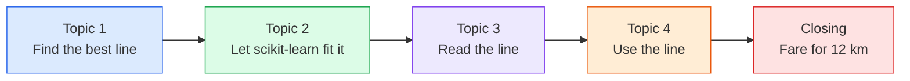
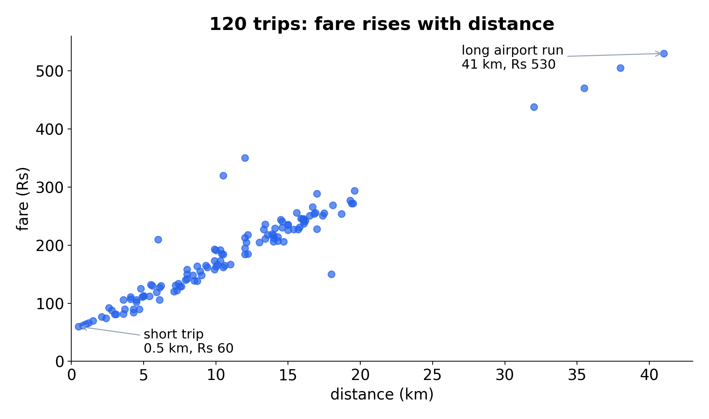
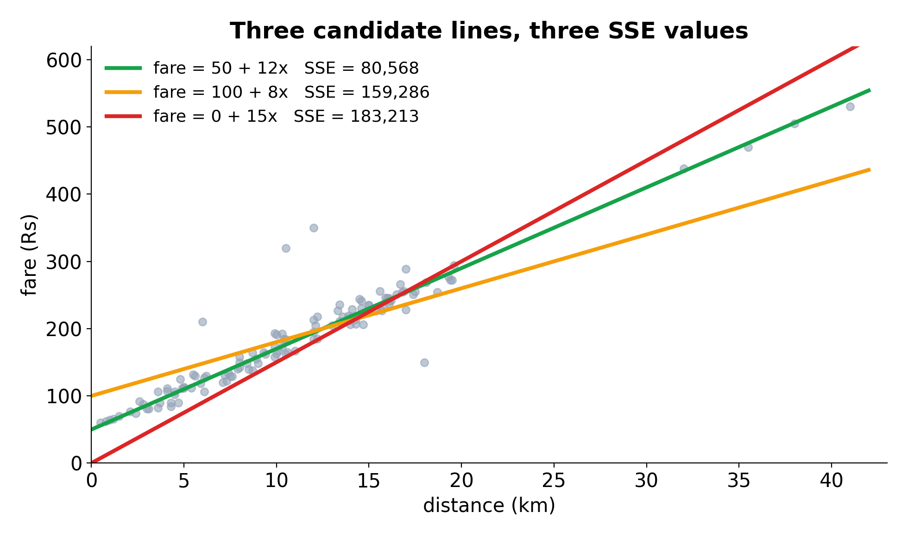
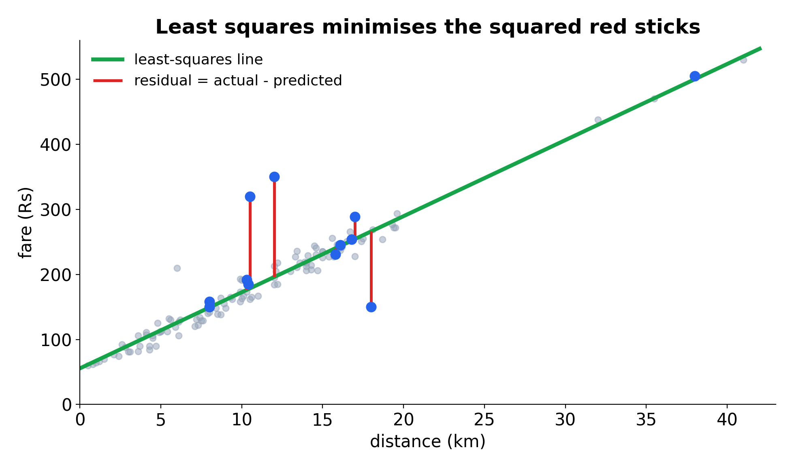
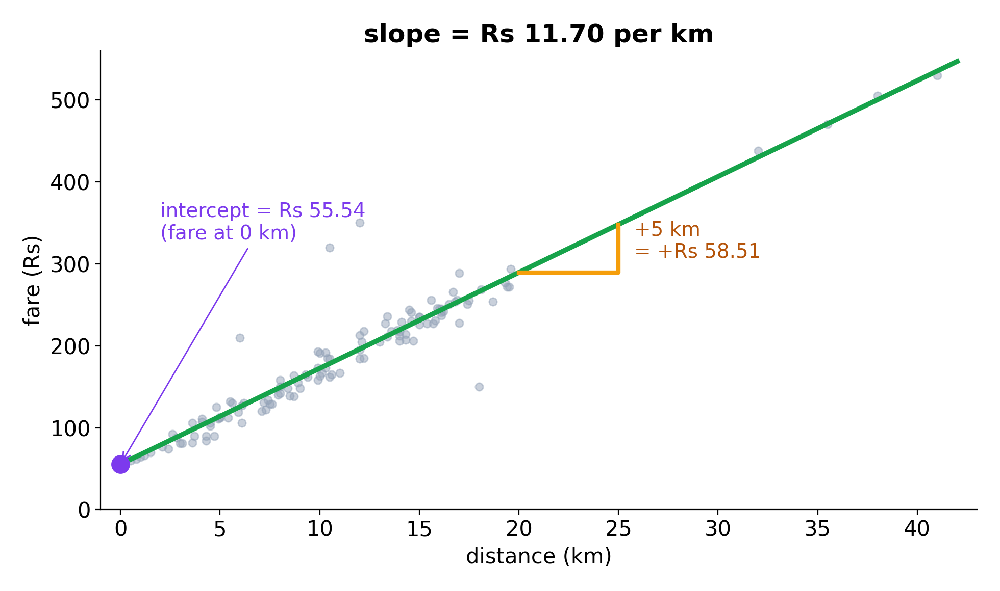
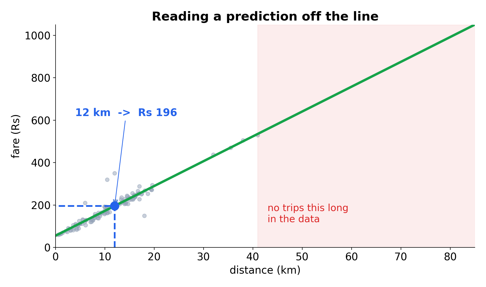
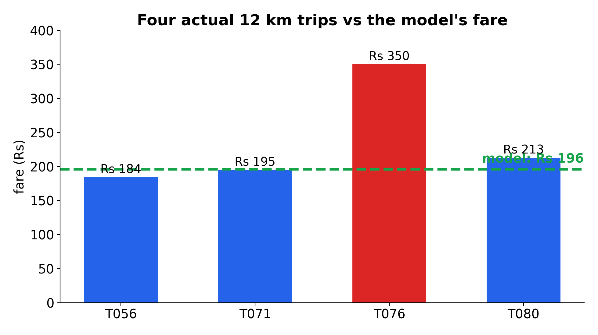

# <font color='#1d4ed8'>Lecture Script: Fitting a First Linear Regression</font>

---

## <font color='blue'>Agenda</font>

The lecture runs as four topics. Each topic ends with a quiz.

| Topic | What we do | Learning objectives covered | Minutes |
|:-:|:--|:--|:-:|
| 1 | Find the best line | Describe how a linear regression model maps numeric features to a continuous target<br>Describe the least-squares criterion that regression fitting minimises | 35 |
| 2 | Let scikit-learn fit it | Train a simple linear regression model on one numeric feature | 20 |
| 3 | Read the line | Interpret the slope and intercept of a simple linear regression in the units of the data | 25 |
| 4 | Use the line | Compute a predicted value by hand from fitted coefficients and one input row | 25 |
| — | Closing: Outcome & Summary | | 15 |
| | **Total** | | **120** |

> <font color="red">**🎯 Instructor Note**</font> Pace: in Topic 1 spend about 10 minutes on the idea and the rest on least squares. Topic 2 is a short, hands-on fit.
> Take Topics 3 and 4 slowly; they are what learners will use at work.

---

## <font color='blue'>Scenario</font>

An Ola-style cab app has to show a fare before the rider books.

| Today | Goal |
|:--|:--|
| The fare is a guess from experience, and the rider can be surprised at the end of the trip | A fare that comes from what past trips really cost |

> <font color="red">**🎯 Instructor Note**</font> Ola is only the setting. Do not claim Ola uses these numbers; the 120 trips in `data/cab_fares.csv` are invented for teaching.
> Share the file before class. It has short trips, repeated distances, long airport runs and a few surge or discount trips.

---

## <font color='blue'>Problem Statement</font>

A rider types in a drop-off 12 km away and asks one thing: "How much will this cost?"

The app has 120 past trips and must answer in a fraction of a second, for every rider, every time.

> <font color='purple'>**How do we turn 120 past trips into a rule that gives a fare for any distance?**</font>

> <font color="red">**🎯 Instructor Note**</font> Poll: "What would you charge for a 12 km ride?" Give learners 30 seconds to respond in chat. Note the range; reveal in the Closing.

---

## <font color='blue'>What We Will Use</font>

Everything the lecture needs, in one place. Each topic uses these terms without repeating them.

| Term | Meaning | In our trips |
|:--|:--|:--|
| **Feature** | The input the model uses | `distance_km` |
| **Target** | The number we want to predict; it can be any value in a range (continuous) | `fare_inr` |
| **Linear regression** | A straight-line rule that maps a numeric feature to a numeric target | a line through the trips |
| **Slope** $b_1$ | The change in the target for one extra unit of the feature | Rs per km |
| **Intercept** $b_0$ | The predicted target when the feature is 0 | base amount in Rs |
| **Residual** | How far the line misses one trip: actual minus predicted | Rs |
| **SSE** | The sum of the squared residuals; smaller is a better line | Rs squared |
| **Least squares** | The rule that picks the line with the smallest SSE | the best line |
| `X`, `y` | In scikit-learn, `X` is the features as a table (rows and columns) and `y` is the target as a list | `df[["distance_km"]]`, `df["fare_inr"]` |
| `fit`, `coef_`, `intercept_` | Learn the line, then read the slope and the intercept | `model.fit(X, y)` |

The line, the miss and the score:

$$\boxed{\hat{y} = b_0 + b_1 x} \qquad e_i = y_i - \hat{y}_i \qquad \text{SSE} = \sum_{i=1}^{n} (y_i - \hat{y}_i)^2$$

The least-squares line:

$$\boxed{b_1 = \frac{\sum (x_i - \bar{x})(y_i - \bar{y})}{\sum (x_i - \bar{x})^2}, \qquad b_0 = \bar{y} - b_1 \bar{x}}$$

> <font color='#b45309'>**Watch out for**</font>
> - Regression predicts a number. "Will the rider cancel?" is a yes or no, so it is classification.
> - Residuals are squared before adding; raw misses above and below the line cancel out.
> - `X` needs double brackets, `df[["distance_km"]]`, so it stays a table.
> - The intercept is the line's value at 0 km, not a real trip.
> - A prediction far outside the distances in the data is a guess.

---

## <font color='blue'>How: Walking Through the Fare Model</font>



---

## <font color='blue'>Topic 1: Find the Best Line</font> `35 min`

> <font color='purple'>**We have 120 trips with a distance and a fare. How does distance turn into a fare?**</font>

### <font color='green'>Example: look at the trips</font>

**Predict before running: What will happen?**

> <font color="red">**🎯 Instructor Note**</font> Expected: 120 rows and 3 columns (trip id, distance, fare). Common guess: learners forget the id column is counted.

```python
import pandas as pd

df = pd.read_csv("data/cab_fares.csv")
print(df.shape)
print(df.head(5))
```

**Output**

```
(120, 3)
  trip_id  distance_km  fare_inr
0    T001         38.0       505
1    T002          3.0        81
2    T003         16.1       245
3    T004         10.3       192
4    T005          3.6        82
```

#### <font color='#c2410c'>Code Explanation</font>

- **Line 1** Loads pandas, which reads tables.
- **Line 3** Reads the trip file into a table called `df`.
- **Line 4** Prints the size as (rows, columns).
- **Line 5** Shows the first 5 trips.

> <font color='green'>**Result**</font> Each row is one trip: a distance (the feature) and a fare (the target).

<p align="center"></p>

### <font color='green'>Extending it: a rule that maps distance to fare</font>

> <font color='purple'>**What if we write a simple rule by hand: Rs 50 plus Rs 12 for every km?**</font>

```python
for d in (2, 12, 30):
    print(d, "km ->", 50 + 12 * d)
```

**Output**

```
2 km -> 74
12 km -> 194
30 km -> 410
```

#### <font color='#c2410c'>Code Explanation</font>

- **Line 1** Loops over three distances.
- **Line 2** Applies the rule $\hat{y} = 50 + 12x$ to each distance and prints the fare.

> <font color='green'>**Result**</font> A linear regression model is exactly this kind of rule: a feature goes in and a fare (a continuous number) comes out. The only question is which numbers to use for the base and the rate.

### <font color='green'>Extending it: does fare really follow distance?</font>

> <font color="red">**🎯 Instructor Note**</font> Ask: "Closer to 0 or closer to 1?" Give learners 30 seconds to respond in chat. Expected: close to 1.

```python
print(df["distance_km"].corr(df["fare_inr"]).round(3))
```

**Output**

```
0.953
```

#### <font color='#c2410c'>Logic Explanation</font>

- The number runs from -1 to 1. Near 1 means the points sit close to a rising straight line.
- 0.953 is close to 1, so a straight line is a sensible rule for these trips.

> <font color='green'>**Result**</font> Fare rises with distance in an almost straight pattern, so linear regression fits the problem.

### <font color='green'>Example: scoring three candidate lines</font>

> <font color='purple'>**Many lines pass through the trips. Which of three guessed lines misses the least?**</font>

By hand for the line $\hat{y} = 50 + 12x$ on three trips:

| Trip | Distance | Actual | Predicted $50 + 12x$ | Residual |
|:--|:-:|:-:|:-:|:-:|
| T002 | 3.0 km | Rs 81 | $50 + 12(3.0) = 86$ | $81 - 86 = -5$ |
| T004 | 10.3 km | Rs 192 | $50 + 12(10.3) = 173.6$ | $192 - 173.6 = 18.4$ |
| T001 | 38.0 km | Rs 505 | $50 + 12(38.0) = 506$ | $505 - 506 = -1$ |

**Predict before running: What will happen?**

> <font color="red">**🎯 Instructor Note**</font> Ask which of the three lines will have the smallest SSE. Expected: Rs 50 + 12 per km.

```python
import numpy as np

x, y = df["distance_km"], df["fare_inr"]
for b0, b1 in [(50, 12), (100, 8), (0, 15)]:
    sse = ((y - (b0 + b1 * x)) ** 2).sum()
    print(f"line {b0} + {b1}x -> SSE = {sse:,.0f}")
```

**Output**

```
line 50 + 12x -> SSE = 80,568
line 100 + 8x -> SSE = 159,286
line 0 + 15x -> SSE = 183,213
```

#### <font color='#c2410c'>Code Explanation</font>

- **Line 1** Loads numpy, a library for number arrays.
- **Line 3** Names the distance column `x` and the fare column `y`.
- **Line 4** Loops over three candidate lines, each with an intercept `b0` and a slope `b1`.
- **Line 5** Predicts every fare, subtracts it from the actual fare, squares each miss and adds them up.
- **Line 6** Prints the line and its SSE.

<p align="center"></p>

> <font color='green'>**Result**</font> Rs 50 + Rs 12 per km has by far the smallest SSE (80,568). The other two are about twice as bad.

### <font color='green'>Extending it: the least-squares line</font>

> <font color='purple'>**Can we do better than the best of our three guesses?**</font>

**Predict before running: What will happen?**

> <font color="red">**🎯 Instructor Note**</font> Expected: a slope near 12 and an intercept near 50, with an SSE slightly below 80,568.

```python
xbar, ybar = x.mean(), y.mean()
b1 = ((x - xbar) * (y - ybar)).sum() / ((x - xbar) ** 2).sum()
b0 = ybar - b1 * xbar
print(round(b1, 4), round(b0, 4))
sse = ((y - (b0 + b1 * x)) ** 2).sum()
print(f"best line SSE = {sse:,.0f}")
```

**Output**

```
11.7014 55.5397
best line SSE = 79,480
```

#### <font color='#c2410c'>Code Explanation</font>

- **Line 1** Computes the average distance and the average fare.
- **Line 2** Computes the slope $b_1$ with the least-squares formula.
- **Line 3** Computes the intercept $b_0$ so the line passes through the averages.
- **Line 4** Prints both numbers to 4 decimals.
- **Lines 5 and 6** Compute and print the SSE of this line.

> <font color='green'>**Result**</font> The least-squares line is $\hat{y} = 55.5397 + 11.7014\,x$, with SSE 79,480, the smallest possible SSE for any straight line on these trips.

### <font color='green'>Extending it: nudging the best line</font>

> <font color='purple'>**What happens if we move the slope up or down a little?**</font>

```python
for d in (-0.5, 0, 0.5):
    resid = y - (b0 + (b1 + d) * x)
    print(f"slope {b1 + d:.2f} -> SSE = {(resid ** 2).sum():,.0f}")
```

**Output**

```
slope 11.20 -> SSE = 84,696
slope 11.70 -> SSE = 79,480
slope 12.20 -> SSE = 84,696
```

#### <font color='#c2410c'>Code Explanation</font>

- **Line 1** Tries three slopes: 0.5 lower, the best slope, and 0.5 higher. The intercept stays fixed.
- **Line 2** Computes every residual for that slope.
- **Line 3** Prints the slope and its SSE.

> <font color='green'>**Result**</font> Moving the slope either way makes the SSE worse. The least-squares slope is the bottom of the dip.

### <font color='green'>Extending it: which trips hurt the most?</font>

> <font color='purple'>**Which trips are missed by the biggest amounts?**</font>

```python
df["resid"] = (y - (b0 + b1 * x)).round(1)
top3 = df.loc[df["resid"].abs().nlargest(3).index]
print(top3)
print(f"share of SSE: {(top3['resid'] ** 2).sum() / sse:.0%}")
```

**Output**

```
trip_id  distance_km  fare_inr  resid
75    T076         12.0       350  154.0
71    T072         10.5       320  141.6
24    T025         18.0       150 -116.2
share of SSE: 72%
```

#### <font color='#c2410c'>Code Explanation</font>

- **Line 1** Stores each trip's residual in a new column.
- **Line 2** Picks the three trips with the largest miss, ignoring the sign.
- **Line 3** Prints those three trips.
- **Line 4** Squares their misses and shows their share of the total SSE.

<p align="center"></p>

> <font color='green'>**Result**</font> Two surge trips and one discount trip cause 72% of the SSE. Squaring makes a few large misses dominate the score.

### <font color='purple'>Quiz 1</font>

**Question:** What does the least-squares criterion minimise?

**Options:**
- A) The sum of the raw residuals
- B) The sum of the squared residuals
- C) The number of trips the line touches
- D) The single largest residual

**Correct Answer:** B

**Explanation:**
- **A)** Wrong: positive and negative misses cancel, so a poor line can still add up to zero.
- **B)** Correct: least squares picks the line with the smallest sum of squared residuals (SSE).
- **C)** Wrong: a line can fit well without touching any trip.
- **D)** Wrong: that rule only controls the worst trip; least squares looks at all trips together.

---

## <font color='blue'>Topic 2: Let scikit-learn Fit It</font> `20 min`

> <font color='purple'>**The formula works, but can the computer find the best line for us?**</font>

### <font color='green'>Example: fitting the fare model</font>

**Predict before running: What will happen?**

> <font color="red">**🎯 Instructor Note**</font> Expected: the same numbers we computed by hand, 11.7014 and 55.5397. Ask learners to compare before revealing.

```python
from sklearn.linear_model import LinearRegression

X = df[["distance_km"]]
y = df["fare_inr"]
model = LinearRegression()
model.fit(X, y)
print(model.coef_, model.intercept_)
```

**Output**

```
[11.7013669] 55.53974327220871
```

#### <font color='#c2410c'>Code Explanation</font>

- **Line 1** Imports the `LinearRegression` class.
- **Line 3** Builds `X` as a one-column table (double brackets).
- **Line 4** Builds `y`, the fares.
- **Line 5** Creates an empty model.
- **Line 6** Learns the least-squares line from `X` and `y`.
- **Line 7** Prints the slope (in a list, one value per feature) and the intercept.

> <font color='green'>**Result**</font> scikit-learn found slope 11.70 and intercept 55.54, the same line we computed by hand.

### <font color='green'>Extending it: quick check</font>

> <font color='purple'>**Why double brackets, and does another tool agree?**</font>

```python
print(df["distance_km"].shape, X.shape)
print(np.polyfit(df["distance_km"], y, 1).round(4))
```

**Output**

```
(120,) (120, 1)
[11.7014 55.5397]
```

#### <font color='#c2410c'>Logic Explanation</font>

- `(120,)` is a plain list of 120 values (the shape of `y`). `(120, 1)` is a table with 120 rows and 1 column (the shape `X` must have).
- `np.polyfit` fits the same line with a different tool and returns the slope and then the intercept.

> <font color='green'>**Result**</font> `X` is a table and `y` is a list, so `X` needs double brackets. Two independent methods give the same slope and intercept.

### <font color='purple'>Quiz 2</font>

**Question:** Which line correctly builds the feature table `X` for a simple regression on distance?

**Options:**
- A) `X = df["distance_km"]`
- B) `X = df[["distance_km"]]`
- C) `X = df["fare_inr"]`
- D) `X = df["distance_km"].mean()`

**Correct Answer:** B

**Explanation:**
- **A)** Wrong: single brackets give a 1-dimensional list, which `fit` rejects as `X`.
- **B)** Correct: double brackets keep a table with 120 rows and 1 column.
- **C)** Wrong: this is the target, not the feature.
- **D)** Wrong: the average is one number, not a column of 120 distances.

---

## <font color='blue'>Topic 3: Read the Line</font> `25 min`

> <font color='purple'>**The model gave us two numbers, 11.70 and 55.54. What do they mean for a cab fare?**</font>

### <font color='green'>Example: slope and intercept with units</font>

**Predict before running: What will happen?**

> <font color="red">**🎯 Instructor Note**</font> Ask learners to say the slope sentence aloud using the units. Expected: "each extra km adds about Rs 11.70".

```python
slope, base = model.coef_[0], model.intercept_
print(f"Each extra km adds Rs {slope:.2f}")
print(f"Fare at 0 km (base) is Rs {base:.2f}")
```

**Output**

```
Each extra km adds Rs 11.70
Fare at 0 km (base) is Rs 55.54
```

#### <font color='#c2410c'>Code Explanation</font>

- **Line 1** Takes the slope out of the list (`coef_[0]`) and the intercept, and names them `slope` and `base`.
- **Line 2** Prints the slope with its unit, to 2 decimals.
- **Line 3** Prints the intercept with its unit, to 2 decimals.

$$\boxed{\text{slope} = \frac{\text{change in fare (Rs)}}{\text{change in distance (km)}}}$$

<p align="center"></p>

> <font color='green'>**Result**</font> On average, each extra km adds Rs 11.70 to the fare, and the line starts from a base of Rs 55.54.

### <font color='green'>Extending it: changing the units</font>

> <font color='purple'>**How much does a 5 km longer trip add, and what is the slope per metre?**</font>

```python
print(round(slope * 5, 2))
print(round(slope / 1000, 4))
```

**Output**

```
58.51
0.0117
```

#### <font color='#c2410c'>Logic Explanation</font>

- 5 extra km adds $5 \times 11.70 = \text{Rs } 58.51$ (using the unrounded slope).
- 1 km is 1,000 m, so the slope per metre is $11.70 \div 1000 \approx \text{Rs } 0.0117$.
- Changing the unit of the feature changes the slope, but the model is the same.

> <font color='green'>**Result**</font> A 5 km longer trip costs about Rs 58.51 more, which is Rs 0.0117 per metre.

### <font color='green'>Extending it: is the intercept a real trip?</font>

> <font color='purple'>**What does the line say for a 0.5 km trip, and what did riders actually pay?**</font>

> <font color="red">**🎯 Instructor Note**</font> Ask: "Is a 0 km trip possible?" Give learners 30 seconds to respond in chat. Expected: no, so read the intercept as a base amount.

```python
short = df.sort_values("distance_km").iloc[0]
print(short["distance_km"], short["fare_inr"])
print(round(base + slope * short["distance_km"], 2))
```

**Output**

```
0.5 60
61.39
```

#### <font color='#c2410c'>Code Explanation</font>

- **Line 1** Takes the shortest trip in the data.
- **Line 2** Prints its distance and fare.
- **Line 3** Applies the line: intercept plus slope times the distance, rounded to 2 decimals.

> <font color='green'>**Result**</font> For the shortest trip (0.5 km) the line says about Rs 61.39 and riders paid Rs 60. The intercept is the line's starting level, a base amount, not a trip that exists.

### <font color='purple'>Quiz 3</font>

**Question:** The fitted slope is 11.70 and the intercept is 55.54. Which statement is correct?

**Options:**
- A) A 1 km trip costs Rs 11.70
- B) Each extra km adds about Rs 11.70 to the predicted fare
- C) The base fare is Rs 11.70
- D) The fare is multiplied by 11.70 for every km

**Correct Answer:** B

**Explanation:**
- **A)** Wrong: a 1 km trip is predicted at $55.54 + 11.70 = \text{Rs } 67.24$, because the intercept is included.
- **B)** Correct: the slope is Rs per km, the change in fare for one extra km.
- **C)** Wrong: the base amount is the intercept, Rs 55.54.
- **D)** Wrong: the slope is added per km; it does not multiply the fare.

---

## <font color='blue'>Topic 4: Use the Line</font> `25 min`

> <font color='purple'>**Now the rider's question: what fare for 12 km, worked out by hand?**</font>

### <font color='green'>Example: a 12 km trip</font>

$$\hat{y} = 55.54 + 11.70 \times 12 = 55.54 + 140.40 = 195.94$$

**Predict before running: What will happen?**

> <font color="red">**🎯 Instructor Note**</font> Expected: the hand answer and `predict` differ by a couple of paise because we rounded the coefficients. Ask why before revealing.

```python
b0, b1 = 55.54, 11.70
by_hand = b0 + b1 * 12
print(round(by_hand, 2))
print(model.predict(pd.DataFrame({"distance_km": [12]})).round(2))
```

**Output**

```
195.94
[195.96]
```

#### <font color='#c2410c'>Code Explanation</font>

- **Line 1** Stores the rounded intercept and slope.
- **Line 2** Applies the line: intercept plus slope times 12.
- **Line 3** Prints the hand answer, rounded to 2 decimals.
- **Line 4** Asks the trained model for the same prediction, using a one-row table with the same column name as `X`.

> <font color='green'>**Result**</font> By hand the fare is Rs 195.94. The model says Rs 195.96 because it uses the unrounded coefficients. Both are about Rs 196.

### <font color='green'>Extending it: one row from the data</font>

> <font color='purple'>**What does the line predict for a real trip, and how far off is it?**</font>

```python
row = df[df["trip_id"] == "T004"].iloc[0]
pred = b0 + b1 * row["distance_km"]
print(row["distance_km"], row["fare_inr"], round(pred, 2))
print(round(row["fare_inr"] - pred, 2))
```

**Output**

```
10.3 192 176.05
15.95
```

#### <font color='#c2410c'>Code Explanation</font>

- **Line 1** Picks the row for trip T004 (the input row).
- **Line 2** Puts its distance into the line.
- **Line 3** Prints the distance, the actual fare and the prediction.
- **Line 4** Prints the residual: actual minus predicted.

> <font color='green'>**Result**</font> For a 10.3 km trip the line predicts Rs 176.05 and the rider paid Rs 192, so the line is Rs 15.95 low for this trip.

### <font color='green'>Extending it: more distances, and a warning</font>

> <font color='purple'>**What about a 2 km trip, a 5 km trip and an 80 km trip?**</font>

**Predict before running: What will happen?**

> <font color="red">**🎯 Instructor Note**</font> Ask: "Is the 80 km answer safe to trust?" Give learners 30 seconds to respond in chat. Expected: no, our longest trip is 41 km.

```python
for d in (2, 5, 80):
    print(d, round(b0 + b1 * d, 2))
```

**Output**

```
2 78.94
5 114.04
80 991.54
```

#### <font color='#c2410c'>Code Explanation</font>

- **Line 1** Loops over three distances.
- **Line 2** Applies the same line to each and prints the distance with its predicted fare.

<p align="center"></p>

> <font color='green'>**Result**</font> 2 km gives Rs 78.94, 5 km gives Rs 114.04 and 80 km gives Rs 991.54. The 80 km number is a guess outside the data (the longest trip is 41 km), so do not rely on it.

### <font color='purple'>Quiz 4</font>

**Question:** Using $b_0 = 55.54$ and $b_1 = 11.70$, what fare does the model predict for an 8 km trip?

**Options:**
- A) Rs 149.14
- B) Rs 67.24
- C) Rs 93.60
- D) Rs 649.82

**Correct Answer:** A

**Explanation:**
- **A)** Correct: $55.54 + 11.70 \times 8 = 55.54 + 93.60 = 149.14$.
- **B)** Wrong: this is $55.54 + 11.70$, the 1 km prediction, because the slope was not multiplied by 8.
- **C)** Wrong: this is only $11.70 \times 8$ and leaves out the intercept.
- **D)** Wrong: this multiplies the intercept by the slope ($55.54 \times 11.70$) instead of adding.

---

## <font color='blue'>Closing: Outcome & Summary</font> `15 min`

Back to the problem: a rider asks for the fare for a 12 km ride. We answer it step by step, using each topic once.

> <font color='purple'>**1. What kind of problem is this?**</font>

The fare is a continuous number and distance is a numeric feature, so linear regression applies: $\hat{y} = b_0 + b_1 x$.

> <font color='purple'>**2. Which line, and how was it chosen?**</font>

Least squares picked the line with the smallest SSE (79,480), and scikit-learn found it in one call: $b_1 = 11.70$ and $b_0 = 55.54$.

> <font color='purple'>**3. What do the numbers say, and what fare for 12 km?**</font>

Each extra km adds about Rs 11.70 on a base of Rs 55.54. By hand: $55.54 + 11.70 \times 12 = \text{Rs } 195.94$. Now compare with the real trips at exactly 12.0 km.

```python
t12 = df[df["distance_km"] == 12.0]
print(t12[["trip_id", "fare_inr"]])
print(model.predict(pd.DataFrame({"distance_km": [12]})).round(0))
```

**Output**

```
trip_id  fare_inr
55    T056       184
70    T071       195
75    T076       350
79    T080       213
[196.]
```

#### <font color='#c2410c'>Code Explanation</font>

- **Line 1** Keeps only the trips that were exactly 12.0 km.
- **Line 2** Prints their ids and fares.
- **Line 3** Prints the model's fare for 12 km, rounded to the nearest rupee.

<p align="center"></p>

### <font color='green'>Outcome</font>

| Trip at 12.0 km | Actual fare | Model fare | Actual minus model |
|:--|:-:|:-:|:-:|
| T056 | Rs 184 | Rs 196 | $-12$ |
| T071 | Rs 195 | Rs 196 | $-1$ |
| T080 | Rs 213 | Rs 196 | $+17$ |
| T076 (surge trip) | Rs 350 | Rs 196 | $+154$ |

> <font color='green'>**Therefore,**</font> the app can show about Rs 196 for a 12 km ride. Three of the four real trips are within Rs 17 of it; the surge trip is far above, because distance alone does not know about surge.

> <font color="red">**🎯 Instructor Note**</font> Reveal the opening poll next to the table: compare learners' guesses with Rs 196. Remind them that surge is a second input, which this one-feature line does not use.

### <font color='green'>Summary</font>

| Learning objective | Takeaway |
|:--|:--|
| Linear regression idea | A straight line $\hat{y} = b_0 + b_1 x$ maps a numeric feature to a continuous target |
| Least-squares fit | The best line has the smallest sum of squared residuals (SSE) |
| Train in scikit-learn | `LinearRegression().fit(X, y)` with `X` as a table and `y` as a list returns $b_1$ and $b_0$ |
| Slope and intercept | Slope is Rs per km (Rs 11.70); intercept is the fare at 0 km (Rs 55.54) |
| Predict by hand | $\hat{y} = b_0 + b_1 x$, for example $55.54 + 11.70 \times 12 \approx \text{Rs } 196$ |
| **Practical value** | A past-data rule gives a quick, explainable estimate for any new input inside the range of the data |

---

## <font color='blue'>Announcements</font>

> <font color="red">**🎯 Instructor Note**</font> Optional. Use this space to tell learners about upcoming activities such as projects or evaluations. By default, the mentor explains.

---

# <font color='red'>Launch the Feedback Poll</font>

> <font color="red">**🎯 Instructor Note**</font> Reminder: launch the feedback poll now to collect learner feedback.
