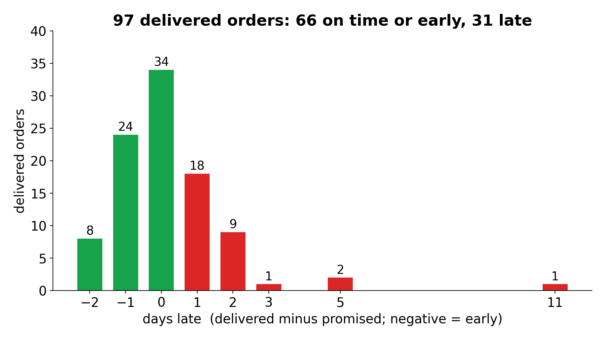
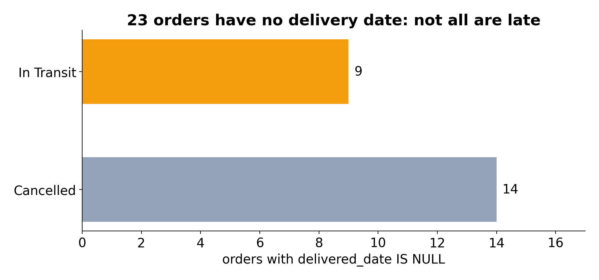
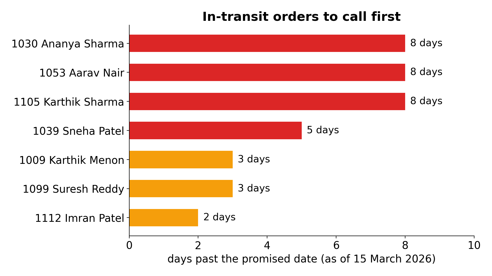

# <font color='#1d4ed8'>Lecture Script: Text and Dates with Calculated Columns (MySQL)</font>

---

## <font color='blue'>Agenda</font>

The lecture runs as four topics. Each topic ends with a quiz.

| Topic | What we do | Learning objectives covered | Minutes |
|:-:|:--|:--|:-:|
| 1 | Clean the text | Apply string functions to clean and combine text columns | 25 |
| 2 | Work with dates | Extract year, month and day parts from a date column<br>Compute the interval between two date columns | 30 |
| 3 | Build the columns | Compute a derived column from arithmetic on existing columns<br>Format query output using column and table aliases | 25 |
| 4 | Tidy and test the output | Format numeric output using ROUND and an explicit type cast<br>Filter rows on missing values using IS NULL and IS NOT NULL | 25 |
| — | Closing: Outcome & Summary | | 15 |
| | **Total** | | **120** |

> <font color="red">**🎯 Instructor Note**</font> Pace: in Topic 2 keep date parts quick (one query) and spend the time on the interval. In Topic 4 keep ROUND and CAST quick and spend the time on missing values.
> Topic 1 is the longest hands-on part; let learners run each query.

---

## <font color='blue'>Scenario</font>

A support lead at a Flipkart-style shopping app works from one `orders` table.

| Column group | What it holds |
|:--|:--|
| Who | customer name, city, email |
| What | product, quantity, unit price, discount percent |
| When | order date, promised date, delivered date (empty until delivery) |

> <font color="red">**🎯 Instructor Note**</font> Flipkart is only the setting. Do not claim Flipkart uses this data; the 120 orders in `data/flipkart_orders.sql` are invented for teaching.
> Learners load the file once in MySQL 8.0 or later, then use the `shop_demo` database. Treat 15 March 2026 as "today" so every output matches.

---

## <font color='blue'>Problem Statement</font>

Every morning the manager asks: "Which orders are late, and who should we call?"

One morning the lead typed `WHERE delivered_date = NULL` to find undelivered orders. It returned no rows, so the lead answered, "Nothing is pending." In fact 23 orders had no delivery date, and customers were waiting.

> <font color='purple'>**How do we turn raw order rows into a clean, correct list of late and pending orders that the team can act on?**</font>

> <font color="red">**🎯 Instructor Note**</font> Poll: "The query found nothing. Does that mean nothing is pending?" Give learners 30 seconds to respond in chat. Reveal the answer in the Closing.

---

## <font color='blue'>What We Will Use</font>

Four groups of tools, one for each topic. Each tool is explained when we first use it.

| Topic | Tools | In one line |
|:-:|:--|:--|
| 1 | `TRIM`, `REPLACE`, `UPPER`, `LOWER`, `LEFT`, `SUBSTRING`, `LENGTH`, `CONCAT`, `CONCAT_WS` | clean and join text |
| 2 | `YEAR`, `MONTH`, `DAY`, `MONTHNAME`, `DAYNAME`, `EXTRACT`, `DATEDIFF`, `TIMESTAMPDIFF` | pull a part out of a date, count the days between two dates |
| 3 | arithmetic, `AS`, table alias | build a new column and give it a name |
| 4 | `ROUND`, `CAST`, `IS NULL`, `IS NOT NULL` | format numbers, find missing values |

---

## <font color='blue'>How: Walking Through the Order Desk</font>


---

## <font color='blue'>Topic 1: Clean the Text</font> `25 min`

> <font color='purple'>**Before anyone can be called, the list needs clean names and cities. What is wrong with them now?**</font>

### <font color='green'>Example: finding the messy names</font>

> <font color='purple'>**Which names carry extra spaces, and how many characters do they waste?**</font>

**Predict before running: What will happen?**

> <font color="red">**🎯 Instructor Note**</font> Expected: `len_trim` is smaller than `len` only where spaces sit at the ends or the middle. Common guess: learners think `LENGTH` ignores spaces.

```sql
SELECT order_id, customer_name,
       LENGTH(customer_name) AS len,
       LENGTH(TRIM(customer_name)) AS len_trim
FROM orders
WHERE order_id IN (1002, 1022, 1070, 1120)
ORDER BY order_id;
```

**Output**

```
+----------+-----------------+------+----------+
| order_id | customer_name   | len  | len_trim |
+----------+-----------------+------+----------+
|     1002 | Priya Das       |    9 |        9 |
|     1022 |   Aarav Sharma  |   14 |       12 |
|     1070 |  Suresh  Singh  |   15 |       13 |
|     1120 | priya REDDY     |   13 |       11 |
+----------+-----------------+------+----------+
```

#### <font color='#c2410c'>Code Explanation</font>

- **Line 1** Picks the order id and the name as stored.
- **Lines 2 and 3** `LENGTH` counts the size of the text. `TRIM` removes the end spaces first, so the second count is shorter when spaces were removed. `AS` names each new column.
- **Line 4** Reads from the `orders` table.
- **Line 5** Keeps four orders that show the different problems.
- **Line 6** Sorts by order id so the output is always in the same order.

> <font color='green'>**Result**</font> Orders 1022, 1070 and 1120 have extra spaces (14 vs 12, 15 vs 13, 13 vs 11 characters). Order 1002 is clean (9 and 9).

### <font color='green'>Extending it: the double space in the middle</font>

> <font color='purple'>**Does `TRIM` alone fix every name?**</font>

> <font color="red">**🎯 Instructor Note**</font> Ask for a prediction for order 1070. Give learners 30 seconds to respond in chat. Expected: `TRIM` leaves the middle double space.

```sql
SELECT order_id, REPLACE(TRIM(customer_name), '  ', ' ') AS clean_name
FROM orders
WHERE order_id IN (1022, 1070);
```

**Output**

```
+----------+--------------+
| order_id | clean_name   |
+----------+--------------+
|     1022 | Aarav Sharma |
|     1070 | Suresh Singh |
+----------+--------------+
```

#### <font color='#c2410c'>Code Explanation</font>

- **Line 1** `TRIM` runs first and removes the end spaces. `REPLACE` then swaps every two spaces for one.
- **Lines 2 and 3** Read from `orders` for two orders.

> <font color='green'>**Result**</font> Both names are now clean, "Aarav Sharma" and "Suresh Singh". Order 1070 needed the `REPLACE` step as well.

### <font color='green'>Extending it: city and email</font>

> <font color='purple'>**How do we make `bengaluru` and `HYDERABAD` look like `Bengaluru` and `Hyderabad`, and make emails lower case?**</font>

```sql
SELECT order_id, city,
       CONCAT(UPPER(LEFT(city, 1)), LOWER(SUBSTRING(city, 2))) AS city_clean,
       LOWER(email) AS email_clean
FROM orders
WHERE order_id IN (1022, 1051, 1120, 1002);
```

**Output**

```
+----------+-----------+------------+--------------------------+
| order_id | city      | city_clean | email_clean              |
+----------+-----------+------------+--------------------------+
|     1002 | Mumbai    | Mumbai     | priya.das81@example.com  |
|     1022 | bengaluru | Bengaluru  | aarav.sharma@example.com |
|     1051 | Delhi     | Delhi      | nisha.gupta@example.com  |
|     1120 | HYDERABAD | Hyderabad  | priya.reddy@example.com  |
+----------+-----------+------------+--------------------------+
```

#### <font color='#c2410c'>Code Explanation</font>

- **Line 2** `LEFT(city, 1)` takes the first letter and `UPPER` capitalises it.
- **Line 2** `SUBSTRING(city, 2)` takes everything from the second letter on, and `LOWER` makes it small. `CONCAT` joins the two pieces.
- **Line 3** `LOWER(email)` makes the whole email lower case.

> <font color='green'>**Result**</font> Cities now read `Bengaluru` and `Hyderabad`, and every email is lower case. Clean values mean the same customer is always written the same way.

### <font color='green'>Extending it: joining text, and a missing email</font>

> <font color='purple'>**What happens when we join a name and an email, and the email is missing?**</font>

**Predict before running: What will happen?**

> <font color="red">**🎯 Instructor Note**</font> Expected: `CONCAT` returns `NULL` for order 1061, while `CONCAT_WS` skips the missing part. Ask learners which one they would trust on a call sheet.

```sql
SELECT order_id,
       CONCAT(customer_name, ' <', email, '>') AS with_concat,
       CONCAT_WS(' ', customer_name, email) AS with_concat_ws
FROM orders
WHERE order_id IN (1002, 1061);
```

**Output**

```
+----------+-------------------------------------+-----------------------------------+
| order_id | with_concat                         | with_concat_ws                    |
+----------+-------------------------------------+-----------------------------------+
|     1002 | Priya Das <priya.das81@example.com> | Priya Das priya.das81@example.com |
|     1061 | NULL                                | Meera                             |
+----------+-------------------------------------+-----------------------------------+
```

#### <font color='#c2410c'>Logic Explanation</font>

- `CONCAT` gives `NULL` as soon as any piece is `NULL`. Order 1061 has no email, so the whole label is lost, even the name.
- `CONCAT_WS(' ', ...)` uses the first value as the separator and skips `NULL` pieces, so the name "Meera" survives.

> <font color='green'>**Result**</font> Use `CONCAT_WS` when a piece can be missing, so one empty column does not erase the rest of the label.

### <font color='purple'>Quiz 1</font>

**Question:** The stored name is `' Suresh  Singh '` (a space at each end and two spaces in the middle). Which expression returns `Suresh Singh`?

**Options:**
- A) `TRIM(customer_name)`
- B) `REPLACE(customer_name, ' ', '')`
- C) `REPLACE(TRIM(customer_name), '  ', ' ')`
- D) `UPPER(TRIM(customer_name))`

**Correct Answer:** C

**Explanation:**
- **A)** Wrong: `TRIM` removes the end spaces only, so the result is `Suresh  Singh` with two spaces in the middle.
- **B)** Wrong: this removes every space, giving `SureshSingh`.
- **C)** Correct: `TRIM` cleans the ends and `REPLACE` turns the double space into one space.
- **D)** Wrong: this changes the case to `SURESH  SINGH` and still has two spaces in the middle.

---

## <font color='blue'>Topic 2: Work with Dates</font> `30 min`

> <font color='purple'>**The names are clean. Now, when was each order placed, and was it delivered on time?**</font>

### <font color='green'>Example: the parts of a date</font>

> <font color='purple'>**What are the year, month, day, month name and weekday of four orders, including two on month and year ends?**</font>

**Predict before running: What will happen?**

> <font color="red">**🎯 Instructor Note**</font> Expected: one value for each function. Ask for order 1022, dated 31 December 2025, before running.

```sql
SELECT order_id, order_date,
       YEAR(order_date) AS yr, MONTH(order_date) AS mth, DAY(order_date) AS dy,
       EXTRACT(YEAR FROM order_date) AS yr_x,
       MONTHNAME(order_date) AS month_name, DAYNAME(order_date) AS weekday
FROM orders
WHERE order_id IN (1022, 1051, 1111, 1120)
ORDER BY order_id;
```

**Output**

```
+----------+------------+------+------+------+------+------------+-----------+
| order_id | order_date | yr   | mth  | dy   | yr_x | month_name | weekday   |
+----------+------------+------+------+------+------+------------+-----------+
|     1022 | 2025-12-31 | 2025 |   12 |   31 | 2025 | December   | Wednesday |
|     1051 | 2025-12-28 | 2025 |   12 |   28 | 2025 | December   | Sunday    |
|     1111 | 2026-02-28 | 2026 |    2 |   28 | 2026 | February   | Saturday  |
|     1120 | 2026-01-31 | 2026 |    1 |   31 | 2026 | January    | Saturday  |
+----------+------------+------+------+------+------+------------+-----------+
```

#### <font color='#c2410c'>Code Explanation</font>

- **Line 1** Shows the id and the original date.
- **Line 2** `YEAR`, `MONTH` and `DAY` each take one part out of the same date as a number.
- **Line 3** `EXTRACT(YEAR FROM ...)` gives the same answer as `YEAR`.
- **Line 4** `MONTHNAME` and `DAYNAME` return the names as text.
- **Lines 5 to 7** Read from `orders`, keep four orders and sort them.

> <font color='green'>**Result**</font> `2025-12-31` splits into year 2025, month 12, day 31, a Wednesday in December. Month-end and year-end dates are handled correctly, and `EXTRACT` and `YEAR` agree.

### <font color='green'>Extending it: filtering on date parts</font>

> <font color='purple'>**How many orders were placed in December 2025?**</font>

```sql
SELECT COUNT(*) AS dec_2025_orders
FROM orders
WHERE YEAR(order_date) = 2025 AND MONTH(order_date) = 12;
```

**Output**

```
+-----------------+
| dec_2025_orders |
+-----------------+
|              24 |
+-----------------+
```

#### <font color='#c2410c'>Code Explanation</font>

- **Line 1** `COUNT(*)` counts every row that passes the filter.
- **Line 3** Both conditions must hold: the month is 12 and the year is 2025 (December 2024 or 2026 would not count).

> <font color='green'>**Result**</font> There are 24 orders in December 2025.

### <font color='green'>Example: days late for four orders</font>

> <font color='purple'>**An order is late when it arrives after the promised date. How many days late or early is each order?**</font>

$$\boxed{\text{DATEDIFF}(a, b) = a - b \quad (\text{in days})}$$

**Predict before running: What will happen?**

> <font color="red">**🎯 Instructor Note**</font> Expected: 11 (late), `NULL` (not delivered), -1 (early), 0 (on the day). Ask for the sign of order 1022 before running.

```sql
SELECT order_id, promised_date, delivered_date,
       DATEDIFF(delivered_date, promised_date) AS days_late
FROM orders
WHERE order_id IN (1004, 1009, 1022, 1078)
ORDER BY order_id;
```

**Output**

```
+----------+---------------+----------------+-----------+
| order_id | promised_date | delivered_date | days_late |
+----------+---------------+----------------+-----------+
|     1004 | 2026-02-14    | 2026-02-25     |        11 |
|     1009 | 2026-03-12    | NULL           |      NULL |
|     1022 | 2026-01-03    | 2026-01-02     |        -1 |
|     1078 | 2026-01-20    | 2026-01-20     |         0 |
+----------+---------------+----------------+-----------+
```

#### <font color='#c2410c'>Code Explanation</font>

- **Line 1** Shows the id and both dates.
- **Line 2** Subtracts the promised date from the delivered date, in days.
- **Lines 3 to 5** Read `orders`, keep four orders and sort them.

> <font color='green'>**Result**</font> Order 1004 is 11 days late, 1022 is 1 day early, 1078 is on the day, and 1009 gives `NULL` because it has not been delivered. Positive means late, 0 means on the day, negative means early, and `NULL` means a missing date.

### <font color='green'>Extending it: the argument order</font>

> <font color='purple'>**What if the two dates are swapped?**</font>

```sql
SELECT order_id,
       DATEDIFF(promised_date, delivered_date) AS wrong_order,
       DATEDIFF(delivered_date, promised_date) AS right_order,
       TIMESTAMPDIFF(DAY, promised_date, delivered_date) AS tsd
FROM orders
WHERE order_id IN (1004, 1022);
```

**Output**

```
+----------+-------------+-------------+------+
| order_id | wrong_order | right_order | tsd  |
+----------+-------------+-------------+------+
|     1004 |         -11 |          11 |   11 |
|     1022 |           1 |          -1 |   -1 |
+----------+-------------+-------------+------+
```

#### <font color='#c2410c'>Logic Explanation</font>

- `wrong_order` has the promised date first, so every sign is reversed: the 11 days late becomes -11.
- `TIMESTAMPDIFF(DAY, promised_date, delivered_date)` takes the earlier date first and returns the same answer as the correct `DATEDIFF`.

> <font color='green'>**Result**</font> Both correct forms give 11 and -1. Always read the call as "first date minus second date" for `DATEDIFF`.

### <font color='green'>Extending it: another interval, order to delivery</font>

> <font color='purple'>**How many days from order to delivery, including a year-end order?**</font>

```sql
SELECT order_id, order_date, delivered_date,
       DATEDIFF(delivered_date, order_date) AS days_to_deliver
FROM orders
WHERE order_id IN (1004, 1009, 1022, 1051, 1078)
ORDER BY order_id;
```

**Output**

```
+----------+------------+----------------+-----------------+
| order_id | order_date | delivered_date | days_to_deliver |
+----------+------------+----------------+-----------------+
|     1004 | 2026-02-10 | 2026-02-25     |              15 |
|     1009 | 2026-03-08 | NULL           |            NULL |
|     1022 | 2025-12-31 | 2026-01-02     |               2 |
|     1051 | 2025-12-28 | 2025-12-31     |               3 |
|     1078 | 2026-01-20 | 2026-01-20     |               0 |
+----------+------------+----------------+-----------------+
```

#### <font color='#c2410c'>Code Explanation</font>

- **Line 2** `delivered_date` minus `order_date`, so the count is the days it took.

<p align="center"></p>

> <font color='green'>**Result**</font> Order 1022 took 2 days even though it crossed from 31 December to 2 January, and order 1078 took 0 days. Month ends and year ends need no special handling.

### <font color='purple'>Quiz 2</font>

**Question:** An order was promised on `2026-01-03` and delivered on `2026-01-02`. What does `DATEDIFF(delivered_date, promised_date)` return?

**Options:**
- A) `1`
- B) `-1`
- C) `0`
- D) `NULL`

**Correct Answer:** B

**Explanation:**
- **A)** Wrong: `1` is what you get when the two dates are swapped.
- **B)** Correct: delivered minus promised is 2 January minus 3 January, which is -1 (one day early).
- **C)** Wrong: `0` would mean the order arrived on the promised day.
- **D)** Wrong: `NULL` appears only if one of the dates is missing, and both are present here.

---

## <font color='blue'>Topic 3: Build the Columns</font> `25 min`

> <font color='purple'>**We can now find the late orders. How much money is tied up in them, when the table has no order value column?**</font>

### <font color='green'>Example: gross value of an order</font>

> <font color='purple'>**What is the value of each order before any discount?**</font>

**Predict before running: What will happen?**

> <font color="red">**🎯 Instructor Note**</font> Expected: quantity times unit price, for example 2 x 649 = 1298. Ask for order 1004 (40 phone cases at Rs 299) first.

```sql
SELECT order_id, quantity, unit_price,
       quantity * unit_price AS gross
FROM orders
WHERE order_id IN (1002, 1004, 1022)
ORDER BY order_id;
```

**Output**

```
+----------+----------+------------+----------+
| order_id | quantity | unit_price | gross    |
+----------+----------+------------+----------+
|     1002 |        2 |     649.00 |  1298.00 |
|     1004 |       40 |     299.00 | 11960.00 |
|     1022 |        1 |     499.00 |   499.00 |
+----------+----------+------------+----------+
```

#### <font color='#c2410c'>Code Explanation</font>

- **Line 1** Picks the id and shows `quantity` and `unit_price` so learners can check the maths.
- **Line 2** `quantity * unit_price` creates a new column in the result, and `AS gross` names it.
- **Lines 3 to 5** Read `orders`, keep three orders and sort them.

> <font color='green'>**Result**</font> Order 1004 is $40 \times 299 = \text{Rs } 11960$, order 1002 is $2 \times 649 = \text{Rs } 1298$, and order 1022 is $1 \times 499 = \text{Rs } 499$. The new column exists only in the result; the table is unchanged.

### <font color='green'>Extending it: the discount and the net total</font>

> <font color='purple'>**How much is taken off, and what does the customer pay?**</font>

$$\boxed{\text{net total} = \text{quantity} \times \text{unit price} \times \left(1 - \frac{\text{discount \%}}{100}\right)}$$

**Predict before running: What will happen?**

> <font color="red">**🎯 Instructor Note**</font> Expected: for order 1004, 20% of 11960 is 2392, so the net is 9568. Order 1061 has no discount value, so ask what happens there.

```sql
SELECT order_id,
       quantity * unit_price AS gross,
       quantity * unit_price * discount_pct / 100 AS discount_rs,
       quantity * unit_price * (1 - discount_pct / 100) AS net_total
FROM orders
WHERE order_id IN (1004, 1022, 1061)
ORDER BY order_id;
```

**Output**

```
+----------+----------+-------------+-------------+
| order_id | gross    | discount_rs | net_total   |
+----------+----------+-------------+-------------+
|     1004 | 11960.00 | 2392.000000 | 9568.000000 |
|     1022 |   499.00 |   49.900000 |  449.100000 |
|     1061 |   649.00 |        NULL |        NULL |
+----------+----------+-------------+-------------+
```

#### <font color='#c2410c'>Code Explanation</font>

- **Line 2** `gross` multiplies quantity by price.
- **Line 3** `discount_rs` is the gross amount times the discount percent, divided by 100.
- **Line 4** `net_total` multiplies the gross amount by `(1 - discount_pct / 100)`, which is the share of the price still to be paid.

> <font color='green'>**Result**</font> Order 1004: gross 11960, discount Rs 2392, net 9568. Order 1022: gross 499, discount 49.9, net 449.1. Order 1061 shows `NULL` in both calculated columns, because its `discount_pct` is empty and any arithmetic with an unknown value is unknown.

### <font color='green'>Extending it: readable headings with aliases</font>

> <font color='purple'>**The call sheet is read by support agents. How do we show a friendly order number, a clean name and the gross value?**</font>

```sql
SELECT o.order_id AS `Order No`,
       TRIM(o.customer_name) AS customer,
       o.quantity * o.unit_price AS gross
FROM orders AS o
WHERE o.order_id IN (1002, 1004, 1022)
ORDER BY o.order_id;
```

**Output**

```
+----------+--------------+----------+
| Order No | customer     | gross    |
+----------+--------------+----------+
|     1002 | Priya Das    |  1298.00 |
|     1004 | Kavya Nair   | 11960.00 |
|     1022 | Aarav Sharma |   499.00 |
+----------+--------------+----------+
```

#### <font color='#c2410c'>Code Explanation</font>

- **Line 1** ``AS `Order No` `` renames the column. Backticks are needed because the name contains a space.
- **Line 2** The `TRIM` expression is renamed to `customer`.
- **Line 3** The calculation is renamed to `gross`.
- **Line 4** `orders AS o` gives the table the short name `o`, and every column starts with `o.`.

> <font color='green'>**Result**</font> The result now has the headings `Order No`, `customer` and `gross` instead of raw column names and formulas.

### <font color='green'>Extending it: where an alias works and where it fails</font>

> <font color='purple'>**Can we use `days_late` in `WHERE`, and in `ORDER BY`?**</font>

**Predict before running: What will happen?**

> <font color="red">**🎯 Instructor Note**</font> Ask which of the two will fail. Give learners 30 seconds to respond in chat. Expected: `WHERE` fails, `ORDER BY` works.

```sql
SELECT order_id, DATEDIFF(delivered_date, promised_date) AS days_late
FROM orders
WHERE days_late > 5;
```

**Output**

```
ERROR 1054 (42S22): Unknown column 'days_late' in 'where clause'
```

```sql
SELECT order_id, DATEDIFF(delivered_date, promised_date) AS days_late
FROM orders
ORDER BY days_late DESC, order_id
LIMIT 3;
```

**Output**

```
+----------+-----------+
| order_id | days_late |
+----------+-----------+
|     1004 |        11 |
|     1014 |         5 |
|     1097 |         5 |
+----------+-----------+
```

#### <font color='#c2410c'>Logic Explanation</font>

- MySQL applies `WHERE` before it builds the output columns, so the name `days_late` does not exist yet and the query fails.
- `ORDER BY` runs after the columns are built, so it can sort by `days_late`.
- To filter on the value, repeat the expression in `WHERE`.

```sql
SELECT order_id, DATEDIFF(delivered_date, promised_date) AS days_late
FROM orders
WHERE DATEDIFF(delivered_date, promised_date) > 2
ORDER BY days_late DESC, order_id;
```

**Output**

```
+----------+-----------+
| order_id | days_late |
+----------+-----------+
|     1004 |        11 |
|     1014 |         5 |
|     1097 |         5 |
|     1019 |         3 |
+----------+-----------+
```

> <font color='green'>**Result**</font> The alias in `WHERE` raises error 1054. Repeating `DATEDIFF(...)` in `WHERE` works and finds the four orders more than 2 days late.

### <font color='purple'>Quiz 3</font>

**Question:** An order has `quantity = 2`, `unit_price = 649.00` and `discount_pct = 20`. What is the net total?

**Options:**
- A) 1038.40
- B) 1298.00
- C) 259.60
- D) 1278.00

**Correct Answer:** A

**Explanation:**
- **A)** Correct: $2 \times 649 \times (1 - 20/100) = 1298 \times 0.8 = 1038.40$.
- **B)** Wrong: 1298.00 is the gross value, with no discount taken off.
- **C)** Wrong: 259.60 is the discount amount (20% of 1298), not the amount the customer pays.
- **D)** Wrong: 1278.00 subtracts 20 rupees instead of 20 percent.

---

## <font color='blue'>Topic 4: Tidy and Test the Output</font> `25 min`

> <font color='purple'>**The totals have long decimals, and some values are simply missing. How do we tidy the numbers and find the gaps?**</font>

### <font color='green'>Example: rounding the net total</font>

> <font color='purple'>**How do we show the net total with 2 decimals, and as a whole number?**</font>

**Predict before running: What will happen?**

> <font color="red">**🎯 Instructor Note**</font> Expected: order 1111 gives 994.65 with 2 places and 995 with 0 places. Ask learners to say which way 994.65 rounds to a whole number.

```sql
SELECT order_id,
       quantity * unit_price * (1 - discount_pct / 100) AS raw_total,
       ROUND(quantity * unit_price * (1 - discount_pct / 100), 2) AS total_2dp,
       ROUND(quantity * unit_price * (1 - discount_pct / 100), 0) AS total_0dp
FROM orders
WHERE order_id IN (1004, 1022, 1111);
```

**Output**

```
+----------+-------------+-----------+-----------+
| order_id | raw_total   | total_2dp | total_0dp |
+----------+-------------+-----------+-----------+
|     1004 | 9568.000000 |   9568.00 |      9568 |
|     1022 |  449.100000 |    449.10 |       449 |
|     1111 |  994.650000 |    994.65 |       995 |
+----------+-------------+-----------+-----------+
```

#### <font color='#c2410c'>Code Explanation</font>

- **Line 2** The unrounded net total, with its long decimals.
- **Line 3** The same value rounded to 2 decimal places.
- **Line 4** The same value rounded to a whole number (0 places).

> <font color='green'>**Result**</font> Order 1111 reads 994.650000, then 994.65, then 995. The rounded columns are easier to read, and the original numbers are unchanged.

### <font color='green'>Extending it: quick check with CAST</font>

> <font color='purple'>**How does `CAST` change the type, instead of rounding?**</font>

```sql
SELECT order_id,
       CAST(unit_price AS SIGNED) AS price_int,
       CAST(unit_price AS CHAR) AS price_text,
       CAST(quantity * unit_price * (1 - discount_pct / 100) AS DECIMAL(10, 2)) AS net_2dp
FROM orders
WHERE order_id IN (1004, 1022, 1111);
```

**Output**

```
+----------+-----------+------------+---------+
| order_id | price_int | price_text | net_2dp |
+----------+-----------+------------+---------+
|     1004 |       299 | 299.00     | 9568.00 |
|     1022 |       499 | 499.00     |  449.10 |
|     1111 |       349 | 349.00     |  994.65 |
+----------+-----------+------------+---------+
```

#### <font color='#c2410c'>Code Explanation</font>

- **Line 2** `CAST(unit_price AS SIGNED)` drops the `.00` and gives a whole number.
- **Line 3** `CAST(... AS CHAR)` turns the number into text.
- **Line 4** `CAST(... AS DECIMAL(10, 2))` fixes the net total to 2 decimals, the same display as `ROUND(..., 2)`.

> <font color='green'>**Result**</font> `ROUND` formats a value, and `CAST` changes its type. Both can give 449.10, but only `CAST` can also turn a number into text.

### <font color='green'>Example: the query that found nothing</font>

> <font color='purple'>**How many orders have no delivery date, and what does `= NULL` return?**</font>

**Predict before running: What will happen?**

> <font color="red">**🎯 Instructor Note**</font> Expected: `= NULL` returns 0 rows and `IS NULL` returns 23. Revisit the opening poll: nothing found does not mean nothing pending.

```sql
SELECT COUNT(*) AS orders,
       SUM(delivered_date IS NULL) AS no_delivery_date,
       SUM(delivered_date IS NOT NULL) AS delivered
FROM orders;
```

**Output**

```
+--------+------------------+-----------+
| orders | no_delivery_date | delivered |
+--------+------------------+-----------+
|    120 |               23 |        97 |
+--------+------------------+-----------+
```

```sql
SELECT COUNT(*) AS rows_found
FROM orders
WHERE delivered_date = NULL;
```

**Output**

```
+------------+
| rows_found |
+------------+
|          0 |
+------------+
```

#### <font color='#c2410c'>Code Explanation</font>

- **First query** `SUM(delivered_date IS NULL)` adds 1 for each row where the test is true, so it counts the missing dates. `IS NOT NULL` counts the filled ones.
- **Second query** `= NULL` is never true, so no row passes the filter.

> <font color='green'>**Result**</font> There are 23 orders with no delivery date and 97 with one (23 + 97 = 120). The query with `= NULL` found 0 rows, which is the mistake from the problem statement.

### <font color='green'>Extending it: listing the missing ones</font>

> <font color='purple'>**Which orders have no delivery date, and why?**</font>

```sql
SELECT order_id, status, promised_date
FROM orders
WHERE delivered_date IS NULL
ORDER BY order_id
LIMIT 5;
```

**Output**

```
+----------+------------+---------------+
| order_id | status     | promised_date |
+----------+------------+---------------+
|     1005 | Cancelled  | 2026-01-26    |
|     1006 | Cancelled  | 2025-12-14    |
|     1009 | In Transit | 2026-03-12    |
|     1020 | Cancelled  | 2025-12-09    |
|     1024 | Cancelled  | 2026-03-16    |
+----------+------------+---------------+
```

```sql
SELECT status, COUNT(*) AS orders
FROM orders
WHERE delivered_date IS NULL
GROUP BY status
ORDER BY status;
```

**Output**

```
+------------+--------+
| status     | orders |
+------------+--------+
| Cancelled  |     14 |
| In Transit |      9 |
+------------+--------+
```

<p align="center"></p>

#### <font color='#c2410c'>Code Explanation</font>

- **First query** `IS NULL` keeps only the orders without a delivery date. `LIMIT 5` shows the first five.
- **Second query** `GROUP BY status` counts these orders for each status.

> <font color='green'>**Result**</font> Of the 23 orders without a delivery date, 14 are cancelled and 9 are still in transit. Only the 9 in transit may need a call.

### <font color='green'>Extending it: NULL is not an empty string</font>

> <font color='purple'>**Is a missing email the same as a blank email?**</font>

```sql
SELECT order_id,
       CONCAT('[', email, ']') AS email_shown,
       email IS NULL AS is_null,
       email = '' AS is_empty
FROM orders
WHERE order_id IN (1002, 1061, 1111);
```

**Output**

```
+----------+---------------------------+---------+----------+
| order_id | email_shown               | is_null | is_empty |
+----------+---------------------------+---------+----------+
|     1002 | [priya.das81@example.com] |       0 |        0 |
|     1061 | NULL                      |       1 |     NULL |
|     1111 | []                        |       0 |        1 |
+----------+---------------------------+---------+----------+
```

```sql
SELECT order_id, TRIM(customer_name) AS customer, status
FROM orders
WHERE email IS NULL OR email = '';
```

**Output**

```
+----------+------------+-----------+
| order_id | customer   | status    |
+----------+------------+-----------+
|     1061 | Meera      | Delivered |
|     1111 | Rohan Iyer | Delivered |
+----------+------------+-----------+
```

#### <font color='#c2410c'>Logic Explanation</font>

- Order 1061 has `NULL`: `email IS NULL` is 1, and `email = ''` is `NULL` because comparing an unknown value gives an unknown result.
- Order 1111 has an empty string: `email IS NULL` is 0 and `email = ''` is 1.
- To find every order with no usable email, test for both: `email IS NULL OR email = ''`.

> <font color='green'>**Result**</font> Two orders have no usable email: 1061 (`NULL`) and 1111 (empty text). A check for `IS NULL` alone would find only one.

### <font color='purple'>Quiz 4</font>

**Question:** Which condition returns the orders that have no delivery date?

**Options:**
- A) `WHERE delivered_date = NULL`
- B) `WHERE delivered_date <> NULL`
- C) `WHERE delivered_date IS NULL`
- D) `WHERE delivered_date IS NOT NULL`

**Correct Answer:** C

**Explanation:**
- **A)** Wrong: comparing with `= NULL` is never true, so it returns 0 rows.
- **B)** Wrong: `<> NULL` is also never true, so it returns 0 rows.
- **C)** Correct: `IS NULL` is the test for a missing value, and it returns the 23 orders.
- **D)** Wrong: `IS NOT NULL` returns the opposite group, the 97 delivered orders.

---

## <font color='blue'>Closing: Outcome & Summary</font> `15 min`

Back to the problem: turn raw rows into a correct list of late and pending orders. We use each topic once.

> <font color='purple'>**1. Who is waiting and overdue?**</font>

Orders still in transit (no delivery date) and past their promised date, with clean names, upper-case cities and days overdue as of 15 March 2026.

```sql
SELECT order_id AS `Order`,
       TRIM(customer_name) AS customer,
       UPPER(city) AS city,
       DATEDIFF('2026-03-15', promised_date) AS days_overdue
FROM orders
WHERE delivered_date IS NULL
  AND status = 'In Transit'
  AND promised_date < '2026-03-15'
ORDER BY days_overdue DESC, order_id;
```

**Output**

```
+-------+----------------+-----------+--------------+
| Order | customer       | city      | days_overdue |
+-------+----------------+-----------+--------------+
|  1030 | Ananya Sharma  | CHENNAI   |            8 |
|  1053 | Aarav Nair     | KOLKATA   |            8 |
|  1105 | Karthik Sharma | PUNE      |            8 |
|  1039 | Sneha Patel    | KOLKATA   |            5 |
|  1009 | Karthik Menon  | BENGALURU |            3 |
|  1099 | Suresh Reddy   | MUMBAI    |            3 |
|  1112 | Imran Patel    | MUMBAI    |            2 |
+-------+----------------+-----------+--------------+
```

#### <font color='#c2410c'>Code Explanation</font>

- **Line 1** An alias gives the order id a clean heading, `Order`.
- **Line 2** `TRIM` cleans the name (Topic 1).
- **Line 3** `UPPER` standardises the city (Topic 1).
- **Line 4** `DATEDIFF` gives the days between the promised date and 15 March 2026 (Topic 2), named with `AS`.
- **Lines 6 to 8** `IS NULL` keeps orders without a delivery date (Topic 4), then the status and date conditions keep only the overdue ones in transit.

<p align="center"></p>

> <font color='purple'>**2. Which delivered orders arrived more than 2 days late?**</font>

```sql
SELECT order_id, TRIM(customer_name) AS customer,
       DATEDIFF(delivered_date, promised_date) AS days_late
FROM orders
WHERE delivered_date IS NOT NULL
  AND DATEDIFF(delivered_date, promised_date) > 2
ORDER BY days_late DESC, order_id;
```

**Output**

```
+----------+--------------+-----------+
| order_id | customer     | days_late |
+----------+--------------+-----------+
|     1004 | Kavya Nair   |        11 |
|     1014 | Vikram Reddy |         5 |
|     1097 | Vikram Khan  |         5 |
|     1019 | Divya Sharma |         3 |
+----------+--------------+-----------+
```

> <font color='purple'>**3. What is the split of all 120 orders?**</font>

```sql
SELECT SUM(delivered_date IS NOT NULL AND DATEDIFF(delivered_date, promised_date) > 0) AS late,
       SUM(delivered_date IS NOT NULL AND DATEDIFF(delivered_date, promised_date) <= 0) AS on_time,
       SUM(delivered_date IS NULL) AS no_delivery_date
FROM orders;
```

**Output**

```
+------+---------+------------------+
| late | on_time | no_delivery_date |
+------+---------+------------------+
|   31 |      66 |               23 |
+------+---------+------------------+
```

### <font color='green'>Outcome</font>

| Group | Orders | How we found them |
|:--|:-:|:--|
| Delivered late | 31 | `DATEDIFF(delivered_date, promised_date) > 0` |
| Delivered on time or early | 66 | `DATEDIFF(...) <= 0` |
| No delivery date | 23 | `delivered_date IS NULL` |
| **Total** | **120** | |

> <font color='green'>**Therefore,**</font> the support team calls the 7 overdue in-transit customers, starting with the three that are 8 days overdue, and reviews the 4 delivered orders that were more than 2 days late. The 14 cancelled orders need no call. The earlier `= NULL` query would have missed all 23.

> <font color="red">**🎯 Instructor Note**</font> Reveal the opening poll: "no rows" meant a wrong test, not "nothing pending". Remind learners that `NULL` is tested with `IS NULL`.

### <font color='green'>Summary</font>

| Learning objective | Takeaway |
|:--|:--|
| String functions | `TRIM`, `REPLACE`, `UPPER`, `LOWER`, `CONCAT` and `CONCAT_WS` clean and combine text; `CONCAT` returns `NULL` if any part is `NULL` |
| Date parts | `YEAR`, `MONTH`, `DAY`, `MONTHNAME`, `DAYNAME` and `EXTRACT` pull one part out of a date |
| Date interval | `DATEDIFF(later, earlier)` gives days; positive is late, negative is early, `NULL` if a date is missing |
| Derived column | Arithmetic in `SELECT` builds a new value without changing the table, for example `quantity * unit_price * (1 - discount_pct / 100)` |
| Aliases | `AS` names columns and tables; use backticks for spaces; aliases work in `ORDER BY` but not in `WHERE` |
| ROUND and CAST | `ROUND` sets decimal places; `CAST` changes the type (`SIGNED`, `DECIMAL(10, 2)`, `CHAR`, `DATE`) |
| IS NULL | Test missing values with `IS NULL` and `IS NOT NULL`, never `= NULL`; an empty string is not `NULL` |
| **Practical value** | Clean, calculated and correctly filtered output gives a reliable list that people can act on |

---

## <font color='blue'>Announcements</font>

> <font color="red">**🎯 Instructor Note**</font> Optional. Use this space to tell learners about upcoming activities such as projects or evaluations. By default, the mentor explains.

---

# <font color='red'>Launch the Feedback Poll</font>

> <font color="red">**🎯 Instructor Note**</font> Reminder: launch the feedback poll now to collect learner feedback.
