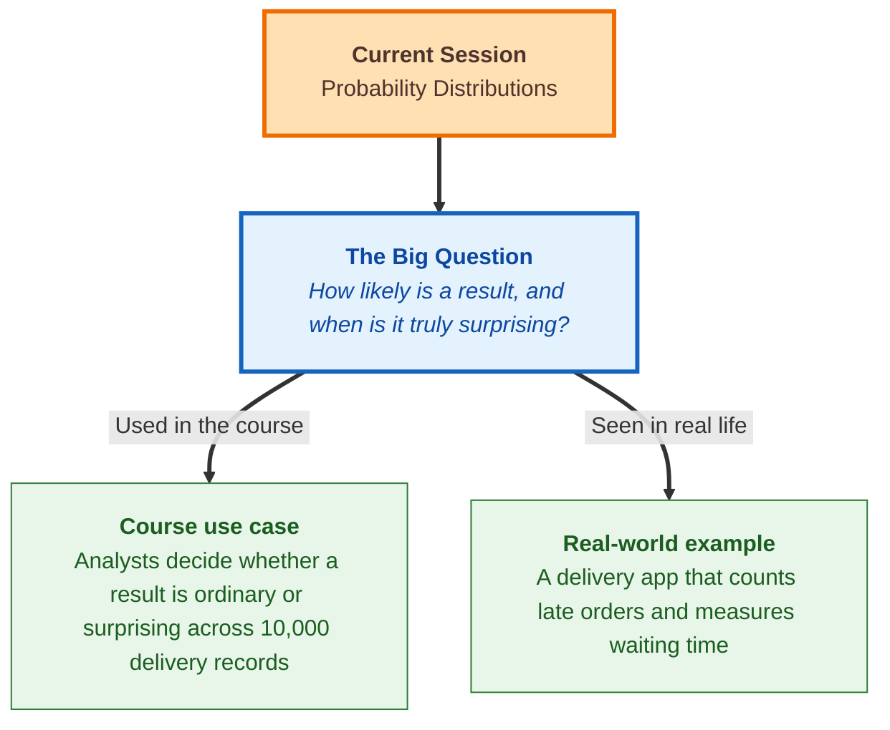

## Probability Distributions

### Mental Map

---

### What You'll Learn

Have you ever wondered how a delivery app guesses your waiting time before you order?

By the end of this session, you will be able to:

- **Classify** each measurement as something you count or something you measure.
- **Calculate** the chance that exactly 3 out of 10 orders arrive late.
- **Determine** the chance that one delivery takes longer than 40 minutes.
- **Estimate** what share of deliveries land close to the usual time.

> **Topics you will meet:** discrete vs continuous, binomial, normal and z-scale, and the empirical rule.
>
> Join the session to learn each of these in detail.

---

### Why You Are Learning This Topic

You order dinner, and the app promises 35 minutes. Yours arrives early. Your friend's order arrives late.

The app cannot know each wait in advance. It knows which waits are common and which are rare. A **probability distribution** means a pattern that shows how likely each outcome is.

In your course, you will use the same idea to judge whether a result is ordinary or surprising.

> **Think about it:** How does the app know that one wait is unusual?

---

### The Delivery App Puzzle

The app promised 35 minutes. Any order over 35 minutes counts as late. Here are the last 6 orders from one restaurant.

| Order | Minutes taken |
|:-----:|:-------------:|
| 1 | 27 |
| 2 | 41 |
| 3 | 30 |
| 4 | 24 |
| 5 | 33 |
| 6 | 38 |

**What you want to happen:**

- Know how likely 3 late orders out of 10 are.
- Know how unusual a 41-minute wait is.
- Know what share of orders arrive between 25 and 35 minutes.

> **Wonder about this:**
>
> - Why can you count late orders, but only measure the minutes?
> - Would one 60-minute order change what you call usual?

---

### Think It Through

There is no wrong first try. Keep your guesses for the session.

**1. Which one do you count: late orders, or minutes of waiting?**
Hint: Ask whether you could ever see 2.5 late orders.

**2. If about 30 minutes is usual, which order looks the most unusual?**
Hint: Look for the biggest gap from 30.

**3. If 10 orders go out tonight, what number of late orders would surprise you?**
Hint: Use the 2 late orders out of 6 above as a guide.

---

### One Question to Carry Into the Session

> **How can a computer turn a feeling like "that wait was unusual" into an exact chance?**
>
> And how can you check its answer yourself?
