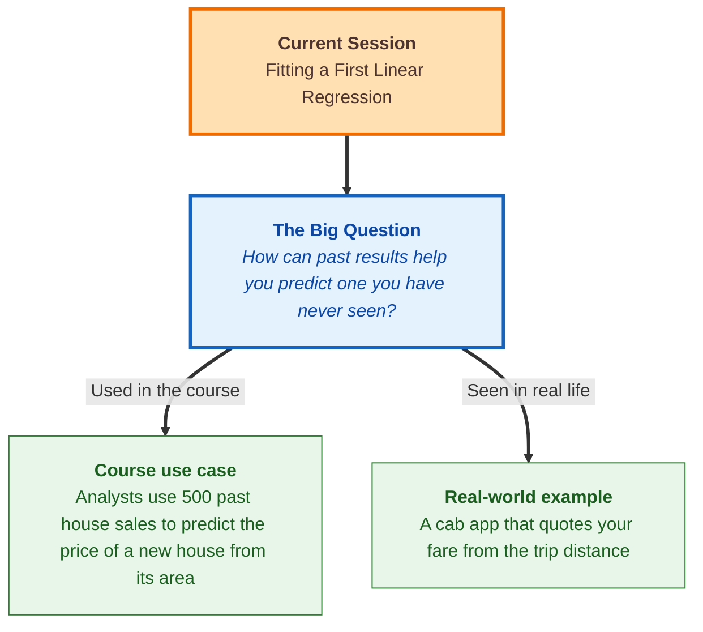

## <span style="color:#2F7DDE">Fitting a First Linear Regression</span>

### <span style="color:#2F7DDE">Mental Map</span>



---

### <span style="color:#2F7DDE">What You'll Learn</span>

Have you ever wondered how a cab app quotes your fare before the ride starts?

By the end of this session, you will be able to:

- <span style="color:#D9660B">**Explain**</span> how a straight line turns a trip distance into a fare.
- <span style="color:#D9660B">**Describe**</span> how the best line is picked so the points sit as close to it as possible.
- <span style="color:#D9660B">**Interpret**</span> what the starting fare and the rise per kilometre mean in rupees.
- <span style="color:#D9660B">**Use**</span> 5 past trips and a little code to fit a straight line.
- <span style="color:#D9660B">**Calculate**</span> the fare for a 7 km trip from the line's starting fare and rise per kilometre.

> <span style="color:#2F7DDE">**Topics you will meet:**</span> linear regression idea, least-squares fit, simple regression in scikit-learn, slope and intercept, and prediction by hand.
>
> Join the session to learn each of these in detail.

---

### <span style="color:#2F7DDE">Why You Are Learning This Topic</span>

You open a cab app and type your destination. The app shows a fare before you book. Nobody at the app has seen your trip yet.

The app guesses from past trips. A <span style="color:#D9660B">**linear regression**</span> means a straight line that predicts one number from another number.

In your course, you will use the same idea to predict prices or sales from numbers you already know.

> <span style="color:#2F7DDE">**Think about it:**</span> How can the app guess a fare for a trip it has never seen?

---

### <span style="color:#2F7DDE">The Cab Fare Puzzle</span>

Here are 5 past trips from one city.

| Trip | Distance (km) | Fare (rupees) |
|:----:|:-------------:|:-------------:|
| 1 | 2 | 60 |
| 2 | 4 | 95 |
| 3 | 6 | 140 |
| 4 | 8 | 170 |
| 5 | 10 | 215 |

<span style="color:#D9660B">**What you want to happen:**</span>

- Draw one straight line that comes close to all 5 trips.
- Know what the line says a 0 km trip costs.
- Know how much each extra kilometre adds.

Here is how a computer might start. You do not need to understand it yet.

```python
model = LinearRegression()
model.fit(distance_km, fare)
model.predict([[7]])
```

> <span style="color:#D9660B">**Wonder about this:**</span>
>
> - Why do two 6 km trips not always cost the same?
> - Where would you place the line if one trip cost far more than the rest?

---

### <span style="color:#2F7DDE">Think It Through</span>

There is no wrong first try. Keep your guesses for the session.

**1. Which number do you want to predict, and which one do you already know?**
Hint: One is on the screen before you book. The other is the price.

**2. Where would you place one straight line among the 5 trips on a graph?**
Hint: Aim for the line that leaves the smallest gaps to the points.

**3. A trip starts at about 20 rupees and adds about 19 rupees per kilometre. What fare would you guess for 9 km?**
Hint: Add the starting fare to the cost of 9 kilometres.

---

### <span style="color:#2F7DDE">One Question to Carry Into the Session</span>

> <span style="color:#2F7DDE">**How does a computer find the one best line through scattered points?**</span>
>
> And how can you check its fare with a pencil?
