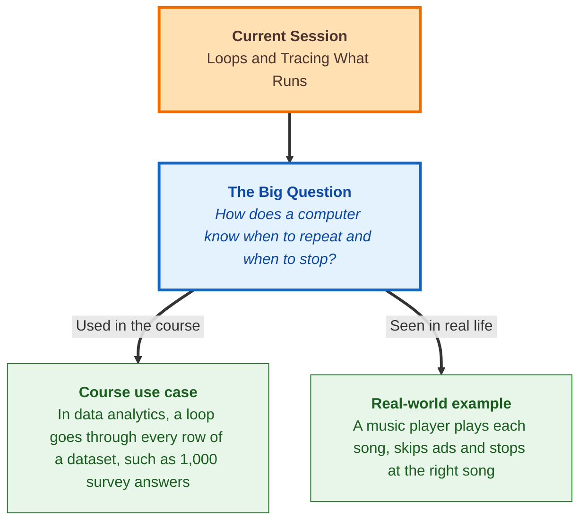

## <span style="color:#2F7DDE">Loops and Tracing What Runs</span>

### <span style="color:#2F7DDE">Mental Map</span>



---

### <span style="color:#2F7DDE">What You'll Learn</span>

Have you ever wondered how a music player plays your playlist, skips the ad and stops on its own?

By the end of this session, you will be able to:

- <span style="color:#D9660B">**Identify**</span> the rule that keeps a player from ever finishing a playlist.
- <span style="color:#D9660B">**Predict**</span> which choice the player makes for an ad and for a song.
- <span style="color:#D9660B">**Apply**</span> a skip rule and a stop-early rule to a 6-track playlist.
- <span style="color:#D9660B">**Trace**</span> one number step by step as the player works through the tracks.
- <span style="color:#D9660B">**Write**</span> steps that go through a playlist one track at a time.
- <span style="color:#D9660B">**Build**</span> steps that keep playing until a stop rule is met.

> <span style="color:#2F7DDE">**Topics you will meet:**</span> for loop, while loop, break and continue, if/else choices, and tracing a value.
>
> Join the session to learn each of these in detail.

---

### <span style="color:#2F7DDE">Why You Are Learning This Topic</span>

You tap Play on a playlist of 6 tracks. The player plays them in order. It skips the ad. It stops right after your favourite song.

Nobody wrote a separate instruction for each track. The player repeats the same steps for every track. A <span style="color:#D9660B">**loop**</span> means steps that the computer repeats.

In your course, the same idea lets a program check 1,000 rows of data without copying code.

> <span style="color:#2F7DDE">**Think about it:**</span> How does the player know when to skip, and when to stop?

---

### <span style="color:#2F7DDE">The Playlist Puzzle</span>

Here is the playlist we will use for the whole session.

| Position | Track |
|:--------:|-------|
| 1 | Song 1 |
| 2 | Song 2 |
| 3 | Ad |
| 4 | Song 4 |
| 5 | My Favourite |
| 6 | Song 6 |

<span style="color:#D9660B">**What you want the player to do:**</span>

- Play the tracks in order.
- Skip the ad.
- Stop right after My Favourite.

Here is how a computer might start reading that playlist. You do not need to understand it yet.

```python
for track in playlist:
    print(track)
```

> <span style="color:#D9660B">**Wonder about this:**</span>
>
> - What decides when the player stops?
> - What if My Favourite is not in the playlist?

---

### <span style="color:#2F7DDE">Think It Through</span>

There is no wrong first try. Keep your guesses for the session.

**1. Which tracks play, and in what order?**
Hint: Remember which track the player skips.

**2. What does the player check at each track?**
Hint: Think about what makes an ad different from a song.

**3. What could make the player keep going forever?**
Hint: Think about the track where it is meant to stop.

---

### <span style="color:#2F7DDE">One Question to Carry Into the Session</span>

> <span style="color:#2F7DDE">**How does the computer know when to stop?**</span>
>
> And how can you prove it by following one value at a time?

---

### <span style="color:#2F7DDE">Set Up Before the Session</span>

> <span style="color:#2F7DDE">**Do this before the session starts.**</span> You will run code in Google Colab, a free tool that works in your web browser. You do not need to install anything. Here is the detailed documentation for the setup: [paste link here]
